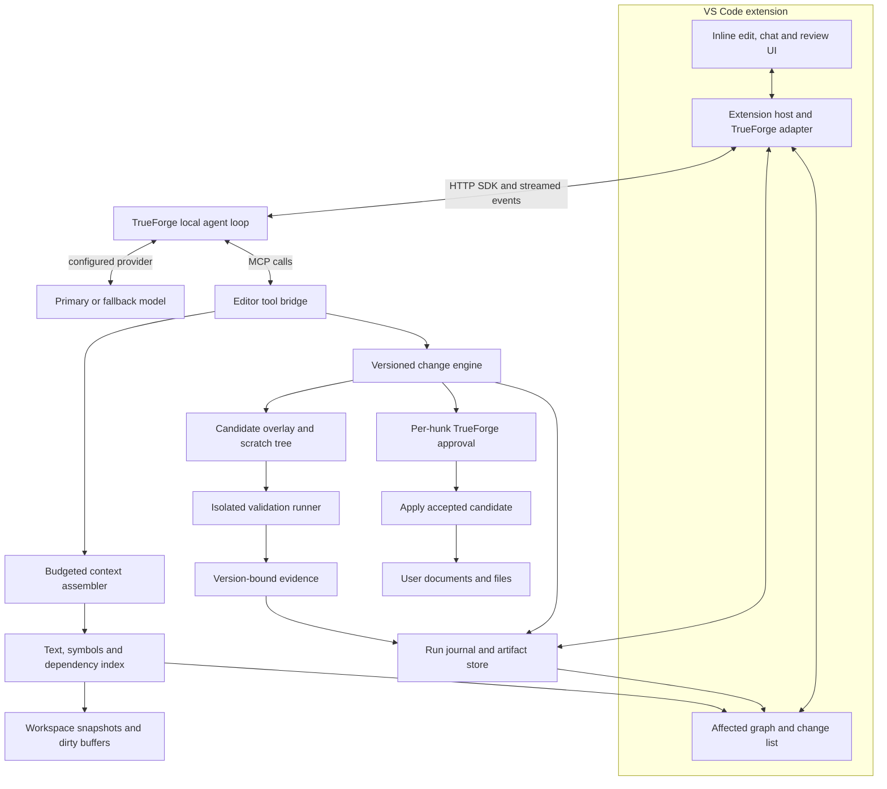
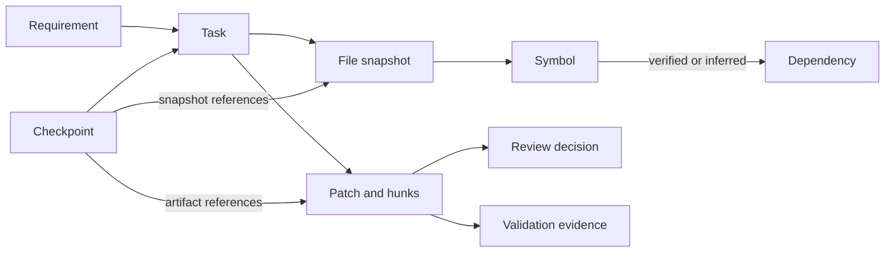
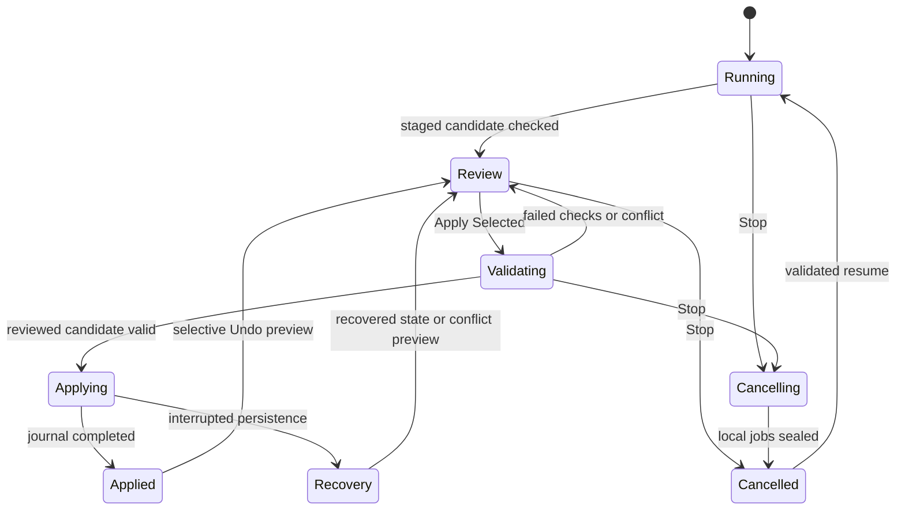

# Proposed Solution V1

**Product:** A harness-led, editor-native coding agent built on TrueForge.  
**Status:** Architecture specification; production readiness requires the validation gates below.  
**Technical reference snapshot:** 10 November 2026.

## 1. Problem Statement

- Build a VS Code extension that understands repository requests, discovers relevant code, makes multi-file changes and presents every change for review.
- Its agent loop must run on **TrueForge in local mode**.
- The extension must not call model providers directly or retain another project's agent loop.
- Five capabilities are required:
  1. Inline edits.
  2. Agent mode.
  3. Context assembly.
  4. Diff review.
  5. Streaming and cancellation.
- The main challenge is selecting useful context within a budget while preserving user work, keeping the editor responsive and recovering from failures.
- Model selection must remain configurable through TrueForge.
- Competition scope excludes tab completion, model training/hosting work, a hosted application backend, user accounts and Marketplace publication.
- An existing compatible local model endpoint remains a valid model choice.

## 2. Proposed Solution in Brief

The product combines **budgeted context retrieval, a versioned change engine and a durable run journal** around TrueForge. A repository index combines text search, symbols and dependency relationships to find relevant implementation, tests and documentation. The agent receives bounded source excerpts with precise instructions, source versions and validation requirements. It proposes changes in a separate candidate workspace; a controlled review-and-apply process manages modifications to the user's code.

An **interactive evidence graph** connects requirements, affected files, changed symbols, review decisions and check results. Clicking a change opens its actual code diff and supporting evidence. Completed patches and task state persist outside the model's prompt, allowing cancellation, recovery and selective resume. The harness enforces edit boundaries and preserves workspace consistency; the model still performs programming reasoning. Smaller models may benefit from this structure, but reliable coding and lower total cost must be demonstrated through evaluation.

## 3. The Five Components

### 3.1. Inline Edits

#### What it must do

- Turn a selected code region and a natural-language instruction into an editor-native proposed diff.
- Support individual hunk acceptance/rejection and undo after application.
- Preserve unrelated source and existing unsaved edits.

#### How it works and technology

1. Capture the selection, containing symbol, document version and content hash through VS Code APIs.
2. Send the request through the TrueForge TypeScript SDK.
3. Use editor MCP tools to retrieve the containing code, necessary imports/interfaces and relevant tests.
4. Generate structured replacements against the captured source.
5. Validate exact old-text matches, edit scope and base hashes.
6. Build immutable original/proposed virtual documents and display them with `vscode.diff`.
7. Review hunks through TrueForge approval events.
8. Apply Selected materializes the accepted candidate through the shared change engine.

- **Default scope:** selected region. An out-of-region change requires explicit scope expansion.
- **Checks:** parse the result and run focused checks where available.
- **Streaming:** display generation progress without writing partial code into the real document.
- **Stale source:** rebase and revalidate, or regenerate the proposal. Changed patch content requires renewed review.
- **Reuse:** VS Code selection/keybinding/virtual-document APIs, native diff rendering and TrueForge UI/SDK.
- The extension adds hunk controls and proposal state rather than rebuilding a diff renderer.

#### Why this architecture

- Relevant source improves precision without sending the whole repository.
- Snapshot-bound edits prevent old generations from silently replacing newer user work.
- Separating generation from application makes rejection and cancellation safe.
- Sharing the change engine with agent mode avoids maintaining two safety implementations.

### 3.2. Agent Mode

#### What it must do

- Accept one repository-level request and discover the required files without the user naming them.
- Search, read, plan, propose changes and run checks through a TrueForge tool loop.
- Coordinate implementation, tests and documentation across at least three files.
- Explain progress and affected relationships through a task panel and interactive graph.

#### How it works and technology

1. The coordinating TrueForge agent records the original request, requirement IDs, decisions and unresolved questions.
2. Through MCP, it searches the repository and requests budgeted context packets.
3. It creates bounded edit tasks containing:
   - Target scopes.
   - Interface constraints.
   - Base hashes.
   - Task dependencies.
   - Expected checks.
4. It stages patches into a versioned candidate.
5. Subsequent reads and checks use that candidate consistently.
6. It validates the combined change and requests per-hunk review.
7. User-approved application goes through the shared change engine.

- **Execution:** TrueForge owns model interaction and the agent/tool loop.
- **Extension responsibility:** tools, policy enforcement, candidate state and editor presentation.
- **Workers:** use fresh TrueForge workers for separable tasks or noisy exploration.
- Each worker receives a complete task contract; it does not automatically inherit the original conversation.
- **Coordination:** serial edits for overlapping targets; parallel work only for disjoint scopes against explicit candidate versions.
- **Permissions:** separate conversations do not provide independent tool permissions. Strict separation requires scoped sessions/connectors or verified runtime support.
- **UI stack:** React, TrueForge UI, React Flow, a searchable change list and native VS Code diffs.

#### Interactive change graph

- Navigation: requirement → file → symbol → hunk → evidence.
- Expand dependencies on demand instead of displaying the whole repository.
- Clicking a node opens:
  - File and symbol.
  - Original/proposed code.
  - Linked requirement.
  - Check results.
  - Review/application status.
- Clicking an edge shows its relationship type, source evidence and confidence.
- Keep positions stable and label inferred relationships.
- Derive progress states from recorded operations:
  - Located.
  - Proposed.
  - Checked.
  - Accepted.
  - Applied.
  - Undone.
- Update the graph after meaningful operations, not every streamed token.
- Compare original and proposed code; do not claim an automatic “optimal code” baseline.

#### Why this architecture

- One coordinator preserves cross-file decisions while bounded tasks limit unnecessary context.
- The graph explains changes without requiring complete repository understanding.
- Requirements, patches and evidence remain connected during review and recovery.
- The model chooses its tools while retrieval and mutation constraints remain enforceable in code.

### 3.3. Context Assembly

#### What it must do

- Support explicit `@file` and `@symbol` references plus automatic discovery.
- Retrieve sufficient current evidence within a configurable token budget.
- Show what was selected, why it was included and what was omitted.
- Continue working when parsing or dependency resolution is incomplete.

#### How it works and technology

- **Indexing:** background TypeScript worker.
- **Structure:** Tree-sitter parsing.
- **Stronger symbol resolution:** language-service definitions/references where available.
- **Search:** lexical ranking and ripgrep for exact matches.
- **Nodes:** files, modules, classes, functions/methods, tests and documentation sections.
- **Edges:** contains, imports, references, inherits, calls, tests and documents.
- Store source range, snapshot hash, provenance and confidence for relationships.
- Index unsaved buffers and maintain a separate candidate overlay.
- Refresh affected entries incrementally.
- Keep direct text search available while indexing catches up.

#### Retrieval method

1. **Resolve anchors**
   - Resolve mentions, selection, identifiers, error text and task terms.
   - Disambiguate duplicate symbols.

2. **Search candidates**
   - Search paths, names, source, tests and documentation.
   - Use exact matching and lexical ranking such as BM25.

3. **Expand relationships**
   - Inspect relevant callers, callees, imported contracts, sibling implementations and tests.
   - Start at one graph hop and cap further expansion.

4. **Combine rankings**
   - Initially use reciprocal-rank fusion:
     - `score(x) = sum(1 / (60 + rank_i(x)))`
   - Tune the constant and traversal limits through evaluation.

5. **Pack the context**
   - Include mandatory target source and required contracts first.
   - Add useful optional excerpts by relevance per token.
   - Penalize duplicate content.
   - Preserve coverage across implementation, tests and documentation.

6. **Return a traceable packet**
   - Exact source references.
   - Requirement text.
   - Allowed targets and interface invariants.
   - Expected checks.
   - Source/candidate hashes.
   - Token estimates.
   - Inclusion reasons and omissions.

7. **Expand when necessary**
   - Retrieve again when the agent or validation exposes missing information.
   - Split the task or widen its allowance rather than silently dropping essential code.

#### Budget and instruction management

- Count request/instructions, harness overhead, tool schemas, history, source, logs and output reserve.
- Example for a 16,000-token window:
  - 3,000 output reserve.
  - 1,000 safety margin.
  - 12,000 input allowance.
- Actual allocations depend on measured model/runtime overhead.
- Bound tool outputs, configure conservative TrueForge compaction and use fresh workers before overflow.
- A strict pre-dispatch request cap needs a verified TrueForge-supported enforcement path.
- Do not assume the SDK client controls every internal message.
- Use the matching tokenizer when available; label estimates and retain extra margin otherwise.
- Track cumulative task usage across workers.
- Load small, versioned instruction packs when relevant.
- Native TrueForge skills require the inspected sandbox capability.
- MCP-served instruction packs must not be presented as native TrueForge skills.
- Add embeddings only after evaluation and through an integration that preserves the no-direct-provider-call constraint.

#### Why this architecture

- Static relationships miss dynamic code, registration, configuration and documentation links; hybrid retrieval covers more cases.
- Exact source supports editing; summaries support navigation.
- Sufficient context matters more than minimum context.
- Fresh conversations, compaction, artifact storage and provider prompt caching solve different problems.
- The assembler supplies evidence and constraints. It does not assume it can derive universally correct replacement code.

### 3.4. Diff Review and Undo

#### What it must do

- Present every proposed change before application.
- Support individual hunk acceptance/rejection.
- Explain actual changes, intended purpose, requirement mapping and validation evidence.
- Support selective undo and whole-run undo without discarding unrelated user changes.

#### How it works and technology

- **Preview:** native VS Code diff on immutable original/candidate documents.
- **Controls:** extension-owned hunk actions.
- **Cards:** React components showing:
  - Actual changed symbols.
  - Intended reason.
  - Original requirement.
  - Check results.
  - Remaining uncertainty.
  - Acceptance/application status.
- **Evidence:** source references, parser/type-check output and recorded test results.
- Bind evidence to the exact candidate, test version and environment.

#### Approval and application flow

1. Agent stages a patch.
2. The change engine derives normalized hunks and immutable IDs.
3. Agent calls `review_hunk(hunkId, proposalHash)`.
4. TrueForge pauses for approval.
5. The UI presents the actual diff and sends allow/deny for the matching tool call.
6. Tool execution records the selection.
7. Apply Selected freezes generation and rebuilds only accepted changes.
8. Check dependencies and validate that selected candidate.
9. Apply through the shared change engine.

- Approval must not silently authorize the full proposal.
- Changed hunk content requires new review.
- Perform intended formatting before review.
- Additional generated changes require review.
- Detect save-time/external transformations instead of treating them as the approved patch.
- Rejection invalidates affected evidence.
- Dependent hunks remain individually reviewable, but inconsistent selections require repair or failed-validation handling before application.

#### Undo

- Retain forward/inverse operations, before/after hashes and dependency references.
- Reverse matching content directly.
- Otherwise prepare a three-way merge and conflict preview.
- Revalidate the resulting candidate.
- Undo Run reverses only that run's changes.
- Never use whole-workspace destructive reset as the undo mechanism.

#### Why this architecture

- Actual diffs and recorded checks provide stronger evidence than explanations alone.
- Hunk-level decisions preserve control; concern-level grouping reduces repeated explanations.
- Content-bound approvals prevent revised patches from inheriting stale permission.
- Dependency checks and merge previews support selective undo without promising automatic semantic correctness.
- Passing tests support their assertions, not universal correctness.
- Another model's agreement is critique, not proof.

### 3.5. Streaming, Cancellation and Recovery

#### What it must do

- Render TrueForge tokens and tool progress without blocking VS Code.
- Stop accepting new generated changes immediately after cancellation.
- Preserve workspace consistency and completed work through cancellation, crashes and provider failure.
- Resume valid work and regenerate invalid or incomplete operations.

#### How it works and technology

- **Streaming:** asynchronous SDK/SSE handling in the extension host.
- Merge event deltas before interpreting complete tool arguments.
- Batch UI updates without blocking interaction.
- **Reconnect:** persist session ID, turn ID and sequence position.
- Inspect the existing turn before resubmitting; a disconnected stream does not prove execution stopped.

#### Cancellation

- Atomically mark the run cancelling and revoke its mutation authority.
- Stop tracked local process trees.
- Call `sessions.cancel`.
- Reject late promotion of results.
- Check run authority and promote artifacts under the same local serialization boundary.
- TrueForge cancellation may wait for in-flight MCP calls.
- Distinguish immediate local stop from eventual backend shutdown.
- Application uses a short serialized, journaled operation.
- Cancellation cannot interrupt application halfway; the controller completes application/recovery while the editor remains responsive.
- Previously applied work remains until explicitly undone.

#### Cache and resume

- **Storage:** content-addressed source/patch/evidence files, append-only journal and atomically replaced checkpoint manifests.
- **Checkpoint contents:**
  - Requirements and task dependencies.
  - Completed patch references.
  - Base/candidate hashes.
  - Review decisions.
  - Validation evidence.
  - Pending actions.
  - Session/event references.
  - Instruction/tool versions.
- **Resume:**
  1. Verify relevant source and dependency hashes.
  2. Reconstruct valid candidates.
  3. Invalidate stale evidence/approvals.
  4. Rebase changed work.
  5. Continue through TrueForge.
- Retain unfinished output for diagnosis only.
- Never treat an incomplete tool argument as a patch or blindly append tokens to resume it.

#### Provider failure

- Use bounded retries/backoff for transient errors.
- Handle invalid credentials promptly.
- Recover automatically through a second model already configured in TrueForge.
- Transfer a validated, bounded checkpoint.
- Make artifact operations idempotent.
- Record command completion; do not blindly replay commands after ambiguous failures.

#### Why this architecture

- Candidate-only generation avoids half-written source after ordinary cancellation.
- Persistent completed operations enable useful resume without keeping all work in the prompt.
- Journaling covers persistence failures as well as model failures.
- Exact mid-token continuation, zero repeated cost and universal semantic rollback are not guarantees.

## 4. Unified System Architecture

### 4.1. Components and Ownership

| Layer | Responsibility | Technology |
|---|---|---|
| Editor shell | Commands, selection, mentions, diffs and application controls | VS Code API, TypeScript |
| Webview | Chat, affected graph, change list and evidence cards | React, TrueForge UI, React Flow |
| TrueForge adapter | Sessions, events, approvals, reconnect and recovery coordination | TrueForge TypeScript SDK |
| Agent runtime | Model interaction and agent/tool loop | TrueForge local mode |
| Editor MCP bridge | Source access, retrieval, proposals and tracked commands | MCP SDK, Streamable HTTP, schema validation |
| Repository index | Incremental symbols, relationships and lexical search | Tree-sitter, language services, background worker |
| Context assembler | Ranking, packets, inclusion reasons and budget accounting | Deterministic retrieval/packing logic |
| Change engine | Candidates, hunks, review, apply, undo and conflicts | Structured patches, WorkspaceEdit, journal |
| Validation runner | Isolated candidate execution and evidence capture | Local isolation adapter, process control |
| Artifact store | Snapshots, patches, evidence, checkpoints and recovery | Content-addressed files, JSON manifests, JSONL journal |



### 4.2. Three Foundations and Their Source of Truth

- **Repository index**
  - Derived from current source snapshots.
  - Rebuildable.
  - An index entry is not more authoritative than the code it describes.

- **Change engine**
  - Authoritative record of proposed operations, immutable hunk content and review/application status.

- **Run journal**
  - Authoritative record of completed operations and recovery progress.
  - References TrueForge execution records rather than replacing its session system.

- **Evidence graph**
  - A projection connecting these records.
  - Stores relationships and artifact references, not another uncontrolled copy of all source.



- The code graph can contain cycles.
- Schedule tasks as a dependency DAG.
- Group mutually dependent edits into one coordinated task.
- Keep internal symbol IDs with path/name/declaration evidence.
- Content hashes version their snapshots.
- Renames and ambiguous moves require explicit remapping.

### 4.3. Unified Request Lifecycle

1. Capture request, workspace identity, dirty buffers and initial source versions.
2. Create a TrueForge session and record the associated run.
3. Agent discovers code through MCP; assembler returns bounded excerpts and visible selection reasons.
4. Record requirements, decisions, task contracts and dependencies.
5. Generate structured patches; reject stale, ambiguous or out-of-scope operations.
6. Build a versioned candidate and run suitable checks in isolation.
7. Request TrueForge-gated per-hunk review against immutable proposal content.
8. Rebuild the accepted selection; recheck dependencies and evidence freshness.
9. Apply only reviewed content, journal persistence and verify the resulting state.
10. Retain undo/checkpoint records and report completed requirements and uncertainty.

### 4.4. MCP Contract and TrueForge Integration

These are application tools to implement, not built-in TrueForge endpoints.

| Tool | Contract |
|---|---|
| `search_workspace(query, filters, limit)` | Bounded matches with source references |
| `read_file(path, range, snapshot)` | Exact source, version and truncation metadata |
| `read_symbol(symbolId, snapshot)` | Symbol source and resolution evidence |
| `assemble_context(taskId, anchors, budget)` | Packet, token estimate, inclusion reasons and omissions |
| `get_instruction_pack(name, version)` | Approved procedural guidance |
| `stage_patch(taskId, baseHashes, operations, requirementIds)` | Candidate version, normalized hunks and errors; no live writes |
| `run_command(argv, candidateVersion, timeout)` | Tracked isolated execution; output, status, duration and candidate reference |
| `review_hunk(hunkId, proposalHash)` | TrueForge-gated recording of the user's hunk decision |
| `get_checkpoint(runId)` | Compact task state and artifact references |

- Use `sessions.create`, `sessions.createTurnStream`, approval input events and `sessions.cancel` through the pinned SDK.
- Reconnect with stored turn/sequence information.
- Merge deltas before resolving pending tool-call arguments.
- Gate `review_hunk` and command execution by literal tool names.
- Do not depend only on write/destructive annotations.
- Staging modifies candidate artifacts only.
- No general tool may bypass the reviewed workspace-write path.
- Keep SDK transport and connector secrets in the extension host.
- Bridge reusable chat UI through typed messages/custom server adapters.
- Enable meaningful selective/deferred tool loading and conservative compaction.
- Demonstrate actual use in the TrueForge session.
- Native skills/Code Mode require a verified sandbox setup.
- Baseline editor capabilities remain local MCP tools.
- Pin a compatible runtime/SDK pair and validate manifests against its schema.
- Technical reference revision:
  - `35bad5df0ef463c172be8f30cce0612bf9b3df1e`.

### 4.5. Change Consistency and Persistence

- **Baseline**
  - Capture relevant saved content, dirty buffers, untracked files and versions.
  - Do not auto-save user work.

- **Candidate**
  - Every agent read/check references an explicit version.
  - Old evidence cannot silently attach to a newer proposal.

- **Review**
  - Bind decisions to immutable hunk content, base references and proposal identity.
  - Additional edits require new review.

- **Existing text files**
  - Check versions/hashes.
  - Use one text-only WorkspaceEdit where applicable.
  - Check its result.

- **Resource operations**
  - File creation, deletion and rename need explicit preconditions, review and recovery.

- **Persistence**
  - Save multiple files through a durable write journal.
  - Do not assume filesystem-wide atomicity.

- **External changes**
  - Detect conflicting buffer/disk updates.
  - Present merge/recovery previews.
  - Never overwrite later user edits to force rollback.

- **Evidence**
  - Bind source, test version, environment, command and result to the candidate hash.
  - Invalidate affected evidence after rejection, repair or undo.

### 4.6. Memory, Cancellation and Recovery State



- **Checkpoint identity**
  - Workspace/run/task IDs.
  - Source and dependency hashes.
  - Instruction/tool/index versions.
  - Candidate references.
  - Validation environment.

- **Durability**
  - Write content-addressed artifacts first.
  - Replace the checkpoint manifest afterward.
  - Journal review, application and recovery events.

- **Resume authority**
  - Reuse unchanged valid artifacts.
  - Changed code, dependencies or proposal content invalidate related checks and decisions.

- **Storage policy**
  - User-only file permissions.
  - Quota, retention and deletion controls.
  - Secret-aware log filtering.
  - Protect snapshots rather than redacting away code needed for exact recovery.
  - Never commit caches or credentials.

- **Fallback**
  - Classify terminal failure.
  - Seal the old run's mutation authority.
  - Create a new TrueForge session with a configured second model.
  - Transfer a bounded validated checkpoint.

- **Routing boundary**
  - Automatic fallback is application recovery logic until the pinned TrueForge public interface proves equivalent support.
  - Do not assume native automatic routing exists.

### 4.7. Production Boundaries and Model Compatibility

- **V1 support target**
  - Desktop VS Code.
  - Local repositories.
  - Python as the first validated language adapter.
  - One active writer per workspace.
  - Additional languages, remote workspaces and multi-root operations require explicit tested support.

- **Local deployment**
  - TrueForge plus the extension.
  - No second hosted service or database.

- **MCP security**
  - Loopback-bound Streamable HTTP.
  - Installation-local connector secret.
  - Request/schema validation.
  - Path confinement after resolving traversal and symlinks.

- **Run authority**
  - Bind mutation permission to a server-validated run-scoped connector grant/session identity.
  - Never trust a model-supplied run ID.
  - Verify this binding before enabling resume/fallback with overlapping shutdown.

- **Commands**
  - Use a local isolation adapter, such as a configured OCI container runner.
  - Candidate writable; original repository not writable from commands.
  - Scope environment, network, output and resources.
  - If isolation is unavailable, block arbitrary commands or use a clearly restricted, explicitly approved mode.
  - Never silently substitute unrestricted host execution.

- **Repository content**
  - Comments, documents and tool results are untrusted data.
  - They cannot grant permissions.

- **Models**
  - Configured entirely in TrueForge.
  - Provider adapters include OpenAI, Anthropic, Google Gemini, Fireworks, Together, Moonshot, Z.ai, Alibaba and custom OpenAI-compatible endpoints.
  - Discover configured choices instead of hard-coding presets.
  - Catalog presence does not prove credentials, availability or coding capability.
  - Model/hardware/API budget remains configurable.

- **Capability profile**
  - Model reference.
  - Context/output limits.
  - Tokenizer estimate.
  - Tool-call support.
  - Timeout/retry policy.
  - Optional configured fallback.

- **Incompatible output**
  - Allow a bounded correction attempt for malformed tool output.
  - Repeated incompatibility produces a useful error without workspace changes.

- **Guarantee boundary**
  - Enforce model-independent edit safety and recovery.
  - Coding success, retrieval coverage and total cost remain model/task dependent.

### 4.8. Stack, Reuse and Source Structure

| Area | Planned reuse | Product-specific work |
|---|---|---|
| Extension shell | MIT VS Code `webview-view-sample` | Commands, typed bridge and workspace integration |
| Chat and sessions | TrueForge UI and SDK | Editor adapter and visible run/context state |
| Diff renderer | Native VS Code diff/virtual documents | Immutable proposals, hunk approvals and undo |
| Graph display | React Flow | Requirement/change/evidence projection |
| Parsing/search | Tree-sitter, language services, ripgrep | Hybrid ranking, freshness and budgeted packets |
| Protocol/schema | MCP SDK and schema-validation library | Scoped tools and deterministic enforcement |

- Starting shell:
  - Repository: `microsoft/vscode-extension-samples`.
  - Commit: `65c1c44800eeac6fb065a54823ee5ae62c79540a`.
- Prefer small reusable components over importing another complete agent runtime.
- Cline/Continue editor components may be source donors after dependency, licence and write-behavior review.
- Preserve upstream licence/NOTICE files, exact source commits and copied-file provenance.
- Check all reachable execution paths for direct provider calls or retained upstream agent loops.

```text
extension/
  src/extension.ts
  src/trueforge/       # SDK, events, approvals, reconnect, fallback
  src/mcp/             # tools, schemas, scope enforcement
  src/indexer/         # worker, language adapters, text/symbol graph
  src/context/         # retrieval, packets, token accounting
  src/proposals/       # candidate overlays, patches, hunks
  src/review/          # decisions, evidence, dependency checks
  src/transactions/    # apply, save journal, undo, recovery
  src/checkpoints/     # artifacts, manifests, invalidation
  src/commands/        # isolation adapter, processes, cancellation
  webview/             # chat adapter, graph, review cards
  trueforge/agent.example.json
  instruction-packs/
  tests/
  UPSTREAMS.md
  README.md

extension-storage/
  index/               # rebuildable indexes
  objects/<hash>       # source, patch and evidence artifacts
  runs/<runId>/manifest.json
  runs/<runId>/journal.jsonl
```

#### Shared records

- `SourceRef`: path, symbol ID, range, snapshot hash and provenance.
- `TaskContract`: original requirements, targets, invariants, dependencies, checks and limits.
- `ContextPacket`: source references, instruction version, budget, reasons and omissions.
- `Patch`: base hashes, operations, hunk IDs and candidate hash.
- `ReviewDecision`: hunk/proposal identity, TrueForge tool-call reference and status.
- `Evidence`: candidate/test/environment identity, command, result and limitations.
- `Checkpoint`: completed artifact references, pending actions, versions and session/event references.

### 4.9. Scoring and Fixed-Task Demonstration

| Criterion | Points | Behavior to demonstrate |
|---|---:|---|
| A1 Inline editing | 10 | Selected-code request, editor diff, individual hunk acceptance/rejection |
| A2 Agent mode | 10 | Autonomous discovery and changes across at least three files |
| A3 Streaming/cancellation | 10 | Live streaming, immediate local stop, responsive editor and consistent workspace |
| B1 Context assembly | 15 | Automatic retrieval with explicit budget and visible selection reasons in Task B |
| B2 Diff safety | 10 | Per-hunk review and successful undo of an applied change |
| B3 Resilience | 10 | Automatic configured-model fallback without user action; workspace unchanged |
| B4 TrueForge depth | 10 | Editor MCP tools, TrueForge-driven approval and meaningful visible context feature |
| C1 Video | 10 | Legible, verified A → B → C demonstrations |
| C2 Write-up | 15 | Architecture/trade-offs, model setup, accurate timestamp scorecard and limitations |

- These are coverage targets, not guaranteed awarded scores.

#### Pinned repository

- Flask `3.1.3`.
- Commit: `22d924701a6ae2e4cd01e9a15bbaf3946094af65`.

#### Task A: Inline edit

- Add case-insensitive `off` and `n` handling to `get_debug_flag`.
- Document `0`, `false`, `no`, `off`, `n`, unset and empty cases.
- Review and apply the change.
- Show the following returning `False`:

```bash
FLASK_DEBUG=off python -c "from flask.helpers import get_debug_flag; print(get_debug_flag())"
```

#### Task B: Agent mode

- Discover CLI implementation/registration, tests and documentation without filenames in the request.
- Add `flask config`, masked JSON, help coverage and documentation.
- Show:
  - `pytest tests/test_cli.py -q`.
  - Real command output.
  - The TrueForge session.

#### Configuration output policy

- Recursively mask mapping keys whose uppercase text contains `SECRET`, `PASSWORD`, `TOKEN` or `KEY`.
- Replace the complete matching value with `***` before conversion/logging.
- Convert known types explicitly:
  - Timedelta → seconds.
  - Date/datetime → ISO strings.
  - Paths → strings.
- Use a documented readable-string fallback for other objects.
- Document recursive behavior and report cycles clearly rather than hanging.
- This is targeted masking, not universal secret detection.

#### Task C: Resilience

- Invalid key/unreachable endpoint triggers bounded recovery and a configured fallback.
- Show responsiveness and unchanged Git status.
- Any fallback proposal remains unaccepted during verification.

#### Submission evidence

- Include cancellation, undo, mentions and context-selection evidence without obscuring the fixed tasks.
- Video: maximum four minutes, prescribed order and editing rules.
- PDF: one to three pages with the eight required headings:
  1. Team.
  2. Starting point.
  3. Architecture on TrueForge.
  4. How context is selected.
  5. Model setup.
  6. Scorecard.
  7. Tools used.
  8. Known limitations.
- Public repository:
  - Reproducible setup.
  - Agent definition.
  - Example model configuration without keys.
  - Upstream provenance and licences.
- Declare model location/cost and AI tools used.
- Record real demonstration timestamps; do not invent scorecard evidence.

### 4.10. Validation and Release Gates

- **Correctness**
  - Fixed Flask tasks plus unrelated repository tasks.
  - No hard-coded file answers or benchmark-specific patches.

- **Context**
  - Compare lexical-only, lexical-plus-graph and optional embedding retrieval at equal budgets.
  - Measure relevant-code coverage and final task success.

- **Models**
  - Compare multiple provider families and a smaller model where available.
  - Record protocol failures, completion rate, total tokens/cost, retries, latency and unintended edits.

- **Review**
  - Compare diff-only and graph/card-assisted review using seeded defects.
  - Measure missed defects, false reports and review time.

- **Safety**
  - Cancel during search, generation, staging, commands, approval and validation.
  - Inject late/duplicate results, stale bases, manual edits, stream disconnects and persistence crashes.

- **Undo/resume**
  - Test rejected dependencies, overlapping undo, changed dependencies, new/deleted files and reconstruction after restart.
  - Preserve unrelated user work.

- **Performance**
  - Measure indexing, retrieval, graph rendering, memory/disk growth and UI responsiveness on documented repository sizes.

- **Integration**
  - Verify approval events, capability behavior, token accounting, command isolation, UI adapter behavior and runtime/SDK compatibility.

- **Operational readiness**
  - Test installation, upgrades/storage migrations, retention/deletion and actionable errors on the declared support matrix.

- **Known limits**
  - Incomplete dynamic dependency resolution.
  - Partial behavioral evidence.
  - Model-dependent coding ability.
  - Conflict-prone selective undo.
  - No globally atomic multi-file save.
  - No guaranteed mid-token continuation or token savings.

## 5. Technical References

- [TrueForge repository](https://github.com/truefoundry/trueforge)
- [TrueForge SDK and session cookbook](https://github.com/truefoundry/trueforge/blob/35bad5df0ef463c172be8f30cce0612bf9b3df1e/docs/api/use-agent.mdx)
- [TrueForge agent configuration](https://github.com/truefoundry/trueforge/blob/35bad5df0ef463c172be8f30cce0612bf9b3df1e/docs/create-agent/overview.mdx)
- [TrueForge models](https://github.com/truefoundry/trueforge/blob/35bad5df0ef463c172be8f30cce0612bf9b3df1e/docs/models.mdx)
- [TrueForge UI adapter contract](https://github.com/truefoundry/trueforge/blob/35bad5df0ef463c172be8f30cce0612bf9b3df1e/docs/ui-sdk/setup-custom-servers/server-contract.mdx)
- [TrueForge deferred tools](https://github.com/truefoundry/trueforge/blob/35bad5df0ef463c172be8f30cce0612bf9b3df1e/docs/key-features/deferred-tool-loading.mdx)
- [TrueForge subagents](https://github.com/truefoundry/trueforge/blob/35bad5df0ef463c172be8f30cce0612bf9b3df1e/docs/key-features/subagents.mdx)
- [TrueForge skills requirements](https://github.com/truefoundry/trueforge/blob/35bad5df0ef463c172be8f30cce0612bf9b3df1e/docs/skills.mdx)
- [VS Code API](https://code.visualstudio.com/api/references/vscode-api)
- [VS Code virtual documents](https://code.visualstudio.com/api/extension-guides/virtual-documents)
- [VS Code extension sample](https://github.com/microsoft/vscode-extension-samples/tree/65c1c44800eeac6fb065a54823ee5ae62c79540a/webview-view-sample)
- [React Flow grouped nodes](https://reactflow.dev/learn/layouting/sub-flows)
- [Tree-sitter](https://tree-sitter.github.io/tree-sitter/using-parsers/)
- [Aider repository maps](https://aider.chat/docs/repomap.html)
- [RepoCoder: iterative retrieval and generation](https://aclanthology.org/2023.emnlp-main.151/)
- [Agentless: localization, repair and validation](https://github.com/OpenAutoCoder/Agentless)
- [SWE-agent: agent tool-interface design](https://arxiv.org/abs/2405.15793)

Research supports these design directions. Product-specific performance and production guarantees must be established through the release gates above.