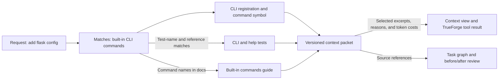
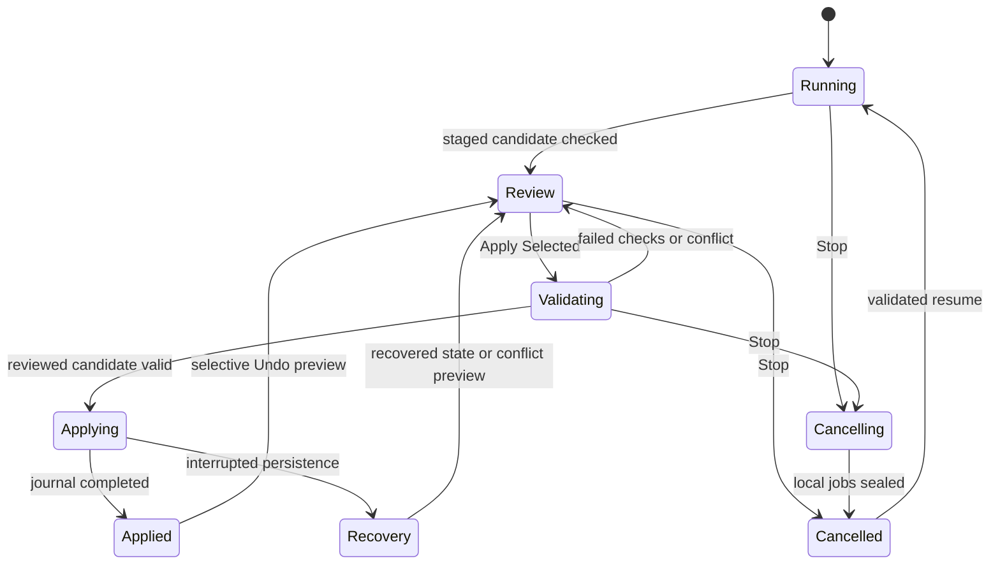
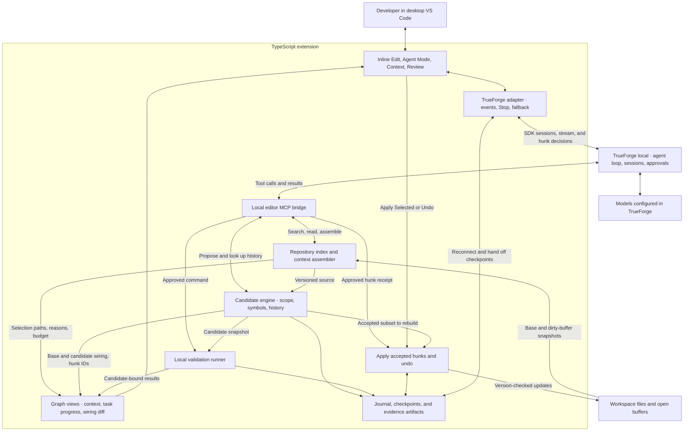
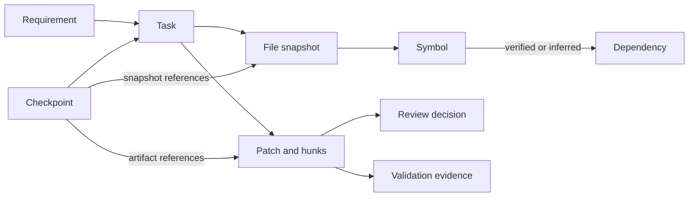

# Proposed Solution V2 · Contexo

Build a coding agent inside desktop VS Code for local repositories on Windows, macOS, and Linux. The developer installs a `.vsix`, starts TrueForge locally, and chooses the model in TrueForge. TrueForge runs the model and tool loop. The TypeScript extension assembles repository context, stages and validates proposed edits, and gives the developer a fast way to understand and approve each change.

Three parts connect the five capabilities below: a **repository index** for finding the right code, a **versioned change engine** for staging and reviewing edits, and a **run journal** for undo and recovery. The graphical Context, Task, and Review views share source and artifact references. Users can trace a selected excerpt from retrieval through the patch and its verification. Flask 3.1.3 is the fixed Round 1 test repository. [TrueForge quickstart](https://trueforge.dev/quickstart) · [VS Code VSIX packaging](https://code.visualstudio.com/api/working-with-extensions/publishing-extension#packaging-extensions)

## 1. Inline editing

### What it does

- Turn a selected code region and a natural-language instruction into an editor-native proposed diff.
- Support individual hunk acceptance/rejection and undo after application.
- Preserve unrelated source and existing unsaved edits.

### How it works

1. Capture the selection, containing symbol, document version and content hash through VS Code APIs.
2. Send the request through the TrueForge TypeScript SDK.
3. Use editor MCP tools to retrieve the containing code, necessary imports/interfaces and relevant tests.
4. Generate structured replacements against the captured source.
5. Validate exact old-text matches, edit scope and base hashes.
6. Build immutable original/proposed virtual documents and display them with `vscode.diff`.
7. Review hunks through TrueForge approval events.
8. Apply Selected materializes the accepted candidate through the shared change engine.

- **Scope guard (A1, B2).** Compare changed spans with the selected range in the captured buffer. Show any change outside it in red, with the affected file and span. Keep Accept available so the reviewer can make an explicit decision without expanding the selection or restarting.
- **Checks.** Parse the result and run focused checks where available. Both edit modes use the symbol check and history handling in section 4.
- **Streaming.** Display generation progress while the workspace stays on its captured version.
- **Stale source:** rebase and revalidate, or regenerate the proposal. Changed patch content requires renewed review.
- **Reuse.** VS Code selection, keybinding and virtual-document APIs, native diff rendering, and the TrueForge UI and SDK. The same proposal checks and hunk controls serve both edit modes.

### Why this architecture

- Relevant source improves precision without sending the whole repository.
- Snapshot-bound edits prevent old generations from silently replacing newer user work.
- Separating generation from application makes rejection and cancellation safe.
- Sharing the change engine with agent mode avoids maintaining two safety implementations.

## 2. Agent mode

### What it does

- Accept one repository-level request and discover the required files without the user naming them.
- Search, read, plan, propose changes and run checks through a TrueForge tool loop.
- Coordinate implementation, tests and documentation across at least three files.
- Explain progress and affected relationships through a task panel and interactive graph.

### How it works

1. The coordinating TrueForge agent records the original request, requirement IDs, decisions and unresolved questions.
2. Through MCP, it searches the repository and requests budgeted context packets.
3. It creates bounded edit tasks containing:
   - Target scopes.
   - Interface constraints.
   - Base hashes.
   - Task dependencies.
   - Expected checks.
4. It stages patches into a versioned candidate.
5. Subsequent reads and checks use that candidate consistently.
6. It validates the combined change and requests per-hunk review.
7. User-approved application goes through the shared change engine.

- **Execution.** TrueForge owns model interaction and the agent/tool loop. Reuse its session stream, MCP dispatch, approvals, and the React UI.
- **Extension responsibility:** tools, policy enforcement, candidate state and editor presentation.
- **Workers.** Use fresh TrueForge subagents for separable tasks or noisy exploration when it helps. Keep the coordinator responsible for the combined candidate and cross-file decisions.
- Give each worker a complete task contract, including the source version, allowed scope, expected checks and the result to return.
- **Coordination.** Keep one writer for the candidate. Overlapping changes run serially. Disjoint tasks can explore or prepare proposals in parallel against explicit candidate versions.
- **Permissions:** separate conversations do not provide independent tool permissions. Strict separation requires scoped sessions/connectors or verified runtime support.
- **UI stack:** React, TrueForge UI, React Flow, a searchable change list and native VS Code diffs.

### Task and evidence graph

- Navigate requirement → task → file → symbol → hunk → evidence. Start from the context selection when a file is located, then follow the same file into its proposed change or checks.
- Expand dependencies on demand instead of displaying the whole repository.
- Clicking a node opens:
  - File and symbol.
  - Original/proposed code.
  - Linked requirement.
  - Check results.
  - Review/application status.
- Clicking an edge shows its relationship type, source evidence and confidence.
- Keep positions stable and label inferred relationships.
- Derive progress states from recorded operations:
  - Located.
  - Proposed.
  - Checked.
  - Accepted.
  - Applied.
  - Undone.
- Update the graph after meaningful operations, not every streamed token.
- The task panel groups related implementation, test, and documentation work. Use the same versioned graph references for the context view in section 3 and the wiring comparison in section 4.

### Why this architecture

- One coordinator preserves cross-file decisions while bounded tasks limit unnecessary context.
- The graph explains changes without requiring complete repository understanding.
- Requirements, patches and evidence remain connected during review and recovery.
- The model chooses its tools within the extension’s retrieval and mutation constraints.

## 3. Context assembly

### What it does

- Support explicit `@file` and `@symbol` references plus automatic discovery.
- Retrieve sufficient current evidence within a configurable token budget.
- Show what was selected, why it was included and what was omitted.
- Continue working when parsing or dependency resolution is incomplete.

### How it works

- **Indexing:** background TypeScript worker.
- **Structure.** Bundle Tree-sitter WebAssembly and the Python grammar. The TypeScript worker parses Flask’s Python source and can index dirty buffers directly. Python runs Flask and its tests during verification.
- **Stronger symbol resolution:** language-service definitions/references where available.
- **Search:** lexical ranking and ripgrep for exact matches. Merge hits from the current disk snapshot with dirty-buffer and candidate hits.
- **Nodes:** files, modules, classes, functions/methods, tests and documentation sections.
- **Edges:** contains, imports, references, inherits, calls, tests and documents.
- Give each symbol an ID tied to its declaration and location. For each relationship, store its type, proof range, snapshot hash, provenance, and confidence. Record uncertain links as inferred. The index represents a specific source snapshot, including the candidate overlay if the run has staged changes.
- Index unsaved buffers and maintain a separate candidate overlay.
- Refresh affected entries incrementally.
- Keep direct text search available while indexing catches up.

### Retrieval method

1. **Resolve anchors**
   - Resolve mentions, selection, identifiers, error text and task terms.
   - Disambiguate duplicate symbols.

2. **Search candidates**
   - Search paths, names, source, tests and documentation.
   - Use exact matching and lexical ranking such as BM25.

3. **Expand relationships**
   - Inspect relevant callers, callees, imported contracts, sibling implementations and tests.
   - Start at one graph hop and cap further expansion. Keep implementation, tests and docs searchable even when a graph edge is missing.

4. **Combine rankings**
   - Initially use reciprocal-rank fusion:
     - `score(x) = sum(1 / (60 + rank_i(x)))`
   - Tune the constant and traversal limits through evaluation.

5. **Pack the context**
   - Include mandatory target source and required contracts first.
   - Add useful optional excerpts by relevance per token.
   - Penalize duplicate content.
   - Preserve coverage across implementation, tests and documentation.

6. **Return a traceable packet**
   - Exact source references.
   - Requirement text.
   - Allowed targets and interface invariants.
   - Expected checks.
   - Source/candidate hashes.
   - Token estimates.
   - Inclusion reasons and omissions.

7. **Expand when necessary**
   - Retrieve again when the agent or validation exposes missing information.
   - Split the task or widen its allowance rather than silently dropping essential code.

### Graphical context view and retrieval evidence (B1)

- In the **Context** panel, start at the request, selection, or mention. Expand matching files and symbols, then the import, call, reference, test, or documentation links that led to other excerpts. Show a compact file list next to the graph for scanning.
- Show which excerpts entered the packet, their estimated tokens, and an explicit inclusion reason per excerpt. Show relevant omitted results on demand, with the reason they were dropped, such as a duplicate, a lower rank, or the token limit.
- Click a file or symbol to open the exact excerpt in the editor. Click an edge to see the source span and confidence for that relationship. Mark lexical matches as retrieval reasons and inferred links as inferred.
- Show used and available retrieval tokens for the active packet. For later reads, show which candidate version supplied the excerpt. Keep selection based on the recorded packet, so the visual view and the model see the same evidence.
- Follow a selected file or symbol into Agent Mode’s task graph and, once proposed, into the Diff Review wiring map and hunk. The views use shared source and version references. Their questions are where the context came from, which task used it, and how the candidate changed the wiring.
- **Task B example.** The agent searches for existing built-in commands. The graph can show the CLI registration as a direct match, a test excerpt because it covers the help listing, and a docs excerpt because it describes the built-in commands. Each excerpt carries its own reason and budget cost. Discovery uses the general retrieval pipeline and the exact fixed prompt.

**Illustrative context paths for Task B**



### Budget and instruction management

- Count request/instructions, harness overhead, tool schemas, history, source, logs and output reserve.
- Example for a 16,000-token window:
  - 3,000 output reserve.
  - 1,000 safety margin.
  - 12,000 input allowance.
- Actual allocations depend on measured model/runtime overhead.
- Bound tool outputs, configure conservative TrueForge compaction and use fresh workers before overflow.
- The extension enforces the excerpt budget and records cumulative context use across calls and workers. A hard limit on the complete model request needs a verified TrueForge enforcement path.
- Use the matching tokenizer when available; label estimates and retain extra margin otherwise.
- Load small, versioned instruction packs when relevant.
- Native TrueForge skills require the inspected sandbox capability.
- Identify extension MCP instruction packs separately from sandbox-backed TrueForge skills.
- Add embeddings only after evaluation and through an integration that preserves the no-direct-provider-call constraint.

### Why this architecture

- Static relationships miss dynamic code, registration, configuration and documentation links; hybrid retrieval covers more cases.
- Exact source supports editing; summaries support navigation.
- Sufficient context matters more than minimum context.
- Fresh conversations, compaction, artifact storage and provider prompt caching solve different problems.
- The assembler supplies evidence and constraints. It does not assume it can derive universally correct replacement code.

## 4. Diff review and undo

### What it does

- Present every proposed change before application.
- Support individual hunk acceptance/rejection.
- Explain actual changes, intended purpose, requirement mapping and validation evidence.
- Support selective undo and whole-run undo without discarding unrelated user changes.

### How it works

- **Preview:** native VS Code diff on immutable original/candidate documents. Reuse jsdiff for structured hunks, and Git for historical evidence.
- **Controls:** extension-owned hunk actions.
- **Cards:** React components showing:
  - Actual changed symbols.
  - Intended reason.
  - Original requirement.
  - Check results.
  - Remaining uncertainty.
  - Acceptance/application status.
- **Evidence:** source references, parser/type-check output and recorded test results.
- Bind evidence to the exact candidate, test version and environment.

### Proposal admission and history

- **Symbol check.** Before `propose_write` emits hunk cards, parse and resolve changed references using the post-edit candidate and the current index. Include definitions introduced by the same proposal, built-ins, imports, and available language-service evidence. Return a confirmed missing function or class to the agent with the file, span, and unresolved name for correction. Surface references that cannot be resolved statically as uncertainty.
- **Chesterton’s Fence.** For a deletion or rewrite, `why_exists` uses Git blame and commit messages. When a concern surfaces, pause the operation, inspect linked PR or issue discussions where available, and search relevant repository docs. Continue to ordinary review when the proposed change addresses the documented reason. Otherwise place the excerpts and links in the warning area and wait for explicit user approval. The inline scope warning in section 1 keeps its normal Accept action.

### Fast, grounded visual review (B2)

- Put the native diff, changed-file list, and per-hunk decisions in one review flow. Show a one- or two-line overview, a one- or two-line behavior summary, and a comma-separated list of new libraries when applicable. Group related changes so implementation, tests, and docs can be reviewed together.
- Derive factual changes from the diff and checks, and use TrueForge to phrase the short explanation. Link important claims to the actual hunks and rationale to requirements, test results, or historical evidence. Surface uncertain claims and unavailable checks.
- **Before/after wiring map.** Compare the base and proposed graph around the changed files and symbols. Show added or removed registrations, imports, and supported call or reference edges. Expand affected neighbors on demand. Click a file, symbol, or edge to jump to its hunk or evidence. Use the same references as the Context and Task views so the reviewer can trace discovery → edit → verification.
- **Example.** When Task B adds `flask config`, show the new command registration and its implementation. Link the registration to the hunk that adds it and show check and docs references in the same review.

### Approval and application flow

1. Agent stages a patch.
2. The change engine derives normalized hunks and immutable IDs.
3. Agent calls `review_hunk(hunkId, proposalHash)`.
4. TrueForge pauses for approval.
5. The UI presents the actual diff and sends allow/deny for the matching tool call.
6. Tool execution records the selection.
7. Apply Selected freezes generation and rebuilds only accepted changes.
8. Check dependencies and validate that selected candidate.
9. Apply through the shared change engine.

- Each approval applies to its own hunk ID, proposal hash, and TrueForge tool-call ID.
- Changed hunk content requires new review.
- Perform intended formatting before review.
- Additional generated changes require review.
- Detect save-time/external transformations instead of treating them as the approved patch.
- Rejection invalidates affected evidence.
- Dependent hunks remain individually reviewable, but inconsistent selections require repair or failed-validation handling before application.

### Undo

- Retain forward/inverse operations, before/after hashes and dependency references.
- Reverse matching content directly.
- Otherwise prepare a three-way merge and conflict preview.
- Revalidate the resulting candidate.
- Undo Run reverses only that run's changes.
- Scope undo to the affected hunks and preserve unrelated workspace edits.

### Why this architecture

- Actual diffs and recorded checks provide stronger evidence than explanations alone.
- Hunk-level decisions preserve control; concern-level grouping reduces repeated explanations.
- Content-bound approvals prevent revised patches from inheriting stale permission.
- Dependency checks and merge previews support selective undo without promising automatic semantic correctness.
- Passing tests support their assertions, not universal correctness.
- Another model's agreement is critique, not proof.

### Workspace consistency

- **Baseline**
  - Capture relevant saved content, dirty buffers, untracked files and versions.
  - Do not auto-save user work.

- **Candidate**
  - Every agent read/check references an explicit version.
  - Old evidence cannot silently attach to a newer proposal.

- **Review**
  - Bind decisions to immutable hunk content, base references and proposal identity.
  - Additional edits require new review.

- **Existing text files**
  - Check versions/hashes.
  - Use one text-only WorkspaceEdit where applicable.
  - Check its result.

- **Resource operations**
  - File creation, deletion and rename need explicit preconditions, review and recovery.

- **Persistence**
  - Save multiple files through a durable write journal.
  - Do not assume filesystem-wide atomicity.

- **External changes**
  - Detect conflicting buffer/disk updates.
  - Present merge/recovery previews.
  - Never overwrite later user edits to force rollback.

- **Evidence**
  - Bind source, test version, environment, command and result to the candidate hash.
  - Invalidate affected evidence after rejection, repair or undo.

## 5. Streaming, cancellation, and recovery

### What it does

- Render TrueForge tokens and tool progress without blocking VS Code.
- Stop accepting new generated changes immediately after cancellation.
- Preserve workspace consistency and completed work through cancellation, crashes and provider failure.
- Resume valid work and regenerate invalid or incomplete operations.

### How it works

- **Streaming:** reuse the TrueForge TypeScript SDK and its SSE events in the extension host.
- Merge event deltas before interpreting complete tool arguments.
- Batch UI updates without blocking interaction.
- **Reconnect:** persist session ID, turn ID and sequence position.
- Inspect the existing turn before resubmitting after a disconnect.

### Cancellation

- Atomically mark the run cancelling and revoke its mutation authority.
- Stop tracked local process trees.
- Call `sessions.cancel`.
- Reject late promotion of results.
- Check run authority and promote artifacts under the same local serialization boundary.
- TrueForge cancellation may wait for in-flight MCP calls.
- Distinguish immediate local stop from eventual backend shutdown.
- Application uses a short serialized, journaled operation.
- Cancellation cannot interrupt application halfway; the controller completes application/recovery while the editor remains responsive.
- Previously applied work remains until explicitly undone.

### Cache and resume

- **Storage:** content-addressed source/patch/evidence files, append-only journal and atomically replaced checkpoint manifests.
- **Checkpoint contents:**
  - Requirements and task dependencies.
  - Completed patch references.
  - Base/candidate hashes.
  - Review decisions.
  - Validation evidence.
  - Pending actions.
  - Session/event references.
  - Instruction/tool versions.
- **Resume:**
  1. Verify relevant source and dependency hashes.
  2. Reconstruct valid candidates.
  3. Invalidate stale evidence/approvals.
  4. Rebase changed work.
  5. Continue through TrueForge.
- Retain unfinished output for diagnosis only.
- Never treat an incomplete tool argument as a patch or blindly append tokens to resume it.

### Provider failure

- Treat a dropped stream as a reconnect problem. On confirmed primary-model failure, including an invalid key or unreachable model endpoint, seal the failed run’s write authority and immediately create a fresh TrueForge session on the second configured model. Skip a retry of the failed primary.
- Rebuild context from the extension’s validated, bounded checkpoint: original request, selected excerpts and their versions, work completed, valid proposals and decisions, and the next pending work. TrueForge retains its own session history. The extension retains the transferable state across sessions.
- Keep fallback output in the candidate until review. If the fallback also fails, show a clear error and preserve the workspace.
- Make artifact operations idempotent.
- Record command completion; do not blindly replay commands after ambiguous failures.

### Why this architecture

- Candidate-only generation avoids half-written source after ordinary cancellation.
- Persistent completed operations enable useful resume without keeping all work in the prompt.
- Journaling covers persistence failures as well as model failures.
- Exact mid-token continuation, zero repeated cost and universal semantic rollback are not guarantees.

### Run states and recovery checks



- **Checkpoint identity**
  - Workspace/run/task IDs.
  - Source and dependency hashes.
  - Instruction/tool/index versions.
  - Candidate references.
  - Validation environment.

- **Durability**
  - Write content-addressed artifacts first.
  - Replace the checkpoint manifest afterward.
  - Journal review, application and recovery events.

- **Resume authority**
  - Reuse unchanged valid artifacts.
  - Changed code, dependencies or proposal content invalidate related checks and decisions.

- **Storage policy**
  - User-only file permissions.
  - Quota, retention and deletion controls.
  - Secret-aware log filtering.
  - Protect snapshots rather than redacting away code needed for exact recovery.
  - Never commit caches or credentials.

- **Routing ownership.** The extension opens the fallback session using TrueForge’s SDK. TrueForge owns all model calls in that session.

## Shared architecture and data

### Runtime ownership

| Layer | Responsibility | Technology |
|---|---|---|
| Editor shell | Commands, selection, mentions, diffs and application controls | VS Code API, TypeScript |
| Webview | Chat, affected graph, change list and evidence cards | React, TrueForge UI, React Flow |
| TrueForge adapter | Sessions, events, approvals, reconnect and recovery coordination | TrueForge TypeScript SDK |
| Agent runtime | Model interaction and agent/tool loop | TrueForge local mode |
| Editor MCP bridge | Source access, retrieval, proposals and tracked commands | MCP SDK, Streamable HTTP, schema validation |
| Repository index | Incremental symbols, relationships and lexical search | Bundled Tree-sitter WASM, language services, TypeScript worker |
| Context assembler | Ranking, packets, inclusion reasons and budget accounting | Deterministic retrieval/packing logic |
| Change engine | Candidates, scope and symbol guards, hunks, review, apply, undo and conflicts | jsdiff, VS Code WorkspaceEdit, journal |
| History evidence | Documented rationale for rewrites or deletions | Git blame and commit messages, repository docs, linked discussions |
| Validation runner | Isolated candidate execution and evidence capture | Local isolation adapter, process control |
| Artifact store | Snapshots, patches, evidence, checkpoints and recovery | Content-addressed files, JSON manifests, JSONL journal |



### Sources of truth and shared records

- **Repository index**
  - Derived from current source snapshots.
  - Rebuildable.
  - An index entry is not more authoritative than the code it describes.

- **Change engine**
  - Authoritative record of proposed operations, immutable hunk content and review/application status.

- **Run journal**
  - Authoritative record of completed operations and recovery progress.
  - References TrueForge execution records rather than replacing its session system.

- **Evidence graph**
  - Projects relationships from these records into three connected views. Context shows why source was selected. Task progress shows which requirement used that source. Review shows how the proposed code changed its wiring.
  - Stores relationships and references to versioned source and artifacts.



- The code graph can contain cycles.
- Schedule tasks as a dependency DAG.
- Group mutually dependent edits into one coordinated task.
- Keep internal symbol IDs with path/name/declaration evidence.
- Content hashes version their snapshots.
- Renames and ambiguous moves require explicit remapping.

### Editor MCP contract

The extension implements these tools; TrueForge dispatches their calls.

| Tool | Contract |
|---|---|
| `search_workspace(query, filters, limit)` | Bounded matches with source references |
| `read_file(path, range, snapshot)` | Exact source, version and truncation metadata |
| `read_symbol(symbolId, snapshot)` | Symbol source and resolution evidence |
| `assemble_context(taskId, anchors, budget)` | Packet, token estimate, inclusion reasons and omissions |
| `get_instruction_pack(name, version)` | Approved procedural guidance |
| `propose_write(taskId, baseHashes, operations, requirementIds)` | Checks scope and symbols, then returns a candidate version, hunks, and diagnostics |
| `run_command(argv, candidateVersion, timeout)` | Tracked isolated execution; output, status, duration and candidate reference |
| `review_hunk(hunkId, proposalHash)` | TrueForge-gated recording of the user's hunk decision |
| `why_exists(path, range, snapshot)` | Git provenance, documented rationale and linked history |
| `get_checkpoint(runId)` | Compact task state and artifact references |

- Use `sessions.create`, `sessions.createTurnStream`, approval input events and `sessions.cancel` through the pinned SDK.
- Reconnect with stored turn/sequence information.
- Merge deltas before resolving pending tool-call arguments.
- Gate `review_hunk` and command execution by literal tool names.
- Do not depend only on write/destructive annotations.
- Staging modifies candidate artifacts only.
- No general tool may bypass the reviewed workspace-write path.
- Keep SDK transport and connector secrets in the extension host.
- Bridge reusable chat UI through typed messages/custom server adapters.
- Preload the core editor tools, defer occasional tools, and configure conservative compaction. Show actual deferred discovery in the Task B session.
- Native skills/Code Mode require a verified sandbox setup.
- Baseline editor capabilities remain local MCP tools.
- Verify and pin the runtime and SDK after a local integration run. Validate the agent manifest against that schema. V1 TrueForge source reference: `35bad5df0ef463c172be8f30cce0612bf9b3df1e`.

### Local setup and support boundaries

- **Support target**
  - Desktop VS Code for Windows, macOS, and Linux. Package a local `.vsix`.
  - Local repositories, with Flask as the first validation target.
  - The extension and MCP bridge run in TypeScript. The bundled Python grammar reads source and a Python interpreter runs Flask verification.
  - One active writer per workspace.
  - Additional languages, remote workspaces and multi-root operations require explicit tested support.

- **Local deployment**
  - TrueForge plus the extension.
  - Start TrueForge in local mode. The extension opens its MCP listener on localhost, and run artifacts stay on the developer’s machine.

- **MCP security**
  - Loopback-bound Streamable HTTP.
  - Installation-local connector secret.
  - Request/schema validation.
  - Path confinement after resolving traversal and symlinks.

- **Run authority**
  - Bind mutation permission to a server-validated run-scoped connector grant/session identity.
  - Never trust a model-supplied run ID.
  - Verify this binding before enabling resume/fallback with overlapping shutdown.

- **Commands**
  - Use a local isolation adapter, such as a configured OCI container runner.
  - Candidate writable; original repository not writable from commands.
  - Scope environment, network, output and resources.
  - If isolation is unavailable, block arbitrary commands or use a clearly restricted, explicitly approved mode.
  - Never silently substitute unrestricted host execution.

- **Repository content**
  - Comments, documents and tool results are untrusted data.
  - They cannot grant permissions.

- **Models**
  - Configured entirely in TrueForge.
  - Provider adapters include OpenAI, Anthropic, Google Gemini, Fireworks, Together, Moonshot, Z.ai, Alibaba and custom OpenAI-compatible endpoints.
  - Discover configured choices instead of hard-coding presets.
  - Catalog presence does not prove credentials, availability or coding capability.
  - Model/hardware/API budget remains configurable.

- **Capability profile**
  - Model reference.
  - Context/output limits.
  - Tokenizer estimate.
  - Tool-call support.
  - Bounded timeouts and fallback policy.
  - Optional configured fallback.

- **Incompatible output**
  - Allow a bounded correction attempt for malformed tool output.
  - Repeated incompatibility produces a useful error without workspace changes.

- **Guarantee boundary**
  - Enforce model-independent edit safety and recovery.
  - Coding success, retrieval coverage and total cost remain model/task dependent.

## End-to-end request flow

1. Capture request, workspace identity, dirty buffers and initial source versions.
2. Create a TrueForge session and record the associated run.
3. Discover code through MCP. The assembler returns bounded excerpts and the Context view shows their selection paths, reasons, and token usage.
4. Record requirements, decisions, task contracts and dependencies.
5. Generate structured patches, reject stale or ambiguous operations and confirmed missing symbols, and flag inline changes outside the selection. Resolve or escalate history concerns.
6. Build a versioned candidate and run suitable checks in isolation.
7. Open the grounded summary, wiring delta, and diff. TrueForge gates each hunk’s review against immutable proposal content.
8. Rebuild the accepted selection; recheck dependencies and evidence freshness.
9. Apply only reviewed content, journal persistence and verify the resulting state.
10. Retain undo/checkpoint records and report completed requirements and uncertainty.

## Example user flow · Task B

1. **Request.** The developer opens Agent Mode and enters the fixed prompt without mentioning a file.

   > Add a new built-in CLI command flask config that prints the loaded application's configuration as JSON, masking the values of any key containing SECRET, PASSWORD, TOKEN or KEY as "***". It must appear in flask --help, be covered by a test, and be documented alongside the other built-in commands.

2. **Discover.** TrueForge searches for the existing command registration and patterns. The Context view shows which implementation, tests, and docs the assembler found, the reason each excerpt was selected, and its cost against the budget. The developer can open the source from the graph.
3. **Stage and check.** The Task view links the request to command registration, implementation, test, and docs work. The agent stages the changes in one versioned candidate. The symbol gate checks the new command reference in the candidate. The validation runner checks the proposed result and attaches its output to that version.
4. **Review.** The summary shows what the command does and how values are masked. The wiring map shows the new registration and links to the hunk. The developer expands the test and docs evidence, reviews the changed files, and accepts each hunk through TrueForge. A user can see which hunk satisfied which part of the request without reading each file end to end.
5. **Apply and verify.** Apply Selected checks and applies the accepted subset. The demo shows the TrueForge session, `flask --help`, `pytest tests/test_cli.py -q`, and masked JSON from a real Flask app. Show Undo on an applied change and restore the reviewed result for final verification.

## Round 1 marking scheme and fixed tasks

**Eligibility.** Use the local TrueForge SDK and stream to drive the editor experience. Expose editor actions through MCP. Configure models in TrueForge. Include the agent definition in the public repo and show the TrueForge session in Task B. [Forge-a-thon problem statement, pp. 6–9](../TrueFoundry_Forge-a-thon_compressed_UvvRJ9C_261109_172141.pdf)

| Criterion | Points | V2 component and on-screen evidence |
|---|---:|---|
| A1 Inline editing | 10 | §1 · Task A shows selected-code request, native diff and per-hunk accept/reject. |
| A2 Agent mode | 10 | §2 · Task B discovers and edits at least three files with no paths in the prompt. |
| A3 Streaming/cancellation | 10 | §5 · Show SSE deltas, immediate Stop, editor responsiveness and a consistent workspace. |
| B1 Context assembly | 15 | §3 · In Task B, show the graph and list of chosen files, excerpt reasons, and budget use. Explain the retrieval strategy in the write-up. |
| B2 Diff safety | 10 | §4 · Navigate from the wiring delta to the native hunk, review each hunk, and show undo of an applied change. |
| B3 Resilience | 10 | §5 · Task C shows automatic takeover by a second configured model and clean Git status before applying any fallback change. |
| B4 TrueForge depth | 10 | §§2–4 · Show editor MCP calls, TrueForge’s native approval, and actual deferred tool discovery in the Task B session. Explain the context feature in the write-up. |
| C1 Video | 10 | Show A → B → C in order, each legible and visibly verified, within four minutes. |
| C2 Write-up | 15 | Cover architecture, retrieval budget, model setup and cost, trade-offs, accurate timestamps and known limits in the required format. |

**Total available: 100 points.**

### Pinned repository

- Flask `3.1.3`.
- Commit: `22d924701a6ae2e4cd01e9a15bbaf3946094af65`.

### Task A: Inline edit

- Add case-insensitive `off` and `n` handling to `get_debug_flag`.
- Document `0`, `false`, `no`, `off`, `n`, unset and empty cases.
- Review and apply the change.
- Show the following returning `False`:

```bash
FLASK_DEBUG=off python -c "from flask.helpers import get_debug_flag; print(get_debug_flag())"
```

### Task B: Agent mode

- Discover CLI implementation/registration, tests and documentation without filenames in the request.
- Add `flask config`, masked JSON, help coverage and documentation.
- Show:
  - `pytest tests/test_cli.py -q`.
  - Real command output.
  - The TrueForge session.

### Configuration output policy

- Recursively mask mapping keys whose uppercase text contains `SECRET`, `PASSWORD`, `TOKEN` or `KEY`.
- Replace the complete matching value with `***` before conversion/logging.
- Convert known types explicitly:
  - Timedelta → seconds.
  - Date/datetime → ISO strings.
  - Paths → strings.
- Use a documented readable-string fallback for other objects.
- Document recursive behavior and report cycles clearly rather than hanging.
- This is targeted masking, not universal secret detection.

### Task C: Resilience

- Repeat Task A with an invalid key or unreachable endpoint. Show automatic fallback through a fresh TrueForge session using the second configured model.
- Show responsiveness and unchanged Git status.
- Any fallback proposal remains unaccepted during verification.

### Submission evidence

- Include cancellation, undo, mentions and context-selection evidence without obscuring the fixed tasks.
- Video: maximum four minutes, A → B → C. Follow the recording and editing rules in the problem statement.
- PDF: one to three pages with the eight required headings:
  1. Team.
  2. Starting point.
  3. Architecture on TrueForge.
  4. How context is selected.
  5. Model setup.
  6. Scorecard.
  7. Tools used.
  8. Known limitations.
- Public repository:
  - Reproducible setup.
  - Agent definition.
  - Example model configuration without keys.
  - Upstream provenance and licences.
- Declare model location/cost and AI tools used.
- Record real demonstration timestamps; do not invent scorecard evidence.

## Stack, reuse, and source layout

| Area | Planned reuse | Product-specific work |
|---|---|---|
| Extension shell | MIT VS Code `webview-view-sample` | Commands, typed bridge and workspace integration |
| Chat and sessions | TrueForge UI and SDK | Editor adapter and visible run/context state |
| Diff renderer | Native VS Code diff/virtual documents | Immutable proposals, hunk approvals and undo |
| Graph display | React Flow | Requirement/change/evidence projection |
| Parsing/search | Bundled Tree-sitter WebAssembly and Python grammar, language services, ripgrep | Hybrid ranking, freshness and budgeted packets |
| Patch hunks and history | jsdiff, native VS Code diff, Git blame and commit queries | Candidate admission, version-bound approvals, Chesterton’s Fence |
| Protocol/schema | MCP SDK and schema-validation library | Scoped tools and deterministic enforcement |

- Starting shell:
  - Repository: `microsoft/vscode-extension-samples`.
  - V1 candidate commit: `65c1c44800eeac6fb065a54823ee5ae62c79540a`. Verify the exact starting commit when adopting the sample.
- Prefer small reusable components over importing another complete agent runtime.
- Use Facade Code as a reference for compact status presentation. Cline and Continue remain possible editor component donors after dependency, licence and write-behavior review.
- Preserve upstream licence/NOTICE files, exact source commits and copied-file provenance.
- Check all reachable execution paths for direct provider calls or retained upstream agent loops.

```text
extension/
  src/extension.ts
  src/trueforge/       # SDK, events, approvals, reconnect, fallback
  src/mcp/             # tools, schemas, scope enforcement
  src/indexer/         # worker, language adapters, text/symbol graph
  src/context/         # retrieval, packets, token accounting
  src/proposals/       # candidate overlays, patches, hunks
  src/review/          # decisions, evidence, dependency checks
  src/transactions/    # apply, save journal, undo, recovery
  src/checkpoints/     # artifacts, manifests, invalidation
  src/commands/        # isolation adapter, processes, cancellation
  webview/             # chat adapter, graph, review cards
  trueforge/agent.example.json
  instruction-packs/
  tests/
  UPSTREAMS.md
  README.md

extension-storage/
  index/               # rebuildable indexes
  objects/<hash>       # source, patch and evidence artifacts
  runs/<runId>/manifest.json
  runs/<runId>/journal.jsonl
```

#### Shared records

- `SourceRef`: path, symbol ID, range, snapshot hash and provenance.
- `TaskContract`: original requirements, targets, invariants, dependencies, checks and limits.
- `ContextPacket`: source references, instruction version, budget, reasons and omissions.
- `Patch`: base hashes, operations, hunk IDs and candidate hash.
- `ReviewDecision`: hunk/proposal identity, TrueForge tool-call reference and status.
- `Evidence`: candidate/test/environment identity, command, result and limitations.
- `Checkpoint`: completed artifact references, pending actions, versions and session/event references.

## Validation and release gates

- **Correctness**
  - Fixed Flask tasks plus unrelated repository tasks.
  - No hard-coded file answers or benchmark-specific patches.

- **Context**
  - Compare lexical-only and lexical-plus-graph retrieval at equal budgets. Evaluate embeddings after the baseline when a TrueForge-compatible integration is available.
  - Measure relevant-code coverage and final task success.

- **Models**
  - Compare multiple provider families and a smaller model where available.
  - Record protocol failures, completion rate, total tokens/cost, retries, latency and unintended edits.

- **Review**
  - Compare diff-only and graph/card-assisted review using deliberately flawed application changes. Test confirmed missing symbols, red scope warnings, and a rewrite with documented history.
  - Measure missed defects, false reports and review time.

- **Safety**
  - Cancel during search, generation, staging, commands, approval and validation.
  - Inject late/duplicate results, stale bases, manual edits, stream disconnects and persistence crashes.

- **Undo/resume**
  - Test rejected dependencies, overlapping undo, changed dependencies, new/deleted files and reconstruction after restart.
  - Preserve unrelated user work.

- **Performance**
  - Measure indexing, retrieval, graph rendering, memory/disk growth and UI responsiveness on documented repository sizes.

- **Integration**
  - Verify approval events, capability behavior, token accounting, command isolation, UI adapter behavior and runtime/SDK compatibility on Windows, macOS, and Linux.

- **Operational readiness**
  - Test installation, upgrades/storage migrations, retention/deletion and actionable errors on the declared support matrix.

- **Known limits**
  - Incomplete dynamic dependency resolution.
  - Partial behavioral evidence.
  - Model-dependent coding ability.
  - Conflict-prone selective undo.
  - No globally atomic multi-file save.
  - No guaranteed mid-token continuation or token savings.

## Round 2 idea

Propose a reusable TrueForge context format for source references, selection reasons, evidence links, and budget reporting.

## References

- [TrueForge repository](https://github.com/truefoundry/trueforge)
- [TrueForge SDK and session cookbook](https://github.com/truefoundry/trueforge/blob/35bad5df0ef463c172be8f30cce0612bf9b3df1e/docs/api/use-agent.mdx)
- [TrueForge agent configuration](https://github.com/truefoundry/trueforge/blob/35bad5df0ef463c172be8f30cce0612bf9b3df1e/docs/create-agent/overview.mdx)
- [TrueForge models](https://github.com/truefoundry/trueforge/blob/35bad5df0ef463c172be8f30cce0612bf9b3df1e/docs/models.mdx)
- [TrueForge UI adapter contract](https://github.com/truefoundry/trueforge/blob/35bad5df0ef463c172be8f30cce0612bf9b3df1e/docs/ui-sdk/setup-custom-servers/server-contract.mdx)
- [TrueForge deferred tools](https://github.com/truefoundry/trueforge/blob/35bad5df0ef463c172be8f30cce0612bf9b3df1e/docs/key-features/deferred-tool-loading.mdx)
- [TrueForge subagents](https://github.com/truefoundry/trueforge/blob/35bad5df0ef463c172be8f30cce0612bf9b3df1e/docs/key-features/subagents.mdx)
- [TrueForge skills requirements](https://github.com/truefoundry/trueforge/blob/35bad5df0ef463c172be8f30cce0612bf9b3df1e/docs/skills.mdx)
- [VS Code API](https://code.visualstudio.com/api/references/vscode-api)
- [VS Code virtual documents](https://code.visualstudio.com/api/extension-guides/virtual-documents)
- [VS Code extension sample](https://github.com/microsoft/vscode-extension-samples/tree/65c1c44800eeac6fb065a54823ee5ae62c79540a/webview-view-sample)
- [React Flow grouped nodes](https://reactflow.dev/learn/layouting/sub-flows)
- [Tree-sitter](https://tree-sitter.github.io/tree-sitter/using-parsers/)
- [Aider repository maps](https://aider.chat/docs/repomap.html)
- [RepoCoder: iterative retrieval and generation](https://aclanthology.org/2023.emnlp-main.151/)
- [Agentless: localization, repair and validation](https://github.com/OpenAutoCoder/Agentless)
- [SWE-agent: agent tool-interface design](https://arxiv.org/abs/2405.15793)

- [Facade Code](https://github.com/y5ez3g/facadecode)
- [jsdiff](https://github.com/kpdecker/jsdiff), [ripgrep](https://github.com/BurntSushi/ripgrep), and [MCP TypeScript SDK](https://github.com/modelcontextprotocol/typescript-sdk)
