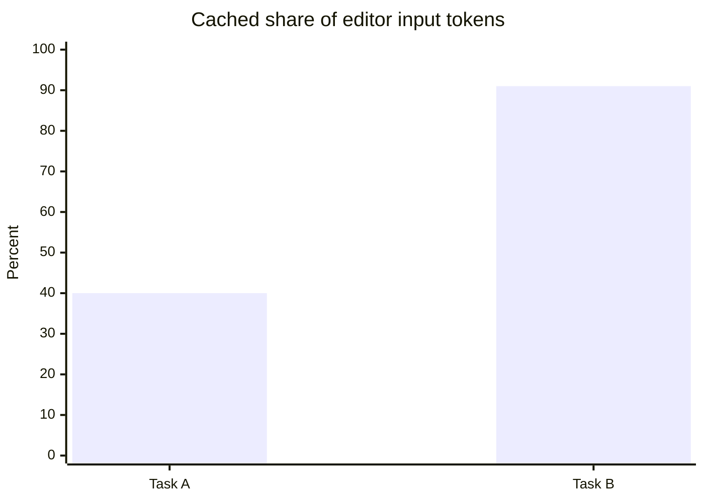

# Contexo

[](#open-the-extension) [](docs/verification/2026-11-20/local-editor/vitest.txt) [](docs/verification/2026-11-20/local-editor/B-mercury-pytest.txt)

**Competition evidence** · [Three-page A4 write-up](docs/Contexo-writeup.pdf) · [34-second evidence reel](docs/verification/2026-11-20/local-editor/evidence-reel.mp4) · [Run counters and tool calls](docs/verification/2026-11-20/local-editor/sessions.json) · [Run the checks yourself](#reproduce-the-checks)

Contexo is a VS Code extension that adds a context-aware coding agent to the editor. Its agent loop runs entirely on [TrueForge](https://github.com/truefoundry/trueforge) (TrueFoundry's open-source agent harness) in local mode. Built for the TrueFoundry Forge-a-thon.

- **Inline edit**: select code, press `Ctrl+K` then `E` (`Cmd+K` then `E` on macOS), type an instruction, review the diff hunk by hunk.
- **Agent mode**: a panel in the Contexo sidebar (Chat / Session / Context / Changes / Settings tabs) where one request drives a multi-file change. The agent finds the files itself.
- **Context assembly**: `@file` / `@symbol` mentions plus automatic budgeted retrieval, with reasons and omissions visible in the Context tab.
- **Safe review**: nothing is written until you accept; every hunk has Accept/Reject CodeLens; applied hunks can be undone.
- **Streaming, Stop, fallback**: tokens stream in; Stop is immediate and leaves the workspace untouched; if the primary model fails, a second configured model takes over.

The extension never calls a model provider. It is a client of a TrueForge agent and exposes the editor to that agent as MCP tools. Models and keys live only in TrueForge. TrueForge is a backend-only harness here: **Contexo provides the editor UI** (setup, models, session inspection and the resilience test all happen in the panel; you never need to open TrueForge's web UI).

## Open the extension

**Install the packaged extension.** In VS Code open Extensions, choose **… → Install from VSIX…** and select **Contexo.vsix**. Open a repository folder. Click the Contexo icon on the left or run **Contexo: Open Assistant and Review Workbench** from the Command Palette. Type a request in the composer. When the agent proposes an edit, the workbench opens with the summary, file cards, decisions and check evidence. Select the hunks to keep, then apply them.

**Connect once.** A fresh installation defaults to Inception Mercury 3. Open **Contexo: Open Setup**, wait for TrueForge to start, enter your Inception key and save. TrueForge keeps the credential and Contexo registers its editor connector and agents. A previously configured model can be selected in Settings. On the prepared Mac the normal VS Code profile already points to the saved Inception provider on port 18790. Each request uses the model account configured in TrueForge.

Build from source with Node 22.14 or newer. From `extension/`, run `npm ci` and `npm run build`. Open that directory in VS Code and choose **Run Extension** in Run and Debug. In the Extension Development Host window, open the repository you want to edit. On macOS the Desktop handoff includes an **Open Contexo.command** launcher and a clean Flask checkout. Run the launcher to load the built extension directly.

**Inline review.** Select code inside the target file, right-click the selection and choose **Contexo: Inline Edit**. Enter the instruction in the prompt box. Review the proposed diff, accept or reject individual hunks, then choose **Apply Accepted Hunks**. The keyboard shortcut is also available. An open file with an empty selection does not expose the context-menu item.

**Assistant.** Open the Contexo sidebar and send a request in Chat. VS Code installations with Chat Participants also expose `@contexo`. The command palette includes **Contexo: Ask Assistant**. Each surface submits turns to the configured TrueForge agent.

**Review workbench.** Choose **Contexo: Open Assistant and Review Workbench** for the before/proposed code cards, pending hunk decisions, requirement links, repository history and run replay. Click **Refresh active review** after moving to another proposal. The workbench applies accepted hunks through the same editor review engine. **Test Accepted Hunks Before Apply** runs pytest on a temporary copy. This isolates the candidate files. Tests still run with your account's OS permissions.

[Feature-by-feature readiness and remaining competition proof](docs/verification/2026-11-20/ASSESSMENT.md) · [Sidebar preview](docs/verification/2026-11-20/extension-sidebar.png) · [Review workbench preview](docs/verification/2026-11-20/review-gradient.png)

## Terminal assistant

Run from `extension/` after building and registering the agents. `--root` selects the target Git repository. Each terminal invocation starts its own loopback MCP listener and scoped session. The terminal prompts for each hunk and command. Noninteractive input denies approvals.

```bash
npm run cli -- doctor
npm run cli -- ask --root /path/to/project "Describe how configuration is loaded"
npm run cli -- inline --root /path/to/project --file src/example.py --lines 10-16 "Update this function"
npm run cli -- commits --root /path/to/project
npm run cli -- review review.json
npm run cli -- replay run.jsonl --format native
```

Set `TRUEFORGE_URL`, `CONTEXO_AGENT` and `CONTEXO_FALLBACK_AGENT` to override the default server and agent names. Use `--check` with ask or inline to run pytest against accepted hunks before writing them. CLI records live under `~/.contexo/runs` by default. Choose a directory outside the target repository when setting `CONTEXO_RUNS_DIR`.

## Verification results

Live compatibility runs used Inception Mercury 3 and local Qwen3 1.7B through TrueForge. Both models read the same colour function, requested a write, waited for approval, and applied the same hunk. The fixed Flask tasks have the following evidence on commit `22d924701a6ae2e4cd01e9a15bbaf3946094af65`.

| Case | Recorded result | Evidence |
| --- | --- | --- |
| A, inline | Mercury edited the selected function in the packaged VS Code extension and CLI. After hunk approval the specified command printed `False`. [Editor record](docs/verification/2026-11-20/local-editor/A-mercury.json). | [Task A replay](docs/verification/2026-11-20/flask-A-cli.jsonl) · [patch](docs/verification/2026-11-20/flask-A.patch) |
| B, agent | Mercury independently selected implementation, tests and docs. The initial full CLI suite returned 59 passed and one failure serializing a timedelta. Mercury proposed a correction and the reviewer applied it. An independent post-fix run passed all 60 tests. The command appeared in help and masked synthetic values for SECRET, PASSWORD, TOKEN and KEY, while PUBLIC_VALUE stayed visible. A separate installed-editor run applied 73 lines across three files. Its harness stopped at command approval. Independent verification on that checkout passed 60 tests and checked four masked keys. [Editor patch](docs/verification/2026-11-20/local-editor/B-mercury.patch). | [Task B replay](docs/verification/2026-11-20/flask-B-cli.jsonl) · [passing pytest output](docs/verification/2026-11-20/flask-B-pytest.txt) · [masked JSON](docs/verification/2026-11-20/flask-B-config.json) · [final patch](docs/verification/2026-11-20/flask-B.patch) |
| C, resilience | The isolated VS Code host reported an unreachable endpoint, processed nine timer ticks and left Git clean. [Editor evidence](docs/verification/2026-11-20/local-editor/C-first.json). | [Three-task runbook](docs/DEMO_SCRIPT.md) |

[Mercury edit replay](docs/verification/2026-11-20/mercury-edit.jsonl) · [Qwen edit replay](docs/verification/2026-11-20/qwen-edit.jsonl) · [Extension suite, 210 passed and one TODO](docs/verification/2026-11-20/vitest.txt). Replays contain task code and tool arguments. Review exported files before sharing. The roadmap tracks additional production work including concurrent editor runs, remote workspaces and live CI or sandbox validation. [Remaining work plan](docs/REMAINING_WORK_PLAN.md)

## Reproduce the checks

From the repository root, run the extension suite and build the installable package:

```bash
cd extension
npm ci
npm run typecheck
npm test
npm run package
```

The package is written to `extension/dist/contexo.vsix`. For the live rehearsal, open separate clean clones of Flask tag 3.1.3 for A, B and C. Enter the [fixed instructions](docs/DEMO_SCRIPT.md) in the editor and review each proposal. For C use the unreachable endpoint in a separate profile. To verify the three resulting directories with a Python environment containing the Flask test dependencies, run the following from the Contexo repo root:

```bash
PYTHON=/absolute/path/to/venv/bin/python ./scripts/verify-flask.sh /path/to/flask-A /path/to/flask-B /path/to/flask-C
```

The verifier imports Flask from each checkout, checks mixed-case false values, runs the CLI suite, tests help and all four masking patterns, and checks C for tracked and untracked changes. Use the session recording for the editor response during C. [Captured output](docs/verification/2026-11-20/local-editor/fixed-checks.txt).

**Bonsai compatibility.** The requested Einstein prompt generated prose locally. The exact 1-bit checkpoint requires PrismML-compatible MLX kernels. On the tested GPU server the weights were losslessly repacked for MLX's 2-bit kernel. Through TrueForge the assistant returned tool syntax as text. In a separate VS Code Task A run it dispatched zero tools and made zero changes. Keep Mercury selected for the fixed tasks. [Story, repacker and run records](docs/verification/2026-11-20/local-editor/bonsai/).

**Recorded inference.** TrueForge counted 10,400 input and 1,101 output tokens for editor A. B used 324,845 input and 8,999 output across repeated model calls. The bars show cached input as a percentage of total input for each run. [Session counters](docs/verification/2026-11-20/local-editor/sessions.json).



## Requirements

- VS Code 1.90 or newer (with the `code` command on PATH for `npm run install:local`)
- Node.js 22.14 or newer (TrueForge requires it) and npm
- Python 3.10+ and git (to prepare the Flask test repository)
- A model API key (or a local OpenAI-compatible endpoint) configured inside TrueForge

## Setup from a clean clone

1. Clone this repository, then prepare the demo target (Flask 3.1.3 in a sibling `flask/` folder, with a venv):

   ```powershell
   # Windows
   powershell -File scripts/setup-flask.ps1
   ```
   ```bash
   # macOS / Linux
   scripts/setup-flask.sh
   ```

   Both scripts clone `pallets/flask`, check out tag `3.1.3`, create `.venv`, install Flask in editable mode and the test dependencies, and add `.venv/` to the clone's `.git/info/exclude` so the demo repo stays clean. They pin `pytest<9` because Flask 3.1.3's tests import `_pytest.monkeypatch.notset`, which pytest 9 removed.

2. Build and install the extension:

   ```bash
   cd extension
   npm ci
   npm run install:local   # builds, runs the provider check, packages dist/contexo.vsix, installs it
   ```

3. Open the Flask folder in VS Code. The Contexo panel (Activity Bar) opens a **setup wizard** the first time; no terminal and no TrueForge UI needed:

   1. **TrueForge**: Contexo starts a local TrueForge for you (`npx @truefoundry/trueforge@latest`, needs Node 22.14+; the first run downloads it and can take a minute). If it is already running, Contexo uses it and never stops it.
   2. **Add provider**: pick a provider, paste its API key, press **Save to TrueForge**. The key is sent once to your local TrueForge's own API and is not kept by Contexo (no settings, no secret storage, no logs).
   3. **Choose models**: Mercury 3 is preselected. Choose a distinct fallback if available.
   4. **Register**: the Inception preset registers automatically when ready. Manual registration creates the `contexo-editor` connector and the `contexo` / `contexo-fallback` agents in TrueForge.
   5. **Done**: the tabs open. The gear tab (**Settings**) keeps the same controls plus health checks; **Contexo: Open Setup** reopens the wizard.

   Settings added: `contexo.autoStartTrueForge` (default `true`), `contexo.primaryModel`, `contexo.fallbackModel` (model names only).

### Manual alternative (no wizard)

Advanced alternative: use this if you prefer the terminal (or TrueForge's own web UI). It is not needed for normal use.

1. Start TrueForge yourself (leave it running), allowing it to reach the local Contexo MCP server. TrueForge blocks connections to `127.0.0.1` by default, so set `OUTBOUND_URL_ALLOWED_HOSTS`:

   ```bash
   OUTBOUND_URL_ALLOWED_HOSTS='["127.0.0.1"]' npx @truefoundry/trueforge@latest
   ```

   PowerShell: `$env:OUTBOUND_URL_ALLOWED_HOSTS='["127.0.0.1"]'; npx @truefoundry/trueforge@latest`. It serves http://localhost:8790 (`--port <n>` or `PORT` to change). Contexo sets this variable itself when it starts TrueForge. Set `contexo.autoStartTrueForge` to `false` to stop Contexo from starting one.
2. Configure two models in TrueForge (its web UI under **Settings -> Models**, or `settings.modelProviders` in its API) (a primary and a fallback, ideally from different providers). See [extension/trueforge/models.example.md](extension/trueforge/models.example.md). Never commit keys.
3. Run **Contexo: Copy MCP Connection** from the Command Palette (copies the MCP URL and the `X-Contexo-Token`).
4. Register the connector and agents (from `extension/`):

   ```bash
   npm run build
   CONTEXO_TOKEN=<token>    PRIMARY_MODEL=<provider>/<primary model>    FALLBACK_MODEL=<provider>/<fallback model>    node trueforge/register.mjs
   ```

   PowerShell: `$env:CONTEXO_TOKEN='...'; $env:PRIMARY_MODEL='...'; $env:FALLBACK_MODEL='...'; node trueforge/register.mjs`.

   Required env vars: `CONTEXO_TOKEN` and `PRIMARY_MODEL`. Optional: `FALLBACK_MODEL` (defaults to the primary model), `TRUEFORGE_URL` (default `http://localhost:8790`), and `CONTEXO_PORT` (default `8791`, must match `contexo.mcpPort`). The CLI and wizard update existing Contexo resources and report errors per resource. Agent definitions are in [extension/trueforge/](extension/trueforge/).

5. Reload the VS Code window. The Contexo icon appears in the Contexo sidebar; the status bar shows the run state.

## Settings

| Setting | Default | Meaning |
|---|---|---|
| `contexo.trueforgeUrl` | `http://localhost:8790` | TrueForge local server URL |
| `contexo.primaryAgent` | `contexo` | Primary TrueForge agent name |
| `contexo.fallbackAgent` | `contexo-fallback` | Fallback agent name |
| `contexo.excerptBudget` | `8000` | Token budget for assembled excerpts |
| `contexo.firstEventTimeoutMs` | `20000` | Wait for the first stream event before treating the model as failed |
| `contexo.commandAllowlist` | `["python","pytest","flask"]` | Allowed `argv[0]` values for `run_command` |
| `contexo.mcpPort` | `8791` | Fixed port of the local Contexo MCP server |
| `contexo.autoStartTrueForge` | `true` | Start a local TrueForge when none is running |
| `contexo.stopTrueForgeOnExit` | `startedByContexo` | When VS Code closes: stop TrueForge only if Contexo started it, `always` stop the local TrueForge, or `never` |
| `contexo.primaryModel` / `contexo.fallbackModel` | inception/mercury-3 / empty | `provider/model` names chosen in the wizard (never keys) |
| `contexo.devMode` | `false` | Show the dev/fixture commands in the Command Palette |

## Commands

`Contexo: Inline Edit` (`Ctrl+K E`, needs a selection), `Contexo: Open Setup`, `Contexo: Stop`, `Contexo: Stop TrueForge` (also a button in the panel's TrueForge section), `Contexo: Copy MCP Connection`, `Contexo: Reindex Workspace`, and the review commands used by the CodeLens and the Changes tab (`Undo Hunk`, `Redo Hunk`, `Decide Hunk`, `Apply Accepted Hunks`, `Accept All Hunks`, `Reject All Hunks`; hidden from the palette). With `contexo.devMode` on: `Contexo Dev: Ping TrueForge`, `Send Test Turn`, `Show Sample Context Packet`, `Open Sample Proposal` (and a missing-symbol variant), `Apply Sample Change`.

## Running the three fixed tasks (Flask 3.1.3)

Open the `flask/` folder (checked out at `3.1.3`, clean `git status`) in VS Code, with TrueForge running and the agents registered.

**Task A: inline edit.** Open `src/flask/helpers.py`, select the function `get_debug_flag`, press `Ctrl+K E` and enter exactly:

> Treat the values 'off' and 'n' as false as well, case-insensitively, and update the docstring to list every value that is treated as false.

Review the diff (per-hunk CodeLens), accept, apply. Verify (from the Flask directory, venv active):

```bash
FLASK_DEBUG=off python -c "from flask.helpers import get_debug_flag; print(get_debug_flag())"   # prints False
```

PowerShell: `$env:FLASK_DEBUG='off'; python -c "from flask.helpers import get_debug_flag; print(get_debug_flag())"`.

**Task B: agent mode.** In the Contexo panel (Chat tab), with no files mentioned, send exactly:

> Add a new built-in CLI command flask config that prints the loaded application's configuration as JSON, masking the values of any key containing SECRET, PASSWORD, TOKEN or KEY as "***". It must appear in flask --help, be covered by a test, and be documented alongside the other built-in commands.

Watch the Context tab (chosen files and reasons), review and accept the hunks (expect `src/flask/cli.py`, `tests/test_cli.py`, `docs/cli.rst`), and open the **Session** tab (or press **View session** in the Chat tab) to show the TrueForge session: each turn with status, timing and tokens, the tool calls (MCP server name, deferred-load marker, args, result), the `propose_write` approval and its allow/deny. Verify:

```bash
pytest tests/test_cli.py -q
flask --app <some app> config      # masked JSON; e.g. copy scripts/demo-app.py into the Flask folder (outside git status) and use --app demo-app.py
```

**Task C: resilience.** In the Contexo **Settings** tab, **Test resilience**, press **Simulate primary model failure** (Contexo registers a custom TrueForge provider `contexo-broken` pointing at an unreachable endpoint and re-registers the `contexo` agent on it; a banner "Primary model is in simulated-failure mode" stays visible in the panel, also after a reload). Repeat Task A. Contexo shows the fallback banner and the `contexo-fallback` agent takes over automatically (or a clear error if the fallback fails too); the Session tab shows the sealed primary session with its error and the fallback session. Press **Restore primary model** afterwards. Verify the editor stays responsive and `git status` in Flask shows no changes.

See [docs/DEMO_SCRIPT.md](docs/DEMO_SCRIPT.md) for the recording plan.

## Switching models

Open the **Settings** (gear) tab in the Contexo panel and pick a different primary or fallback model. Contexo updates the `contexo` / `contexo-fallback` agents in TrueForge right away. To use a new provider, add its key in the same tab first. No extension change or rebuild is needed.

Models and keys still live only in TrueForge, so as advanced alternatives you can also change them in TrueForge's own web UI (Build Agent), re-run `register.mjs` with different `PRIMARY_MODEL` / `FALLBACK_MODEL`, or point `contexo.primaryAgent` / `contexo.fallbackAgent` at other agents.

## Development

```bash
cd extension
npm ci
npm run watch        # esbuild watch for the extension host; press F5 for an Extension Development Host
npm run watch:web    # vite watch for the webview
npm run typecheck
npm test             # vitest
npm run package      # build + provider check + dist/contexo.vsix
npm run install:local
```

`npm run check` greps the built bundle for provider SDKs/URLs and fails if any are found (the extension must not call a model directly).

## Declared fork point

| Field | Value |
|---|---|
| Upstream | https://github.com/microsoft/vscode-extension-samples |
| Path | `webview-view-sample/` |
| Commit | `65c1c44800eeac6fb065a54823ee5ae62c79540a` |
| Licence | MIT, preserved in `extension/LICENSE.upstream` |

Details and all other dependencies with licences: [UPSTREAMS.md](UPSTREAMS.md).

### What we changed and why

The upstream sample is a minimal webview view with colour-picker commands and no agent. Only the `WebviewViewProvider` shape, the CSP meta tag and `getNonce()` were taken (`extension/src/shell/panel.ts`). Everything else is ours:

- **Agent loop on TrueForge** (`src/run/`): sessions and turns through the TrueForge SDK, event streaming, tool approvals, Stop, and automatic fallback to a second agent. No upstream loop exists.
- **Editor capabilities as MCP tools** (`src/mcp/`): a local Streamable HTTP MCP server (127.0.0.1, token header) exposing `search_workspace`, `read_file`, `assemble_context`, `list_symbols`, `propose_write` and `run_command`, so the agent decides what to read and change.
- **Context assembly** (`src/context/`): Tree-sitter symbol index, BM25 / symbol / ripgrep retrieval, one-hop expansion, RRF fusion and budgeted packing with reasons and omissions.
- **Review and undo** (`src/review/`): `propose_write` is approval-gated; the proposal is shown as per-hunk diffs with CodeLens, guarded (stale base, scope, missing symbols), applied only after accept, and undoable per hunk or per apply.
- **Setup without a terminal** (`src/run/trueforgeProcess.ts`, `src/run/trueforgeAdmin.ts`, `src/shell/setup*.ts`): starts a local TrueForge, forwards the provider key to TrueForge's API, lists models, and registers the connector and agents.
- **Session inspection** (`src/run/timeline.ts`, `src/shell/sessionController.ts`): read-only view of TrueForge sessions built from its API (sessions, turns, turn events), so TrueForge's UI is never needed.
- **Resilience test** (`src/run/failureMode.ts`): re-registers the primary agent on a deliberately broken model and back.
- **UI** (`webview/`): setup wizard, Chat, Session, Context (graph and ranked list), Changes and Settings tabs.

## Project layout

```text
extension/
  src/extension.ts        activation and wiring
  src/shell/              panel, inline edit command, status bar, setup state + controller
  src/run/                RunManager, TrueForge client wrapper, fallback, TrueForge auto-start + admin, agent manifests
  src/mcp/                MCP server, tool registration, run_command
  src/context/            indexer, search (BM25, ripgrep), assembler, token counts
  src/review/             proposal/hunks, guards, diff view + CodeLens, apply/undo
  src/dev/                fixtures and dev commands
  webview/                React webview (setup wizard, Chat, Session, Context, Changes, Settings)
  trueforge/              agent JSONs, connector JSON, instructions.md, register.mjs, models.example.md
  test/                   Vitest suites
scripts/                  setup-flask.{ps1,sh}, check-no-provider.mjs, demo-app.py
docs/                     plan, PRD, contracts, spike notes, write-up, demo script
UPSTREAMS.md              provenance and licences
```

## Docs

- [docs/PRD_Lite.md](docs/PRD_Lite.md): scope and design
- [docs/IMPLEMENTATION_PLAN.md](docs/IMPLEMENTATION_PLAN.md): slices and manual scripts
- [docs/spike-notes.md](docs/spike-notes.md): TrueForge findings and open questions
- [docs/writeup.md](docs/writeup.md): submission write-up
- [docs/DEMO_SCRIPT.md](docs/DEMO_SCRIPT.md): demo recording plan

## Licence

MIT (see `LICENSE`); the upstream sample's MIT licence is kept in `extension/LICENSE.upstream`.

## Standalone local review

From `extension/`, run `npm run build` and then `npm run review:local`. Open
`http://127.0.0.1:18792`. Set `CONTEXO_REVIEW_PORT` if the port is occupied.
The app accepts a review JSON file containing before/after file text, optional
checks and findings, and saved hunk decisions. **Load example** shows the input
format. **Save review JSON** exports decisions and requirement links for reopening.
Run replay accepts Contexo JSONL, recorded ACP session update JSONL, and OTLP span
JSON. The standalone viewer reads evidence and computes candidate changes without
writing project files or executing commands. The impact graph uses Python syntax
from changed files. Provider fetch commands remain in the VS Code extension.

Run `node local-review/smoke.mjs` after building to exercise the HTTP workflow.
