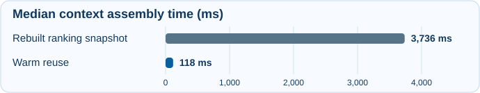
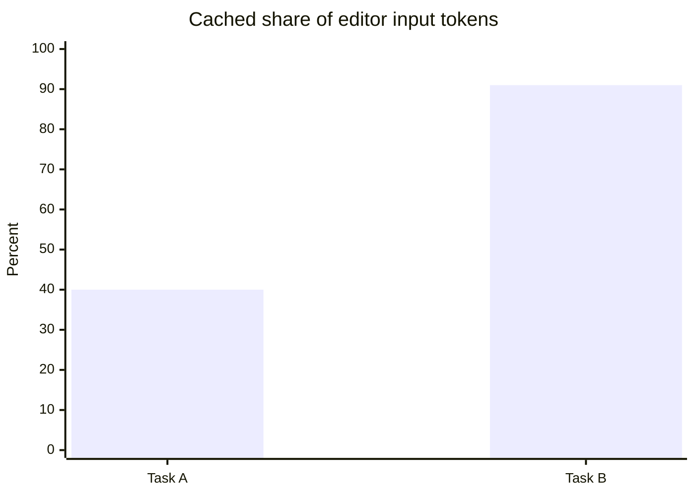
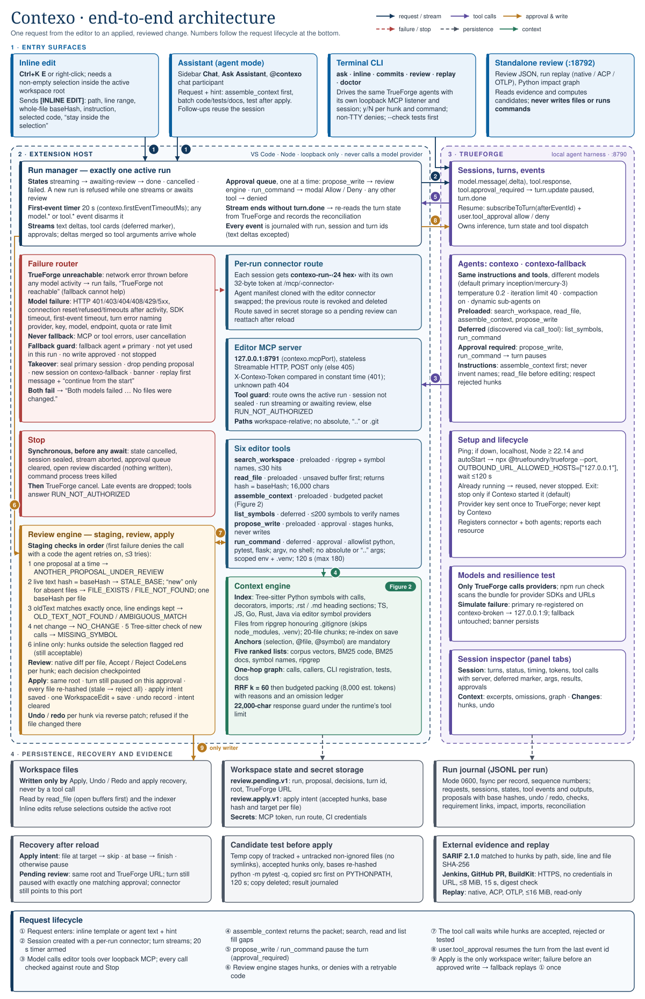
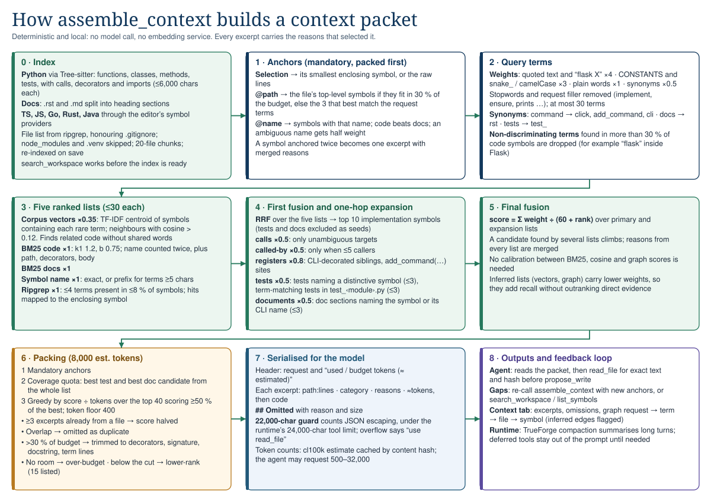

# Contexo

[](#open-the-extension) [](docs/verification/2026-11-21/AGENT_BRIDGE.md#current-candidate-summary) [](docs/verification/2026-11-20/local-editor/B-mercury-pytest.txt)

**Competition evidence** · [Three-page A4 write-up](docs/Contexo-writeup.pdf) · [34-second evidence reel](docs/verification/2026-11-20/local-editor/evidence-reel.mp4) · [Run counters and tool calls](docs/verification/2026-11-20/local-editor/sessions.json) · [Run the checks yourself](#reproduce-the-checks) · [Architecture and context management](#architecture)

Contexo is a VS Code extension that adds a context-aware coding agent to the editor. Its agent loop runs entirely on [TrueForge](https://github.com/truefoundry/trueforge) (TrueFoundry's open-source agent harness) in local mode. Built for the TrueFoundry Forge-a-thon.

- **Inline edit**: select code, press `Ctrl+K` then `E` (`Cmd+K` then `E` on macOS), type an instruction, review the diff hunk by hunk.
- **Agent mode**: a panel in the Contexo sidebar (Chat / Session / Context / Changes / Settings tabs) where one request drives a multi-file change. The agent finds the files itself.
- **Context assembly**: `@file` / `@symbol` mentions plus automatic budgeted retrieval, with reasons and omissions visible in the Context tab.
- **Safe review**: nothing is written until you accept; every hunk has Accept/Reject CodeLens; applied hunks can be undone.
- **Streaming, Stop, fallback**: follow the turn as it runs, stop pending work, and switch to a configured fallback on eligible model failures before approval.

The extension never calls a model provider. It is a client of a TrueForge agent and exposes the editor to that agent as MCP tools. Models and keys live only in TrueForge. TrueForge is a backend-only harness here: **Contexo provides the editor UI** (setup, models, session inspection and the resilience test all happen in the panel; you never need to open TrueForge's web UI).

## Implemented features

| Area | What Contexo ships |
| --- | --- |
| Entry points | VS Code inline edit, sidebar assistant, Chat Participant, command palette, and terminal assistant. The workspace MCP bridge and bundled review skill support Copilot and Claude Code. |
| Agent lifecycle | TrueForge sessions and turns, streamed events, deferred tool discovery, separate write and command approvals, Stop, explicit failure classification, and a configured fallback on eligible failures. Wizard and CLI registration reconcile the same runtime configuration. |
| Initial context | Selected source, path, line range and buffer hash for inline edits. Goal-first discovery for agent mode. Explicit file and symbol anchors reserve evidence. Bare mention keywords contribute search hints. |
| Retrieval | Incremental Tree-sitter index for Python code and heading-based docs, weighted query terms, separate BM25 ranks for code and docs, local sparse TF-IDF vectors with inverted postings, symbol matching, live ripgrep, and Go/Rust source previews. |
| Relationships and ranking | One-hop expansion of Python calls, callers, chained re-exports, CLI registration, tests and docs. VS Code language providers can add bounded Go, Rust, Java and JS/TS call edges. Weighted reciprocal rank fusion and feature/CLI coverage bring related file roles into the packet. |
| Packet assembly | Score-per-token packing, per-file penalties, overlap removal, and syntax-aware trimming. The default is 8,000 estimated source tokens. The independent 22,000-character escaped response cap protects priority excerpts and counts shortened and omitted material. |
| File understanding | Up to eight versioned file summaries. Each can show contents, inclusion reason, differences against HEAD and the latest file-changing commit subject. Exact reads expose historical source, rename history, or current editor text with a revision hash. |
| Caching and freshness | Lexical postings, rankings and sparse-vector data are reused by symbol snapshot. Git blobs and history are reused by immutable revision. Live search, working-tree reads and unsaved buffers provide fresh evidence. Provider cache counters are recorded separately. |
| Long tasks | TrueForge transcript compaction and on-demand tool schemas. Contexo’s journal can reconstruct the goal, source pointers, review decisions and checks. Decisions page 12 files at a time. The durable batch plan orders prerequisites, enforces active scope, validates reviewed output and required checks, and reopens affected batches if completed files change. |
| Native editing | Exact line ranges with replacement-only output, legacy unique-text replacement, and new-file staging. Hash, overlap, bounds and no-op validation precede review. Inline scope and Python symbol checks surface issues in the proposal. |
| Native review | CodeLens and diff views, mixed hunk decisions, apply to source files, undo and redo, revision recheck during apply, and saved review checkpoints. |
| Verification | Approved argv commands with scoped environment, time/output limits and cancellation. Optional candidate pytest checks run on a temporary copy. |
| UI and traceability | Markdown chat, source links, filterable session timeline, expandable tool inputs/results and approvals, context graph, versioned file map, and packet delivery details. Traces record observed actions and checks. |
| Persistence and replay | SQLite events and review projections, JSONL export and fallback, content fingerprints, dropped-stream reconciliation, and replay of native, ACP and OTLP records. |
| Review evidence | Requirement revisions, revision- and side-aware hunk matching, SARIF, Jenkins test reports, GitHub review comments and commit check runs, and BuildKit import with digest checks. Standalone review supports saved decisions and replay. |
| Code intelligence | Definitions, references, implementations, bounded caller/callee navigation, and a Python before/after impact graph. |
| Workspace and provider boundaries | Authenticated loopback MCP, scoped run connectors, workspace-relative path checks, symlink guards, and a packaged-bundle check for direct provider calls. |

### Readiness and remaining implementation

The evidence supports a **Mercury-first supervised workflow**. An HTTPX repair turn completed through the approved command tool. Bonsai remains experimental. The current build adds durable batches, an opt-in loopback model adapter, broader graph resolution, selected-root routing, stronger interrupted-write recovery, and GitHub check-run evidence. Live small-model writes, SSH/Codespaces verification, concurrent runs, provisioned sandbox Skills and Code Mode, and deeper recovery testing remain open. Separate acceptance work covers forced provider compaction across a large migration, actual Copilot and Claude Code edits, restart faults, and a continuous release rehearsal. [Current work and acceptance gates](docs/REMAINING_WORK_PLAN.md#current-implementation-and-release-gates)

## Open the extension

**Install the packaged extension.** In VS Code open Extensions, choose **… → Install from VSIX…** and select **Contexo.vsix**. Open a repository folder. Click the Contexo icon on the left or run **Contexo: Open Assistant and Review Workbench** from the Command Palette. Type a request in the composer. When the agent proposes an edit, the workbench opens with the summary, file cards, decisions and check evidence. Select the hunks to keep, then apply them.

**Connect once.** A fresh installation defaults to Inception Mercury 3. Open **Contexo: Open Setup**, wait for TrueForge to start, enter your Inception key and save. TrueForge keeps the credential and Contexo registers its editor connector and agents. A previously configured model can be selected in Settings. On the prepared Mac the normal VS Code profile already points to the saved Inception provider on port 18790. Each request uses the model account configured in TrueForge.

Build from source with Node 22.14 or newer. From `extension/`, run `npm ci` and `npm run build`. Open that directory in VS Code and choose **Run Extension** in Run and Debug. In the Extension Development Host window, open the repository you want to edit. On macOS the Desktop handoff includes an **Open Contexo.command** launcher and a clean Flask checkout. Run the launcher to load the built extension directly.

**Inline review.** Select code inside the target file, right-click the selection and choose **Contexo: Inline Edit**. Enter the instruction in the prompt box. Review the proposed diff, accept or reject individual hunks, then choose **Apply Accepted Hunks**. The keyboard shortcut is also available. An open file with an empty selection does not expose the context-menu item.

**Assistant.** Open the Contexo sidebar and send a request in Chat. VS Code installations with Chat Participants also expose `@contexo`. The command palette includes **Contexo: Ask Assistant**. Each surface submits turns to the configured TrueForge agent.

**Review workbench.** Choose **Contexo: Open Assistant and Review Workbench** for the before/proposed code cards, pending hunk decisions, requirement links, repository history and run replay. Click **Refresh active review** after moving to another proposal. The workbench applies accepted hunks through the same editor review engine. **Test Accepted Hunks Before Apply** runs pytest on a temporary copy. This isolates the candidate files. Tests still run with your account's OS permissions.

[Feature-by-feature readiness and remaining competition proof](docs/verification/2026-11-20/ASSESSMENT.md) · [Sidebar preview](docs/verification/2026-11-20/extension-sidebar.png) · [Review workbench preview](docs/verification/2026-11-20/review-gradient.png)

## Terminal assistant

Run from `extension/` after building and registering the agents. `--root` selects the target Git repository. Each terminal invocation starts its own loopback MCP listener and scoped session. The terminal prompts for each hunk and command. Noninteractive input denies approvals.

```bash
npm run cli -- doctor
npm run cli -- ask --root /path/to/project "Describe how configuration is loaded"
npm run cli -- inline --root /path/to/project --file src/example.py --lines 10-16 "Update this function"
npm run cli -- commits --root /path/to/project
npm run cli -- review review.json
npm run cli -- replay run.jsonl --format native
```

Set `TRUEFORGE_URL`, `CONTEXO_AGENT` and `CONTEXO_FALLBACK_AGENT` to override the default server and agent names. Use `--check` with ask or inline to run pytest against accepted hunks before writing them. CLI records live under `~/.contexo/runs` by default. Choose a directory outside the target repository when setting `CONTEXO_RUNS_DIR`.

## Verification results

The [submission audit and detailed Flask A/B/C checks](docs/verification/2026-11-22/SUBMISSION.md) include the fresh replay, actual CLI results and the distinction between contest evidence and product readiness.

Live compatibility runs used Inception Mercury 3 and local Qwen3 1.7B through TrueForge. Both models read the same colour function, requested a write, waited for approval, and applied the same hunk. The fixed Flask tasks have the following evidence on commit `22d924701a6ae2e4cd01e9a15bbaf3946094af65`.

| Case | Recorded result | Evidence |
| --- | --- | --- |
| A, inline | Mercury edited the selected function in the packaged VS Code extension and CLI. After hunk approval the specified command printed `False`. [Editor record](docs/verification/2026-11-20/local-editor/A-mercury.json). | [Task A replay](docs/verification/2026-11-20/flask-A-cli.jsonl) · [patch](docs/verification/2026-11-20/flask-A.patch) |
| B, agent | Mercury independently selected implementation, tests and docs. The initial full CLI suite returned 59 passed and one failure serializing a timedelta. Mercury proposed a correction and the reviewer applied it. An independent post-fix run passed all 60 tests. The command appeared in help and masked synthetic values for SECRET, PASSWORD, TOKEN and KEY, while PUBLIC_VALUE stayed visible. A separate installed-editor run applied 73 lines across three files. Its harness stopped at command approval. Independent verification on that checkout passed 60 tests and checked four masked keys. [Editor patch](docs/verification/2026-11-20/local-editor/B-mercury.patch). | [Task B replay](docs/verification/2026-11-20/flask-B-cli.jsonl) · [passing pytest output](docs/verification/2026-11-20/flask-B-pytest.txt) · [masked JSON](docs/verification/2026-11-20/flask-B-config.json) · [final patch](docs/verification/2026-11-20/flask-B.patch) |
| C, resilience | The isolated VS Code host reported an unreachable endpoint, processed nine timer ticks and left Git clean. [Editor evidence](docs/verification/2026-11-20/local-editor/C-first.json). | [Three-task runbook](docs/DEMO_SCRIPT.md) |

### Live HTTPX model comparison

Mercury delivered and read all three required files on the first attempt and passed **15/15** independent behavior checks. Feedback repaired its test and documentation edits. Its follow-up completed **13/13** CLI tests through Contexo and independent upstream verification passed **1,418** tests. The clean baseline passed **1,416** with the same one skip and one pre-existing Trio test excluded. Native Bonsai made zero tool calls and scored the baseline’s **6/15**. The adapter follow-up and bare-mention fix delivered **3/3** required files, and Bonsai identified them in its reply. It reached its 512-token output limit before a read or write. [Benchmark, exact patches and per-run metrics](docs/verification/2026-11-21/model-comparison/README.md)


### Context delivery and local cache

Pinned, filename-free LMCache and HTTPX prompts delivered **5/5** and **3/3** required files in both excerpts and the file map. In the LMCache microbenchmark, 12 forced misses and 12 warm lookups had median in-memory assembly times of **3,736 ms** and **118 ms** with identical excerpt order. That measurement excludes file parsing, live search, Git, MCP and inference. [Retrieval measurements](docs/verification/2026-11-21/AGENT_BRIDGE.md#retrieval-and-range-edit-follow-up)



[Mercury edit replay](docs/verification/2026-11-20/mercury-edit.jsonl) · [Qwen edit replay](docs/verification/2026-11-20/qwen-edit.jsonl) · [Current candidate summary](docs/verification/2026-11-21/AGENT_BRIDGE.md#current-candidate-summary)

## Reproduce the checks

From the repository root, run the extension suite and build the installable package:

```bash
cd extension
npm ci
npm run typecheck
npm test
npm run package
```

The package is written to `extension/dist/contexo.vsix`. For the live rehearsal, open separate clean clones of Flask tag 3.1.3 for A, B and C. Enter the [fixed instructions](docs/DEMO_SCRIPT.md) in the editor and review each proposal. For C use the unreachable endpoint in a separate profile. To verify the three resulting directories with a Python environment containing the Flask test dependencies, run the following from the Contexo repo root:

```bash
PYTHON=/absolute/path/to/venv/bin/python ./scripts/verify-flask.sh /path/to/flask-A /path/to/flask-B /path/to/flask-C
```

The verifier imports Flask from each checkout, checks mixed-case false values, runs the CLI suite, tests help and all four masking patterns, and checks C for tracked and untracked changes. Use the session recording for the editor response during C. [Captured output](docs/verification/2026-11-20/local-editor/fixed-checks.txt).

**Bonsai 4B on MLX.** The native TrueForge editor run ended after emitting a tool request as text. A controlled 1,004-file experiment retrieved all four necessary files. A single patch response failed JSON validation. Four file-local calls produced the exact patch, which Contexo staged and applied in a disposable clone. Both behavior tests and exact scope checks passed. The experimental driver used the original 1-bit weight codes repacked for the stock MLX kernel. [Run details](docs/verification/2026-11-21/AGENT_BRIDGE.md#bonsai-4b-coordinated-edit-probe).

**Recorded inference.** TrueForge counted 10,400 input and 1,101 output tokens for editor A. B used 324,845 input and 8,999 output across repeated model calls. The bars show cached input as a percentage of total input for each run. [Session counters](docs/verification/2026-11-20/local-editor/sessions.json).



<!-- architecture:start -->
## Architecture

<!-- pdf:page title="Appendix A · Architecture" -->

Figure 1 traces one request from an editor surface to a reviewed change on disk. It shows each component, the order of the checks and where each failure is routed. Contexo only sees the workspace through tools that it implements itself. TrueForge owns the model and the turn. A file changes only when a person applies hunks they accepted.



*Figure 1. End-to-end architecture. Numbers follow the request lifecycle in the bottom band. Generated by [scripts/docs/diagrams.py](scripts/docs/diagrams.py).*

<!-- pdf:page title="Appendix B · Context management" -->

## How context is managed

The model sees context in four tiers. Each tier has its own owner and limit. Contexo controls the first three. TrueForge controls the fourth.

| Tier | Owner | What enters the model's context | Bound |
| --- | --- | --- | --- |
| Prompt | Contexo, then TrueForge | Shared agent instructions, then the first message. An inline edit carries the selected code, line range and whole-file `baseHash`. An agent request carries the text and a hint to call `assemble_context` first. | Instructions are fixed. An inline edit adds only the selection. |
| Packet | `assemble_context` | Ranked code, test and documentation excerpts. Each one carries reasons. A bounded ledger records omissions and counts any entries dropped during serialization. | 8,000 estimated tokens by default (the agent may request 500–32,000). The response stays under 22,000 characters. |
| On demand | `read_file`, `search_workspace`, `list_symbols` | Exact file text with its hash, search hits and symbol lists, fetched when the packet is not enough. | Up to 16,000 source characters per read, with an escaped response cap. 30 hits. 200 symbols. |
| Session | TrueForge | Model turns and tool results across iterations. | Compaction is on. 40 iterations. Deferred tool schemas load only when needed. |



*Figure 2. The `assemble_context` pipeline. It runs locally and deterministically. It makes no model call and uses no embedding service.*

<!-- pdf:page title="Appendix B · Context management" -->

### Worked example: Task B with no file names

The editor run recorded in [B-mercury.jsonl](docs/verification/2026-11-20/local-editor/B-mercury.jsonl) asked for a `flask config` command and named no paths. The packet used 7,112 of 8,000 estimated tokens across 14 excerpts:

- **Implementation (4).** Three ranges came from `src/flask/cli.py`, chosen by `lexical "command"`, `registers Flask` and `calls FlaskGroup.get_command`. The fourth was a CLI registration example from the tutorial.
- **Tests (3).** Two ranges came from `tests/test_cli.py`, both chosen through the `tests FlaskGroup` graph edge. The third was a configuration test.
- **Docs (7).** These included two sections of `docs/cli.rst` and a section of `docs/config.rst`.
- **Omitted.** `src/flask/config.py`, `src/flask/app.py` and a tutorial page were over budget. Twenty-two further ledger entries were cut at the response limit with a pointer to `read_file`.

The agent then read and changed exactly the three files the task needed: `cli.py`, `test_cli.py` and `cli.rst`. The packet also carried two weak matches on "secret" and "password", `CHANGES.rst` and a flashing pattern page, at about 950 tokens. The density packer keeps such noise small, but lexical overlap is still the main limit on precision. The packet is a small part of the whole turn. TrueForge counted 324,845 input tokens for Task B across repeated model calls, 91% of them cached, against 10,400 for the inline Task A. [Session counters](docs/verification/2026-11-20/local-editor/sessions.json).

### What each feature adds to context

| Feature | Mechanism | Contribution |
| --- | --- | --- |
| Inline template | Selection, line range and whole-file hash go in the first message. Small local edits skip retrieval. | Smallest possible context. The scope guard flags any hunk that drifts outside the selection. |
| Anchors | The selection, `@file` and `@symbol` are packed before ranking. A large file contributes its three best-matching symbols. | Explicit anchors take priority within the configured budget. |
| Term extraction | Quoted text, CLI phrases, constants, identifiers, plain words and synonyms are weighted. Filler words are removed. Terms found in over 30% of symbols are dropped. | Queries rest on distinctive words, not on the project name. |
| Corpus vectors | TF-IDF centroid neighbours computed locally, at weight 0.35. | Finds related code that uses different words, without sending code to an embedding service. |
| BM25 code and docs | k1 1.2, b 0.75. Code and docs are ranked in separate lists. | Lexical relevance. Prose does not compete with code for rank. |
| Symbol names and ripgrep | Exact or prefix name matches. A grep for rare terms, mapped back to the enclosing symbol. | Catches identifiers, strings and comments, and returns whole symbols instead of line fragments. |
| One-hop graph | Calls, callers, CLI registration, tests and docs reached from the top 10 implementation symbols. Static Python imports and aliases help disambiguate same-named functions. | Brings in what the request implies but does not name, such as registration sites, the matching tests and the right docs page. |
| Reciprocal rank fusion | k = 60, with per-list weights. | Agreement between independent signals beats one inflated score. |
| Coverage quota | The best test and best doc candidate are reserved first. | The packer prioritizes tests and a relevant matching module guide when available. |
| Density packing | Score ÷ tokens, a 400-token floor, a cutoff at 50% of the best score, the top 40, and half score after three excerpts from one file. | Spreads the budget across files instead of spending it on one large module. |
| Trimming | Oversized symbols keep their decorators, signature, docstring and term-matching lines. | Large symbols stay represented at a fraction of their size. |
| Omission ledger | Each omission is listed as duplicate, over-budget or lower-rank, with its size, plus a notice when the list itself overflows. | The agent knows what it did not see. It reads that file instead of guessing. |
| Response guard | 22,000 characters, counted after JSON escaping. | The guard leaves room for the transport wrapper. A Task B rehearsal hit exactly this failure before the guard existed. |
| `read_file` hash | Reads the editor buffer and returns its SHA-256, which becomes the `baseHash`. | Edits are built on exact current text. Stale context fails closed with `STALE_BASE`. |
| Deferred tools | `list_symbols` and `run_command` load through tool discovery. | Fewer tool schemas in every prompt. In Task B the agent found the command tool only when it needed pytest. |
| Compaction and iteration limit | TrueForge summarises long turns. A run stops after 40 iterations. | Long agent loops stay bounded. |
| Fallback replay | A fresh session receives the original first message and a "continue from the start" note. | The fallback starts with a fresh prompt and can request a scoped checkpoint. It re-reads files before editing. |
| Re-index on save | Files are parsed again after each save, including applied hunks. | Follow-up turns see the agent's own changes. |
| Context tab and journal | The packet, its graph, reasons and tool outputs are shown and recorded. | A reviewer can audit why a file was or was not in context. |

<!-- pdf:page title="Appendix C · Routing and rules" -->

## Routing and rules reference

### Failure routing

A model failure triggers the fallback only when all four conditions hold:

- The fallback agent is not the primary agent.
- The fallback has not already been used in this run.
- No write has been approved.
- The user has not pressed Stop.

If the fallback fails too, the run reports "Both models failed … No files were changed."

| Signal | Classified as | Result |
| --- | --- | --- |
| A thrown network error (ECONNREFUSED, ENOTFOUND, ETIMEDOUT, ECONNRESET, EAI_AGAIN, connect timeout, "fetch failed") before any model or tool event | TrueForge unreachable | The run fails with "TrueForge not reachable at ‹url›". A fallback would reach the same server. |
| The same network error after model activity | Model failure | Fallback |
| HTTP 401, 403, 404, 408, 429 or 5xx, or an SDK timeout | Model failure | Fallback |
| No `model.*` or `tool.*` event within `firstEventTimeoutMs` (20 s) | Model failure | The primary session is sealed and cancelled, then the fallback starts. |
| A `turn.done` error naming a status code, key, auth, model, provider, endpoint, quota, rate limit or timeout | Model failure | Fallback, with a plain-language reason for unsupported tools, 402, 429 and unknown models. |
| A `turn.done` error from an MCP server | Other | The run fails. A broken editor connector is not a model problem. |
| Any other HTTP status, a tool error, or unmatched text | Other | The run fails, or a tool error goes back to the model as a tool result. |
| Abort or cancellation | Cancelled | Nothing further happens. |
| The stream ends without `turn.done` | Reconciled | The turn state is re-read. Done or cancelled finishes the run. An error is classified as above. Anything else fails and points to the Session tab. |

### Staging and apply outcomes

| Code | Raised when | The agent's next step |
| --- | --- | --- |
| `ANOTHER_PROPOSAL_UNDER_REVIEW` | A proposal is already open. | End the turn and wait for the review. |
| `STALE_BASE ‹path›` | The live hash differs from `baseHash`, or two edits to one file disagree on the base. | Re-read the file and refresh the exact coordinates and hash, or rebuild the legacy `oldText`. |
| `FILE_EXISTS` / `FILE_NOT_FOUND` | `"new"` was used for an existing file, or a hash was given for a missing file. | Use the `read_file` hash or `"new"`. |
| `OLD_TEXT_NOT_FOUND` / `AMBIGUOUS_MATCH` | `oldText` matches zero times, or more than once. | Copy the text exactly, or add surrounding lines. |
| `NO_CHANGE` | The edits leave every file identical. | Propose a real change, or say none is needed. |
| `MISSING_SYMBOL ‹name› @ ‹path:line›` | A call or decorator on an added line is not defined, imported, builtin or bound in scope. The message notes "defined in X but not imported" where the index knows the name. | Import or define the name in the same proposal. |
| Outside selection (inline only) | A hunk changes lines outside the selection. | Not a denial. The hunk is flagged red and the reviewer decides. |
| `STALE_BASE during review` | The file changed while the diff was open. Nothing was written. | Re-read and propose again. |
| `APPLY_FAILED` | The write failed. Every hunk is reported as rejected. | Report the error. |
| `RUN_NOT_AUTHORIZED` | Stop was pressed, the session is sealed, or the connector does not own the active run. | Stop calling tools. |
| `COMMAND_REFUSED` / `PATH_INVALID` | The command is not on the allowlist, or a path is absolute, contains `..` or points into `.git`. | Use an allowed program and workspace-relative paths. |

The agent retries each proposal at most three times. It never re-proposes a rejected hunk unless asked.

<!-- pdf:page title="Appendix C · Routing and rules" -->

### Boundaries and limits

| Boundary | Limit |
| --- | --- |
| Editor MCP server | `127.0.0.1:8791`, POST only. A 32-byte token, checked in constant time. Each run has its own connector path and 32-byte token. |
| Workspace paths | Relative only. No absolute paths, `..` or `.git`. Inline edits must stay inside the active root. |
| Tool output | `read_file` returns up to 16,000 characters. `search_workspace` returns up to 30 hits and `list_symbols` up to 200 symbols. `assemble_context` stays under 22,000 characters. |
| `run_command` | Approval required. The program must be `python`, `pytest` or `flask` (`contexo.commandAllowlist`). It takes an argv array with no shell. It runs with an allowlisted environment plus the project `.venv`, for 120 s by default and 180 s at most. Output is capped. The process tree is killed on Stop. |
| Agent | Temperature 0.2. 40 iterations. Approval required for `propose_write` and `run_command`. |
| TrueForge start | Localhost only, Node 22.14 or newer. Contexo waits up to 120 s. It stops TrueForge on exit only if it started it. |
| Candidate test | A temporary copy runs `pytest -q` for 120 s, then the copy is deleted. Tests still run with the user's OS permissions. |
| External evidence | HTTPS with no credentials in the URL. Up to 8 MiB and 15 s. BuildKit provenance is checked against its SHA-256 digest. Credentials live in secret storage. |
| Review and replay files | Up to 16 MiB. Read-only. |
| Run journal | Mode 0600 in a 0700 directory. Each record is synced to disk on write. |

<!-- architecture:end -->

## Requirements

- VS Code 1.90 or newer (with the `code` command on PATH for `npm run install:local`)
- Node.js 22.14 or newer (TrueForge requires it) and npm
- Python 3.10+ and git (to prepare the Flask test repository)
- A model API key (or a local OpenAI-compatible endpoint) configured inside TrueForge

## Setup from a clean clone

1. Clone this repository, then prepare the demo target (Flask 3.1.3 in a sibling `flask/` folder, with a venv):

   ```powershell
   # Windows
   powershell -File scripts/setup-flask.ps1
   ```
   ```bash
   # macOS / Linux
   scripts/setup-flask.sh
   ```

   Both scripts clone `pallets/flask`, check out tag `3.1.3`, create `.venv`, install Flask in editable mode and the test dependencies, and add `.venv/` to the clone's `.git/info/exclude` so the demo repo stays clean. They pin `pytest<9` because Flask 3.1.3's tests import `_pytest.monkeypatch.notset`, which pytest 9 removed.

2. Build and install the extension:

   ```bash
   cd extension
   npm ci
   npm run install:local   # builds, runs the provider check, packages dist/contexo.vsix, installs it
   ```

3. Open the Flask folder in VS Code. The Contexo panel (Activity Bar) opens a **setup wizard** the first time; no terminal and no TrueForge UI needed:

   1. **TrueForge**: Contexo starts a local TrueForge for you (`npx @truefoundry/trueforge@0.185.1`, needs Node 22.14+; the first run downloads it and can take a minute). If it is already running, Contexo uses it and never stops it.
   2. **Add provider**: pick a provider, paste its API key, press **Save to TrueForge**. The key is sent once to your local TrueForge's own API and is not kept by Contexo (no settings, no secret storage, no logs).
   3. **Choose models**: Mercury 3 is preselected. Choose a distinct fallback if available.
   4. **Register**: the Inception preset registers automatically when ready. Manual registration creates the `contexo-editor` connector and the `contexo` / `contexo-fallback` agents in TrueForge.
   5. **Done**: the tabs open. The gear tab (**Settings**) keeps the same controls plus health checks; **Contexo: Open Setup** reopens the wizard.

   Settings added: `contexo.autoStartTrueForge` (default `true`), `contexo.primaryModel`, `contexo.fallbackModel` (model names only).

### Manual alternative (no wizard)

Advanced alternative: use this if you prefer the terminal (or TrueForge's own web UI). It is not needed for normal use.

1. Start TrueForge yourself (leave it running), allowing it to reach the local Contexo MCP server. TrueForge blocks connections to `127.0.0.1` by default, so set `OUTBOUND_URL_ALLOWED_HOSTS`:

   ```bash
   OUTBOUND_URL_ALLOWED_HOSTS='["127.0.0.1"]' npx @truefoundry/trueforge@0.185.1
   ```

   PowerShell: `$env:OUTBOUND_URL_ALLOWED_HOSTS='["127.0.0.1"]'; npx @truefoundry/trueforge@0.185.1`. It serves http://localhost:8790 (`--port <n>` or `PORT` to change). Contexo sets this variable itself when it starts TrueForge. Set `contexo.autoStartTrueForge` to `false` to stop Contexo from starting one.
2. Configure two models in TrueForge (its web UI under **Settings -> Models**, or `settings.modelProviders` in its API) (a primary and a fallback, ideally from different providers). See [extension/trueforge/models.example.md](extension/trueforge/models.example.md). Never commit keys.
3. Run **Contexo: Copy MCP Connection** from the Command Palette (copies the MCP URL and the `X-Contexo-Token`).
4. Register the connector and agents (from `extension/`):

   ```bash
   npm run build
   CONTEXO_TOKEN=<token>    PRIMARY_MODEL=<provider>/<primary model>    FALLBACK_MODEL=<provider>/<fallback model>    node trueforge/register.mjs
   ```

   PowerShell: `$env:CONTEXO_TOKEN='...'; $env:PRIMARY_MODEL='...'; $env:FALLBACK_MODEL='...'; node trueforge/register.mjs`.

   Required env vars: `CONTEXO_TOKEN` and `PRIMARY_MODEL`. Optional: `FALLBACK_MODEL` (defaults to the primary model), `TRUEFORGE_URL` (default `http://localhost:8790`), and `CONTEXO_PORT` (default `8791`, must match `contexo.mcpPort`). The CLI and wizard update existing Contexo resources and report errors per resource. Agent definitions are in [extension/trueforge/](extension/trueforge/).

5. Reload the VS Code window. The Contexo icon appears in the Contexo sidebar; the status bar shows the run state.

## Settings

| Setting | Default | Meaning |
|---|---|---|
| `contexo.trueforgeUrl` | `http://localhost:8790` | TrueForge local server URL |
| `contexo.primaryAgent` | `contexo` | Primary TrueForge agent name |
| `contexo.fallbackAgent` | `contexo-fallback` | Fallback agent name |
| `contexo.excerptBudget` | `8000` | Token budget for assembled excerpts |
| `contexo.firstEventTimeoutMs` | `20000` | Wait for the first stream event before treating the model as failed |
| `contexo.commandAllowlist` | `["python","pytest","flask"]` | Allowed `argv[0]` values for `run_command` |
| `contexo.mcpPort` | `8791` | Fixed port of the local Contexo MCP server |
| `contexo.autoStartTrueForge` | `true` | Start a local TrueForge when none is running |
| `contexo.stopTrueForgeOnExit` | `startedByContexo` | When VS Code closes: stop TrueForge only if Contexo started it, `always` stop the local TrueForge, or `never` |
| `contexo.primaryModel` / `contexo.fallbackModel` | inception/mercury-3 / empty | `provider/model` names chosen in the wizard (never keys) |
| `contexo.devMode` | `false` | Show the dev/fixture commands in the Command Palette |

## Commands

`Contexo: Inline Edit` (`Ctrl+K E`, needs a selection), `Contexo: Open Setup`, `Contexo: Stop`, `Contexo: Stop TrueForge` (also a button in the panel's TrueForge section), `Contexo: Copy MCP Connection`, `Contexo: Reindex Workspace`, and the review commands used by the CodeLens and the Changes tab (`Undo Hunk`, `Redo Hunk`, `Decide Hunk`, `Apply Accepted Hunks`, `Accept All Hunks`, `Reject All Hunks`; hidden from the palette). With `contexo.devMode` on: `Contexo Dev: Ping TrueForge`, `Send Test Turn`, `Show Sample Context Packet`, `Open Sample Proposal` (and a missing-symbol variant), `Apply Sample Change`.

## Running the three fixed tasks (Flask 3.1.3)

Open the `flask/` folder (checked out at `3.1.3`, clean `git status`) in VS Code, with TrueForge running and the agents registered.

**Task A: inline edit.** Open `src/flask/helpers.py`, select the function `get_debug_flag`, press `Ctrl+K E` and enter exactly:

> Treat the values 'off' and 'n' as false as well, case-insensitively, and update the docstring to list every value that is treated as false.

Review the diff (per-hunk CodeLens), accept, apply. Verify (from the Flask directory, venv active):

```bash
FLASK_DEBUG=off python -c "from flask.helpers import get_debug_flag; print(get_debug_flag())"   # prints False
```

PowerShell: `$env:FLASK_DEBUG='off'; python -c "from flask.helpers import get_debug_flag; print(get_debug_flag())"`.

**Task B: agent mode.** In the Contexo panel (Chat tab), with no files mentioned, send exactly:

> Add a new built-in CLI command flask config that prints the loaded application's configuration as JSON, masking the values of any key containing SECRET, PASSWORD, TOKEN or KEY as "***". It must appear in flask --help, be covered by a test, and be documented alongside the other built-in commands.

Watch the Context tab (chosen files and reasons), review and accept the hunks (expect `src/flask/cli.py`, `tests/test_cli.py`, `docs/cli.rst`), and open the **Session** tab (or press **View session** in the Chat tab) to show the TrueForge session: each turn with status, timing and tokens, the tool calls (MCP server name, deferred-load marker, args, result), the `propose_write` approval and its allow/deny. Verify:

```bash
pytest tests/test_cli.py -q
flask --app <some app> config      # masked JSON; e.g. copy scripts/demo-app.py into the Flask folder (outside git status) and use --app demo-app.py
```

**Task C: resilience.** In the Contexo **Settings** tab, **Test resilience**, press **Simulate primary model failure** (Contexo registers a custom TrueForge provider `contexo-broken` pointing at an unreachable endpoint and re-registers the `contexo` agent on it; a banner "Primary model is in simulated-failure mode" stays visible in the panel, also after a reload). Repeat Task A. Contexo shows the fallback banner and the `contexo-fallback` agent takes over automatically (or a clear error if the fallback fails too); the Session tab shows the sealed primary session with its error and the fallback session. Press **Restore primary model** afterwards. Verify the editor stays responsive and `git status` in Flask shows no changes.

See [docs/DEMO_SCRIPT.md](docs/DEMO_SCRIPT.md) for the recording plan.

## Advanced runtime and workspaces

- Use **Contexo: Select Workspace Folder** in a multi-root window. Contexo binds the agent, journal evidence, review and undo to the selected folder. One run is active at a time. In a remote VS Code window, install the extension in the workspace host and run TrueForge next to it. The external editor bridge remains single-root.
- An agent can create a durable plan through `batch_plan`, refresh it after compaction, and restore a prior plan with its run ID in the original workspace. Completion requires applied output hashes and successful approved commands listed in that batch.
- For a local OpenAI-compatible model that emits textual tool envelopes, launch `node extension/trueforge/local-model-adapter.mjs`. Set `CONTEXO_LOCAL_MODEL_URL` to its loopback `/v1` endpoint, set a long `CONTEXO_LOCAL_ADAPTER_TOKEN`, and use that token when registering the adapter as a custom provider in TrueForge. The adapter listens on loopback port 8793 by default. `CONTEXO_LOCAL_MAX_OUTPUT_TOKENS` caps the adapter budget. `CONTEXO_MODEL_MAX_OUTPUT_TOKENS` sets the TrueForge agent budget when using manual registration.
- For Skills and Code Mode, configure a ready sandbox environment in TrueForge and provide `CONTEXO_SANDBOX` and `CONTEXO_SKILLS` at manual registration. `CONTEXO_REVIEW_SKILL_SHA` can register the bundled skill from a published, pinned repository commit. Registration verifies environment readiness and reads the skills back. [TrueForge Skills](https://github.com/truefoundry/trueforge/blob/main/docs/skills.mdx) · [TrueForge Code Mode](https://github.com/truefoundry/trueforge/blob/main/docs/key-features/code-mode.mdx)
- **Contexo: Sync Review Evidence** can import GitHub check runs from a full commit URL. The importer confirms that returned check runs belong to the selected commit before recording them.

## Switching models

Open the **Settings** (gear) tab in the Contexo panel and pick a different primary or fallback model. Contexo updates the `contexo` / `contexo-fallback` agents in TrueForge right away. To use a new provider, add its key in the same tab first. No extension change or rebuild is needed.

Models and keys still live only in TrueForge, so as advanced alternatives you can also change them in TrueForge's own web UI (Build Agent), re-run `register.mjs` with different `PRIMARY_MODEL` / `FALLBACK_MODEL`, or point `contexo.primaryAgent` / `contexo.fallbackAgent` at other agents.

## Use Contexo from Copilot or Claude Code

Open the target folder in a trusted VS Code window with Contexo installed. The bridge is scoped to that folder. An agent can inspect the selection, assemble context, read exact source and stage edits. The editor opens the actual source file with hunk controls. Hover the highlighted hunk for the patch preview, or use **Open full diff**. **Apply accepted** saves the chosen changes to the workspace file. New files open in the native diff until they are created.

- **Copilot in VS Code.** Enable the extension-provided **Contexo Workspace** MCP server. Use the bundled `/contexo-review` skill or ask Copilot to route the request through Contexo. If automatic discovery is unavailable, use **Contexo: Copy Copilot or Claude MCP Connection**, choose **Copilot**, and merge the entry into the workspace-root `.mcp.json` or Copilot Global configuration. Set `CONTEXO_AGENT_TOKEN` in the environment that launches the Copilot host using **Agent token** from the same command.
- **Claude Code in the VS Code terminal.** Choose **Claude Code** in that command and merge the copied entry into `.mcp.json` in the folder Claude opens. Set `CONTEXO_AGENT_TOKEN` in the launching terminal using the copied **Agent token**. Keep the value in your environment. Run `/mcp` to check the connection. The project's `.claude/skills/contexo-review` skill is available in this repository. Use **Contexo: Install Claude Code Workspace Skill** to install it in another project.

The MCP proposal returns a review ID. The agent can call `review_status` after the editor decision. The bridge leaves test or shell execution to the host's existing controls. [VS Code MCP](https://code.visualstudio.com/api/extension-guides/ai/mcp) · [Claude Code MCP](https://code.claude.com/docs/en/mcp)

### What the model receives

A Contexo inline turn starts with the instruction, selected text, workspace-relative path, line range and full-buffer hash. An agent-mode turn starts with the goal and a short workflow hint. External agents can opt into the current selection with `useEditorSelection`. The context assembler preserves primary anchors, retrieves and ranks repository excerpts, expands related code, tests and docs, and fits them within the excerpt budget. The response sent to the model includes exact excerpts or marked trims, source ranges, inclusion reasons and omission details. The separate serialized budget accounts for escaping and transport. The Context tab distinguishes the packed excerpts from those actually delivered. Targeted reads return exact text and its version hash. TrueForge manages compaction for its own sessions. Copilot and Claude Code manage their conversation history when they call the bridge.

The file map adds a repository overview before the selected excerpts. It starts with the editor selection, explicit file mentions and ranked results, with up to eight files per packet. Each entry explains why the file is relevant and lists indexed symbols or a short source sample. It records the current editor buffer or working tree against Git HEAD, along with the latest file-changing commit and its subject. For up to three files, it also prepares short before-and-after samples and a comparison with the prior committed version. The packet includes these details as space allows. The Context tab shows which file summaries reached the model.

Call `file_context` with a workspace path to inspect the file's before-and-after hunks, commit message and previous path when Git recorded a rename. Set `version` to `head` or `previous` and pass a line range for the exact historical source. `previous` reads the first parent of the latest commit that touched that file. The map uses a separate metadata budget of up to 1,300 estimated tokens within the shared 22,000-character serialized response limit. Diff inspection reads text files up to 256 KiB. Git and the workspace index supply the evidence locally.

On pinned Flask 3.1.3, a filename-free Task B request with a 1,800-token source budget returned the CLI implementation, tests and command documentation. The packer reserves a related module guide when its name and terms connect it to the leading implementation. It also budgets omission details separately so diagnostic metadata stays proportional to the source. Exact reads preserve line endings and account for JSON escaping before returning a slice and its full-file hash. [Flask retrieval and tool trace](docs/verification/2026-11-21/AGENT_BRIDGE.md#bonsai-on-upstream-flask).

For a multi-file request, the assembler preserves likely implementation, test and documentation roles through the serialized tool response. Priority excerpts include suggested exact-read coordinates and can be shortened to fit. Ask for up to 24 exact lines and use the returned coordinates and base hash to submit only replacement text. The extension checks the file revision and opens the proposal in native review.

Repeated requests reuse the lexical ranking data for the same symbol snapshot, and Git history reads reuse immutable data for the same repository revision. Live search, the active buffer and working tree supply current evidence. [Context engineering design and published research](docs/CONTEXT_ENGINEERING.md)

### Long edits, compaction, and traceability

TrueForge performs conversation compaction. Contexo's `resume_context` tool restores selected facts from the current run journal on demand. It returns the goal, original selection reference, last delivered snippet locations, proposal decisions and recent check statuses. The context receipt records a SHA-256 of the exact MCP text, plus the run, session, turn, inclusion reasons and delivery counts. Proposal decisions are paged by file, 12 at a time. A cursor for a superseded proposal is rejected. The tool returns source pointers and review counts. Read exact current lines before constructing another edit.

| Problem | Shipped behavior | Release validation still needed |
| --- | --- | --- |
| Small model and 100+ files | Agent instructions call for dependency-ordered batches with one active review. The checkpoint can page through 120 files with mixed decisions. Each intended write uses an exact base hash. | Run a full 100-file model-driven migration with dependency ordering, cancellation, stale revisions and final whole-candidate checks. The 120-file test exercises checkpoint pagination. |
| Context loss during a long run | TrueForge compacts the conversation. Contexo reconstructs a bounded checkpoint from independently recorded events. An indexed SQLite lookup retrieves relevant records even after many unrelated events. | Force actual provider compaction repeatedly and measure whether tasks preserve every required constraint and decision. |
| Explainability | The Session and Context views, journal and Git versions expose tool actions, source ranges, approved hunks and observed checks. Ask the agent for a short evidence-linked rationale. | Verify complete correlation and redaction on realistic error flows. A rationale is a model claim, and the recorded sources and checks let the reviewer assess it. |
| Language coverage | Python uses parsed symbols. Rust and Go search hits supply explicitly labelled source previews, with exact reads and hash-checked writes. | Multilingual dependency graphs, cross-package and re-export resolution, and real multi-file model evaluations in each language. |

Anthropic describes compacting older messages, preserving structured notes and reopening exact sources when needed. Cursor describes lazy tool discovery and storing lengthy results for selective rereads. Contexo applies these ideas through deferred MCP tools, bounded context, source pointers and a run-scoped checkpoint. The checkpoint is a structured record of observations. Provider-supplied thinking summaries, where available, are separate from verifiable execution evidence. [Anthropic context engineering](https://www.anthropic.com/research/effective-context-engineering-for-ai-agents) · [Anthropic thinking summaries](https://platform.claude.com/docs/en/build-with-claude/extended-thinking) · [Cursor dynamic context discovery](https://cursor.com/blog/dynamic-context-discovery)

Run `scripts/verify-oss.sh` after building the extension to check retrieval, stale-base rejection and exact hunk application in pinned Flask, Go x/sync and ripgrep checkouts. The script needs Python with Flask's runtime dependencies, Go, Git and ripgrep. Set `CONTEXO_TEST_RUST=1` with Cargo installed to also run globset's tests. The edits and checkouts stay in disposable directories. [Release evidence](docs/verification/2026-11-21/AGENT_BRIDGE.md).

### Inspect an agent run

Chat renders Markdown, code blocks, tables and workspace source links. Open **Session activity** to select a run and a turn, then filter tools, messages or approvals. Expand a tool row for its inputs and result. **View context** opens the current packet and its file map. Filter by path, open source or expand the graph and transport details when needed. Settings groups model setup, runtime, editor controls and diagnostics.

### Review history

Contexo stores run events and review snapshots in the extension's workspace storage. Hosts with Node's SQLite API commit events and review projections in SQLite and preserve existing JSONL journals. The run record is still available as JSONL through **Contexo: Open Run Record**. A review checkpoint stores its full snapshot by digest for replay. Older hosts use the JSONL journal.

## Development

```bash
cd extension
npm ci
npm run watch        # esbuild watch for the extension host; press F5 for an Extension Development Host
npm run watch:web    # vite watch for the webview
npm run typecheck
npm test             # vitest
npm run package      # build + provider check + dist/contexo.vsix
npm run install:local
```

`npm run check` greps the built bundle for provider SDKs/URLs and fails if any are found (the extension must not call a model directly).

## Declared fork point

| Field | Value |
|---|---|
| Upstream | https://github.com/microsoft/vscode-extension-samples |
| Path | `webview-view-sample/` |
| Commit | `65c1c44800eeac6fb065a54823ee5ae62c79540a` |
| Licence | MIT, preserved in `extension/LICENSE.upstream` |

Details and all other dependencies with licences: [UPSTREAMS.md](UPSTREAMS.md).

### What we changed and why

The upstream sample is a minimal webview view with colour-picker commands and no agent. Only the `WebviewViewProvider` shape, the CSP meta tag and `getNonce()` were taken (`extension/src/shell/panel.ts`). Everything else is ours:

- **Agent loop on TrueForge** (`src/run/`): sessions and turns through the TrueForge SDK, event streaming, tool approvals, Stop, and automatic fallback to a second agent. No upstream loop exists.
- **Editor capabilities as MCP tools** (`src/mcp/`): a local Streamable HTTP MCP server (127.0.0.1, token header) exposing `search_workspace`, `read_file`, `assemble_context`, `list_symbols`, `propose_write` and `run_command`, so the agent decides what to read and change.
- **Context assembly** (`src/context/`): Tree-sitter symbol index, BM25 / symbol / ripgrep retrieval, one-hop expansion, RRF fusion and budgeted packing with reasons and omissions.
- **Review and undo** (`src/review/`): `propose_write` is approval-gated; the proposal is shown as per-hunk diffs with CodeLens, guarded (stale base, scope, missing symbols), applied only after accept, and undoable per hunk or per apply.
- **Setup without a terminal** (`src/run/trueforgeProcess.ts`, `src/run/trueforgeAdmin.ts`, `src/shell/setup*.ts`): starts a local TrueForge, forwards the provider key to TrueForge's API, lists models, and registers the connector and agents.
- **Session inspection** (`src/run/timeline.ts`, `src/shell/sessionController.ts`): read-only view of TrueForge sessions built from its API (sessions, turns, turn events), so TrueForge's UI is never needed.
- **Resilience test** (`src/run/failureMode.ts`): re-registers the primary agent on a deliberately broken model and back.
- **UI** (`webview/`): setup wizard, Chat, Session, Context (graph and ranked list), Changes and Settings tabs.

## Project layout

```text
extension/
  src/extension.ts        activation and wiring
  src/shell/              panel, inline edit command, status bar, setup state + controller
  src/run/                RunManager, TrueForge client wrapper, fallback, TrueForge auto-start + admin, agent manifests
  src/mcp/                MCP server, tool registration, run_command
  src/context/            indexer, search (BM25, ripgrep), assembler, token counts
  src/review/             proposal/hunks, guards, diff view + CodeLens, apply/undo
  src/dev/                fixtures and dev commands
  webview/                React webview (setup wizard, Chat, Session, Context, Changes, Settings)
  trueforge/              agent JSONs, connector JSON, instructions.md, register.mjs, models.example.md
  test/                   Vitest suites
scripts/                  setup-flask.{ps1,sh}, check-no-provider.mjs, demo-app.py
docs/                     plan, PRD, contracts, spike notes, write-up, demo script
UPSTREAMS.md              provenance and licences
```

## Docs

- [Competition PDF](docs/Contexo-writeup.pdf) and [editable source](docs/writeup.md)
- [Context engineering design and research](docs/CONTEXT_ENGINEERING.md)
- [Remaining engineering and release checks](docs/REMAINING_WORK_PLAN.md#current-implementation-and-release-gates)
- [Release verification](docs/verification/2026-11-21/AGENT_BRIDGE.md#current-candidate-summary) and [live Mercury/Bonsai benchmark](docs/verification/2026-11-21/model-comparison/README.md)
- [Demo recording plan](docs/DEMO_SCRIPT.md)
- [Original scope](docs/PRD_Lite.md), [build slices](docs/IMPLEMENTATION_PLAN.md), and [early spike notes](docs/spike-notes.md)

## Licence

MIT (see `LICENSE`); the upstream sample's MIT licence is kept in `extension/LICENSE.upstream`.

## Standalone local review

From `extension/`, run `npm run build` and then `npm run review:local`. Open
`http://127.0.0.1:18792`. Set `CONTEXO_REVIEW_PORT` if the port is occupied.
The app accepts a review JSON file containing before/after file text, optional
checks and findings, and saved hunk decisions. **Load example** shows the input
format. **Save review JSON** exports decisions and requirement links for reopening.
Run replay accepts Contexo JSONL, recorded ACP session update JSONL, and OTLP span
JSON. The standalone viewer reads evidence and computes candidate changes without
writing project files or executing commands. The impact graph uses Python syntax
from changed files. Provider fetch commands remain in the VS Code extension.

Run `node local-review/smoke.mjs` after building to exercise the HTTP workflow.
