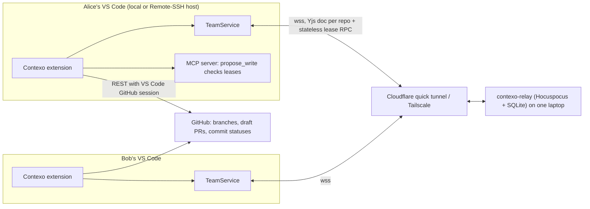

# Contexo feature plan: PRD backlog, team sync, and developer features

Date: 22 November 2026 · Branch at writing: `foldr` (`95bf1ec`)

This document plans every feature Contexo still needs. It covers three groups:

1. **PRD backlog.** Capabilities in [PRD.md](PRD.md) (the full V2 PRD, not the Lite one) that the code does not have yet.
2. **Team and remote.** The new main selling point: several people using Contexo on the same codebase do not break each other's code, and Contexo works inside VS Code Remote-SSH.
3. **Developer and quality-of-life features.** Features kept from the brainstormed list after critique.

Each feature has a one-line summary, the justification, what exists today, and a full build method: where the code goes, the data shapes, the flow, the libraries, the open-source projects to borrow from, the decisions, the risks and a "done when" check.

---

## 0. Decisions this plan rests on

These came from the planning conversation. Anything marked *(my call)* in later sections is a proposal you can override. Those calls are collected in §7.

| Question | Decision |
|---|---|
| Constraints | Lean route. The Forge-a-thon constraints (no hosted backend and so on) no longer bind. TrueForge stays the agent loop because everything already runs on it. |
| Where team state lives | A live relay for presence, leases and ghost edits. GitHub is the durable record (branches, PRs, commit statuses). |
| Relay hosting | One teammate's laptop runs the relay and shares it through a Cloudflare quick tunnel or Tailscale. No deploy. |
| Collision policy | **Lease plus queue.** The first agent to stage a change on a symbol holds the lease. Others get `LEASE_HELD`, are queued, and resume when it is released. A human can override. |
| Backstop | A pre-merge semantic re-check (syntax-aware merge plus symbol, impact and test re-runs) catches whatever leases miss. |
| What teammates see live | Presence plus ghost edits, and context packets (what the other agent is looking at). There is **no** chat mirror and **no** remote approve or stop. |
| Remote meaning | VS Code Remote-SSH: the extension, TrueForge and the tools run on the SSH host. |
| Target repos | Python backends and CLIs. Structural features stay Python-only, with no multi-language LSP work. |

### What changes from the PRD

PRD §4.2 listed *remote workspaces* and *multiple concurrent writers* as out of scope, and §4.2 also excluded *any hosted backend*. This plan reverses all three on purpose. The PRD's safety invariant still holds and now extends to teams: **no workspace write without a reviewed, version-checked hunk, and no staged change on a symbol another person is actively changing without that person's lease being released or overridden.**

### Guardrails carried over from the risk notes

- **A weak model may be chosen live.** Every new MCP tool in this plan is **deferred** (loaded on discovery), takes flat and simple inputs, and is never required for the basic loop. Lease checks, history checks and merge checks run **inside** existing tools (`propose_write`) or in the extension, so they work even if the model never calls anything new.
- **Retrieval stays deterministic.** Search plus the import graph is unchanged. No new feature makes file finding depend on model quality.
- **TrueForge features are already verified** in this repo: deferred tools, compaction and `dynamicSubAgents` are set in [manifests.ts](../extension/src/run/manifests.ts). Task A behaviour is verified in [SUBMISSION.md](verification/2026-11-22/SUBMISSION.md).

---

## 1. Feature list at a glance

Sizes: **S** is about a day or less, **M** is 2–4 days, **L** is about a week, all for one developer who knows the codebase.

| ID | Feature | Group | Size | Depends on |
|---|---|---|---|---|
| T1 | Remote-SSH support | Team/remote | M | — |
| T2 | GitHub identity | Team/remote | S | — |
| T3 | Team relay (Hocuspocus + tunnel) | Team/remote | M | T2 |
| T4 | Presence | Team/remote | S | T3 |
| T5 | Symbol leases with queue | Team/remote | L | T3, T4 |
| T6 | Ghost edits in the editor | Team/remote | M | T3, T5 |
| T7 | Live context-packet stream | Team/remote | S | T3 |
| T8 | GitHub layer: ship to PR, lease status, multi-repo Team tab | Team/remote | L | T2, T5 |
| T9 | Pre-merge semantic re-check (backstop) | Team/remote | L | T8 |
| P1 | Chesterton's Fence (`why_exists` + history guard) | PRD | M | — |
| P2 | Three-way-merge undo and Undo Run | PRD | M | — |
| P3 | Task tab: requirements and task graph | PRD | M | — |
| P4 | Wiring map in the Review tab | PRD | S | — |
| P5 | Grounded review summary | PRD | S | P4 |
| P6 | `@` mention completion in chat | PRD | S | — |
| P7 | `read_symbol` tool | PRD | S | — |
| P8 | Instruction packs (`get_instruction_pack`) | PRD | S | — |
| P9 | Explorer and editor-worker subagents | PRD | M | P7 |
| P10 | Regenerate and rebase on stale source | PRD | S | — |
| P11 | Startup Recover/Resume prompt | PRD | S | — |
| P12 | Index worker thread and PRD performance metrics | PRD | M | — |
| P13 | `review_hunk` per-hunk TrueForge approval | PRD | — | **Not building** (see entry) |
| D1 | Fragility heatmap in the gutter | Dev | M | — (stronger with T3) |
| D2 | Mutation test of the agent's own tests | Dev | M | — |
| D3 | Reviewer comprehension check | Dev | S | P1, D1 |

**Already built, so not in this plan:** the symbol check (`MISSING_SYMBOL` in [guards.ts](../extension/src/review/guards.ts), Python), the inline scope guard (red out-of-selection hunks), `get_checkpoint` (shipped as `resume_context`), the Python before/after impact graph ([impactGraph.ts](../extension/src/review/impactGraph.ts)), and Task A's exact behaviour.

### Suggested order

1. **Phase 1, team core (the selling point):** T2 → T3 → T4 → T5 → T6 → T7. This is the shortest path to a demo: two laptops, one function, the second agent told to wait.
2. **Phase 2, durability:** T8 → T9, plus T1 in parallel.
3. **Phase 3, safety:** P1 → D1 → D3 → D2.
4. **Phase 4, PRD completeness:** P2, P3, P4, P5, P6, P7, P8, P10, P11, then P9 and P12.

---

## 2. Features dropped or deferred, and why

| Feature (from the brainstorm) | Verdict | Reason |
|---|---|---|
| Shadow mode (silently predict your next edit) | **Drop** | It needs a model call on almost every edit. That is the tab-completion and fill-in-the-middle work PRD §4.2 excludes, and it is expensive. It does nothing for team sync. Its "earned autonomy" idea needs months of data a hackathon team will not have. |
| Runtime rewind (bisect program states) | **Drop** | It needs a record-and-replay tracer (rr, or a Python `sys.settrace` recorder) with heavy overhead and its own UI. It is a separate product, and it does not serve the team selling point. |
| Two-way sketch sync (diagram ↔ code) | **Drop for now** | Bidirectional diagram-to-refactor is a research-grade feature. The existing context graph plus the P4 wiring map already give the "see the structure" value. |
| Point-and-fix on the running app | **Drop** | It needs a live web UI and DOM-to-source mapping (as in LocatorJS or click-to-component). The targets are Python backends and CLIs, which have no UI to point at. |
| Auto-recorded proof video | **Drop** | The same reason: it needs a browsable flow. For CLIs the existing evidence (approved command output bound to the candidate hash) is the proof, and it is more precise than a video. |
| Overnight shift (alert → PR) | **Drop for now** | It needs an unattended runner, auto-approved commands and an error-feed receiver. T8's ship-to-PR is the reusable half if this is revisited later. |
| Multi-language symbol check through LSP | **Defer** | The targets are Python only, and the Python symbol check already exists. |
| Multiplayer chat mirror and remote approve/stop | **Not chosen** | You chose presence, ghosts and context packets only. This also avoids the permission model that remote approve would need. |

---

## 3. Team and remote features (T1–T9)

### Shared architecture



**New code locations** (paths relative to `extension/`):

```text
src/team/
  teamService.ts      connection lifecycle, room per repo, offline mode
  identity.ts         GitHub session, login, avatar (T2)
  repoId.ts           origin URL -> "gh:owner/repo" normalisation
  presence.ts         awareness state publish/subscribe (T4)
  leases.ts           lease keys from hunks, acquire/release/queue client (T5)
  ghosts.ts           ghost hunk publishing + editor decorations (T6)
  packetStream.ts     context packet references (T7)
  github.ts           branch/commit/push/draft PR/commit status (T8)
  mergeCheck.ts       temp worktree + mergiraf + semantic re-check (T9)
relay/                separate tiny package: `npx contexo-relay`
  server.mjs          Hocuspocus server, auth, lease authority
  leases.mjs          pure lease state machine (unit-tested)
webview/src/TeamTab.tsx   multi-repo team view
```

One Yjs document per repository ("room"), named `gh:<owner>/<repo>`, with these top-level types:

| Yjs type | Key | Written by | Content |
|---|---|---|---|
| Awareness (not persisted) | client ID | each client | `{login, avatar, machine, runId?, state, files[], symbols[], editing?}` |
| `Y.Map leases` | lease key | **server only** | lease records (T5) |
| `Y.Map ghosts` | runId | owning client | in-flight hunks (T6) |
| `Y.Map packets` | runId | owning client | latest context packet references (T7) |
| `Y.Map pending` | symbol key | server | "changed by X, not yet in main (PR #n)" markers (T5/T8) |
| `Y.Array events` | — | server | capped log of 200 entries: lease granted, released, overridden, merged |

---

### T1. Remote-SSH support

**What it is:** Contexo works when VS Code is connected to a machine over Remote-SSH. Indexing, TrueForge, MCP tools, commands and review all run on the SSH host, and the UI stays local.

**Why it helps:** Team code often lives on a dev box or GPU server, not the laptop. Today the [README](../README.md#readiness-and-remaining-implementation) and [REMAINING_WORK_PLAN.md](REMAINING_WORK_PLAN.md) list SSH and Codespaces as unverified, so remote users have no guarantee anything works.

**What exists today:**
- `extensionKind: ["workspace"]` in `package.json`, so the extension already runs on the remote host.
- `hasNativeFiles()` in [workspaceRoot.ts](../extension/src/shell/workspaceRoot.ts) accepts `vscode-remote`.
- ripgrep resolves VS Code's bundled binary from `appRoot`.
- The webview talks to the host through `postMessage`, which VS Code proxies across the remote boundary.

**Method:**

1. **Build a lab.** The leanest real SSH target is a WSL distro running `sshd` (`ssh localhost -p 2222`) or any cheap VM. A WSL window via *Remote-WSL* is a different transport, so use real SSH. Install Node ≥ 22.14, Python 3.10+, git and the Flask checkout on the host.
2. **Run the existing Flask A/B/C runbook** ([DEMO_SCRIPT.md](DEMO_SCRIPT.md)) unchanged in a Remote-SSH window and record each failure. Known suspects, in order:
   - **TrueForge auto-start** (`src/run/trueforgeProcess.ts`): it runs `npx` on the remote. Add a doctor check for `node --version` ≥ 22.14 on the *host where the extension runs*, and show "Node 22.14+ is required on the SSH host" rather than a timeout.
   - **Loopback addresses.** `contexo.trueforgeUrl = http://localhost:8790` and MCP `127.0.0.1:8791` now mean the *remote* host, which is correct because both run there. Document it. Never pass these URLs to the webview.
   - **Any URL the webview opens** (the standalone local review server on `18792`, any "Open in TrueForge" link): route through `vscode.env.asExternalUri(uri)` so VS Code forwards the port. Add a grep test that bans raw `http://127.0.0.1` / `localhost` strings in `webview/src`.
   - **ripgrep path:** on a remote host `vscode.env.appRoot` points at the VS Code server install. Confirm `resolveRgPath()` finds `node_modules/@vscode/ripgrep/bin/rg` there. If not, fall back to `rg` on PATH with a doctor message.
   - **Tree-sitter WASM:** loaded from the extension's install directory on the remote. Confirm with a reindex.
   - **SecretStorage and authentication:** both are proxied to the local UI by VS Code. No change expected.
   - **Run journal and storage:** `context.storageUri` is on the remote. Correct.
3. **Relay from a remote host (T3):** the relay client runs on the SSH host, so the relay URL must be reachable *from that host*. A trycloudflare URL is public, so it works. With Tailscale the SSH host must join the tailnet. The Team tab shows "relay unreachable from <remoteName>" using `vscode.env.remoteName`.
4. **Add a "Remote" section** to the Settings tab health checks: host name, Node version, TrueForge reachability from the host, rg path, and relay reachability.

**Tech:** VS Code remote APIs only. See [Supporting Remote Development](https://code.visualstudio.com/api/advanced-topics/remote-extensions), the doc for `asExternalUri` and `extensionKind`.

**Risks:**
- Some users run TrueForge on their laptop, not the remote. Then `localhost` from the remote is wrong, and the doctor message must say "TrueForge must run on the SSH host or be given a reachable URL".
- Claude Code's own VS Code webview has a reported Remote-SSH failure ([anthropics/claude-code#37919](https://github.com/anthropics/claude-code/issues/37919)). Test the Contexo webview early.

**Done when:** Flask A, B and C pass in a Remote-SSH window with the same evidence files as local, and the Settings tab shows all remote checks green.

---

### T2. GitHub identity

**What it is:** Contexo knows who you are (your GitHub login and avatar) through VS Code's built-in GitHub sign-in.

**Why it helps:** Leases, ghosts and presence need a stable, trusted name ("alice's agent is editing `flask.cli.run_command`"). GitHub is where the team already exists, and the same token powers T8. There is no Contexo account system to build.

**Method:**
- `src/team/identity.ts`: `vscode.authentication.getSession('github', ['repo'], { createIfNone: true })` when the user first joins a team room. This uses VS Code's own GitHub auth provider, which also works under Remote-SSH (proxied to the UI side).
- Read `/user` once and cache `{login, id, avatar_url}` in memory. Never store the token. VS Code owns it.
- `src/team/repoId.ts`: parse `git remote get-url origin` (SSH and HTTPS forms, with or without `.git`) into `gh:owner/repo`. If there is no GitHub remote, the room key is `local:<sha256(first root commit)>`, so a team can still use the relay without GitHub (T8 disabled).

**Decision (my call):** request only the `repo` scope. It covers branch push, PR creation, commit statuses and reading collaborator permission.

**Done when:** the Team tab shows your avatar and login, and the room key for the Flask clone is `gh:pallets/flask` (or your fork).

---

### T3. Team relay (Hocuspocus + tunnel)

**What it is:** A tiny realtime server, started by one teammate with `npx contexo-relay`, that every teammate's Contexo connects to.

**Why it helps:** Leases and ghost edits must arrive in under a second. Polling GitHub takes seconds to minutes. Per your answer, the laptop-plus-tunnel route has zero cost and zero deploy.

**Prior art to borrow:**
- [Hocuspocus](https://github.com/ueberdosis/hocuspocus) (MIT, by Tiptap). A Yjs WebSocket server with `onAuthenticate`, `onStateless`, `onDisconnect` hooks and an SQLite persistence extension (`@hocuspocus/extension-sqlite`). It does what plain [y-websocket](https://github.com/yjs/y-websocket) does, plus the auth and server-side hooks the lease authority needs.
- [Eclipse Open Collaboration Tools](https://github.com/eclipse-oct/open-collaboration-tools) (EPL/MIT). A VS Code extension plus a Node relay built on Yjs. Read its VS Code client for connection UX, its room-join flow and how it maps document positions across peers. Do not adopt it wholesale: it shares *editor buffers* (Live Share style), and Contexo shares *agent intent*.

**Method:**
1. **Package.** `relay/` is a separate small npm package with a `bin` entry, so it runs as `npx contexo-relay --port 1234`. Dependencies: `@hocuspocus/server`, `@hocuspocus/extension-sqlite`, `yjs`. Pin exact versions when adopting, and verify the major version's hook names against its docs.
2. **Auth (`onAuthenticate`).** The client sends its GitHub token as the connection token. The server calls `GET https://api.github.com/repos/{owner}/{repo}` with that token and requires `permissions.push === true` for room `gh:owner/repo`. It caches the result for 10 minutes per token hash. For `local:` rooms the server requires a shared room secret printed at start-up. The token is never stored or logged.
3. **Persistence.** The SQLite extension writes room documents to `./contexo-relay.sqlite` on the host laptop. Awareness is never persisted.
4. **Lease authority (`onStateless`).** See T5. The server is the **only** writer of `leases`, `pending` and `events`.
5. **Exposure.** The CLI prints two copy-paste options:
   - `cloudflared tunnel --url http://localhost:1234` → `wss://<random>.trycloudflare.com`. No account is needed. Cloudflare documents full WebSocket support for tunnels. Quick tunnels have no uptime guarantee, a 200 in-flight request cap and a new hostname each run ([Quick Tunnels](https://developers.cloudflare.com/cloudflare-one/networks/connectors/cloudflare-tunnel/do-more-with-tunnels/trycloudflare/)). **Verify WebSockets on a quick tunnel in the first hour.**
   - `tailscale serve` for teams already on a tailnet. This is stable and private.
6. **Client** (`src/team/teamService.ts`): `@hocuspocus/provider` with the `ws` package as `WebSocketPolyfill` (the extension host is Node, not a browser). One provider per joined room. Settings: `contexo.team.relayUrl`, `contexo.team.enabled`.
7. **Offline mode.** If the relay is unreachable, `TeamService.status = 'offline'`. Leases cannot be checked, so `propose_write` proceeds with a visible amber warning ("Team relay offline: lease not checked"). The proposal is tagged `leaseUnverified`, and T9 becomes mandatory before ship. *(my call: blocking all agent work whenever the laptop sleeps would make the feature unusable.)*

**Risks:**
- The host laptop sleeping takes the relay down. Offline mode and T8's GitHub mirror cover it.
- The trycloudflare hostname changes each run, so teammates must paste a new URL. A stable alternative is Tailscale or a free named tunnel later.
- Ghost hunks contain source code and travel through Cloudflare (encrypted in transit). State this in the Team tab. Teams that object use Tailscale.

**Done when:** two machines join `gh:owner/repo` through a quick tunnel, see each other, an unauthorised GitHub user is rejected, and restarting the relay keeps leases.

---

### T4. Presence

**What it is:** The Team tab and status bar show who is online in this repo, whether their agent is running, and which files and symbols it is touching. Files touched by others get a small marker in the Explorer.

**Why it helps:** Knowing someone is in `cli.py` before you start is the cheapest collision avoidance. It costs nothing to compute because Contexo already knows the run state and staged files.

**Method:**
- `src/team/presence.ts` publishes Yjs awareness state on change, debounced to 250 ms: `{login, avatar, machine: os.hostname() + remoteName, runId, runState, files: string[], symbols: string[], editing?: {path, symbol}}`.
- **Sources:** `RunManager` `'state'` events supply `runState`. Files and symbols come from the active proposal and the last packet's anchors. `editing` comes from `onDidChangeTextDocument` on the active editor, mapped to the enclosing Python symbol through the index (this feeds human soft leases in T5).
- **UI:** a status bar item shows `Contexo team: 3 online · 1 agent near you`. Explorer decorations use `window.registerFileDecorationProvider` to put a coloured badge on files in others' `files[]`, with a tooltip like "bob's agent (staging)". The Team tab lists members per room.

**Done when:** Bob's Explorer badges `src/flask/cli.py` within 1 s of Alice's agent staging it.

---

### T5. Symbol leases with queue (the core)

**What it is:** Before Contexo stages a change, it takes a lease on every symbol the change touches. If a teammate's agent (or the teammate typing) already holds one, the proposal is refused with `LEASE_HELD`, queued, and resumed when the lease frees.

**Why it helps:** This is the selling point. Branches and worktrees isolate *files* but surface conflicts only at merge time, which the multi-agent worktree tools themselves admit. Their own write-ups say conflicts "typically go undetected until patches merge". A lease prevents the clash before either side wastes review time. Enforcement sits inside `propose_write`, code Contexo owns, so even a weak model cannot skip it. Advisory systems like mcp_agent_mail rely on the agent choosing to call a reserve tool.

**Prior art:** [mcp_agent_mail](https://github.com/Dicklesworthstone/mcp_agent_mail) file reservations. Borrow its semantics: exclusive versus shared reservations, TTL plus renew, `force_release` for stale holders, and an audit trail. Do not run it: it is file-level, advisory and a separate Python server.

**Lease key and scope** (`src/team/leases.ts`):

| Changed thing | Lease key |
|---|---|
| Lines inside an existing Python def or class | `sym:<qualifiedName>` of the **innermost** enclosing symbol, from the existing index (e.g. `sym:flask.cli.FlaskGroup.get_command`) |
| A new Python symbol | `sym:<qualifiedName to be created>`, so two agents cannot add `config_command` twice |
| Module-level Python lines (imports, constants) | `mod:<path>#toplevel` |
| A docs section (`.rst`/`.md`) | `doc:<path>#<heading slug>` from the docs indexer |
| Anything else | `file:<path>` |

**Dependency awareness (non-blocking):** if a hunk changes a `def` signature line or deletes a symbol, the client computes the callers from the index's `calls`/`references` edges (one hop) and sends them as `dependents`. The server attaches a warning to any current or future lease on those callers: "alice is changing the signature of `X`, which you call."

**Lease record** (server-owned `Y.Map leases`):

```ts
interface Lease {
  key: string;                       // sym:flask.cli.run_command
  holder: { login: string; runId?: string; clientId: number };
  kind: 'agent' | 'human';
  state: 'staged' | 'reviewing';     // agent leases
  acquiredAt: number; heartbeatAt: number; ttlMs: number;
  baseCommit: string;                // holder's HEAD when acquired
  proposalId?: string;
  queue: Array<{ login: string; runId: string; clientId: number; queuedAt: number }>;
  dependentsWarn?: string[];
}
```

**Why the server must be the only writer:** a Yjs `Y.Map` is a CRDT. If two clients write the same key at the same moment, both writes "succeed" locally and one silently wins after merge. That makes it unusable as a lock. So clients send `{type:'lease.acquire', reqId, keys[], runId, proposalId, baseCommit, dependents}` as a Hocuspocus **stateless** message. The server's `onStateless` handler runs in one Node process, applies a pure state machine (`relay/leases.mjs`) per room in arrival order, writes the result into `leases`, and replies with a stateless `{reqId, granted | held}`.

**Rules of the state machine** (unit-tested in isolation):
1. **All-or-nothing:** a proposal's keys are sorted and granted together or not at all. Nothing is held partially, so there are no deadlocks.
2. **Re-entrant:** the same `runId` re-acquiring its own keys succeeds (retries, re-proposals).
3. **Held:** if any key is held by another holder, the reply is `held` with holder login, key, state and queue position. The requester is appended to that key's queue (FIFO, deduplicated by runId).
4. **Human leases:** `kind:'human'`, TTL 2 min since the last keystroke in that symbol. They block other people's **agents**. They never block a human: typing cannot be blocked, so that case shows a warning decoration only.
5. **Agent leases:** TTL 10 min, renewed by a heartbeat every 30 s while the run is alive. On `onDisconnect` the lease is marked orphaned and expires at TTL. Expired leases are released.
6. **Release:** on apply complete, reject-all, Stop, run end, or `force` (any authenticated collaborator, after a confirmation dialog, logged to `events` with who and why).
7. **On release with a queue:** the server writes a 2-minute `grantOffer` for the queue head and broadcasts `lease.free`.

**Lease lifetime (my call):** a lease lasts from **staging until apply, reject or stop**, not until merge. You chose lease plus queue over "lock until PR merges" to avoid blocking people for hours. After apply, the server writes a **pending marker** (`Y.Map pending`): "`flask.cli.run_command` changed by alice, not yet in main (PR #n once shipped)". The marker does not block. It is injected into anyone's later context (see the handoff below), and T9 checks the actual merge.

**Flow inside `propose_write`** ([tools.ts](../extension/src/mcp/tools.ts) handler, before `ReviewEngine.beginProposal`):

```text
hunks = buildHunks(...)                 // existing
keys  = leaseKeys(hunks, index)         // new
res   = await team.acquire(keys, runId, proposalId)   // ~1 RTT; timeout 3 s -> offline mode
if res.held:
   journal 'lease.held'; park the proposal (store proposal blob + keys)
   return tool error:
     LEASE_HELD sym:flask.cli.run_command by alice (agent, reviewing). You are #1 in queue.
     Do not retry. Work on parts that do not touch these symbols, or end your turn.
     Contexo will resume you when the lease is free.
else: continue to review as today; ghosts publish (T6)
```

**Resume (queue head):** the `lease.free` grant offer shows a chat banner, "Lease on `run_command` is free (alice applied her change). Resume?", plus a status bar flash. On click, Contexo re-acquires the lease and starts a continuation turn, reusing the existing continuation path ([continuation.ts](../extension/src/run/continuation.ts)). The turn carries a **handoff note**: alice's applied hunks for those symbols (taken from her ghost entry, T6) and the instruction "this change is not in your branch yet. Keep your edit compatible; re-read the file before proposing." The parked proposal is discarded because it was built on assumptions that may now be wrong. *(my call: simpler and safer than trying to revalidate a parked patch.)*

**Agent instructions:** add four lines to [instructions.md](../extension/trueforge/instructions.md) on how to treat `LEASE_HELD` (do not retry, do not touch those symbols, end the turn if blocked). Weak-model safety: the extension refuses repeats anyway, because re-acquire of a held key returns `held` again without the agent doing anything harmful.

**Human override:** the `LEASE_HELD` card in chat has **Override** (force-release with reason) and **Message alice**. "Message" just copies `@alice` text. There is no chat system to build.

**Tests:** pure state-machine unit tests (concurrent acquires, all-or-nothing, TTL expiry, re-entrancy, queue order, force). An integration test runs two `HocuspocusProvider` clients against an in-process server and fires simultaneous acquires 100 times, asserting exactly one grant each round.

**Done when:** on two machines with the same Flask clone, Alice inline-edits `get_debug_flag`, and Bob's agent, asked to change the same function, gets `LEASE_HELD` and stops. When Alice applies, Bob sees **Resume**, and Bob's resumed turn receives Alice's diff in its handoff note.

---

### T6. Ghost edits in the editor

**What it is:** When a teammate's agent stages a change, you see faded highlights on the affected lines in your own editor. Hovering shows their proposed diff and who owns it.

**Why it helps:** You see the in-flight change *before* it lands, so you do not start the same fix or build on code about to change. It is the "Figma cursors for agents" idea from the brainstorm, and it is the most visible part of the team demo.

**Method:**
- **Publish** (`src/team/ghosts.ts`): on proposal creation, update and decision, write `ghosts[runId] = {login, state: 'staged'|'reviewing'|'applied', baseCommit, files: {path: {symbols: string[], hunks: [{oldStart, oldLines, newText, symbol?}]}}, updatedAt}`. Delete it on reject-all or Stop. Mark it `applied` (kept 30 min, then removed) on apply. This source feeds the T5 handoff.
- **Render:** a VS Code text editor cannot show multi-line inline ghost text from an extension; decorations support only single-line `before`/`after` text. So:
  - Use a `TextEditorDecorationType` with a faint background (`editor.wordHighlightBackground`-style theme colour), plus an `after` text on the first line: `  ⟡ alice's agent · +4 −1 · reviewing`.
  - Use a `HoverProvider` on those ranges that returns a `MarkdownString` with a fenced `diff` block of the hunk, plus links **Open full diff** (a virtual document using the existing `diffView` provider) and **Message**.
  - Use the overview ruler colour so ghosts show in the scrollbar.
- **Anchoring across different working copies:** teammates' files may differ (other branches, unpulled commits). Re-resolve each hunk by `symbol` through *your* local index and highlight that symbol's current range. If there is no symbol (module-level), use line numbers and mark the ghost "approximate". If the symbol does not exist locally, list it in the Team tab only.
- **Throttle:** at most one decoration refresh per editor per 300 ms.

**Done when:** Bob sees Alice's staged hunk on `get_debug_flag` in his editor with a hover diff, within 1 s, on a clone at a different commit.

---

### T7. Live context-packet stream

**What it is:** In the Team tab you can open "What alice's agent is looking at": the files, ranges and reasons in its latest context packet, opened against your own copy.

**Why it helps:** You chose this so teammates understand what the other agent knows, for example "it never saw `config.py`". It is cheap because the Context tab already has this data.

**Method:**
- **Publish** (`src/team/packetStream.ts`): after each `assemble_context`, write `packets[runId] = {login, goal (first 200 chars), createdAt, budget: {used, limit}, excerpts: [{path, startLine, endLine, category, reasons[]}], omitted: [{path, reason}]}`.
- **References only, no source text** *(my call)*. Teammates have the same repo, so text would be redundant, much bigger, and a privacy leak through the tunnel.
- **View:** the Team tab renders it with the existing `ContextTab` list components in read-only mode. Clicking a row opens *your* file at that range. If your file hash differs, show "your copy differs from theirs".

**Done when:** Bob opens Alice's packet for Task B and sees `cli.py`, `test_cli.py` and `cli.rst` with reasons.

---

### T8. GitHub layer: ship to PR, lease status, multi-repo Team tab

**What it is:** One click turns your applied, reviewed hunks into a branch and a draft PR with the run's evidence. The PR carries a Contexo status showing overlapping leases. The Team tab lists every repo you collaborate on, with its people, active runs, leases and open Contexo PRs.

**Why it helps:**
- GitHub is the durable record that survives the relay laptop sleeping.
- Reviewers who do not use Contexo still see what the agent did and what it overlapped with.
- "Multi-people, multi-code management" means one place to see the whole team's agent work across repositories.

**Method:**
1. **Ship** (`src/team/github.ts`, a button in the Changes tab after Apply):
   - Branch `contexo/<login>/<slug(goal)>-<runId[0:6]>` from the current HEAD.
   - `git add` **only** the paths of applied hunks from this run. Do not touch other dirty files. Fail clearly if one of those paths also has unrelated user edits: show them and ask.
   - Commit with the message `<goal first line>`. The body lists requirements and checks. No Claude or Anthropic attribution.
   - `git push -u origin <branch>`, then `POST /repos/{o}/{r}/pulls` with `{draft: true, head, base: <default branch>}`.
   - Use the git CLI through the existing `execFile` helpers, or VS Code's built-in `vscode.git` extension API.
   - **PR body:** generated from the journal. It includes the goal, requirements (P3), files, approved command outputs with exit codes, Chesterton acknowledgements (P1), mutation score (D2) and the lease history for these symbols.
2. **Lease status on the PR:** `POST /repos/{o}/{r}/statuses/{sha}` with context `contexo/team`. The state is `success` when no other active lease or pending marker overlaps this PR's symbols. Otherwise it is `pending`, with a description such as "overlaps bob's in-flight change to run_command".
   - **Why commit statuses, not check runs:** GitHub only lets **GitHub Apps** create check runs. An OAuth token, which is what VS Code gives us, cannot. Statuses work with the `repo` scope and need no app installation. (Contexo already *reads* check runs as evidence; that stays.)
3. **Pending markers to PR:** after ship, the relay's `pending[key]` gets `prNumber`, so teammates' handoff notes and ghosts say "in PR #123".
4. **Merge detection:** each client polls **its own** open Contexo PRs every 2 minutes with conditional requests (`If-None-Match`, so unchanged responses cost no rate limit). When a teammate's client is offline, any online client polls the room's PR list with backoff. On merge, the client sends `pr.merged {number, files, symbols}` to the relay. The server clears matching pending markers and broadcasts it, and every client with in-flight work on overlapping files runs T9.
5. **Team tab (multi-repo):** rooms the user joined are stored in `globalState`. Each repo card shows online members (T4), active runs, the leases table (key, holder, state, age, queue, **Override**), pending markers with PR links and status, and a recent-events log. A **Join repo** button takes a relay URL and the current workspace's repo. Several workspaces (several codebases) can be joined at once, and the tab aggregates them.

**Risks:** pushing from Remote-SSH needs git credentials on the remote host. VS Code's git credential helper usually forwards them. Verify this in T1.

**Done when:** Alice ships Task A and a draft PR appears with an evidence body and a `contexo/team` status. Bob's Team tab shows the PR under the Flask repo card. Merging it triggers T9 on Bob's in-flight change.

---

### T9. Pre-merge semantic re-check (backstop)

**What it is:** Before you ship, and whenever a teammate's change merges, Contexo merges your changes with the latest main in a throwaway worktree. It then re-runs the symbol check, the impact diff and the tests, and tells you whether the *combination* breaks.

**Why it helps:** Leases cover concurrent edits to the same symbol. They do not cover *semantic* conflicts between different symbols, for example Bob renames `get_env` while Alice's new code calls `get_env`. Git merges both cleanly and the code breaks. The worktree-per-agent tools leave this to the human at merge time. This check catches it automatically, using guards Contexo already has.

**Prior art:**
- [Mergiraf](https://mergiraf.org) (GPL-3.0, Rust binary), a syntax-aware git merge driver built on Tree-sitter. It resolves many conflicts line-based git cannot, such as two edits in the same function at different statements. It is used as an *external binary*, so its licence does not affect Contexo's code. **Verify Python is in its supported-language list** (expected via `tree-sitter-python`).
- The claude-squad / vibe-kanban worktree pattern for isolation.

**Method** (`src/team/mergeCheck.ts`):
1. `git fetch origin <default>`.
2. `git worktree add --detach <storage>/merge-check/<id> origin/<default>`. The worktree lives under `context.storageUri`, never inside the repo.
3. Bring in your change:
   - If shipped: `git merge --no-commit --no-ff <yourBranch>`.
   - If applied but unshipped: `git diff HEAD -- <run paths>`, then `git apply --3way`.
   - If Mergiraf is on PATH, run with a per-command config so it is not installed globally: `-c merge.mergiraf.name=mergiraf -c merge.mergiraf.driver="mergiraf merge --git %O %A %B -s %S -x %X -y %Y -p %P -l %L" -c core.attributesFile=<tmp .gitattributes with "*.py merge=mergiraf">`. Check the exact driver line against Mergiraf's docs at adoption.
4. **Textual result:** a clean merge, or conflict files shown with an **Open conflict** button.
5. **Semantic checks** on the merged tree, reusing current code:
   - `symbolCheck()` ([guards.ts](../extension/src/review/guards.ts)) on your changed files. This catches calls to functions the teammate removed or renamed.
   - **Signature drift:** for every function your added lines call, compare its parameters in your base against the merged tree, using the index on the temp worktree (an `Indexer` instance pointed at that directory). Report results like "`X(a, b)` is now `X(a, b, *, strict)`; your call at `cli.py:120` passes positionally."
   - `compareProposalImpact()` between your-only and merged for your changed symbols, listing changed call edges.
   - **Tests:** the test files linked by `tests` edges to your changed symbols, plus tests you changed. Run them through the existing approved `run_command` path with cwd set to the temp worktree. Approval is still required.
6. **Report:** a "Merge check" card in the Changes tab (green, amber or red with reasons). The same summary goes to the PR as the `contexo/team` status (T8).
7. **Clean up** with `git worktree remove --force` and prune in a `finally` block. Remove leftovers on activation.

**Done when:** a scripted case in which Bob's merged PR renames a helper that Alice's unshipped change calls produces a red merge check naming the call site, while plain `git merge` reports no conflict.

---

## 4. PRD backlog features (P1–P13)

### P1. Chesterton's Fence: `why_exists` and the history guard

**What it is:** Before the agent deletes or rewrites existing code, Contexo looks up why that code exists (git blame, the commit message, linked issues and PRs). If the history shows a reason, for example "fix race in #412", the agent is told to account for it, and the reviewer sees that history inline before accepting.

**Why it helps:** Agents remove "weird" or "dead" code that is load-bearing (workarounds, security checks, compatibility shims), and the reviewer usually has no time to run blame on every deleted line. PRD §11.5 specified exactly this guard (`HISTORY_CONCERN`, `why_exists`), and it is not built. In a team setting it matters more, because the code you are deleting was often written by a teammate.

**Prior art:**
- [semblame](https://github.com/vasilisp/semblame) (blame plus an LLM to explain the why).
- [git-why](https://pypi.org/project/git-why/), which plans to extract issue and PR links from commit messages.
- [gitlog-mcp](https://pypi.org/project/gitlog-mcp/), which offers an `analyze_commit` MCP tool.

Contexo's version needs no model call for detection: it is deterministic, which suits weak models.

**Method:**
1. **`src/history/historyGuard.ts`:**
   - **Trigger per hunk:** the hunk deletes or rewrites ≥ 3 existing lines, **or** any removed line is a guard construct (`if`/`try`/`except`/`raise`/`assert`/`with lock`) or contains a comment with `TODO`, `NOTE`, `HACK`, `XXX`, "do not", "don't remove" or "workaround".
   - **Blame:** `git blame --porcelain -w -M -C -L <start>,<end> HEAD -- <path>` on the removed base-side range, grouped by commit. Cache by `(path, HEAD sha)`. Lines not in HEAD (uncommitted) are reported as "no history yet".
   - **Commit details:** `git show -s --format=%H%x00%an%x00%aI%x00%s%x00%b <sha>` for each commit.
   - **Concern detection:** scan the subject and body for `fix|bug|regression|race|deadlock|security|CVE-|vuln|workaround|compat|revert|hotfix|leak|crash|edge case`. Extract issue refs (`#123`, `GH-123`, `fixes|closes|resolves #123`) and the PR number from a squash subject `(#1234)` or a merge commit.
   - **Optional GitHub enrichment:** if T2 is signed in, `GET /repos/{o}/{r}/pulls/{n}` and `/issues/{n}` fetch the title and the first 500 characters of the body. Reuse the HTTP guard in [integrations.ts](../extension/src/review/integrations.ts). Cache per repo and number.
   - **Related tests:** tests linked by `tests` edges to the enclosing symbol, from the index.
2. **In `propose_write`:** if any hunk has a concern **and** the call did not include `acknowledgedHistory: [{commit, reason}]` for that commit, return `HISTORY_CONCERN <path:lines> commit <sha7> "<subject>" (#412). Explain how your change preserves this, then re-propose with acknowledgedHistory.` This happens **once** per (proposal target, commit). If the agent re-proposes without acknowledging, stage anyway with a `history-concern` flag, so a weak model cannot loop forever.
3. **`why_exists` (deferred MCP tool):** input `{path, startLine, endLine}`. Output `{commits: [{sha, author, date, subject, bodyExcerpt, lines}], issues: [{ref, title?}], tests: [path], concern: string | null}`, capped at 4,000 characters.
4. **Review UI:**
   - A hunk with `history-concern` gets a CodeLens line `⚠ Why does this exist?` that opens a peek of the commits and issue links.
   - The hunk's Accept requires one extra click, "I've read why this exists".
   - The agent's acknowledgement text is shown beside it. The acknowledgement is recorded in the journal and the PR body (T8).
5. **Team tie-in:** if the blamed author is a current room member (T4), show "written by bob (online)".

**Risks:**
- Noise on refactors (big rewrites trigger the guard constantly). Mitigations: the ≥ 3-line threshold, `-w -M -C` to ignore whitespace and moves, and only scanning keyword-matching commits.
- Repos with shallow clones have no blame history. Detect `git rev-parse --is-shallow-repository` and say so.

**Done when:** on Flask, a scripted proposal deleting a guarded branch whose blame commit mentions a fix returns `HISTORY_CONCERN` once. The acknowledged re-proposal shows the history peek, and Accept needs the extra click.

---

### P2. Three-way-merge undo and Undo Run

**What it is:** Undoing an applied hunk still works after you or a teammate edited nearby lines. Contexo shows a merge preview instead of refusing or overwriting. **Undo Run** reverts all of a run's hunks in reverse order.

**Why it helps:** PRD §5.6 promised this, and the undo-correctness metric in PRD §3.3 ("reverses only the run's hunks; unrelated user edits preserved") depends on it. Today [applyUndo.ts](../extension/src/review/applyUndo.ts) has no conflict path. In teams, files move under you more often, so plain undo fails more often.

**Method:**
- Add [`node-diff3`](https://github.com/bhousel/node-diff3) (MIT), the PRD's named choice, and create `src/review/threeWayUndo.ts`.
- **Undo hunk:** if the current text at the hunk equals its after-text, apply the inverse directly (today's path). Otherwise run `diff3Merge(current, base = hunkAfterState, theirs = hunkBeforeState)`.
  - A clean result becomes a *new proposal*, reviewed through the normal engine with all guards. Nothing is written silently.
  - Conflicts open a diff of `current ↔ merged-with-markers`, with conflict CodeLens (keep mine, take undo, edit).
- **Undo Run:** collect the run's applied changes from the journal, newest first, and fold them into one merge proposal per file. List dependent hunks with a warning, for example a later hunk that edits lines an earlier one added.
- Wire the existing `undoRun` button in [ChangesTab.tsx](../extension/webview/src/ChangesTab.tsx) to this.

**Done when:** after applying Task A and then editing an adjacent line by hand, Undo hunk produces a clean merge proposal that keeps the hand edit. An overlapping hand edit produces a conflict preview.

---

### P3. Task tab: requirements and task graph

**What it is:** A Task tab that splits the request into numbered requirements (R1 the command exists, R2 JSON output, R3 masking…). Each requirement is linked to the hunks and checks that satisfy it, and progresses through Located → Proposed → Checked → Accepted → Applied.

**Why it helps:** A reviewer can tell whether *every* part of the request was done, not just whether the diff looks fine. PRD §5.3 specifies it. Requirement records and evidence linking already exist ([evidence.ts](../extension/src/review/evidence.ts), [workbench.ts](../extension/src/review/workbench.ts)), but only the standalone `local-review` app shows them.

**Method:**
- **Requirements source:** the agent records them through `batch_plan` (already present) or a new optional `requirements` field on `propose_write`. In addition, a deterministic splitter cuts the user request at sentence and clause boundaries ("…, masking…", "It must…", "be covered by a test", "documented…") as a default the user can edit. The agent's list wins when present.
- **New `webview/src/TaskTab.tsx`:** a requirements list with an editable text and revision (data model already in `evidence.ts`), plus a graph (requirement → file → symbol → hunk → check) using the existing [ContextGraph.tsx](../extension/webview/src/ContextGraph.tsx) renderer. Status badges are computed from journal events.
- **Link editing:** the user can link or unlink a hunk to a requirement, recording whether the link came from the human or the agent (contract already in REMAINING_WORK_PLAN §4).
- **Port** the display logic from `local-review/app.js` rather than rewriting it.

**Done when:** Task B shows five requirements (the splitter output pinned in the implementation plan), each linked to at least one hunk or check, with correct states after apply.

---

### P4. Wiring map in the Review tab

**What it is:** In the review, a before/after graph of what the change rewires (for example "new edge: `FlaskGroup` registers `config_command`"). Clicking an edge opens the hunk that creates it.

**Why it helps:** Reviewers understand structural impact in seconds instead of reading every line. PRD §5.3 step 8 specifies it. The computation exists (`compareProposalImpact` in [impactGraph.ts](../extension/src/review/impactGraph.ts)), but the Changes tab does not show it.

**Method:**
- Post a `review.wiring` message with `{added, removed}` edges (already computed) to the webview.
- Render added edges green and removed edges red with the `ContextGraph` component in a "wiring" mode, laid out with Dagre and keeping existing node positions stable (PRD requirement).
- Edge click sends `hunk.open` with the hunk whose lines contain the edge's proof span.

**Done when:** Task B's review shows the new registration edge, and clicking it opens `cli.py` at the registering hunk.

---

### P5. Grounded review summary

**What it is:** A 2–4 line summary at the top of each review ("Adds `flask config` command; masks 4 key patterns; 1 new test; docs updated; tests 60/60 passed"). Every claim links to a hunk or a check.

**Why it helps:** Reviewers skim first. PRD §11.5 specifies `summary.ts`. Because every line is derived from recorded facts, the summary cannot claim something that did not happen, unlike a free-form model summary.

**Method:**
- `src/review/summary.ts` derives facts deterministically: files and categories, added and removed symbols (index diff), new imports (scan added lines), wiring edges (P4), check results with exit codes, and flags (scope, history, lease).
- It renders them from templates. There is **no model call** *(my call)*: the PRD's optional phrasing pass through a TrueForge turn adds latency and a failure mode for little gain.
- Each fact carries hunk or check IDs, which become links.

**Done when:** Task B's summary lists exactly the facts in the journal, and every phrase links to its source.

---

### P6. `@` mention completion in chat

**What it is:** Typing `@` in the chat box opens a list of files (fuzzy path) and symbols (qualified name, kind, file). The picks become chips that are sent as mandatory context anchors.

**Why it helps:** Explicit anchors are the most reliable way to steer a weak model. The assembler already supports `@file`/`@symbol` text, but there is no picker, so users must type exact names. PRD §5.8 specifies it.

**Method:**
- `ChatTab.tsx` gets an inline completion popover. The webview sends `mentions.query {text}`. The host answers from the index (symbols) and `workspace.findFiles` (paths, cached), returning 20 items.
- Chips serialise to the existing mention syntax, so the assembler is unchanged.
- Ambiguous symbols show the file in the item.

**Done when:** typing `@get_deb` offers `flask.helpers.get_debug_flag`, and sending it puts that symbol first in the packet.

---

### P7. `read_symbol` tool

**What it is:** An MCP tool that returns one symbol's exact source by qualified name, with its hash and line range.

**Why it helps:** It is simpler for weak models than `read_file` with line numbers. "Read `flask.cli.FlaskGroup.get_command`" is one flat argument. PRD §9.2 lists it.

**Method:**
- In [tools.ts](../extension/src/mcp/tools.ts): input `{name: string}`. Resolve against the index (exact, then suffix match). Return `{path, startLine, endLine, text, baseHash}`, or `{candidates: [...]}` when the name is ambiguous.
- Reuse `read_file`'s buffer and hash logic. Cap output at 16,000 characters like `read_file`.
- Make it **deferred**.

**Done when:** a unit test returns `get_debug_flag` text plus the same hash `read_file` gives.

---

### P8. Instruction packs (`get_instruction_pack`)

**What it is:** Short, versioned how-to guides the agent can load on demand: `python-editing@1`, `pytest-testing@1`, `rst-docs@1`.

**Why it helps:** Weak models do better with precise procedure ("tests for CLI commands use `runner.invoke`…"), but putting all of it in the system prompt wastes context on every turn. On-demand loading is the same idea as deferred tools. PRD §7 and §9.2 list it.

**Method:**
- Add `extension/instruction-packs/*.md` (≤ 1,500 tokens each, with front-matter `name`, `version`, `when`).
- Create a deferred MCP tool `get_instruction_pack {name}` and list the pack names plus their `when` lines in `instructions.md`.
- Record the pack and version in the packet (PRD's `instructionPacks` field) and the journal.

**Done when:** Task B's session shows the agent loading `pytest-testing@1` before writing the test.

---

### P9. Explorer and editor-worker subagents

**What it is:** Two named subagents: a read-only **explorer** (search and read tools only) for questions like "find how built-in commands are documented", and an **editor-worker** that can propose into the coordinator's candidate.

**Why it helps:** Exploration in a child context keeps the parent's context small on long tasks, and the PRD's B4 depth criterion names subagents. **Caveat:** small models handle delegation poorly, so this is opt-in and is not part of the basic loop.

**What exists:** `dynamicSubAgents: { enabled: true }` in [manifests.ts](../extension/src/run/manifests.ts), and `timeline.ts` already renders subagent events.

**Method:**
1. **Verify first:** read the pinned TrueForge release's docs and SDK for *named* subagent definitions (fields, tool subsetting, approval inheritance). The PRD itself marked these names as "to verify".
2. If supported, add `trueforge/subagents/explorer.json` (tools `search_workspace`, `read_file`, `read_symbol`, `assemble_context`, `list_symbols`) and `editor-worker.json` (plus `propose_write`, which still needs approval). Register them in `register.mjs` / `trueforgeAdmin.ts` with read-back.
3. **Run authority:** a child's MCP calls carry the parent's run connector credential, so leases (T5) and Stop apply unchanged.
4. If TrueForge supports only dynamic subagents, document the explorer prompt in `instructions.md` and stop there.

**Done when:** a Task B run shows a nested explorer session in the Session tab with only read tools.

---

### P10. Regenerate and rebase on stale source

**What it is:** When a proposal fails with `STALE_BASE` (the file changed under it), a **Regenerate** button re-runs the step against the current file in one click.

**Why it helps:** With teammates and ghosts, files change more often during a run. Today the user has to retype the request. PRD §5.2 specifies it.

**Method:**
- On `STALE_BASE` during staging or review, show **Regenerate** in the chat and the Changes tab.
- It starts a continuation turn with "the file changed; re-read `<path>` and re-propose the same intent", attaching the rejected hunks as a reference.
- It reuses `continuation.ts`.

**Done when:** editing the selection during Task A and clicking Regenerate yields a fresh proposal on the new text.

---

### P11. Startup Recover/Resume prompt

**What it is:** On VS Code start, Contexo checks for interrupted applies and unfinished runs and offers **Recover** (finish or roll back the apply) or **Resume** (continue the run).

**Why it helps:** Today an interrupted apply only blocks the next one with an error (`extension.ts:281`) instead of offering to fix it. PRD §5.7 specifies the prompt. It matters more with Remote-SSH, where disconnects are common.

**Method:**
- On activation, read `review.apply.v1` and the journal's non-terminal runs, then show one notification with the buttons.
- Recover runs the existing per-file compare (equals target means done, equals base means finish, anything else is a conflict view). Resume restores the batch plan by run ID (exists) and starts a continuation turn.
- Add an **Open in TrueForge** link where a session URL is known (minor PRD item).

**Done when:** killing VS Code mid-apply and restarting shows the prompt, and Recover leaves exactly the reviewed content.

---

### P12. Index worker thread and PRD performance metrics

**What it is:** Move Tree-sitter indexing into a `worker_threads` worker, and record the PRD §3.3 metrics: stop latency, event-loop stall, first-token overhead, index time and assembly time.

**Why it helps:** It keeps typing smooth while big repos index, which matters on shared dev boxes over SSH. It also turns the PRD's targets (stall < 50 ms p95, Stop < 300 ms) into measured numbers instead of claims. There is no worker today and no `monitorEventLoopDelay`.

**Method:**
- Add an `src/context/indexWorker.ts` entry to `esbuild.mjs`. Message protocol: `parse {path, text}` → symbols and edges. The WASM grammar loads inside the worker. `indexer.ts` keeps the API and posts to the worker.
- Add `src/metrics.ts` with `perf_hooks.monitorEventLoopDelay` in dev builds. Record timestamps on Stop click → authority revoked → processes killed. Show p50/p95 in the Settings diagnostics.

**Done when:** a Flask reindex shows < 50 ms p95 event-loop delay, and Stop latency is recorded in the journal.

---

### P13. `review_hunk` per-hunk TrueForge approval: **not building**

**What it was:** The PRD wanted the agent to call `review_hunk` once per hunk, with each call paused for TrueForge approval, so that TrueForge's approval *is* the hunk decision.

**Why not:**
1. Contexo already makes per-hunk decisions in its own review engine, and `propose_write` is already approval-gated, so TrueForge approval demonstrably drives the diff.
2. `review_hunk` would force the model to make N extra tool calls per proposal. That is a real failure risk with small models, and it is exactly what the weak-model guardrail warns against.
3. The `review_status` tool already lets an agent read the decisions afterwards.

Keep this entry so the PRD-to-plan mapping is complete.

---

## 5. Developer and quality-of-life features (D1–D3)

### D1. Fragility heatmap in the gutter

**What it is:** A gutter colour (green, amber, red) on functions, showing how risky they are to touch: frequent changes, reverts, bug-fix commits, flaky tests, and places where agents previously failed. Hot zones automatically get stricter review.

**Why it helps:** It tells people and agents where to slow down *before* editing. "Hotspot = change frequency × complexity" is the established model from Adam Tornhill's [Code Maat](https://github.com/adamtornhill/code-maat) and *Your Code as a Crime Scene*. Contexo adds signals only it has, namely its own journal of agent failures and imported CI results. In a team, hot code is usually where people collide.

**Method** (`src/review/fragility.ts`, computed lazily per file when opened, cached by HEAD sha):

| Signal | Source | Weight (start, tune later) |
|---|---|---|
| Change frequency | `git log --since=12.months --format=%H --numstat -- <path>`: commits per file. Per symbol, the fraction of the symbol's lines with blame date < 90 days (blame is computed anyway for P1). | 0.30 |
| Bug-fix density | Commits touching the file whose subject matches the P1 keyword set | 0.20 |
| Reverts | Subjects starting `Revert "` touching the file | 0.15 |
| Size / complexity | Symbol line count and max nesting depth from the Tree-sitter index | 0.15 |
| Flaky tests | Imported CI evidence (Jenkins / GitHub check runs already ingested): a test that both passed and failed on the **same sha** is flaky, mapped to symbols through `tests` edges. Optional: [flaky-tests-detection](https://pypi.org/project/flaky-tests-detection/) style flip-rate over JUnit history. | 0.10 |
| Agent failures | Contexo journal: rejected hunks, `STALE_BASE`, `MISSING_SYMBOL`, undone hunks, and failed checks per symbol | 0.10 |

- Normalise each signal to its percentile within the repo, take the weighted sum, and bucket the result: < 0.4 green (no mark), 0.4–0.7 amber, ≥ 0.7 red.
- **Render:** `TextEditorDecorationType` with three small SVG `gutterIconPath`s on the symbol's first line, plus overview ruler colour. The hover lists the top two reasons ("7 fixes in 12 months; 2 agent rejections").
- **Stricter review in hot zones:**
  - Red-zone hunks disable **Accept All** (per-hunk decisions only) and trigger D3.
  - The packet adds the hint "this function is fragile: run its tests before proposing".
  - D2 runs automatically on red-zone changes.
- **Team** *(optional, my call to defer)*: share agent-failure counts through the relay so heat reflects the whole team. Start local-only.
- Setting: `contexo.fragility.enabled` (default on).

**Done when:** on Flask, `cli.py`'s most-changed functions show amber or red with plausible reasons, and a red-zone hunk cannot be bulk-accepted.

---

### D2. Mutation test of the agent's own tests

**What it is:** After the agent writes code and tests that pass, Contexo plants small bugs in the *changed lines* (flipped comparisons, swapped `and`/`or`, `True`↔`False`, off-by-one). It reruns the related tests on a temporary copy and reports how many planted bugs the tests caught ("test strength 8/10").

**Why it helps:** A passing test proves only that the test passes. Agent-written tests are often weak, for example asserting only that a command exits 0. Mutation score is the standard measure of whether tests actually check behaviour. It gives reviewers a number instead of trust, which targets the review overload the brainstorm notes cite.

**Prior art:**
- [mutmut](https://github.com/boxed/mutmut) (operator set, `# pragma: no mutate`, coverage-only mode). The search found **no built-in diff-only mode** in mutmut 3.
- [fermut](https://pypi.org/project/fermut/), which advertises a diff-only profile.
- cosmic-ray.

**Decision (my call): build a small mutator in TypeScript on the existing Tree-sitter Python parse instead of depending on mutmut.**
- It is diff-scoped by construction, because only the candidate's added or changed lines are mutated.
- Nothing is installed into the user's venv.
- It reuses the candidate-copy test runner already in [candidateCheck.ts](../extension/src/review/candidateCheck.ts).
- mutmut's operator list is the reference.

**Method** (`src/review/mutation.ts`):
1. **Targets:** Python nodes on added lines of accepted (or proposed) hunks.
2. **Operators** (each one AST node replacement, one mutant at a time):
   - comparison `==`↔`!=`, `<`↔`>=`, `>`↔`<=`, `in`↔`not in`, `is`↔`is not`
   - boolean `and`↔`or`, drop `not`
   - constant `True`↔`False`, int `n`→`n+1`, string `"x"`→`"XX"`
   - `return <expr>` → `return None`
   - drop one element from a tuple or list literal of strings (this catches "masks SECRET, PASSWORD, TOKEN, KEY")
3. **Budget:** at most 12 mutants, distributed across hunks and deduplicated by line.
4. **Tests to run:** the test files changed in the run plus tests linked by `tests` edges to the changed symbols. If there are none, report "no tests linked: strength unknown". Do not run the whole suite.
5. **Run:** for each mutant, write it into a temp copy (the existing materialisation), run `python -m pytest <tests> -x -q` with a 60 s per-mutant timeout, and count *killed* (test failed or errored), *survived* (passed) and *timeout* (counted as killed, flagged).
   - Runs go through the approved `run_command` permission model: one approval covers the batch, and the batch shows the argv list.
6. **Report:** `strength = killed / total` on the review card. Each survivor shows its line and mutation ("survived: `'KEY'` removed from mask list → no test checks KEY"). Survivors are offered to the agent as a follow-up: "write a test that kills these".
7. **Triggers:** a manual **Test strength** button. Automatic for red-zone hunks (D1). Results go into the PR body (T8).

**Cost:** Flask's `tests/test_cli.py` runs in about 2–3 s, so 12 mutants take about 30–40 s in the background. That is acceptable because it is opt-in or limited to hot zones.

**Done when:** on Task B, removing `KEY` from the mask list is killed by the agent's test if the test asserts all four keys, and survives (and is reported) if it does not.

---

### D3. Reviewer comprehension check

**What it is:** For high-risk changes only, Accept is locked behind one or two quick questions about the change. The questions are generated from facts Contexo already knows, so the answers can be checked without a model.

**Why it helps:** Rubber-stamping is the real failure in reviewing AI code. Practitioner guidance (CodeRabbit's "do you understand what you're about to merge", among others) says a reviewer should be able to state what changes, how behaviour differs, and what depends on it before approving. The Faros data cited by The New Stack reports a 76.3% rise in PRs merged without review. A small forced moment of attention on the riskiest changes is cheap insurance. Limiting it to high-risk changes keeps the friction tolerable.

**Triggers** (any one): a red fragility zone (D1), a history concern (P1), a signature change with callers (T5 dependents), or > 80 changed lines in one file.

**Decision (my call): deterministic multiple-choice questions from templates, no model grading.** This works with any model and cannot be gamed by a wrong model answer key.

| Fact source | Question template | Answer key |
|---|---|---|
| Impact graph (P4) / T5 dependents | "Which of these call `X` and are affected by its new signature?" (multi-select from 4–5 symbols, including real callers and distractors from the same file) | Index call edges |
| History concern (P1) | "This hunk removes code added in `<sha7>` '<subject>'. Which statement is true?" (preserved by `<agent acknowledgement>` / not addressed / unrelated) | Acknowledgement present or absent |
| Test evidence | "Which behaviour is covered by a passing test in this change?" | Tests linked to the hunk, plus mutation survivors (D2) as wrong options |
| Behaviour change in a condition | "After this change, what does `get_debug_flag()` return for `FLASK_DEBUG=off`?" when a test or approved command output asserts it | The recorded command or test output |

- **Flow:** the hunk's Accept opens a quick pick with the question. A wrong answer shows the correct answer plus the source link and allows Accept after viewing (it teaches, it does not block). A right answer unlocks immediately. Answers are recorded in the journal and the PR body.
- Setting: `contexo.review.comprehensionCheck`: `highRisk` (default), `off` or `always`.

**Done when:** a history-concern hunk asks one question, a wrong answer shows the source, and the answer is in the journal.

---

## 6. Cross-cutting work

- **Journal events.** Add these event types to `src/run/journal.ts` (and the SQLite projection): `lease.acquired|held|released|overridden`, `team.offline`, `history.concern`, `merge.check`, `mutation.result`, `comprehension.answer`, `ship.pr`. Replay ([replay/](../extension/src/replay/)) must render them as inert data.
- **Settings** (`package.json` → `contributes.configuration`): `contexo.team.enabled`, `contexo.team.relayUrl`, `contexo.fragility.enabled`, `contexo.review.comprehensionCheck`, `contexo.mutation.maxMutants` (12), `contexo.history.minLines` (3).
- **Agent instructions** ([instructions.md](../extension/trueforge/instructions.md)): a few lines each for `LEASE_HELD`, `HISTORY_CONCERN` and the instruction pack list. Keep the total prompt growth under about 300 tokens.
- **New dependencies:**
  - In the extension: `@hocuspocus/provider`, `yjs`, `ws`, `node-diff3`.
  - In `relay/`: `@hocuspocus/server`, `@hocuspocus/extension-sqlite`.
  - Optional external binaries: `mergiraf`, `cloudflared`/`tailscale`.
  - Record all of them in [UPSTREAMS.md](../UPSTREAMS.md) with licences.
- **Tests:**
  - Pure unit tests for the lease state machine, lease-key mapping, history concern detection, mutation operators, fragility scoring and question templates.
  - Integration tests: a two-client relay, and T9's rename case.
  - All in Vitest beside the existing 233 tests.

---

## 7. Calls I made that you should check

1. **Lease lifetime:** a lease lasts from staging to apply, reject or stop, not until merge. After apply, a non-blocking "pending upstream" marker plus a diff handoff takes over, and T9 catches the merge (T5).
2. **The server is the only lease writer,** through Hocuspocus stateless messages, because CRDT maps cannot act as locks (T5).
3. **Offline relay means agents proceed with a warning** and T9 becomes mandatory before ship. Agents are not blocked (T3).
4. **Human typing creates a 2-minute soft lease** that blocks other people's agents but never another human (T5).
5. **A parked proposal is discarded on resume,** and a fresh continuation turn with the teammate's diff runs instead (T5).
6. **Context packets are streamed as references only, with no source text** (T7).
7. **Commit statuses, not check runs,** on PRs, because check runs need a GitHub App (T8).
8. **Our own Tree-sitter mutator instead of mutmut** (D2).
9. **The comprehension check is deterministic multiple choice,** and a wrong answer teaches instead of blocking (D3).
10. **The review summary is template-only, with no model phrasing pass** (P5).
11. **`review_hunk` is not built** (P13).
12. **The fragility heatmap is local-only at first** (D1).

---

## 8. Open verifications (do these first; each takes an hour or less)

| Check | Why it matters | Blocks |
|---|---|---|
| WebSockets through a Cloudflare quick tunnel (Hocuspocus round trip from two machines) | No source states it outright for quick tunnels | T3 |
| Hocuspocus current major: `onStateless`, `onAuthenticate`, `broadcastStateless`, the SQLite extension | Lease authority design | T3, T5 |
| Mergiraf supports Python, and the exact `merge.*.driver` line | Backstop quality | T9 |
| TrueForge named subagent definition support in the pinned release | Whether P9 is configuration or prompt-only | P9 |
| `resolveRgPath()` on a Remote-SSH host | Search works remotely | T1 |
| Git push credentials from a Remote-SSH host | Ship works remotely | T8 |

---

## Sources

- Collaboration and relay: [Hocuspocus](https://github.com/ueberdosis/hocuspocus) · [y-websocket](https://github.com/yjs/y-websocket) · [Eclipse Open Collaboration Tools](https://github.com/eclipse-oct/open-collaboration-tools) ([announcement](https://typefox.io/blog/open-collaboration-tools-announcement)) · [silvernio/collab](https://github.com/silvernio/collab) (rough Yjs VS Code example) · [Cloudflare Quick Tunnels](https://developers.cloudflare.com/cloudflare-one/networks/connectors/cloudflare-tunnel/do-more-with-tunnels/trycloudflare/) · [Cloudflare Tunnel FAQ](https://developers.cloudflare.com/cloudflare-one/faq/tunnel/)
- Agent coordination: [mcp_agent_mail](https://github.com/Dicklesworthstone/mcp_agent_mail) · [claude-squad and worktree patterns](https://dev.to/stevengonsalvez/claude-squad-run-multiple-ai-agents-in-parallel-without-the-mess-1hfl) · [vibe-kanban overview](https://isomoes.github.io/blog/tools/vibe-kanban-intro) · [Augment: worktrees for parallel agents](https://augmentcode.com/guides/git-worktrees-parallel-ai-agent-execution) · [Mergiraf](https://mergiraf.org) ([LWN article](https://lwn.net/SubscriberLink/1042355/434ad706cc594276/))
- Remote: [VS Code: Supporting Remote Development](https://code.visualstudio.com/api/advanced-topics/remote-extensions) · [VS Code extension host](https://code.visualstudio.com/api/advanced-topics/extension-host) · [anthropics/claude-code#37919](https://github.com/anthropics/claude-code/issues/37919)
- History: [semblame](https://awesome.ecosyste.ms/projects/github.com%2Fvasilisp%2Fsemblame) · [git-why](https://pypi.org/project/git-why/) · [gitlog-mcp](https://pypi.org/project/gitlog-mcp/) · [git-chronicle](https://pypi.org/project/git-chronicle/)
- Hotspots and flakiness: [Code Maat](https://github.com/adamtornhill/code-maat) · [hotspot walkthrough](https://wonderbird.github.io/2022/02/21/applied-forensics-hotspots.html) · [flaky-tests-detection](https://pypi.org/project/flaky-tests-detection/) · [Flaky builds in GitHub Actions (arXiv 2602.02307)](https://arxiv.org/abs/2602.02307)
- Mutation testing: [mutmut](https://github.com/boxed/mutmut) ([docs](https://mutmut.readthedocs.io)) · [fermut](https://pypi.org/project/fermut/)
- Review comprehension: [CodeRabbit: do you understand what you're about to merge](https://coderabbit.ai/blog/do-you-understand-what-youre-about-to-merge) · [Bitloops: the problem with AI PR reviews](https://bitloops.com/resources/governance/the-problem-with-ai-pull-request-reviews) · [The New Stack: review decisions, not code](https://thenewstack.io/review-decisions-not-code) · [GitHub: review AI-generated code](https://docs.github.com/en/copilot/tutorials/review-ai-generated-code)
