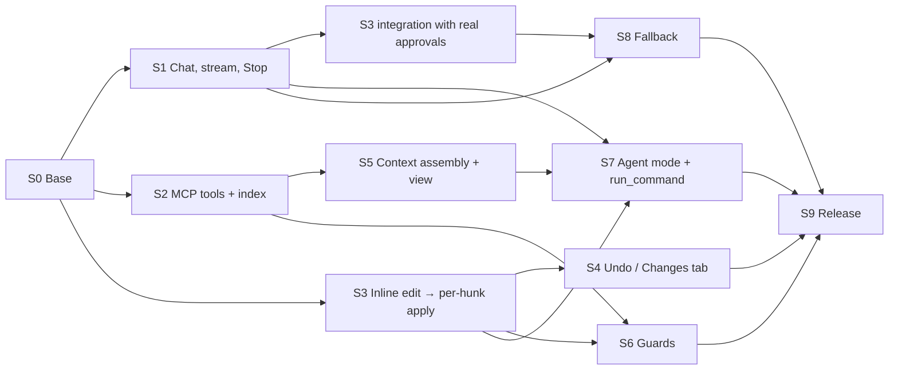

# Implementation Plan · Contexo (vertical slices)

> Builds [PRD_Lite.md](PRD_Lite.md) on top of the scaffold in `extension/`. The order is **Slice 0 (Base)**, then **Slices 1–8 (features)**, then **Slice 9 (release)**.
> Every slice ends with the same loop: **build → install locally → run the slice's manual script → run the base smoke test → merge**.

## How we work

| Topic | Rule |
|---|---|
| Team | 3 people: **P1** (C2 run manager + chat), **P2** (C3 MCP + context), **P3** (C4 review + changes) |
| Git | One branch per slice: `slice/sN-<name>`. PR into `main`; one teammate skims it; merge; everyone pulls. |
| Package manager | npm. Commit `package-lock.json`. Pin exact versions (`--save-exact`). |
| Dev loop | **F5** (Extension Development Host, `npm run watch`) while coding; **`npm run install:local`** (VSIX) at the end of every slice and before the demo |
| Tests | Every slice has a **manual script** run in the installed extension against Flask. Pure modules also need **Vitest** tests (`npm test`). |
| Stubs | Slice 0 ships every module with its **final exported signatures** and a stub body (canned data from `src/dev/fixtures.ts` or a logged no-op). A slice replaces stub bodies; it does not change signatures unless the PR says so. |
| Conflict hot spots | `types.ts`, `package.json`, `extension.ts`. Slice 0 defines all types, commands, settings and wiring up front, so later slices should rarely touch these. When a slice must change them, keep that change small and separate in the PR. |
| Definition of done (every slice) | Builds with no type errors · `npm test` green · manual script passes in the **installed VSIX** · base smoke test still passes · `git status` in the Flask checkout is clean after any Stop or reject scenario |

### Timeline (≈12 h)

```text
h0 ─ h2   S0 Base (split across P1/P2/P3, merged by h2)
h2 ─ h5   P1: S1 Chat+Stream+Stop   P2: S2 Tools+Index      P3: S3 Inline edit → review
h5 ─ h8   P1: S7 Agent mode+cmds    P2: S5 Context+graph    P3: S4 Undo/Changes, then S6 Guards
h8 ─ h9   P1: S8 Fallback           P2: tune retrieval on Task B   P3: S6 finish / bugfix
h9 ─ h10  Integration: rehearse Tasks A → B → C on a clean Flask checkout
h10─ h12  S9 Release: README, video, write-up
```

### Slice dependency graph



Each slice can start on fixtures as soon as S0 is merged. The arrows show when a slice switches from fixtures to the real dependency.

---

## Slice 0 · The Base

**Goal:** a real, installable extension with every surface present and the TrueForge + MCP wiring live, but no feature logic. After S0, anyone can `npm run install:local`, open Flask, and see:
- the panel with three tabs, the status bar, and the commands;
- the MCP server reachable from a real TrueForge session (tools return canned data);
- fixture-driven demos of the Context tab, the diff review and the Changes tab.

**Branch:** `slice/s0-base` (three sub-branches merged in the order a → b → c, each owner rebasing on the previous).

### S0 decisions (made here because later slices depend on them)

| Decision | Choice | Reason |
|---|---|---|
| MCP port | **Fixed, configurable** `contexo.mcpPort` (default `8791`). This changes PRD_Lite, which used a random port. | The agent definition is registered in TrueForge once and survives window reloads |
| MCP token | Generated once, stored in `context.secrets`; `Contexo: Copy MCP Connection` copies URL + header | Stable across reloads; never committed |
| ripgrep | Use **VS Code's bundled rg** (`<vscode.env.appRoot>/node_modules/@vscode/ripgrep/bin/rg[.exe]`, with an `node_modules.asar.unpacked` fallback) | `vsce package --no-dependencies` would otherwise drop the platform binary |
| Tree-sitter | `web-tree-sitter` + grammar wasm from `tree-sitter-wasms` (or `tree-sitter-python`), **pinned as an ABI-compatible pair**; both `.wasm` files copied to `dist/` by `esbuild.mjs` | Works on Windows/macOS/Linux with no native build |
| Packaging | Bundle everything with esbuild/Vite; `vsce package --no-dependencies` | Small VSIX, no `node_modules` |
| Chat rendering | **Decided by the S0b spike** (see below) | Depends on whether TrueForge UI can attach to a host-owned session |
| Who sends turns | **Always the extension host** (panel input → host → `createTurnStream`) | The host must see every event for approvals, Stop and fallback |

### S0a · Shell, build, install (owner P1)

**Files added:** `extension/.vscode/launch.json`, `extension/.vscode/tasks.json`, `extension/.vscodeignore`, `extension/.gitignore`, `extension/tsconfig.webview.json`, `extension/vitest.config.ts`, `scripts/check-no-provider.mjs`.
**Files filled:** `package.json`, `tsconfig.json`, `esbuild.mjs`, `vite.config.ts`, `src/extension.ts`, `src/config.ts`, `src/shell/panel.ts`, `src/shell/statusBar.ts`, `webview/index.html`, `webview/src/{main,App,bridge}.tsx|ts`, empty-state versions of the three tabs.

Steps:
1. **Fork.** Copy `webview-view-sample` at the pinned commit into a temp folder. Port its provider/CSP/nonce code into `shell/panel.ts`. Copy its LICENSE into `extension/LICENSE.upstream`, and fill in `UPSTREAMS.md` with the files you took.
2. **Install packages** (`--save-exact`):
   - **deps:** `@truefoundry/trueforge-sdk`, `@truefoundry/trueforge-ui`, `@modelcontextprotocol/sdk`, `zod`, `diff`, `web-tree-sitter`, `tree-sitter-wasms`, `js-tiktoken`, `tree-kill`, `react`, `react-dom`, `@xyflow/react`.
   - **dev:** `typescript`, `esbuild`, `vite`, `@vitejs/plugin-react`, `vitest`, `@types/vscode@1.90`, `@types/node`, `@types/react`, `@types/react-dom`, `@vscode/vsce`.
3. **Add these `package.json` scripts:**
   ```json
   "build": "node esbuild.mjs && vite build",
   "watch": "node esbuild.mjs --watch",
   "watch:web": "vite build --watch",
   "typecheck": "tsc -p tsconfig.json --noEmit && tsc -p tsconfig.webview.json --noEmit",
   "test": "vitest run",
   "check": "node ../scripts/check-no-provider.mjs dist",
   "package": "npm run build && npm run check && vsce package --no-dependencies -o dist/contexo.vsix",
   "install:local": "npm run package && code --install-extension dist/contexo.vsix --force"
   ```
4. **Configure the builds:**
   - `esbuild.mjs` bundles `src/extension.ts` to `dist/extension.js` (cjs, node18, external `vscode`) and copies the `.wasm` files into `dist/`.
   - `vite.config.ts` builds `webview/` to `dist/webview` with fixed file names (`index.js`, `index.css`) so `panel.ts` can reference them.
   - `tsconfig.json` covers `src/**` only; `tsconfig.webview.json` covers `webview/**` with `jsx: react-jsx` and the DOM lib.
5. **Update the `package.json` manifest:**
   - Add these commands: `contexo.inlineEdit`, `contexo.stop`, `contexo.undoHunk`, `contexo.redoHunk`, `contexo.copyMcpConnection`, `contexo.reindex`.
   - Add dev commands, shown only when `config.contexo.devMode` is set: `contexo.dev.pingTrueForge`, `contexo.dev.sendTestTurn`, `contexo.dev.showSamplePacket`, `contexo.dev.openSampleProposal`, `contexo.dev.applySampleChange`.
   - Add the settings `contexo.mcpPort` (8791) and `contexo.devMode` (false).
6. **Implement `extension.ts` `activate()`.** This is the final wiring order; slices don't change it:
   ```ts
   const cfg = getConfig();
   const panel = new ContexoPanelProvider(ctx);           // registerWebviewViewProvider('contexo.panel')
   const status = new StatusBar();
   const index = startIndexing();                          // stub in S0
   const mcp = await startServer({ port: cfg.mcpPort, token: await getOrCreateToken(ctx.secrets) });
   const runs = new RunManager({ tf: createTfClient(cfg), mcp, panel, review });
   registerTools(mcp.server, { index, runs, review, panel }); // all 6 tools, stub handlers
   registerInlineEdit(ctx, runs);
   registerReview(ctx, runs);                              // content providers + CodeLens (stub)
   registerDevCommands(ctx, { panel, review, runs });      // fixtures
   runs.on('state', s => { status.update(s); panel.post({ type: 'runState', ...s }); });
   ```
7. **Webview.** `App.tsx` has tabs Chat / Context / Changes; the selected tab is persisted via `setState`. Add a run header (state pill, model, **Stop** button → `post({type:'stop'})`) and an **agent input box** (→ `post({type:'send', text})`). Each tab renders an empty state.
8. **Status bar.** Shows `Contexo: idle`; clicking it runs `contexo.stop`.
9. **`check-no-provider.mjs`.** Fails if `dist/` contains `api.openai.com`, `api.anthropic.com`, `generativelanguage.googleapis.com`, `openai`/`@anthropic-ai/sdk` imports, and similar provider markers.

### S0b · Live TrueForge + MCP wiring, and the spike (owner P2)

**Files filled:** `src/run/tfClient.ts` (real), `src/run/runManager.ts` (minimal), `src/mcp/server.ts` (real), `src/mcp/tools.ts` (stub handlers), `extension/trueforge/*.agent.json`, `instructions.md`, `models.example.md`.

Steps:
1. Run `npx @truefoundry/trueforge@latest` and configure `<PRIMARY_MODEL>` and `<FALLBACK_MODEL>` in TrueForge.
2. **`mcp/server.ts`:**
   - Use a Node `http` server on `127.0.0.1:cfg.mcpPort` and `StreamableHTTPServerTransport` in stateless mode (new `McpServer` + transport per request).
   - Reject a request with 401 unless its `X-Contexo-Token` header matches.
   - Export these signatures:
   ```ts
   export interface McpHandle { server: McpServer; port: number; revoke(runId: string): void; allow(runId: string): void; isAllowed(runId?: string): boolean; stop(): Promise<void> }
   export function startServer(o: { port: number; token: string }): Promise<McpHandle>;
   export function resolveInWorkspace(p: string): string;   // throws on '..', absolute, .git/
   export function capOutput(s: string, max = 16_000): { text: string; truncated: boolean };
   ```
3. **`mcp/tools.ts`:** register all six tools with their **final zod schemas** and stub handlers that return `fixtures.*` (for `propose_write`: `{applied:[],rejected:[],note:'stub'}`).
4. **Agent JSONs:** fill in the real schema after checking TrueForge docs. Register both agents (`contexo`, `contexo-fallback`) in local TrueForge using the URL and token from `Contexo: Copy MCP Connection`. Record the exact registration steps in README.
5. **`tfClient.ts` (final API):**
   ```ts
   export interface TfClient {
     createSession(agent: string): Promise<string>;
     streamTurn(sessionId: string, content: string, signal?: AbortSignal): AsyncIterable<TfEvent>;   // merges deltas
     approve(a: { sessionId: string; turnId: string; threadId: string; toolCallId: string; allow: boolean; reason?: string; afterEventId: string }): AsyncIterable<TfEvent>; // resumed stream
     cancel(sessionId: string): Promise<void>;
     sessionUrl(sessionId: string): string;
     ping(): Promise<boolean>;
   }
   ```
6. **Minimal `RunManager`:** `start()` creates a session and logs the stream to an OutputChannel `Contexo`; any `tool.approval_required` is **auto-denied** with `"not implemented in base"`.
7. **Spike (a timeboxed experiment), max 1 h.** Record the answers in `docs/spike-notes.md`:
   1. The exact `tool.approval_required` payload: are the tool name and full args present? Which fields hold `toolCallId` and `threadId`?
   2. Does a `propose_write` allow lead TrueForge to call our MCP tool with **byte-identical args**? (This matters for `proposalKey`.)
   3. Agent JSON field names for approval-required and deferred tools.
   4. What a bad key and an unreachable endpoint each look like: a `turn.done` error, a thrown error, or a hang.
   5. Can `TrueForgeUI` render an **existing** session in a webview, read-only, while the host sends turns? It needs `connect-src http://localhost:8790` in CSP and CORS.
      - **Yes:** ChatTab uses TrueForgeUI.
      - **No:** ChatTab uses the host-relayed renderer (S1).

### S0c · Fixtures, dev commands, stubs (owner P3)

**Files added:** `src/dev/fixtures.ts`, `src/dev/devCommands.ts`.
**Files filled with stubs (final signatures):** all of `src/context/*`, `src/review/*`, `src/shell/inlineEdit.ts`, `src/run/fallback.ts`, `src/mcp/runCommand.ts`, `webview/src/{ContextTab,ContextGraph,ChangesTab,ChatTab}.tsx` (rendering fixture data).

1. **`fixtures.ts`:**
   - `samplePacket: ContextPacket` uses real Flask paths (`src/flask/cli.py`, `tests/test_cli.py`, `docs/cli.rst`) with reasons, omissions and a graph.
   - `sampleProposalArgs(path, text)` builds a `propose_write` args object that edits two places in the open file.
   - `sampleApplied: AppliedHunk[]`.
2. **Final signatures with stub bodies.** Each stub logs `[stub]` to the OutputChannel.
   ```ts
   // context
   export function startIndexing(): IndexApi;                       // ready resolves immediately, empty index
   export interface IndexApi { ready: Promise<void>; symbols(): SymbolEntry[]; byName(n: string): SymbolEntry[]; inFile(p: string): SymbolEntry[]; enclosing(p: string, line: number): SymbolEntry | undefined; reindexFile(p: string): Promise<void> }
   export function ripgrepSearch(term: string, o?: { glob?: string; max?: number }): Promise<Array<{ path: string; line: number; preview: string }>>;
   export function assembleContext(i: { request: string; mentions?: string[]; budget?: number; selection?: Selection; runId: string }, index: IndexApi): Promise<ContextPacket>; // returns fixtures.samplePacket
   export function formatForModel(p: ContextPacket): string;
   export function count(text: string): number;                     // stub: Math.ceil(len/4)
   // review
   export function proposalKey(args: unknown): Sha;
   export function applyEditExact(base: string, oldText: string, newText: string): string;
   export function buildHunks(path: string, base: string, proposed: string, baseHash: Sha): Hunk[];
   export function rebuildFromAccepted(base: string, hunks: Hunk[]): string;
   export function symbolCheck(files: Proposal['files'], index: IndexApi): Promise<string[]>; // stub: []
   export function scopeGuard(hunks: Hunk[], sel: Selection): void;                         // stub: no-op
   export class ReviewEngine { beginProposal(run: Run, toolCallId: string, threadId: string, args: ProposeArgs): Promise<'reviewing' | { deny: string }>; setDecision(hunkId: string, d: 'accepted' | 'rejected'): void; applyAccepted(key: Sha): Promise<void>; rejectAll(key: Sha): void; finalize(key: Sha): { applied: string[]; rejected: string[] } | { error: string }; discardPending(): void; onResolve?: (allow: boolean, reason?: string) => void }
   export class UndoStack { applyFiles(m: Map<string, string>): Promise<void>; recordApplied(runId: string, hunks: Hunk[]): void; undoHunk(id: string): Promise<boolean>; redoHunk(id: string): Promise<boolean>; undoLastApply(): Promise<void>; list(): AppliedHunk[] }
   // run
   export function classify(x: unknown): 'model-failure' | 'cancelled' | 'other';          // stub: 'other'
   export async function takeOver(run: Run, deps: FallbackDeps): Promise<void>;           // stub: throw
   export function runCommand(argv: string[], timeoutSec?: number): Promise<{ exitCode: number; stdout: string; stderr: string; truncated: boolean }>; // stub: refuses
   export function killAll(): void;
   ```
3. **Dev commands:**
   - `showSamplePacket` → `panel.post({type:'packet', packet: samplePacket})`.
   - `openSampleProposal` → registers the two virtual docs with a hard-coded edit of the active file and opens `vscode.diff`. There is no CodeLens yet; that comes in S3.
   - `applySampleChange` → posts `sampleApplied` to the Changes tab.
4. **Webview tabs** render fixture data: the Context tab shows a plain list and the budget number (graph comes in S5), and the Changes tab shows a list with disabled Undo buttons.
5. **`scripts/setup-flask.ps1`/`.sh`:** clone flask, check out `3.1.3`, create a `.venv`, then `pip install -e . -r requirements/tests.txt` (verify the file name in the tag). `scripts/demo-app.py` sets `SECRET_KEY`, `API_TOKEN`, `DB_PASSWORD` and a nested dict with `AWS_KEY`.

### S0 manual script (this is also the **base smoke test**, re-run after every merge)

1. `cd extension && npm ci && npm run install:local`, then reload VS Code. Open the Flask checkout and set `"contexo.devMode": true`.
2. The Contexo icon appears in the secondary sidebar, and the panel shows Chat / Context / Changes. The status bar reads `Contexo: idle`.
3. `Contexo (dev): Ping TrueForge` shows "TrueForge OK at http://localhost:8790".
4. `Contexo: Copy MCP Connection` puts the URL and header on the clipboard. A `curl` to the URL without the token gets 401.
5. Type "list your tools and call search_workspace for 'command'" in the panel input box. The Contexo output channel shows streamed text and a `search_workspace` tool call that returns fixture hits. The TrueForge UI session shows the same call.
6. `Contexo (dev): Show sample context packet` fills the Context tab.
7. With `src/flask/helpers.py` open, `Contexo (dev): Open sample proposal` opens a diff whose left side matches the file.
8. `Contexo (dev): Apply sample change` lists items in the Changes tab.
9. `npm run typecheck && npm test && npm run check` all pass.
10. `git -C <flask> status` is clean.

**Done when:** all S0 steps pass on at least 2 teammates' machines, and `docs/spike-notes.md` answers all five spike questions.

---

## Slice 1 · Chat, streaming and Stop (P1)

**Goal:** a real conversation in the panel with tokens streaming, tool calls visible, the editor responsive, and an immediate Stop that leaves the workspace clean. This is the A3 criterion. It replaces the minimal `RunManager` and the empty Chat tab.

**Branch:** `slice/s1-chat-stream`. **Touches:** `run/runManager.ts`, `run/tfClient.ts`, `shell/panel.ts`, `shell/statusBar.ts`, `webview/src/ChatTab.tsx`, `types.ts` (only `UiStreamEvent`, if needed).

Steps:
1. **`RunManager` (final shape):**
   ```ts
   export class RunManager extends EventEmitter<{ state: [RunStateMsg]; event: [UiStreamEvent]; session: [{ sessionId: string; agent: string; url: string }] }> {
     active?: Run;
     start(mode: 'inline' | 'agent', text: string, selection?: Selection): Promise<void>; // rejects if a run is active and not finished
     send(text: string): Promise<void>;          // follow-up turn on the same session (agent mode)
     stop(): Promise<void>;
     resolveApproval(allow: boolean, reason?: string): Promise<void>;
     private consume(stream: AsyncIterable<TfEvent>, sessionId: string): Promise<void>;
   }
   ```
2. **`consume`:**
   - For every event, ignore it if `run.sealedSessions.includes(sessionId)` or `run.state === 'cancelled'`.
   - Track `turnId` and `lastEventId`. Map the event to a `UiStreamEvent` (`text-delta`, `tool-call`, `tool-result`, `approval`, `turn-done`, `thread`) and emit it.
   - **Batch UI posts:** the panel flushes at most every 50 ms.
3. **Approval routing** (still a stub in this slice):
   - `tool.approval_required` with `propose_write` → `review.beginProposal(...)` (still the S0 stub, which returns `{deny:'not implemented'}`) → `resolveApproval(false, ...)`.
   - `run_command` → deny for now (S7 implements it).
   - Store `pendingApproval = { sessionId, turnId, threadId, toolCallId, args }`.
4. **`resolveApproval`:** `tf.approve({... afterEventId: lastEventId })` returns the resumed stream; `consume` that stream.
5. **`stop()`:**
   - **Synchronous part:** set `state='cancelled'`, `mcp.revoke(run.id)`, `review.discardPending()`, `killAll()`, abort the stream's `AbortController`, then emit state.
   - **Asynchronous part:** `await tf.cancel(sessionId)`, catching and logging errors.
   - Measure the time from the click to the local stop and log it (A3 evidence).
6. **MCP authority:** on `start`, call `mcp.allow(run.id)`. Every tool handler checks `mcp.isAllowed()` and returns `RUN_NOT_AUTHORIZED` otherwise.
7. **ChatTab:**
   - If the spike said **TrueForgeUI works**, mount it on `session.sessionId`.
   - **Otherwise** use the relayed renderer: merged assistant text (markdown via `<pre>`-safe rendering), tool-call chips (name, collapsed args, result size, "deferred" badge if the tool was loaded on demand), approval chips, turn status.
   - Add an "Open in TrueForge" link (`session.url`).
8. **Status bar:** show `streaming · <agent>` and `stopped`.

**Vitest:** `test/runManager.test.ts` with a fake `TfClient` that yields a scripted event list. Check:
- Deltas are merged.
- Events after `stop()` are ignored.
- Events from a sealed session are ignored.
- `stop()` calls `revoke`, `discardPending` and `killAll` before `cancel` resolves.

**Manual script:**
1. Install. In the panel type: "Explain what flask/cli.py does in detail and search for every command". Text streams token by token, tool chips appear, and typing in an editor during the stream doesn't lag.
2. Press **Stop** mid-stream. The UI shows "Stopped" within ~0.3 s, the output channel logs the local stop time, and TrueForge shows the turn `cancelled`. `git status` is clean.
3. Start a new request right after the Stop. It works, with no stuck state.
4. Ask for a change. The agent's `propose_write` is denied with "not implemented", and the agent reports it. Nothing is written.

**Done:** the A3 behaviour is demoable.

---

## Slice 2 · MCP read/search tools + repository index (P2)

**Goal:** the agent can really read and search Flask. The index exists for S5 and S6.

**Branch:** `slice/s2-tools-index`. **Touches:** `context/indexer.ts`, `context/search.ts`, `context/tokens.ts`, `mcp/tools.ts` (`read_file`, `search_workspace`, `list_symbols`), `shell/` (`contexo.reindex`).

Steps:
1. **`indexer.ts`:**
   - `startIndexing()`: load `web-tree-sitter` with the wasm from `dist/`.
   - List files with `rg --files -g '*.py' -g '*.rst' -g '*.md'` (respects `.gitignore`).
   - Parse in chunks of 20 files with `await new Promise(setImmediate)` between chunks.
   - **Python queries** (tree-sitter S-expressions) capture:
     - `function_definition` / `class_definition` (with the `decorated_definition` parent to collect decorator text);
     - `call` → `function: identifier | attribute` (keep the last identifier);
     - `import_statement` / `import_from_statement` names.
   - Build `SymbolEntry` items: methods are qualified by class, and anything named `test_*` in `tests/` is kind `test`.
   - **Docs:** split `.rst` into sections where a line is followed by an underline of `= - ~ ^ "`, and `.md` on `#` headings. Each section becomes a `SymbolEntry` with kind `doc` and its title as the name.
   - Maps: `byName` (lower-cased), `byFile`.
   - `reindexFile` runs on `workspace.onDidSaveTextDocument`.
2. **`search.ts`:**
   - `tokenize`: split on non-word characters, then snake_case and camelCase, lower-case, drop stopwords and tokens shorter than 2.
   - `class Bm25 { constructor(docs: Array<{id:string; text:string}>); rank(terms: string[], k?: number): Array<{id:string; score:number}> }` with k1=1.2, b=0.75. Build it lazily after `ready`, and rebuild only the changed documents on reindex.
   - `symbolNameMatch(terms)` scores exact = 3, prefix = 2, contains = 1.
   - `ripgrepSearch(term)` runs `rg --json -n -i -F --max-count 50` and maps each hit to `enclosing(path, line)`.
3. **`tokens.ts`:** `count` uses `js-tiktoken` `getEncoding('cl100k_base')`, with a `Map<sha,number>` cache.
4. **Tools:**
   - `read_file`: prefer the open `TextDocument` text (dirty buffer) over disk. Return `hash = sha256(fullText)`, the line slice and `totalLines`, and apply `capOutput`.
   - `search_workspace`: merge ripgrep hits and symbol-name hits, dedupe by `path:line`, return up to `limit`.
   - `list_symbols`: filter by path or query.
5. **Status bar:** show `indexing n/N` while indexing runs.

**Vitest:** `test/search.test.ts` checks tokenizer splits and BM25 ranking on a 3-doc corpus. `test/indexer.test.ts` runs on a small Python string fixture and checks that decorators, calls, methods and tests are captured. It loads the wasm from `dist/`, so run it after `npm run build`.

**Manual script:**
1. Install and open Flask. The status bar shows indexing finishes in under 10 s, and the output channel logs the symbol and doc-section counts.
2. Ask in chat: "Find where built-in flask CLI commands are registered and read that code." The agent calls `search_workspace`, gets real `cli.py` hits, then calls `read_file` with a range and gets the real text and a hash.
3. Edit `helpers.py` without saving and ask the agent to `read_file` it. The result reflects the unsaved text.
4. Ask the agent to read `../outside.txt`. It gets a path error.

**Done:** real read and search tools, an index ready for S5 and S6.

---

## Slice 3 · Inline edit → staged diff → per-hunk apply (P3; real approvals after S1 merges)

**Goal:** Task A end to end, which is A1 and the core of B2 and B4. Nothing is written until Apply. It replaces the `ReviewEngine` stubs, the `proposal.ts` stubs and `inlineEdit.ts`.

**Branch:** `slice/s3-inline-review`. **Touches:** `review/proposal.ts`, `review/diffView.ts`, `review/applyUndo.ts` (`applyFiles` + `recordApplied` only), `shell/inlineEdit.ts`, `run/runManager.ts` (approval hook only), `mcp/tools.ts` (`propose_write` handler), `trueforge/instructions.md`.

### Phase A, independent of S1 (dev command driven)
1. **`proposal.ts`:**
   - `proposalKey(args)` = `sha256(canonicalJson(args))`, where canonical JSON sorts keys recursively and has no whitespace.
   - `applyEditExact(base, old, new)`: count occurrences of `old` (an empty `old` means a create, which requires `base === ''`). Zero occurrences throws `OLD_TEXT_NOT_FOUND`; more than one throws `AMBIGUOUS_MATCH`. Otherwise return the replaced text. Preserve the file's EOL by normalizing `old` and `new` to it.
   - `buildHunks(...)` uses `structuredPatch(path, path, base, proposed, '', '', { context: 3 })`. Map each hunk to a `Hunk` with `id = sha256(path + baseHash + lines.join('\n')).slice(0, 12)` and `decision: 'pending'`.
   - `rebuildFromAccepted(base, hunks)`: build a patch object from the accepted hunks only and run `applyPatch(base, patch)`. If the result is `false`, throw `REBUILD_FAILED`.
2. **`diffView.ts` `ReviewEngine`:**
   - `beginProposal(run, toolCallId, threadId, args)`:
     1. Compute `key`.
     2. For each edit, read the live text (open doc, otherwise `fs`). If `sha256(live) !== baseHash`, return `{deny: 'STALE_BASE <path>: file changed (current hash <h>). Re-read and retry.'}`.
     3. `applyEditExact`. Errors become `{deny}`.
     4. `buildHunks`.
     5. Call the guards (S6 stubs return nothing).
     6. Store the `Proposal` and register the doc contents `contexo-base:/<key>/<path>` and `contexo-proposed:/<key>/<path>`.
     7. `vscode.diff(base, proposed, '<file> · Contexo proposal (n hunks)')` for each file, focusing the first.
     8. Return `'reviewing'`.
   - **CodeLens provider** on the `contexo-proposed` scheme:
     - Per hunk at `newStart-1`: `✓ Accept` / `✗ Reject` (shows `✓ Accepted` / `✗ Rejected` once decided), plus `⚠ outside selection` if flagged.
     - At line 0: `Apply accepted (n)` · `Accept all` · `Reject all`.
     - Commands: `contexo.hunk.decide`, `contexo.proposal.apply`, `contexo.proposal.rejectAll`. Fire `onDidChangeCodeLenses` after every decision.
   - `applyAccepted(key)`:
     1. Re-check each base hash. If one changed, set status `stale` and call `onResolve(false, 'STALE_BASE during review')`.
     2. `rebuildFromAccepted` per file.
     3. `undo.applyFiles(map)` and `undo.recordApplied(run.id, accepted)`.
     4. Store `result`, close the diff tabs, then `onResolve(true)`.
   - `rejectAll` → `onResolve(false, 'user rejected all hunks')`.
   - `finalize(key)` → the stored result, or `{error:'UNKNOWN_PROPOSAL'}`. It never writes.
   - `discardPending()` → close the diffs, set status `discarded`, and drop the docs.
3. **`applyUndo.ts` `applyFiles`:**
   - Build one `WorkspaceEdit` with a full-range `replace` per file (`createFile` for new files) and call `workspace.applyEdit`. If it returns false, throw.
   - Then `doc.save()` each document and verify `sha256(doc.getText()) === expected`. A mismatch is logged as `external-transform`.
4. **`recordApplied`:** for each accepted hunk, store a single-hunk unified patch string (`createPatch` of that hunk alone) as an `AppliedHunk`.
5. **Dev command `openSampleProposal`** now calls `beginProposal` with a fake run and `onResolve = log`. You can test the whole review UI with no model.

### Phase B, after S1 merges (real approvals)
6. **`runManager`:** on `tool.approval_required` for `propose_write`, set `review.onResolve = (allow, reason) => this.resolveApproval(allow, reason)`, then `const r = await review.beginProposal(...)`. If `r` is a deny, call `resolveApproval(false, r.deny)` right away. Set the status to `awaiting review (n hunks)`.
7. **`tools.ts` `propose_write` handler:** returns `JSON.stringify(review.finalize(proposalKey(args)))`. If the spike showed args are not byte-identical, key on `toolCallId` instead: either the MCP call carries it (if TrueForge passes it in `_meta`), or the handler matches the last allowed proposal.
8. **`inlineEdit.ts`:**
   - `captureSelection(editor)` and `showInputBox({ prompt: 'Contexo: what should change?' })`.
   - `runs.start('inline', instruction, sel)`.
   - The first message template, also documented in `instructions.md`:
   ```text
   [INLINE EDIT] File: {path} lines {start+1}-{end+1} (baseHash {hash}).
   Instruction: {instruction}
   Selected code:
   ```{text}```
   Rules: change only what the instruction needs, prefer staying inside the selection, call propose_write once with exact oldText copied from the file and the baseHash above.
   ```
9. **`instructions.md`:** add the `propose_write` contract: edits use exact `oldText`, `baseHash` comes from `read_file`, and one call per logical change set. Add the retry rules for `STALE_BASE`, `OLD_TEXT_NOT_FOUND`, `AMBIGUOUS_MATCH` and `MISSING_SYMBOL`.

**Vitest:** `test/proposal.test.ts` covers:
- exact single match;
- not found / ambiguous / create;
- CRLF preserved;
- hunk IDs stable for the same input;
- `rebuildFromAccepted` with all, none, and the first of two hunks;
- `proposalKey` independent of key order.

**Manual script (Task A):**
1. Open `src/flask/helpers.py`, select `get_debug_flag`, press `Ctrl+Alt+E`, and type the Task A instruction. The response streams, then the diff opens with Accept/Reject on each hunk.
2. Reject one hunk, accept the others, and click **Apply accepted**. Only the accepted hunks land in the file and it's saved. The agent receives `applied/rejected` and finishes.
3. Run `FLASK_DEBUG=off python -c "from flask.helpers import get_debug_flag; print(get_debug_flag())"`. It prints `False` (when the logic hunk was accepted).
4. `git checkout -- .` Repeat, but type in `helpers.py` while the diff is open, then Apply. You get a stale message and nothing is written.
5. Repeat and click **Reject all**. The agent is told, and `git status` is clean.
6. Repeat and press **Stop** while the diff is open. The diff closes and `git status` is clean.

**Done:** Task A passes, including the stale, reject-all and Stop paths.

---

## Slice 4 · Undo/redo + Changes tab (P3)

**Goal:** applied hunks are listed and can be undone or redone, which finishes B2.

**Branch:** `slice/s4-undo`. **Touches:** `review/applyUndo.ts`, `webview/src/ChangesTab.tsx`, `shell/panel.ts` (undo/redo routing), the commands `contexo.undoHunk`/`redoHunk`.

Steps:
1. `undoHunk(id)`:
   - Read the current text.
   - `applyPatch(current, reversePatch(record.patch))`. Use jsdiff's `reversePatch` if available; otherwise swap the `+` and `-` lines and the old/new ranges.
   - If the result is `false`, show a warning ("file changed at this hunk; cannot undo automatically") and return false. Otherwise `applyFiles`, set `undone=true`, and post `changes`.
2. `redoHunk(id)` is the same with the forward patch, setting `undone=false`.
3. `undoLastApply()` undoes the hunks of the latest `appliedAt` group in reverse line order.
4. `list()` posts `{type:'changes', hunks}` after every change.
5. **ChangesTab:**
   - Group by run, then by file.
   - Each row shows `path:line`, a +/- mini-preview of the first 3 lines, and **Undo** / **Redo**.
   - Clicking the row runs `openSource`.
   - A run-level **Undo run** button.
6. **Commands:** `contexo.undoHunk` / `redoHunk` with no argument show a QuickPick of recent hunks.

**Vitest:** `test/undo.test.ts` uses a pure helper `reverseHunkPatch` and checks round trips: apply, undo (equals base), redo (equals proposed), and that undo after an unrelated edit elsewhere in the file still works.

**Manual script:**
1. Do Task A and apply 2 hunks. The Changes tab shows 2 rows.
2. Undo the docstring hunk. Only that hunk reverts, and the file is saved.
3. Redo it. It returns.
4. Edit a line far away, then undo the logic hunk. It works, and your edit stays.
5. Edit inside the hunk, then undo. You get a clear warning and the file is unchanged.

**Done:** "Undo of an applied change" is demoable.

---

## Slice 5 · Context assembly + Context tab + graph (P2)

**Goal:** the B1 core. `assemble_context` performs budgeted hybrid retrieval with reasons and omissions, and the Context tab shows it live as a graph and a list. It replaces the `assembler.ts` stub and the fixture Context tab.

**Branch:** `slice/s5-context`. **Touches:** `context/assembler.ts`, `mcp/tools.ts` (`assemble_context`), `webview/src/ContextTab.tsx`, `webview/src/ContextGraph.tsx`, `trueforge/instructions.md`.

Steps (signatures in `assembler.ts`):
```ts
export function extractAnchors(request: string, mentions: string[] = [], sel?: Selection): { terms: string[]; mandatory: Candidate[] };
export function candidateLists(terms: string[], index: IndexApi): Promise<RankedList[]>;   // bm25(symbols), bm25(docs), symbolName, ripgrep
export function expandOneHop(top: Candidate[], index: IndexApi): RankedList[];            // calls, calledBy, registers, tests, documents
export function rrfFuse(lists: RankedList[], k = 60): Candidate[];                        // keeps contributing reasons
export function pack(mandatory: Candidate[], ranked: Candidate[], budget: number): { excerpts: Excerpt[]; omitted: ContextPacket['omitted'] };
export function buildGraph(request: string, terms: string[], excerpts: Excerpt[]): ContextPacket['graph'];
export async function assembleContext(i: AssembleInput, index: IndexApi): Promise<ContextPacket>;
export function formatForModel(p: ContextPacket): string;
```
1. **Anchors:**
   - `@path` mentions match file paths (suffix match). They're mandatory: the whole file if it fits in 30% of the budget, otherwise its top 3 symbols.
   - `@name` mentions go through `index.byName`; ambiguous names keep all matches at lower weight.
   - A selection is mandatory and becomes its enclosing symbol.
   - **Terms:** identifiers (`[A-Za-z_][A-Za-z0-9_]{2,}`), quoted strings, uppercase constants, and CLI phrases (`flask X` → `X`, `command`, `cli`), minus stopwords. Add a small synonym table, also written up: `command → click.command, add_command, cli`; `config → config`; `test → test_`; `docs → rst`.
2. **Candidate lists:** each list is ranked separately and keeps `reason = {kind, term, rank}`.
3. **Expansion** over the top 10 fused results:
   - `calls`/`called-by`: name present in the other symbol's `calls`.
   - `registers`: decorators matching `/\.command\(|click\.command|add_command|app\.cli/`, plus siblings with the same decorator pattern in the same file.
   - `tests`: kind `test` symbols whose `calls`/text reference the name, or `tests/test_<module>.py`.
   - `documents`: doc sections containing the symbol name or the CLI word.
   - Each expansion is its own ranked list, with reasons naming the source symbol.
4. **RRF:** `score += 1/(k + rank)` for each list a candidate appears in. Merge the reasons.
5. **Packing:**
   1. Mandatory items go first.
   2. Reserve the best test candidate and the best docs candidate if they exist.
   3. Then go greedy by `score / tokens`.
   4. Skip overlapping ranges (omitted as `duplicate`). After 3 excerpts from one file, multiply the score by 0.5.
   5. Over budget → `over-budget`. Below the top 40 → `lower-rank`.
   6. A symbol larger than 30% of the budget is trimmed to its signature + docstring + lines matching terms, marked `trimmed`.
6. **Graph:**
   - Nodes: request → term nodes → file nodes → symbol nodes.
   - Edge labels: `lexical:"term"`, `name`, `registers`, `tests`, `documents`, `calls`.
   - `inferred: true` for heuristic edges (registers, tests by name, documents).
7. **The tool:** `assemble_context` calls `assembleContext`, posts `{type:'packet'}` to the panel, and returns `formatForModel` (budget line + excerpts + omitted list).
8. **Context tab:**
   - A `BudgetBar` showing used/budget with an "≈ estimated tokens" label.
   - The excerpt list: category chip, `path:lines`, reasons as chips, ≈tokens. Clicking a row opens the source.
   - A collapsible `OmittedList`.
   - `ContextGraph` uses React Flow with **fixed columns** (x = column × 260, y = index × 70). There's no layout library and positions stay stable. Edge labels show the reason, inferred edges are dashed, and clicking a node opens the source. Persist the viewport with `setState`.
9. **`instructions.md`:** "Before proposing any edit, call `assemble_context` with the user's request (and any @mentions). Re-call with new anchors if evidence is missing."

**Vitest:** `test/assembler.test.ts` with an in-memory `IndexApi` fake. Check:
- RRF ordering on hand-made lists;
- the budget is never exceeded, and mandatory items always come first;
- the quota reserves a test and a doc excerpt;
- duplicates are omitted with a reason;
- an oversized symbol gets trimmed;
- the graph has edges for each reason.

**Manual script:**
1. In chat, send the Task B request and **stop after the first `assemble_context`**. The Context tab shows a graph and list containing `cli.py` (command registration), `tests/test_cli.py` (help/commands tests) and `docs/cli.rst` (built-in commands section), each with a reason. The budget bar is ≤ 8000, and the Omitted list is non-empty and has reasons.
2. Send "@get_debug_flag explain it". The mention appears as a mandatory excerpt with a `mention` reason.
3. Set `contexo.excerptBudget` to 2000 and repeat step 1. There are fewer excerpts and more `over-budget` omissions, but tests and docs are still present thanks to the quota.

**Done:** B1 is visible and the strategy is documented in code comments for the write-up.

---

## Slice 6 · Guards: scope guard + symbol check (P3)

**Goal:** inline changes outside the selection show in red; proposals that call undefined names are auto-denied, so the agent corrects itself. It replaces the S0 stubs in `guards.ts`.

**Branch:** `slice/s6-guards`. **Touches:** `review/guards.ts`, `review/diffView.ts` (decorations + CodeLens label), `test/guards.test.ts`.

Steps:
1. **`scopeGuard(hunks, sel)`:**
   - Walk the hunks in order, keeping `delta` = the sum of `(newLines - oldLines)` of earlier hunks.
   - A hunk is outside if `[oldStart-1, oldStart-1+oldLines)` doesn't intersect `[sel.startLine, sel.endLine]`. The selection lines are on the base side, so no delta is needed for old ranges; the delta is only used to place the decoration on the proposed side.
   - Set `hunk.outsideSelection`.
2. **Decorations:** a red `backgroundColor` (theme token `diffEditor.removedLineBackground`-like, with a custom colour `contexo.outsideSelection`) on the proposed-side lines of flagged hunks, plus a CodeLens label `⚠ outside selection (L{n}-{m})`. Accept stays enabled.
3. **`symbolCheck(files, index)`:**
   1. Parse each proposed file with tree-sitter.
   2. Collect the `+` line numbers from its hunks.
   3. For every `call` whose function is a bare `identifier`, plus every decorator identifier located on a `+` line, check these, in order:
      - names defined in the proposed file (`def`/`class`/assignments at module level);
      - imported names (`import x`, `from y import x`, `as` aliases);
      - parameters and local assignments of the enclosing function, comprehension variables, `for` targets and `with ... as`;
      - `PYTHON_BUILTINS`;
      - `index.byName(name)` exists **and** the file imports its module. If the module isn't imported, that's still a violation: "defined in X but not imported".
   4. If the file has `from x import *`, skip it (tolerated).
   5. Return the violations as `MISSING_SYMBOL <name> @ <path>:<line>`.
4. **`beginProposal`:** if there are violations, return `{deny: 'MISSING_SYMBOL ...; define or import it, then propose again.'}` (all violations in one message) and never open the diff.

**Vitest:** `test/guards.test.ts` covers:
- a missing call is detected;
- these pass: a builtin (`len`), a local def added in the same proposal, an imported name, a parameter, a loop variable;
- an attribute call `x.foo()` is ignored;
- a star import is tolerated;
- the scope guard flags only the hunk outside the selection (with two hunks, one inside and one outside).

**Manual script:**
1. Task A with an instruction that also asks to "add a helper at the top of the module". The helper hunk shows in red with `⚠ outside selection`, and Accept still works.
2. Dev command `Contexo (dev): Open sample proposal (missing symbol)`, which inserts a call to `undefined_helper()`. The output channel shows an auto-deny with the message, and no diff opens.
3. Live check: tell the agent "call normalize_debug_value() in get_debug_flag but do not define it". The first proposal is auto-denied, the agent's next proposal defines or imports it, and the diff opens.

**Done:** both guards are visible on screen.

---

## Slice 7 · Agent mode multi-file + run_command + deferred tools (P1)

**Goal:** Task B end to end, covering A2 and B4: discovery, a multi-file proposal, tests run through a deferred, approval-gated tool, and the TrueForge session shown.

**Branch:** `slice/s7-agent`. **Touches:** `mcp/runCommand.ts`, `mcp/tools.ts` (`run_command`), `run/runManager.ts` (`run_command` approval UI, agent-mode prompt), `trueforge/instructions.md`, `trueforge/*.agent.json` (verify deferred + approval config).

Steps:
1. **`runCommand(argv, timeoutSec=120)`:**
   - Reject if `argv[0]` isn't in the allowlist, or if any argument resolves outside the workspace.
   - `spawn(argv[0], argv.slice(1), { cwd: root, shell: false, env: scopedEnv() })`. `scopedEnv` passes `PATH`, `SYSTEMROOT`/`HOME`/`USERPROFILE`, `VIRTUAL_ENV` and `PYTHONPATH` only, and prepends the workspace `.venv` bin/Scripts to `PATH` if it exists.
   - Track PIDs. Apply `capOutput` to stdout and stderr.
   - Enforce the timeout with `treeKill`. `killAll()` kills every tracked PID.
2. **`run_command` approval:**
   - In `runManager`, `tool.approval_required` for `run_command` shows `window.showInformationMessage('Agent wants to run: pytest tests/test_cli.py -q', 'Allow', 'Deny')`.
   - The answer calls `resolveApproval`. If the TrueForge UI also shows an approval, whichever answers first wins; ignore the second, since the host tracks `pendingApproval` by `toolCallId`.
3. **Agent-mode first message:** the request plus "Use assemble_context first. Stage related edits (implementation, tests, docs) in as few propose_write calls as is natural. After the user applies, run the relevant tests with run_command."
4. **Multi-file proposals:** confirm that `beginProposal` opens one diff per file. The CodeLens `Apply accepted (n)` counts across **all files of the proposal**, and the title shows `file i/N`.
5. **Deferred tools:** confirm in the TrueForge session that `run_command` (and `list_symbols`) are discovered or loaded on demand. If the schema needs explicit config, fix the agent JSONs. ChatTab badges deferred loads.
6. **Panel "Open in TrueForge":** make sure the link works for the demo.

**Vitest:** `test/runCommand.test.ts` checks the allowlist rejection, `shell:false` (no `&&` interpretation: `['python','-c','print(1) && echo hi']` prints the literal text), the timeout kill and output capping (it uses `node` added to the allowlist in the test).

**Manual script (Task B):**
1. Use a clean Flask checkout and send the exact Task B prompt, with no files named.
2. Context tab: impl, tests and docs are chosen with reasons. The TrueForge session shows `assemble_context`, `read_file` and `search_workspace`.
3. Proposals touch at least 3 files: `src/flask/cli.py`, `tests/test_cli.py` and `docs/cli.rst` (or equivalents). Review each hunk and apply.
4. The agent loads `run_command` (deferred), asks to run pytest, and you Allow. Output streams back and the tests pass. Then run `pytest tests/test_cli.py -q` in the terminal yourself, and `flask --app scripts/demo-app.py config` prints JSON with `***` for the secret-like keys (nested ones too).
5. `flask --help` lists `config`.
6. Press Stop while pytest is running. The process tree dies and the Stop is clean.
7. Open the session in TrueForge: the turns, MCP calls and approvals are visible.

**Done:** Task B passes twice in a row on a clean checkout.

---

## Slice 8 · Automatic fallback (P1)

**Goal:** Task C. When the primary model fails, the fallback agent takes over with no user action, and the workspace stays unchanged. This is B3. It replaces the `fallback.ts` stubs.

**Branch:** `slice/s8-fallback`. **Touches:** `run/fallback.ts`, `run/runManager.ts` (failure path, first-event timer), `webview/src/App.tsx` (banner).

Steps:
1. **`classify(x)`.** Use the shapes recorded in `spike-notes.md`:
   - `turn.done` with `state.status==='error'` and text matching `/401|403|unauthori[sz]ed|invalid.*key|api key|authentication|not found|404|ECONNREFUSED|ENOTFOUND|ETIMEDOUT|fetch failed|5\d\d|model/i` → `model-failure`.
   - A thrown SDK error with HTTP status 401/403/404/5xx, or a network error code → `model-failure`.
   - `status==='cancelled'` → `cancelled`.
   - Everything else → `other`.
   - **TrueForge itself unreachable** (ping fails) → `other`, with the message "TrueForge not running at <url>". Fallback can't help there.
2. **First-event timer:** start `firstEventTimeoutMs` when a turn begins and clear it on the first model or tool event. On timeout, call `tf.cancel(primary)` and treat it as `model-failure`.
3. **`takeOver(run)`:**
   - Guard so it runs only once per run: `run.agent==='contexo-fallback'` means it already ran, so show a terminal error card.
   - Push the primary session onto `sealedSessions` and call `review.discardPending()`.
   - `createSession(cfg.fallbackAgent)`, then set `run.sessionId` and `run.agent`.
   - Emit `session` (Chat attaches to the new session) and emit `state` with `banner: 'Primary model failed (<short reason>). Continued on fallback <agent>.'`.
   - `consume(streamTurn(newSession, firstMessage + '\n\n[Note] The previous model failed before finishing; continue the same task from the start.'))`.
4. **Webview:** an amber banner in the run header, and a toast via `window.showWarningMessage` (no buttons).
5. **Fallback also fails:** a red error card: "Both models failed: <reasons>. No files were changed." The run state becomes `failed`.

**Vitest:** `test/fallback.test.ts` covers:
- `classify` on sample payloads from the spike notes (401, ECONNREFUSED, cancelled, a tool error = `other`);
- with a fake TfClient whose primary errors: `takeOver` is called once, primary events are ignored after sealing, and the fallback's stream is consumed;
- a fake where both fail ends in state `failed`.

**Manual script (Task C):**
1. In TrueForge, set the primary agent's model key to an invalid value (or point it at `http://127.0.0.1:9`). Leave the fallback valid.
2. `git status` is clean. Repeat Task A.
3. The banner appears within ~5 s with no clicks, the response streams from the fallback model, and the diff opens. **Do not accept**; close it or press Stop.
4. Type in the editor throughout; it stays responsive. `git status` is clean.
5. Break both models and repeat. You get a clear error card, no hang, and `git status` is clean.
6. Restore the primary's config.

**Done:** Task C passes twice.

---

## Slice 9 · Release (all)

**Branch:** `slice/s9-release`.

| Owner | Task |
|---|---|
| P2 | `README.md`: prerequisites, `scripts/setup-flask`, start TrueForge, register the two agents (exact steps from S0b), configure models (placeholders), `npm ci && npm run install:local`, settings, the A/B/C demo steps, the fork point (repo + commit + path), and a summary of what we changed. `UPSTREAMS.md` with every reused package and its licence, verified with `npx license-checker --production --summary`. |
| P1 | Record the video (≤ 4 min): A → verify → B (show the TrueForge session) → verify → C → verify. Cut only model waiting time, never the gap between the instruction and the diff appearing. Write down the timestamps. |
| P3 | `docs/writeup.md` → PDF: architecture (C1–C4 + MCP tools + approval flow), the retrieval strategy and budget (from S5), the model setup and cost, a **scorecard with real timestamps**, tools used (including AI assistants), and known limitations (from PRD_Lite §4.4). |
| All | A final run on a fresh clone of our repo, following the README only. |

**Release checklist:**
- `npm run check` passes (no provider SDKs or URLs).
- No keys are in the repo: `git grep -nE "sk-|api[_-]?key\s*[:=]"`.
- The agent JSONs hold placeholders, and `models.example.md` is present.
- The VSIX installs on a second machine.
- The video link and repo are public.

---

## Appendix A · Per-slice PR template

```markdown
## Slice N · <name>
- Replaces stubs: <files/functions>
- Signature changes: none | <list + reason>
- Vitest: <files> (all green)
- Manual script: steps 1..n passed in installed VSIX (`npm run install:local`) on <OS>
- Base smoke test: passed
- Flask `git status` clean after Stop / reject paths: yes
```

## Appendix B · Fallback options if a slice blocks

| Blocker | Fast way around it |
|---|---|
| TrueForgeUI can't attach (S0b) | Use the host-relayed ChatTab renderer from the start (S1) |
| Approval args differ from the MCP call args (S3) | Key proposals by "last allowed proposal for this run" in `finalize`. Only one proposal can be under review at a time anyway. |
| Deferred tool config unclear (S7) | Configure it via the TrueForge UI and export the agent JSON into the repo |
| Tree-sitter wasm ABI mismatch (S2) | Pin `web-tree-sitter` to the version listed in the `tree-sitter-wasms` release notes |
| `reversePatch` is missing from jsdiff (S4) | Implement `reverseHunkPatch` (swap `+`/`-`, swap old/new ranges) in 20 lines |
| Behind schedule | Cut, in order: Redo → the graph (keep the list) → `list_symbols` → the symbol check. Never cut per-hunk CodeLens, Stop, fallback or the Context list. |
