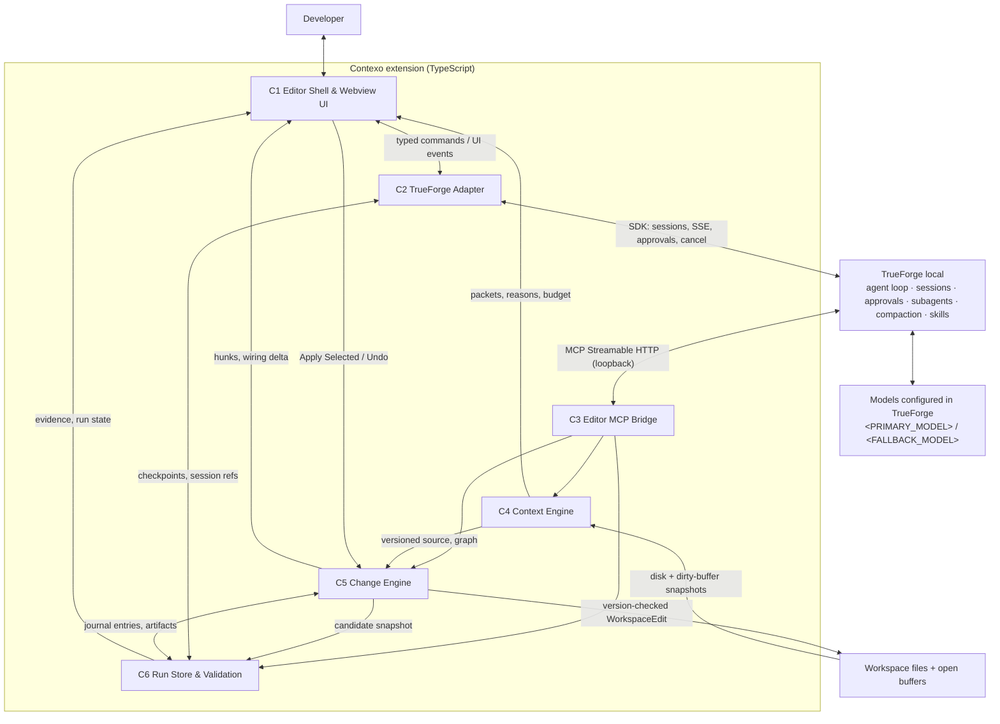

# PRD · Contexo

> An editor-native coding agent for desktop VS Code whose agent loop runs on TrueForge.
> Source design: [Proposed_Solution_V2.md](Proposed_Solution_V2.md). Competition: TrueFoundry Forge-a-thon, Techfest 2026-27 (Round 1 due 20 Nov 2026, 23:59 IST).

| Field | Value |
|---|---|
| Status | Draft v1 |
| Scope | Full V2 design (all capabilities in Proposed_Solution_V2.md) |
| Fork point | `microsoft/vscode-extension-samples` → `webview-view-sample` @ `65c1c44800eeac6fb065a54823ee5ae62c79540a` (verify when adopting) |
| Test repository | `pallets/flask` tag `3.1.3`, commit `22d924701a6ae2e4cd01e9a15bbaf3946094af65` |
| Agent runtime | TrueForge local mode (`npx @truefoundry/trueforge@latest`), SDK/runtime pinned after the first integration run; V1 source reference `35bad5df0ef463c172be8f30cce0612bf9b3df1e` |

### Decisions recorded for this PRD

| Decision | Choice |
|---|---|
| Core component split | 6 runtime components (§6) |
| Scope | Full V2 as written |
| Starting point | Fork of `vscode-extension-samples/webview-view-sample` |
| Command isolation | Host execution only, gated by TrueForge approval, run inside a materialized candidate copy |
| Repo layout | Single package (`extension/` with `src/` and `webview/`) |
| Artifact storage | VS Code workspace storage (`context.storageUri`), never inside the repository |
| Models | Placeholders only (`<PRIMARY_MODEL>`, `<FALLBACK_MODEL>`); model-agnostic |
| TrueForge features | Deferred tool loading, subagents, compaction, Skills / Code Mode |
| Sandbox | Optional and feature-flagged; Skills / Code Mode only light up with a verified sandbox |
| Hunk controls | Both: CodeLens in the native diff **and** review cards in the webview, sharing one decision state |
| Symbol resolution | Tree-sitter always, augmented by VS Code language services (e.g. Pylance) when present |
| Tooling | esbuild (extension host + worker), Vite (webview), Vitest (unit), `@vscode/test-electron` (integration) |

---

## 1. Problem being solved

AI coding tools fail in three recurring ways:

1. **They lose the right code.** Real repositories (Flask 3.1.3 is ~17,000 lines of Python) exceed a model's context window. Tools either concatenate whole files until the window fills or depend on the user to name every file. What goes into the context, and what is left out, decides whether the agent works at all.
2. **They make unsafe edits.** They rewrite functions nobody asked them to touch, call symbols that do not exist, delete code whose purpose they do not understand, and write to disk before the user sees the change. Undo is usually "hope Git saves you".
3. **They break under failure.** A cancelled generation leaves half-applied edits; a dead provider endpoint leaves a stack trace or a hung editor; a crashed run loses all progress.

The developer needs an agent that **finds** the right code within a budget it can explain, **stages** every change for hunk-level review before anything touches disk, and **keeps the workspace consistent** through cancellation, crashes and model failure. Because the agent loop must run on TrueForge, the difficulty that remains is exactly these two things: context assembly and a safe, fast editor experience.

---

## 2. The solution in brief

Contexo is a TypeScript VS Code extension, packaged as a local `.vsix`, that acts as a **client of a TrueForge agent** and an **MCP tool server** for that agent.

- **TrueForge** (local mode) owns the model, the agent/tool loop, sessions, streaming, approvals, subagents, deferred tools, compaction and (optionally) skills.
- **The extension** owns everything the editor knows: repository indexing and retrieval, versioned staging of proposed edits, safety guards, review UI, application, undo, journaling and recovery.
- The agent decides what to read and change by calling ten **editor MCP tools** (`search_workspace`, `assemble_context`, `propose_write`, `review_hunk`, …). Writes are never direct: `propose_write` only stages a **candidate**, `review_hunk` is gated by **TrueForge's native approval**, and only the user's **Apply Selected** moves accepted hunks into the workspace.

Three internal records connect the five capabilities:

| Record | Role |
|---|---|
| **Repository index** | Finds the right code: Tree-sitter symbols + relationships, BM25 + ripgrep, language-service evidence, versioned by snapshot hash |
| **Versioned change engine** | Stages, guards, presents, applies and undoes edits as immutable hunks bound to proposal hashes |
| **Run journal** | Append-only record of completed operations + atomic checkpoints, enabling cancel, resume, fallback and undo |

Three graphical views (**Context**, **Task**, **Review**) share the same source and artifact references, so a reviewer can trace one excerpt from retrieval → task → hunk → verification.

---

## 3. Goals and success metrics

### 3.1 Goals

| ID | Goal |
|---|---|
| G1 | Score full anchors on all nine Round 1 criteria (A1–A3, B1–B4, C1–C2) on the three fixed Flask tasks. |
| G2 | Never write to the workspace without a reviewed, version-checked hunk. |
| G3 | Make retrieval visible and explainable: every excerpt has a reason and a token cost; every omission has a reason. |
| G4 | Keep the workspace consistent through cancellation, crashes, stream drops and provider failure. |
| G5 | Work with any model configured in TrueForge; never call a provider directly; never hard-code a provider. |
| G6 | Reproducible from a clean clone on Windows, macOS and Linux. |

### 3.2 Round 1 scoring targets

| Criterion | Pts | Target anchor | Evidence that proves it |
|---|---:|---|---|
| A1 Inline edit | 10 | Diff rendered with per-hunk accept/reject | Task A: selection → keybinding → instruction → native diff with CodeLens Accept/Reject per hunk |
| A2 Agent mode | 10 | Discovers and edits ≥3 files unprompted | Task B: `src/flask/cli.py`, `tests/test_cli.py`, `docs/cli.rst` (or equivalent) found by the agent, none named |
| A3 Streaming/cancel | 10 | Immediate cancel, workspace consistent | SSE deltas visible; Stop mid-generation; `git status` clean; editor typing stays responsive |
| B1 Context | 15 | Budgeted retrieval, stated, visibly at work in Task B | Context view: graph + file list + per-excerpt reason + token meter |
| B2 Diff safety | 10 | Per-hunk review + working undo shown | Wiring map → hunk navigation; per-hunk decisions; Undo of an applied hunk |
| B3 Resilience | 10 | Automatic fallback to second model | Task C: invalid key/unreachable endpoint → fresh session on fallback model, no user action, `git status` clean |
| B4 TrueForge depth | 10 | MCP tools + native approval + context-engineering feature | Session shows editor MCP calls, approval-driven `review_hunk`, deferred tool discovery, subagent, compaction config |
| C1 Video | 10 | A → B → C complete, legible, verified | ≤4 min recording |
| C2 Write-up | 15 | Architecture, strategy, trade-offs, accurate scorecard, honest limits | 1–3 page PDF with the eight required headings |

### 3.3 Product and engineering metrics

| Metric | Target | How measured |
|---|---|---|
| Silent writes (workspace changes not traceable to an accepted hunk + Apply) | **0** | Journal audit vs. file-system diff in integration tests |
| `git status` after cancel / fallback / rejected run | Unchanged from baseline | Integration test + demo |
| Local stop latency (Stop click → mutation authority revoked, local processes killed) | < 300 ms | Timestamps in journal |
| Extension host event-loop stall during streaming / indexing | < 50 ms p95 | `perf_hooks.monitorEventLoopDelay` in dev builds |
| Time to first streamed token rendered (after TrueForge emits) | < 100 ms added by extension | Event timestamps |
| Initial index of Flask 3.1.3 | < 10 s on a mid-range laptop; text search available immediately | Indexer telemetry (local only) |
| Incremental re-index of one edited file | < 200 ms | Indexer telemetry |
| Context packet assembly | < 500 ms at 12k-token budget | `assemble_context` timing |
| Retrieval recall at budget (relevant files in packet / relevant files total) | Lexical+graph ≥ lexical-only at equal budget | Evaluation set (§10 of V2: fixed tasks + unrelated tasks) |
| Fallback takeover (confirmed primary failure → fallback session streaming) | < 5 s, no user action | Task C timing |
| Undo correctness | Reverses only the run's hunks; unrelated user edits preserved | Undo test matrix |

---

## 4. Scope and constraints

### 4.1 In scope (full V2)

1. **Inline editing**: selection + instruction → staged proposal → native diff → per-hunk accept/reject → apply → undo; scope guard; stale-source rebase/regenerate.
2. **Agent mode**: one repository-level request → coordinator agent + optional subagents → multi-file candidate → checks → per-hunk review → apply; task panel + interactive task/evidence graph.
3. **Context assembly**: `@file` / `@symbol` mentions, automatic hybrid retrieval, token-budgeted packing, inclusion reasons and omissions, Context view graph.
4. **Diff review and undo**: native diffs, CodeLens + cards, grounded summaries, before/after wiring map, symbol check, Chesterton's Fence (`why_exists`), selective and whole-run undo with three-way merge previews.
5. **Streaming, cancellation and recovery**: SSE rendering, immediate local stop, journaled application, checkpoints, reconnect, resume, automatic fallback to a second configured model.
6. **TrueForge depth**: MCP tools, native approvals, deferred tool loading, subagents, compaction, Skills / Code Mode (sandbox-gated).
7. **Submission artefacts**: README with fork point and reproducible setup, agent definition, example model configuration without keys, UPSTREAMS.md, write-up, video.

### 4.2 Out of scope

From the problem statement (not scored): tab completion / fill-in-the-middle; training, fine-tuning or hosting models; any hosted backend, database or deployed service beyond TrueForge local mode; user accounts / authentication; Marketplace publishing.

From product decisions: remote workspaces (SSH/WSL/Codespaces), multi-root workspaces, languages other than Python for structural indexing, embeddings (deferred until a TrueForge-compatible integration exists and evaluation justifies it), multiple concurrent writers in one workspace.

### 4.3 Hard constraints (eligibility)

| Constraint | Consequence for design |
|---|---|
| Agent loop runs on TrueForge | No upstream agent loop is kept; the extension never decides the next tool call. |
| Extension is a TrueForge client via HTTP API or TS SDK | All sessions/turns go through the pinned TrueForge TypeScript SDK. |
| Editor capabilities exposed as MCP tools | Read, search, propose-write, run-command are MCP tools; the agent chooses them. |
| No direct model provider calls | No provider SDK is a dependency; a CI check greps the bundle for provider hosts/SDKs. Summaries are phrased by TrueForge, not by a direct call. |
| Models configured in TrueForge; no single-provider dependency | Model choice is discovered from TrueForge; config ships as placeholders. |
| No API keys committed | Example config only; secrets in TrueForge's own config and VS Code SecretStorage. |
| Upstream licence preserved, fork point declared | MIT LICENSE from the sample kept; UPSTREAMS.md lists every copied file + commit. |
| Agent definition in the public repo | `extension/trueforge/agent.example.json` (+ subagent and inline-agent definitions). |

### 4.4 Technical constraints and assumptions

- Desktop VS Code (≥ 1.90 assumed for webview/view APIs; pin in `engines.vscode`) on Windows, macOS, Linux.
- One active writer (run) per workspace.
- Command execution is **host-only**, gated per call by TrueForge approval, executed with an argv allowlist (no shell), inside a **materialized candidate copy** so the original repository is never the working directory of a command. This is the "clearly restricted, explicitly approved mode" from V2; it is labelled as such in the UI and write-up.
- The sandbox is optional. Skills / Code Mode are behind `contexo.features.sandboxSkills`; every fixed task must pass with it off.
- A Python interpreter with Flask's dev dependencies (`pip install -e . -r requirements/tests.txt` or equivalent) is available for verification.
- TrueForge SDK method names used in this PRD (`sessions.create`, `sessions.createTurnStream`, `sessions.cancel`, approval input events) come from the V2 research and **must be verified against the pinned SDK** before implementation; adapter code isolates them in one folder so renames are local.

### 4.5 Known limits (stated honestly in the write-up)

Incomplete dynamic dependency resolution; partial behavioural evidence (passing tests support only their assertions); model-dependent coding ability; conflict-prone selective undo; no globally atomic multi-file save; no guaranteed mid-token continuation or token savings; host-mode commands are restricted, not sandboxed.

---

## 5. Proposed experience

### 5.1 Surfaces

| Surface | Where | What it shows |
|---|---|---|
| **Inline Edit prompt** | Quick input over the editor, triggered by keybinding `Ctrl+Alt+E` / `Cmd+Alt+E` (configurable) | Instruction box prefilled with the selection's symbol name |
| **Contexo panel** (webview view in the secondary sidebar) | Tabs: **Chat**, **Task**, **Context**, **Review** | Streaming chat, task graph, context graph + packet list, review cards |
| **Native diff editor** | `vscode.diff(original, proposed)` on immutable virtual documents | Per-hunk CodeLens: `✓ Accept` · `✗ Reject` · `Why?` · state badge |
| **Status bar item** | Left status bar | Run state (`Contexo: Running · primary`, `Cancelling…`, `Fallback model`, `3 hunks pending`) + Stop |
| **Decorations** | Source editor + diff editor | Red background on changes outside the inline selection; amber for unresolved/uncertain references |
| **Notifications** | VS Code toast, sparingly | Fallback takeover, recovery available on startup, apply conflict |

### 5.2 Flow: Inline edit (Task A)

1. User opens `src/flask/helpers.py`, selects `get_debug_flag`, presses `Ctrl+Alt+E`, types the instruction.
2. Extension captures a **SelectionSnapshot** (URI, range, document version, content hash, containing symbol) and opens a TrueForge session on the **inline agent** with that snapshot ID.
3. Chat tab (auto-focused but non-modal) streams tokens and tool calls (`read_symbol`, `assemble_context`) as they arrive. The editor stays fully usable.
4. Agent calls `propose_write`. The change engine validates base hashes and exact old text, runs the scope guard and symbol check, builds candidate v1 and its hunks.
5. Native diff opens. Each hunk has CodeLens. Out-of-selection changes show red with a "Outside selection: helpers.py L60–62" label; Accept remains available.
6. Agent calls `review_hunk(hunkId, proposalHash)` for each hunk → TrueForge pauses for approval → the CodeLens and the matching card become active. User clicks Accept/Reject in either place; the adapter sends allow/deny for that exact tool call.
7. User clicks **Apply Selected** (CodeLens at top of diff, card header, or command). Accepted hunks are rebuilt, version-checked and applied via one `WorkspaceEdit`. The file is not auto-saved unless the user saves (configurable: `contexo.apply.saveAfterApply`, default `true` for multi-file runs so the journal can verify disk state).
8. User runs the verification command and sees `False`.
9. **Undo hunk** / **Undo run** are available from the Review tab and the command palette.

Stale source: if the user edits the selection while the run streams, `propose_write` rejects the stale base; the agent receives `STALE_BASE` with the new hash and either rebases (re-proposes against the new snapshot) or the user clicks **Regenerate**. Any changed patch content requires new review.

### 5.3 Flow: Agent mode (Task B)

1. User types the fixed request in the Chat tab (mentions optional; none used in Task B). **Send**.
2. A coordinator session starts. Status: `Running · <PRIMARY_MODEL>`.
3. **Context tab** fills as the agent calls `search_workspace` / `assemble_context`: graph starting at the request node → matched files/symbols → expanded edges (imports, calls, tests, docs). Side list shows each excerpt, its reason ("lexical match: `@click.command` registration", "tests `flask --help` listing", "docs section lists built-in commands"), its token cost and a budget meter (`7,840 / 12,000`). An **Omitted** drawer lists dropped results with reasons (duplicate, lower rank, over budget).
4. **Task tab** shows requirement IDs parsed from the request (R1 command exists, R2 JSON output, R3 masking, R4 in `--help`, R5 test, R6 docs) and tasks linked to files; node states progress Located → Proposed → Checked → Accepted → Applied.
5. The agent may spawn subagents for separable exploration (e.g. "find how built-in commands are documented"); their tool calls appear nested under the coordinator.
6. Deferred tools (`why_exists`, `get_checkpoint`, `get_instruction_pack`) appear in the session only when the agent discovers and loads them.
7. Agent stages edits across ≥3 files into one candidate, then requests `run_command(["python","-m","pytest","tests/test_cli.py","-q"])`. TrueForge pauses for approval; a card shows argv, working directory (candidate copy), timeout. User allows; output streams into the card and is stored as Evidence bound to the candidate hash.
8. **Review tab** opens: 1–2 line overview, 1–2 line behaviour summary, new libraries (none), grouped changes (implementation / tests / docs), **wiring map** (base vs candidate: new `config` command registration edge highlighted). Clicking the new edge opens the native diff at the registering hunk.
9. Agent calls `review_hunk` per hunk; user decides each in CodeLens or cards. **Apply Selected** → dependency check → journaled apply.
10. User shows the TrueForge session (opened from the panel's "Open in TrueForge" link), runs `pytest tests/test_cli.py -q`, then `flask --app <demo app> config` to show masked JSON. Demonstrates **Undo hunk** on one applied hunk and re-applies it.

### 5.4 Flow: Cancellation

1. User clicks **Stop** (panel, status bar, or `Escape` in the chat input / `contexo.stop`).
2. Within one tick: run marked `Cancelling`, MCP mutation authority for the run revoked, tracked process trees killed, UI shows "Stopped locally · waiting for TrueForge to close the turn".
3. Adapter calls `sessions.cancel`. Late tool results are rejected with `RUN_NOT_AUTHORIZED`; late stream events are rendered greyed but never promoted.
4. If an application was in flight, it completes or recovers (application is a short serialized journaled operation that Stop cannot split).
5. Final state: `Cancelled`. Candidate and evidence are retained for diagnosis and **Resume**. Workspace untouched unless the user had already applied hunks, which remain until explicitly undone.

### 5.5 Flow: Fallback (Task C)

1. TrueForge is configured with an invalid key / unreachable endpoint for `<PRIMARY_MODEL>`. User repeats Task A.
2. The adapter receives a provider failure event (or the turn fails with an auth/connection error). The failure classifier confirms it as a **primary-model failure** (not a dropped stream).
3. Without user action: the failed run's write authority is sealed; a checkpoint is written; a **fresh TrueForge session** is created on `<FALLBACK_MODEL>` with a handoff message built from the checkpoint (original request, selected excerpts + versions, completed work, valid proposals, next pending step). No retry of the failed primary.
4. UI: amber banner "Primary model failed (invalid credentials). Continuing on fallback model `<FALLBACK_MODEL>`." The editor is responsive throughout.
5. Fallback output stays in the candidate. During verification the proposal is left **unaccepted**; `git status` shows nothing changed.
6. If the fallback also fails: clear error card with the failure class, workspace preserved, Resume available once configuration is fixed.

### 5.6 Flow: Undo

- **Undo hunk**: if the hunk's after-content still matches the file, reverse directly; otherwise open a three-way merge preview (base = hunk after-state, ours = current file, theirs = hunk before-state). Dependent hunks are listed with a warning. The result is a new candidate that is revalidated before application.
- **Undo run**: same, for all hunks of the run, in reverse journal order. Unrelated user edits are preserved; conflicts produce a preview instead of an overwrite.

### 5.7 Flow: Recovery on restart

On activation, the run store scans for runs with an incomplete `apply` journal entry or a non-terminal state. A notification offers **Recover** (complete or roll back the interrupted application, then show the result in Review) or **Resume** (verify hashes, rebuild valid candidates, invalidate stale evidence/approvals, continue through a new TrueForge turn).

### 5.8 Mentions

In the chat input, `@` opens a completion list fed by the index: files (fuzzy path) and symbols (qualified name, kind, file). Selected mentions become chips; on send they are resolved to `SourceRef`s and passed as mandatory anchors to the session's first user message and to `assemble_context`. Ambiguous symbols show a disambiguation picker.

---

## 6. Components of the solution

| # | Component | One-line responsibility | Folders |
|---|---|---|---|
| C1 | **Editor Shell & Webview UI** | Everything the developer sees and clicks: commands, keybindings, inline edit capture, mentions, native diffs + CodeLens, decorations, the React panel (Chat, Task, Context, Review) | `src/extension.ts`, `src/shell/`, `src/webviewHost/`, `webview/` |
| C2 | **TrueForge Adapter** | Sessions, turn streams, delta assembly, approvals, cancellation, reconnect, failure classification and fallback | `src/trueforge/` |
| C3 | **Editor MCP Bridge** | Loopback MCP server exposing the ten editor tools with schemas, auth, run authority and path confinement | `src/mcp/` |
| C4 | **Context Engine** | Incremental repository index (Tree-sitter + language services + lexical) and the budgeted context assembler | `src/indexer/`, `src/context/` |
| C5 | **Change Engine** | Candidates, operations, hunks, scope/symbol/history guards, review decisions, evidence binding, apply, undo, conflicts | `src/proposals/`, `src/review/`, `src/transactions/`, `src/history/` |
| C6 | **Run Store & Validation** | Run lifecycle state machine, content-addressed artifacts, journal, checkpoints, resume/invalidation, host command runner | `src/runs/`, `src/checkpoints/`, `src/commands/` |

Cross-cutting: `src/shared/` (types, protocol, hashing, IDs, mutex, logging) used by all six.



---

## 7. Folder structure of the repo

```text
TrueFoundry-Weights-of-Sin/
├── README.md                       # Setup from clean clone, TrueForge start, agent load, fork point, model config
├── PRD.md                          # This document
├── Proposed_Solution_V2.md         # Source design
├── LICENSE                         # Project licence (MIT, compatible with upstream)
├── UPSTREAMS.md                    # Fork point + every copied/adapted file with upstream commit and licence
├── docs/
│   ├── writeup/                    # Write-up source (8 required headings) → exported PDF
│   ├── architecture.md             # Long-form architecture notes and diagrams
│   └── evaluation/                 # Retrieval/review evaluation tasks, results, scripts
├── scripts/
│   ├── setup-flask.sh / .ps1       # Clone pallets/flask @3.1.3, create venv, install test deps
│   ├── check-no-provider-calls.mjs # Fails build if a provider SDK/host appears in the bundle
│   └── package-vsix.mjs            # Build + vsce package
└── extension/
    ├── package.json                # Manifest: commands, keybindings, views, configuration, activation events
    ├── tsconfig.json               # Extension host TS config (node target)
    ├── tsconfig.webview.json       # Webview TS config (DOM target)
    ├── esbuild.mjs                 # Bundles src/extension.ts and src/indexer/indexWorker.ts
    ├── vite.config.ts              # Builds webview/ into dist/webview
    ├── vitest.config.ts            # Unit tests
    ├── .vscodeignore
    ├── LICENSE.upstream            # Preserved MIT licence of vscode-extension-samples
    ├── media/                      # Icons for view container, status bar
    ├── grammars/
    │   ├── tree-sitter-python.wasm # Bundled grammar
    │   └── queries/python/
    │       ├── symbols.scm         # Definitions (class, function, method, decorated)
    │       └── references.scm      # Imports, calls, attribute access, decorators
    ├── trueforge/
    │   ├── agent.example.json      # Coordinator agent definition (MCP connector, tools, deferred list, subagents, compaction)
    │   ├── inline-agent.example.json # Inline-edit agent definition (narrow toolset)
    │   ├── subagents/
    │   │   ├── explorer.json       # Read-only exploration worker
    │   │   └── editor-worker.json  # Bounded edit worker (proposes into coordinator's candidate version)
    │   ├── models.example.json     # <PRIMARY_MODEL> / <FALLBACK_MODEL> placeholders, no keys
    │   ├── prompts/
    │   │   ├── coordinator.md
    │   │   ├── inline.md
    │   │   ├── worker.md
    │   │   └── fallback-handoff.md
    │   └── skills/                 # Sandbox-only TrueForge skills (feature-flagged)
    │       └── python-verification/SKILL.md
    ├── instruction-packs/          # Versioned MCP instruction packs (non-sandbox)
    │   ├── python-editing@1.md
    │   ├── pytest-testing@1.md
    │   └── rst-docs@1.md
    ├── src/
    │   ├── extension.ts
    │   ├── shared/
    │   │   ├── types.ts
    │   │   ├── protocol.ts
    │   │   ├── hash.ts
    │   │   ├── ids.ts
    │   │   ├── mutex.ts
    │   │   ├── result.ts
    │   │   ├── errors.ts
    │   │   ├── logger.ts
    │   │   └── config.ts
    │   ├── shell/                              # C1 (host side)
    │   │   ├── commands.ts
    │   │   ├── inlineEdit.ts
    │   │   ├── selectionCapture.ts
    │   │   ├── mentionResolver.ts
    │   │   ├── statusBar.ts
    │   │   ├── notifications.ts
    │   │   └── diff/
    │   │       ├── proposalDocumentProvider.ts
    │   │       ├── diffPresenter.ts
    │   │       ├── hunkCodeLensProvider.ts
    │   │       └── decorations.ts
    │   ├── webviewHost/                        # C1 (host ↔ webview)
    │   │   ├── panelProvider.ts
    │   │   ├── messageBridge.ts
    │   │   ├── uiStateProjector.ts
    │   │   └── html.ts
    │   ├── trueforge/                          # C2
    │   │   ├── client.ts
    │   │   ├── sessionManager.ts
    │   │   ├── turnStream.ts
    │   │   ├── deltaAssembler.ts
    │   │   ├── eventRouter.ts
    │   │   ├── approvals.ts
    │   │   ├── cancellation.ts
    │   │   ├── reconnect.ts
    │   │   ├── failureClassifier.ts
    │   │   ├── fallback.ts
    │   │   ├── capabilityProfile.ts
    │   │   └── agentDefinitions.ts
    │   ├── mcp/                                # C3
    │   │   ├── server.ts
    │   │   ├── auth.ts
    │   │   ├── runAuthority.ts
    │   │   ├── pathGuard.ts
    │   │   ├── schemas.ts
    │   │   ├── toolRegistry.ts
    │   │   ├── outputLimits.ts
    │   │   └── tools/
    │   │       ├── searchWorkspace.ts
    │   │       ├── readFile.ts
    │   │       ├── readSymbol.ts
    │   │       ├── assembleContext.ts
    │   │       ├── getInstructionPack.ts
    │   │       ├── proposeWrite.ts
    │   │       ├── runCommand.ts
    │   │       ├── reviewHunk.ts
    │   │       ├── whyExists.ts
    │   │       └── getCheckpoint.ts
    │   ├── indexer/                            # C4 (index)
    │   │   ├── indexWorker.ts
    │   │   ├── indexClient.ts
    │   │   ├── snapshotManager.ts
    │   │   ├── fileWatcher.ts
    │   │   ├── treeSitter.ts
    │   │   ├── languages/python.ts
    │   │   ├── docsIndexer.ts
    │   │   ├── symbolTable.ts
    │   │   ├── edgeExtractor.ts
    │   │   ├── graphStore.ts
    │   │   ├── lexicalIndex.ts
    │   │   ├── ripgrep.ts
    │   │   ├── languageServiceEnricher.ts
    │   │   └── indexPersistence.ts
    │   ├── context/                            # C4 (assembly)
    │   │   ├── assembler.ts
    │   │   ├── anchors.ts
    │   │   ├── candidateSearch.ts
    │   │   ├── expansion.ts
    │   │   ├── fusion.ts
    │   │   ├── packer.ts
    │   │   ├── tokenizer.ts
    │   │   ├── budget.ts
    │   │   ├── packetStore.ts
    │   │   └── instructionPacks.ts
    │   ├── proposals/                          # C5 (staging)
    │   │   ├── proposalService.ts
    │   │   ├── candidateStore.ts
    │   │   ├── operations.ts
    │   │   ├── hunker.ts
    │   │   ├── scopeGuard.ts
    │   │   └── symbolGuard.ts
    │   ├── history/                            # C5 (Chesterton's Fence)
    │   │   ├── git.ts
    │   │   └── historyGuard.ts
    │   ├── review/                             # C5 (decisions, evidence, explanation)
    │   │   ├── decisionStore.ts
    │   │   ├── evidence.ts
    │   │   ├── dependencyCheck.ts
    │   │   ├── summary.ts
    │   │   └── wiringDiff.ts
    │   ├── transactions/                       # C5 (apply/undo)
    │   │   ├── applySelected.ts
    │   │   ├── rebuild.ts
    │   │   ├── workspaceApplier.ts
    │   │   ├── externalChangeDetector.ts
    │   │   ├── undo.ts
    │   │   └── threeWayMerge.ts
    │   ├── runs/                               # C6 (lifecycle)
    │   │   ├── runController.ts
    │   │   ├── runStateMachine.ts
    │   │   └── runRegistry.ts
    │   ├── checkpoints/                        # C6 (persistence)
    │   │   ├── storageLayout.ts
    │   │   ├── artifactStore.ts
    │   │   ├── journal.ts
    │   │   ├── manifest.ts
    │   │   ├── checkpointBuilder.ts
    │   │   ├── invalidation.ts
    │   │   ├── resume.ts
    │   │   ├── recovery.ts
    │   │   ├── retention.ts
    │   │   └── redaction.ts
    │   └── commands/                           # C6 (validation runner)
    │       ├── runner.ts
    │       ├── candidateWorkspace.ts
    │       ├── argvPolicy.ts
    │       ├── envScope.ts
    │       ├── pythonEnv.ts
    │       └── processTree.ts
    ├── webview/                                # C1 (React app)
    │   ├── index.html
    │   └── src/
    │       ├── main.tsx
    │       ├── App.tsx
    │       ├── bridge/
    │       │   ├── vscodeApi.ts
    │       │   └── trueforgeUiAdapter.ts
    │       ├── state/
    │       │   ├── store.ts
    │       │   └── selectors.ts
    │       ├── views/
    │       │   ├── ChatView.tsx
    │       │   ├── TaskView.tsx
    │       │   ├── ContextView.tsx
    │       │   └── ReviewView.tsx
    │       ├── components/
    │       │   ├── chat/MentionInput.tsx
    │       │   ├── chat/ToolCallCard.tsx
    │       │   ├── chat/ApprovalCard.tsx
    │       │   ├── run/RunHeader.tsx
    │       │   ├── run/FallbackBanner.tsx
    │       │   ├── graph/EvidenceGraph.tsx
    │       │   ├── graph/nodeTypes.tsx
    │       │   ├── graph/edgeTypes.tsx
    │       │   ├── graph/stableLayout.ts
    │       │   ├── graph/EdgeInspector.tsx
    │       │   ├── context/PacketList.tsx
    │       │   ├── context/BudgetMeter.tsx
    │       │   ├── context/OmissionsDrawer.tsx
    │       │   ├── review/SummaryHeader.tsx
    │       │   ├── review/ChangeList.tsx
    │       │   ├── review/HunkCard.tsx
    │       │   ├── review/WiringMap.tsx
    │       │   ├── review/WarningPanel.tsx
    │       │   └── review/EvidencePanel.tsx
    │       └── styles/theme.css
    └── tests/
        ├── unit/                   # Vitest: pure modules (hunker, guards, fusion, packer, journal, state machine…)
        ├── integration/            # @vscode/test-electron: apply/undo/cancel/recovery against a fixture workspace
        ├── fixtures/
        │   ├── mini-python-repo/   # Small repo for fast tests
        │   └── fake-trueforge/     # Scripted SSE/approval server for deterministic adapter tests
        └── e2e/                    # Flask 3.1.3 Tasks A/B/C scripts (manual-trigger, real TrueForge)
```

Runtime storage (outside the repo, `context.storageUri`):

```text
<storageUri>/contexo/
├── index/                     # Rebuildable index snapshot (graph + lexical) keyed by index schema version
├── objects/<sha256>           # Content-addressed source snapshots, patches, evidence outputs
├── runs/<runId>/manifest.json # Atomically replaced checkpoint manifest
├── runs/<runId>/journal.jsonl # Append-only journal
└── packets/<packetId>.json    # Recorded context packets (what the model and the Context view saw)
```

---

## 8. Data models

All types live in `extension/src/shared/types.ts` and are imported by both host and webview (webview only via `protocol.ts` view models). Hashes are lowercase hex SHA-256 unless noted. IDs are prefixed for readability (`run_`, `task_`, `cand_`, `hunk_`, …).

### 8.1 Source and snapshots

```ts
type Sha256 = string;
type RunId = `run_${string}`;
type SnapshotId = `snap_${string}`;

interface Range { startLine: number; startCol: number; endLine: number; endCol: number } // 0-based, end-exclusive col

/** A specific version of the workspace view used by a read, check or proposal. */
interface Snapshot {
  id: SnapshotId;
  kind: 'disk' | 'dirty' | 'candidate';
  /** path (workspace-relative, POSIX) → content hash */
  files: Record<string, Sha256>;
  /** VS Code document versions for dirty buffers at capture time */
  documentVersions: Record<string, number>;
  parent?: SnapshotId;          // candidate snapshots point at their base
  createdAt: string;            // ISO
}

interface SourceRef {
  path: string;                 // workspace-relative POSIX
  range?: Range;
  symbolId?: SymbolId;
  snapshotId: SnapshotId;
  contentHash: Sha256;          // hash of the referenced file version
  provenance: 'disk' | 'dirty-buffer' | 'candidate' | 'git-history';
}

interface SelectionSnapshot {
  uri: string;
  path: string;
  range: Range;
  documentVersion: number;
  contentHash: Sha256;
  selectedText: string;
  containingSymbol?: SymbolId;
  snapshotId: SnapshotId;
}
```

### 8.2 Repository index

```ts
type SymbolId = `sym_${string}`; // hash(path + qualifiedName + declaration start) — stable across unrelated edits

type NodeKind = 'file' | 'module' | 'class' | 'function' | 'method' | 'test' | 'doc_section';
type EdgeKind = 'contains' | 'imports' | 'references' | 'inherits' | 'calls' | 'tests' | 'documents' | 'registers';

interface IndexNode {
  id: SymbolId | `file_${string}` | `doc_${string}`;
  kind: NodeKind;
  path: string;
  qualifiedName: string;        // e.g. flask.cli.routes_command
  declaration: Range;
  bodyRange: Range;
  snapshotHash: Sha256;
  signature?: string;
  docstring?: string;
}

interface IndexEdge {
  id: `edge_${string}`;
  kind: EdgeKind;
  from: IndexNode['id'];
  to: IndexNode['id'] | { unresolved: string };
  proof: SourceRef;             // span that justifies the edge
  provenance: 'tree-sitter' | 'language-service' | 'lexical' | 'heuristic';
  confidence: number;           // 0..1
  inferred: boolean;            // true for heuristic / name-only links
  snapshotHash: Sha256;
}

interface LexicalHit {
  path: string; range: Range; score: number;
  source: 'bm25' | 'ripgrep' | 'path' | 'symbol-name';
  snapshotKind: Snapshot['kind'];
}
```

### 8.3 Context

```ts
type PacketId = `pkt_${string}`;

type InclusionReason =
  | { kind: 'mention'; text: string }
  | { kind: 'selection' }
  | { kind: 'lexical-match'; query: string; rank: number }
  | { kind: 'graph'; edge: IndexEdge['id']; hopFrom: IndexNode['id'] }
  | { kind: 'test-coverage'; testFor: IndexNode['id'] }
  | { kind: 'doc-coverage'; documents: IndexNode['id'] }
  | { kind: 'required-contract'; contractOf: IndexNode['id'] }
  | { kind: 'agent-request'; toolCallId: string };

type OmissionReason = 'duplicate' | 'lower-rank' | 'over-budget' | 'out-of-scope' | 'parse-failed';

interface Excerpt {
  ref: SourceRef;
  text: string;
  tokens: number;
  tokenEstimateKind: 'exact' | 'estimated';
  mandatory: boolean;
  fusedScore: number;
  reasons: InclusionReason[];
  category: 'implementation' | 'test' | 'docs' | 'config';
}

interface ContextPacket {
  id: PacketId;
  runId: RunId;
  taskId?: TaskId;
  anchors: SourceRef[];
  requirementText: string;
  allowedTargets: string[];             // paths/symbols the task may edit
  interfaceInvariants: string[];
  expectedChecks: string[][];           // argv lists
  excerpts: Excerpt[];
  omissions: Array<{ ref: SourceRef; reason: OmissionReason; tokens: number; score: number }>;
  budget: BudgetAccount;
  snapshotId: SnapshotId;
  candidateVersion?: CandidateVersion;
  instructionPacks: Array<{ name: string; version: number }>;
  createdAt: string;
}

interface BudgetAccount {
  window: number;            // model context window from capability profile
  outputReserve: number;
  safetyMargin: number;
  inputAllowance: number;
  excerptBudget: number;     // what assemble_context may spend
  excerptUsed: number;
  cumulativeRunTokens: number; // across calls and workers, as recorded
  overhead: { instructions: number; toolSchemas: number; history: number; logs: number };
}
```

### 8.4 Tasks and requirements

```ts
type RequirementId = `R${number}`;
type TaskId = `task_${string}`;

interface Requirement { id: RequirementId; text: string; source: 'user-request' | 'derived'; status: 'open' | 'satisfied' | 'unsatisfied' | 'uncertain' }

interface TaskContract {
  id: TaskId;
  runId: RunId;
  requirementIds: RequirementId[];
  title: string;
  targets: Array<{ path: string; symbolId?: SymbolId }>;
  interfaceConstraints: string[];
  baseHashes: Record<string, Sha256>;
  dependsOn: TaskId[];
  expectedChecks: string[][];
  limits: { maxFiles: number; maxTokens: number };
  assignedTo: 'coordinator' | { subagentSessionId: string };
  state: 'planned' | 'located' | 'proposed' | 'checked' | 'accepted' | 'applied' | 'undone' | 'failed';
}
```

### 8.5 Candidates, proposals, hunks

```ts
type CandidateVersion = `cand_${string}@${number}`;
type HunkId = `hunk_${string}`;     // hash(path + baseHash + normalized hunk text)
type ProposalHash = Sha256;         // hash(sorted hunkIds + candidate parent version)

type Operation =
  | { op: 'replace'; path: string; baseHash: Sha256; oldText: string; newText: string; occurrence?: number }
  | { op: 'create'; path: string; content: string }
  | { op: 'delete'; path: string; baseHash: Sha256 }
  | { op: 'rename'; from: string; to: string; baseHash: Sha256 };

interface Candidate {
  version: CandidateVersion;
  runId: RunId;
  parent?: CandidateVersion;
  baseSnapshot: SnapshotId;
  overlay: Record<string, Sha256 | { deleted: true } | { renamedFrom: string; hash: Sha256 }>;
  createdBy: { toolCallId: string; taskId?: TaskId };
  frozen: boolean;              // true after Apply Selected starts
}

interface Proposal {
  hash: ProposalHash;
  runId: RunId;
  candidate: CandidateVersion;
  operations: Operation[];
  hunkIds: HunkId[];
  requirementIds: RequirementId[];
  diagnostics: Diagnostic[];
}

interface Hunk {
  id: HunkId;
  proposalHash: ProposalHash;
  path: string;
  baseHash: Sha256;
  oldStart: number; oldLines: number; newStart: number; newLines: number;
  lines: string[];              // unified diff lines with ' ', '-', '+'
  changedSymbols: SymbolId[];
  requirementIds: RequirementId[];
  dependsOn: HunkId[];          // e.g. test hunk depends on implementation hunk
  group: 'implementation' | 'test' | 'docs' | 'config';
  flags: HunkFlag[];
}

type HunkFlag =
  | { kind: 'outside-selection'; span: Range }
  | { kind: 'unresolved-reference'; name: string; span: Range; confirmedMissing: boolean }
  | { kind: 'history-concern'; whyExistsRef: string }
  | { kind: 'external-transform' };

interface Diagnostic { severity: 'error' | 'warning' | 'info'; code: string; path: string; range?: Range; message: string }
```

### 8.6 Review, evidence, application

```ts
interface ReviewDecision {
  hunkId: HunkId;
  proposalHash: ProposalHash;
  toolCallId: string;                   // TrueForge tool call of review_hunk
  sessionId: string;
  status: 'pending' | 'accepted' | 'rejected' | 'invalidated';
  decidedVia?: 'codelens' | 'card' | 'command';
  decidedAt?: string;
}

interface Evidence {
  id: `ev_${string}`;
  runId: RunId;
  candidate: CandidateVersion;
  kind: 'command' | 'parse' | 'symbol-check' | 'type-check' | 'history';
  argv?: string[];
  cwd?: string;                          // candidate copy path (display only)
  environment: { python?: string; platform: string; envHash: Sha256 };
  exitCode?: number;
  durationMs?: number;
  stdoutRef?: Sha256;                    // artifact object
  stderrRef?: Sha256;
  summary: string;
  limitations: string[];
  valid: boolean;                        // false once invalidated
}

interface AppliedChange {
  hunkId: HunkId;
  path: string;
  beforeHash: Sha256;
  afterHash: Sha256;
  forward: Hunk['lines'];
  inverse: Hunk['lines'];
  journalSeq: number;
}
```

### 8.7 Runs, journal, checkpoints

```ts
type RunState =
  | 'running' | 'review' | 'validating' | 'applying' | 'applied'
  | 'cancelling' | 'cancelled' | 'recovery' | 'failed';

interface RunRecord {
  id: RunId;
  mode: 'inline' | 'agent';
  workspaceId: Sha256;                   // hash of workspace folder URI
  state: RunState;
  request: string;
  mentions: SourceRef[];
  selection?: SelectionSnapshot;
  sessions: Array<{ sessionId: string; model: string; role: 'primary' | 'fallback' | 'subagent'; sealed: boolean }>;
  activeCandidate?: CandidateVersion;
  createdAt: string;
}

type JournalEntry =
  | { seq: number; t: string; type: 'run.created'; run: RunRecord }
  | { seq: number; t: string; type: 'run.state'; from: RunState; to: RunState; reason: string }
  | { seq: number; t: string; type: 'session.opened'; sessionId: string; model: string; role: string }
  | { seq: number; t: string; type: 'session.sealed'; sessionId: string; failure?: FailureClass }
  | { seq: number; t: string; type: 'packet.recorded'; packetId: PacketId }
  | { seq: number; t: string; type: 'proposal.staged'; proposalHash: ProposalHash; candidate: CandidateVersion }
  | { seq: number; t: string; type: 'review.decided'; decision: ReviewDecision }
  | { seq: number; t: string; type: 'evidence.recorded'; evidenceId: string }
  | { seq: number; t: string; type: 'apply.begin'; txId: string; hunkIds: HunkId[]; expected: Record<string, Sha256> }
  | { seq: number; t: string; type: 'apply.file'; txId: string; path: string; beforeHash: Sha256; afterHash: Sha256 }
  | { seq: number; t: string; type: 'apply.commit'; txId: string }
  | { seq: number; t: string; type: 'undo.begin' | 'undo.commit'; txId: string; hunkIds: HunkId[] }
  | { seq: number; t: string; type: 'invalidate'; what: 'evidence' | 'decision'; ids: string[]; reason: string };

interface CheckpointManifest {
  schemaVersion: 1;
  runId: RunId;
  workspaceId: Sha256;
  taskIds: TaskId[];
  requirements: Requirement[];
  tasks: TaskContract[];
  completedPatches: ProposalHash[];
  candidates: CandidateVersion[];
  baseHashes: Record<string, Sha256>;
  dependencyHashes: Record<string, Sha256>;    // e.g. pyproject, requirements
  decisions: ReviewDecision[];
  evidence: string[];
  pendingActions: string[];
  sessions: Array<{ sessionId: string; turnId?: string; lastSeq?: number; model: string }>;
  versions: { extension: string; index: number; instructionPacks: Record<string, number>; tools: number; agentDefinition: Sha256 };
  validationEnv: Sha256;
  journalSeq: number;                          // last seq included
  writtenAt: string;
}
```

### 8.8 TrueForge-facing types

```ts
type FailureClass =
  | 'stream-dropped'           // reconnect
  | 'auth-invalid'             // fallback
  | 'endpoint-unreachable'     // fallback
  | 'model-not-found'          // fallback
  | 'rate-limited'             // bounded backoff, then fallback
  | 'malformed-tool-output'    // bounded correction attempt
  | 'tool-error'               // returned to agent
  | 'unknown';

interface CapabilityProfile {
  modelRef: string;            // as configured in TrueForge
  contextWindow: number;
  maxOutput: number;
  tokenizer: 'exact' | 'estimate';
  supportsToolCalls: boolean;
  timeouts: { firstTokenMs: number; idleMs: number; turnMs: number };
  role: 'primary' | 'fallback';
}

interface StreamCursor { sessionId: string; turnId: string; lastSeq: number }
```

### 8.9 Webview protocol view models (in `protocol.ts`)

`HostToWebview` and `WebviewToHost` discriminated unions; see §9.4. View models are projections (e.g. `GraphViewModel { nodes, edges, version }`, `ReviewViewModel { summary, groups, hunks, decisions, evidence }`), never raw store objects.

---

## 9. API / Integrations surface

### 9.1 TrueForge (via pinned TypeScript SDK; names to verify)

| Use | Call / event | Owner file |
|---|---|---|
| Discover agents/models | Agent + model listing (catalog) | `trueforge/capabilityProfile.ts` |
| Start run | `sessions.create({ agent, metadata: { runId, workspaceId } })` | `trueforge/sessionManager.ts` |
| Send turn + stream | `sessions.createTurnStream(sessionId, { input })` → SSE events (text deltas, tool-call deltas, tool results, approvals requested, turn completed/failed) | `trueforge/turnStream.ts` |
| Approvals | Approval input events: allow/deny for a specific `toolCallId` | `trueforge/approvals.ts` |
| Cancel | `sessions.cancel(sessionId)` | `trueforge/cancellation.ts` |
| Reconnect | Resume stream from stored `{sessionId, turnId, lastSeq}`; inspect turn before resubmitting | `trueforge/reconnect.ts` |
| Session link | URL to TrueForge local UI for the session (shown in Task B) | `trueforge/sessionManager.ts` |

Agent definitions (`extension/trueforge/*.example.json`) declare:

- MCP connector: `http://127.0.0.1:<port>/mcp` with header `Authorization: Bearer <connector secret>` (secret injected at load time, never committed).
- Preloaded tools: `search_workspace`, `read_file`, `read_symbol`, `assemble_context`, `propose_write`, `review_hunk`, `run_command`.
- Deferred tools: `why_exists`, `get_checkpoint`, `get_instruction_pack`.
- Approval required (by **literal tool name**): `review_hunk`, `run_command`.
- Subagents: `explorer` (read-only tools), `editor-worker` (read + `propose_write`).
- Compaction: conservative threshold (e.g. compact at 70% of window, preserve tool results referenced by the active candidate).
- Skills (only if `contexo.features.sandboxSkills` and sandbox verified): `python-verification`.

### 9.2 Editor MCP tools (served by C3)

| Tool | Input | Output | Side effects | Approval |
|---|---|---|---|---|
| `search_workspace` | `{ query: string, filters?: { paths?: string[], kinds?: NodeKind[], category?: string }, limit?: number (≤50), snapshot?: SnapshotId \| CandidateVersion }` | `{ hits: Array<{ ref: SourceRef, preview: string, score, source }>, truncated: boolean, indexFresh: boolean }` | None | No |
| `read_file` | `{ path, range?, snapshot? }` | `{ ref: SourceRef, text, totalLines, truncated, version }` | None | No |
| `read_symbol` | `{ symbolId \| qualifiedName, snapshot? }` | `{ node: IndexNode, text, ref, resolution: { provenance, confidence, candidates? } }` | None | No |
| `assemble_context` | `{ taskId?, anchors: Array<SourceRef \| string>, budget?: number, requirement: string }` | `ContextPacket` (excerpts, reasons, omissions, budget) | Records packet; updates Context view | No |
| `get_instruction_pack` *(deferred)* | `{ name, version? }` | `{ name, version, text }` | None | No |
| `propose_write` | `{ taskId?, baseHashes: Record<path,Sha256>, operations: Operation[], requirementIds: RequirementId[] }` | `{ candidate: CandidateVersion, proposalHash, hunks: HunkSummary[], diagnostics: Diagnostic[] }` or error `STALE_BASE` / `OLD_TEXT_NOT_FOUND` / `AMBIGUOUS_MATCH` / `MISSING_SYMBOL` / `HISTORY_CONCERN` / `OUT_OF_PATH` | Stages candidate only; never workspace | No (staging is not writing) |
| `run_command` | `{ argv: string[], candidateVersion, timeoutMs? (≤300000) }` | `{ exitCode, stdout (bounded), stderr (bounded), durationMs, candidate, evidenceId, truncated }` | Runs process in candidate copy | **Yes** (TrueForge approval) |
| `review_hunk` | `{ hunkId, proposalHash }` | `{ hunkId, status: 'accepted' }` (only executes when allowed; deny is recorded by the adapter) | Records decision | **Yes** (TrueForge approval = the user's hunk decision) |
| `why_exists` *(deferred)* | `{ path, range, snapshot? }` | `{ blame: Array<{ commit, author, date, summary, lines }>, linkedIssues: string[], docs: SourceRef[], concern?: string }` | None | No |
| `get_checkpoint` *(deferred)* | `{ runId? }` (defaults to grant's run) | Compact `CheckpointManifest` view + artifact refs | None | No |

Common rules: every call carries the connector secret; the run is derived from the **server-validated grant bound to the session**, never from a model-supplied argument; outputs are bounded (default 16k chars) with explicit `truncated` flags; all paths are confined to the workspace after resolving `..` and symlinks.

### 9.3 VS Code APIs

| API | Use |
|---|---|
| `commands.registerCommand`, `contributes.keybindings` | Inline edit, open panel, stop, apply, undo, resume, show context |
| `window.registerWebviewViewProvider` | Contexo panel |
| `workspace.registerTextDocumentContentProvider` | `contexo-base:` / `contexo-proposed:` immutable virtual documents |
| `commands.executeCommand('vscode.diff', …)` | Native diff |
| `languages.registerCodeLensProvider` | Per-hunk Accept/Reject/Why on proposed documents |
| `window.createTextEditorDecorationType` | Out-of-scope (red) and uncertainty (amber) decorations |
| `workspace.applyEdit(WorkspaceEdit)` + `TextDocument.version` | Version-checked application |
| `workspace.onDidChangeTextDocument`, `createFileSystemWatcher` | Dirty-buffer indexing, external change detection |
| `vscode.executeDefinitionProvider` / `executeReferenceProvider` / `executeDocumentSymbolProvider` | Language-service enrichment |
| `ExtensionContext.storageUri`, `secrets` | Artifact storage; connector secret |
| `window.createStatusBarItem`, `window.withProgress` | Run state, indexing progress |
| `extensions.getExtension('ms-python.python')` (optional) | Discover active Python interpreter |

### 9.4 Host ↔ webview message protocol (`src/shared/protocol.ts`)

```ts
type WebviewToHost =
  | { type: 'chat.send'; text: string; mentions: MentionChip[] }
  | { type: 'mention.query'; prefix: string; kind: 'file' | 'symbol' }
  | { type: 'run.stop' }
  | { type: 'run.resume'; runId: RunId }
  | { type: 'approval.respond'; toolCallId: string; allow: boolean }       // run_command / review_hunk
  | { type: 'hunk.open'; hunkId: HunkId }
  | { type: 'apply.selected'; runId: RunId }
  | { type: 'undo.hunk'; hunkId: HunkId } | { type: 'undo.run'; runId: RunId }
  | { type: 'graph.expand'; nodeId: string; view: 'context' | 'task' | 'wiring' }
  | { type: 'source.open'; ref: SourceRef }
  | { type: 'ready' };

type HostToWebview =
  | { type: 'state.snapshot'; state: UiState }                // on ready / reload
  | { type: 'stream.batch'; runId: RunId; events: UiStreamEvent[] } // batched ≤ every 50 ms
  | { type: 'approval.requested'; toolCallId: string; tool: 'review_hunk' | 'run_command'; payload: unknown }
  | { type: 'context.packet'; packet: ContextPacketView }
  | { type: 'graph.update'; view: 'context' | 'task' | 'wiring'; graph: GraphViewModel }
  | { type: 'review.update'; review: ReviewViewModel }
  | { type: 'run.state'; runId: RunId; state: RunState; model: string; banner?: Banner }
  | { type: 'mention.results'; items: MentionItem[] };
```

### 9.5 Other integrations

| Integration | How | Purpose |
|---|---|---|
| Git CLI | `child_process.execFile('git', …)` (no shell) | `blame --porcelain`, `log`, `show`, `worktree`/`archive` for candidate materialization, `status` for demo checks |
| ripgrep | `@vscode/ripgrep` binary | Exact-match search |
| Tree-sitter | `web-tree-sitter` + bundled `tree-sitter-python.wasm` | Parsing in worker thread |
| jsdiff | `diff` package | Structured hunks |
| diff3 | `node-diff3` | Three-way merge previews for undo |
| MCP | `@modelcontextprotocol/sdk` Streamable HTTP server | Tool serving |
| Schema validation | `zod` (+ `zod-to-json-schema` for MCP tool schemas) | Request/response validation |
| Tokenizer | `js-tiktoken` (estimate; labelled) unless the capability profile provides an exact tokenizer | Budget accounting |
| Process trees | `tree-kill` | Stop tracked commands on cancel |
| Python | Interpreter from `contexo.python.interpreter` or the Python extension | Running Flask checks |

### 9.6 Contributed configuration (`package.json → contributes.configuration`)

| Setting | Default | Meaning |
|---|---|---|
| `contexo.trueforge.baseUrl` | `http://127.0.0.1:<TrueForge default port>` | Local TrueForge |
| `contexo.trueforge.agent` / `inlineAgent` | `contexo-coordinator` / `contexo-inline` | Agent names to load |
| `contexo.models.primary` / `fallback` | `""` | Model refs as named in TrueForge; picker lists discovered models |
| `contexo.context.excerptBudget` | `8000` | Tokens `assemble_context` may spend per packet |
| `contexo.context.outputReserve` / `safetyMargin` | `3000` / `1000` | Budget accounting |
| `contexo.context.maxHops` | `2` | Graph expansion cap |
| `contexo.commands.allowlist` | `["python","pytest","flask","git"]` (first argv element) | Host-mode command policy |
| `contexo.commands.timeoutMs` | `120000` | Default command timeout |
| `contexo.python.interpreter` | `""` (auto-detect) | Interpreter for checks |
| `contexo.apply.saveAfterApply` | `true` | Save applied files so the journal can verify disk |
| `contexo.features.sandboxSkills` | `false` | Enable Skills / Code Mode |
| `contexo.storage.retentionDays` | `14` | Artifact retention |

---

## 10. State management map

| State | Lives in | Persisted? | Authority | Why there |
|---|---|---|---|---|
| Model choice, provider credentials | TrueForge config | Yes (TrueForge) | TrueForge | Eligibility: models configured only in TrueForge; extension never holds provider keys |
| Conversation history, turns, tool-call log | TrueForge session store | Yes (TrueForge) | TrueForge | Harness owns sessions; the extension references, never duplicates |
| Session/turn/seq cursor | C2 memory + checkpoint manifest | Yes (manifest) | Extension | Needed to reconnect without resubmitting a turn |
| Pending tool-call argument deltas | C2 `deltaAssembler` memory | No (retained only for diagnosis) | Extension | Incomplete args must never become patches; discarded on reset |
| Pending approvals (`toolCallId` → hunk/command) | C2 `approvals` memory, mirrored to UI | No (TrueForge re-emits on reconnect) | TrueForge (decision recorded by extension) | Approval is TrueForge-native; extension only routes |
| Connector secret | VS Code `SecretStorage` | Yes (OS keychain) | Extension | Never on disk in plain text; never in repo |
| Run-scoped write grants | C3 `runAuthority` memory | No | Extension | Revocation must be instant and in-process; restart revokes all |
| Run record + lifecycle state | C6 `runRegistry` memory → journal | Yes (journal + manifest) | Extension journal | Single serialized authority for state transitions |
| Repository index (graph, lexical) | C4 worker memory, cached in `index/` | Cache only (rebuildable) | Source code | Index is derived; never more authoritative than code |
| Dirty-buffer content | VS Code documents; hashed into Snapshot | Hash + objects for referenced versions | VS Code | Do not auto-save; capture only what reads/proposals reference |
| Candidate overlays | C5 `candidateStore` memory + `objects/` | Yes (objects + manifest refs) | Change engine | Resume and Undo need exact staged content |
| Hunks, proposals | C5 memory + `objects/` | Yes | Change engine | Immutable, content-addressed |
| Review decisions | C5 `decisionStore` + journal | Yes (journal) | Change engine (bound to TrueForge `toolCallId`) | Content-bound approvals must survive restart and be invalidated precisely |
| Evidence (command output, checks) | C5 `evidence` index + `objects/` | Yes | Change engine | Bound to candidate/test/env; invalidated on change |
| Context packets | C4 `packetStore` → `packets/` | Yes | Context engine | Context view must show exactly what the model saw |
| Applied changes (forward/inverse) | Journal (`apply.*`) + `objects/` | Yes | Run journal | Undo and crash recovery |
| Checkpoint manifest | `runs/<id>/manifest.json` | Yes (atomic replace) | Run journal | Fast resume / fallback handoff |
| Graph layouts (node positions) | Webview store, keyed by node ID | `vscode.getState()` | Webview | Stable positions across updates and panel reloads |
| UI view state (active tab, expanded nodes, filters) | Webview Zustand store | `vscode.getState()` | Webview | Pure presentation; host re-sends `state.snapshot` on reload |
| Streaming text buffer for display | Webview store | No | Webview | Ephemeral; full history is in TrueForge |
| Status bar text | C1 `statusBar` | No | Derived from run state | Projection only |
| Settings | VS Code configuration | Yes | User | Standard |

Rules:

1. **One writer per piece of state.** Webview never mutates host state directly; it sends intents.
2. **Projections are recomputable.** `uiStateProjector` derives view models from run/change/context stores; the webview can be reloaded at any time.
3. **Journal before effect.** Any change to workspace files is preceded by `apply.begin` with expected hashes and followed by `apply.commit`.
4. **Content-addressed artifacts first, manifest second.** A manifest never points at an artifact that is not yet on disk.

---

## 11. Components in detail

### 11.1 C1 · Editor Shell & Webview UI

**Purpose.** All developer-facing interaction. Captures intent (selection, instruction, mentions, Stop, Apply, Undo), presents state (stream, graphs, diffs, cards), and turns clicks into typed intents for C2/C5/C6. It contains **no** agent logic and makes **no** decisions about what to read or change.

**Tech stack.** VS Code Extension API (TypeScript, Node target, esbuild); React 18 + TypeScript (Vite); TrueForge UI components for chat rendering (bridged through a custom adapter); React Flow (`@xyflow/react`) for graphs with `@dagrejs/dagre` for initial layout; Zustand for webview state; VS Code Webview UI Toolkit-compatible CSS variables for theming.

**How it is built.**

- The forked `webview-view-sample` provides the `WebviewViewProvider` skeleton, CSP and nonce handling. It is extended into a React host that loads the Vite bundle from `dist/webview`.
- Host side is split into `shell/` (editor-native surfaces) and `webviewHost/` (panel). Neither imports TrueForge SDK types; they talk to C2/C5/C6 through service interfaces created in `extension.ts`.
- Diff presentation uses two virtual URI schemes. `contexo-base:/<proposalHash>/<path>` serves the exact base content from the artifact store; `contexo-proposed:/<proposalHash>/<path>` serves candidate content. Both are immutable, so a diff can never show a moving target.
- CodeLens appears on the proposed side, one lens line per hunk: `✓ Accept · ✗ Reject · Why? · [pending|accepted|rejected|stale]`. Lens commands send the same intent as the webview card (`approval.respond`), and both read from one decision state in C5, so they cannot disagree. Accept/Reject are enabled only when a matching TrueForge approval is pending; otherwise the lens reads "Waiting for agent review request".
- The webview receives batched stream events (≤ every 50 ms) and full view models for graphs and review; it never interprets raw TrueForge events.

**Files.**

| File | What it contains | Why it exists | Depends on |
|---|---|---|---|
| `src/extension.ts` | `activate()` builds the service container: config, logger, storage layout, run registry, index client (spawns worker), MCP server, TrueForge client, change engine, panel provider, CodeLens/doc providers, status bar; registers disposables; runs startup recovery scan. `deactivate()` revokes grants, stops worker and server. | Single composition root so dependencies are explicit and testable | All component entry modules |
| `src/shell/commands.ts` | Registers `contexo.inlineEdit`, `contexo.openPanel`, `contexo.stop`, `contexo.applySelected`, `contexo.undoHunk`, `contexo.undoRun`, `contexo.resumeRun`, `contexo.showContext`, `contexo.regenerate`, `contexo.reindex`, `contexo.pickModels`. Each is a thin call into a service. | Keep command wiring out of business logic | `inlineEdit`, `runs/runController`, `transactions/*` |
| `src/shell/inlineEdit.ts` | Flow: guard single active run → `selectionCapture` → `showInputBox` → `runController.startInline(selectionSnapshot, instruction)`; opens diff when the first proposal arrives. | Inline-edit entry point (A1) | `selectionCapture`, `runController`, `diffPresenter` |
| `src/shell/selectionCapture.ts` | Builds `SelectionSnapshot`: document version, SHA-256 of buffer text, selected range, containing symbol via `indexClient.symbolAt()`, and registers the dirty snapshot with `snapshotManager`. | Snapshot-bound edits; stale detection | `indexer/indexClient`, `indexer/snapshotManager`, `shared/hash` |
| `src/shell/mentionResolver.ts` | Answers `mention.query` with fuzzy file/symbol matches; resolves chips to `SourceRef` on send; returns disambiguation choices. | `@file` / `@symbol` (B1 explicit) | `indexer/indexClient` |
| `src/shell/statusBar.ts` | Status bar item reflecting run state/model/pending hunks; click → Stop or open panel. | Always-visible run state and Stop | `runs/runRegistry` events |
| `src/shell/notifications.ts` | Wrappers for fallback, recovery-available, conflict notifications with actions. | Consistent, non-spammy messaging | — |
| `src/shell/diff/proposalDocumentProvider.ts` | `TextDocumentContentProvider` for `contexo-base:` and `contexo-proposed:`; reads from `artifactStore`/`candidateStore` by hash. | Immutable diff sides | `checkpoints/artifactStore`, `proposals/candidateStore` |
| `src/shell/diff/diffPresenter.ts` | Opens `vscode.diff` per file, reveals a hunk by ID, opens a multi-file review via sequential diffs or `vscode.changes` where available; tracks open diff editors. | Native diff rendering (A1, B2) | `proposalDocumentProvider`, `proposals/hunker` |
| `src/shell/diff/hunkCodeLensProvider.ts` | Provides one CodeLens group per hunk on proposed documents + an "Apply Selected (n accepted)" lens at top; refreshes on decision changes. | Per-hunk accept/reject in editor | `review/decisionStore`, `trueforge/approvals` |
| `src/shell/diff/decorations.ts` | Red decoration for `outside-selection` flags; amber for unresolved/uncertain; gutter icons for history concerns. | Scope guard visualization | `proposals/scopeGuard` output |
| `src/webviewHost/panelProvider.ts` | `WebviewViewProvider` (from fork), loads HTML, wires `messageBridge`, restores on reload with `state.snapshot`. | Panel lifecycle | `html`, `messageBridge`, `uiStateProjector` |
| `src/webviewHost/html.ts` | Builds HTML with CSP, nonce, asset URIs for the Vite bundle. | Secure webview loading | — |
| `src/webviewHost/messageBridge.ts` | Validates `WebviewToHost` messages (zod), dispatches to services; batches `HostToWebview` stream events (50 ms timer, max batch size). | Typed, validated boundary; no UI-thread flooding | `shared/protocol`, services |
| `src/webviewHost/uiStateProjector.ts` | Pure functions: run/change/context/evidence stores → `UiState`, `GraphViewModel` (context/task/wiring), `ReviewViewModel`. Graph updates only on meaningful operations. | Projections recomputable after reload | C4, C5, C6 stores |
| `webview/src/main.tsx` | React root, theme, error boundary. | Entry | `App` |
| `webview/src/App.tsx` | Tabs (Chat/Task/Context/Review), run header, fallback banner. | Layout | views |
| `webview/src/bridge/vscodeApi.ts` | `acquireVsCodeApi()` wrapper, typed `post`, message subscription, `getState`/`setState`. | Single channel | `shared/protocol` |
| `webview/src/bridge/trueforgeUiAdapter.ts` | Implements the TrueForge UI custom-server adapter contract on top of `stream.batch` / `chat.send`, so TrueForge UI chat components render events without talking to TrueForge directly (keeps secrets in host). | Reuse TrueForge UI (V2) | `vscodeApi`, TrueForge UI |
| `webview/src/state/store.ts` | Zustand store: `uiState`, stream buffers per run, graph layouts by node ID, active tab, expanded nodes. Persists layout/view state via `setState`. | Webview state | `vscodeApi` |
| `webview/src/state/selectors.ts` | Memoized selectors (pending hunks, budget %, grouped changes). | Avoid re-render storms | `store` |
| `webview/src/views/ChatView.tsx` | TrueForge UI chat + `MentionInput` + Stop; nested subagent tool calls. | A2/A3 streaming UI | components |
| `webview/src/views/TaskView.tsx` | Requirements list + task graph (requirement → task → file → symbol → hunk → evidence) with progress states. | Agent progress (A2) | `EvidenceGraph` |
| `webview/src/views/ContextView.tsx` | Context graph + `PacketList` + `BudgetMeter` + `OmissionsDrawer`; packet selector for later reads. | B1 visible retrieval | context components |
| `webview/src/views/ReviewView.tsx` | `SummaryHeader`, `WiringMap`, `ChangeList` grouped by concern, `HunkCard`s, `WarningPanel`, `EvidencePanel`, Apply Selected / Undo. | B2 review | review components |
| `webview/src/components/chat/MentionInput.tsx` | `@` autocomplete, chips, disambiguation. | Mentions | bridge |
| `webview/src/components/chat/ToolCallCard.tsx` | Renders a tool call (name, args summary, result summary, timing, deferred-load badge). | B4 visibility | — |
| `webview/src/components/chat/ApprovalCard.tsx` | For `run_command`: argv, cwd (candidate copy), timeout, Allow/Deny. | Approval UX | bridge |
| `webview/src/components/run/RunHeader.tsx` | State pill, active model, elapsed, Stop, Open in TrueForge link. | Run state | store |
| `webview/src/components/run/FallbackBanner.tsx` | Failure class + fallback model message. | B3 | store |
| `webview/src/components/graph/EvidenceGraph.tsx` | Shared React Flow canvas for context/task/wiring; on-demand expansion (`graph.expand`), node click → `source.open`/`hunk.open`, edge click → `EdgeInspector`. | One graph component for three views | `nodeTypes`, `edgeTypes`, `stableLayout` |
| `webview/src/components/graph/nodeTypes.tsx` | Request, requirement, task, file, symbol, hunk, evidence, excerpt node renderers with state badges. | Visual vocabulary | — |
| `webview/src/components/graph/edgeTypes.tsx` | Solid (verified), dashed (inferred), added (green), removed (red) edges with labels. | Mark inferred vs verified | — |
| `webview/src/components/graph/stableLayout.ts` | Dagre layout for new nodes only; existing node positions pinned from store. | Stable positions (V2 requirement) | `store` |
| `webview/src/components/graph/EdgeInspector.tsx` | Edge kind, proof span (open source), provenance, confidence. | Edge evidence | bridge |
| `webview/src/components/context/PacketList.tsx` | Compact file/excerpt list: path, range, category, tokens, reasons, candidate version. | B1 list | — |
| `webview/src/components/context/BudgetMeter.tsx` | Used vs allowance; breakdown (instructions, schemas, history, excerpts, reserve); "estimated" label. | Budget visible | — |
| `webview/src/components/context/OmissionsDrawer.tsx` | Omitted results with reason and score. | Show what was left out | — |
| `webview/src/components/review/SummaryHeader.tsx` | Overview, behaviour summary, new libraries, uncertain claims. | Fast grounded review | — |
| `webview/src/components/review/ChangeList.tsx` | Searchable list grouped by implementation/tests/docs with per-file decision counts. | Navigation | — |
| `webview/src/components/review/HunkCard.tsx` | Hunk mini-diff, changed symbols, requirement mapping, flags, Accept/Reject (when approval pending), Open in diff. | Mirror of CodeLens | bridge |
| `webview/src/components/review/WiringMap.tsx` | Base vs candidate graph delta using `EvidenceGraph` in wiring mode. | Before/after wiring | `EvidenceGraph` |
| `webview/src/components/review/WarningPanel.tsx` | History concerns (`why_exists` excerpts + links), missing-symbol reports, scope warnings. | Chesterton's Fence UI | — |
| `webview/src/components/review/EvidencePanel.tsx` | Command results bound to candidate version, validity, limitations. | Evidence | — |
| `webview/src/styles/theme.css` | VS Code theme variables, graph colours with light/dark parity. | Theming | — |

**Dependencies (inbound/outbound).** C1 → C2 (start/stop runs, respond to approvals via `runController`), C1 → C5 (apply/undo, decisions read), C1 → C4 (mentions, symbol lookup, packets), C1 → C6 (run state). Nothing depends on C1 except `extension.ts`.

---

### 11.2 C2 · TrueForge Adapter

**Purpose.** The only module that talks to TrueForge's HTTP/SDK surface. Turns runs into sessions and turns, turns SSE into typed internal events, routes approvals, implements cancellation, reconnect, failure classification and automatic fallback.

**Tech stack.** TrueForge TypeScript SDK (pinned exact version), Node `AbortController`, `EventEmitter`-style typed bus, zod for event validation.

**How it is built.**

- `client.ts` wraps the SDK behind a narrow interface (`createSession`, `streamTurn`, `respondApproval`, `cancel`, `listModels`, `getTurn`). Every other file depends on that interface, so SDK API drift is contained in one file and `tests/fixtures/fake-trueforge` can stand in for it.
- Streams are consumed off the critical UI path: events are validated, sequence-numbered, merged (tool-arg deltas) and emitted onto an internal bus; `eventRouter` fans out to the UI batcher, the journal and C6's run controller.
- **Approvals.** When TrueForge emits an approval request for `review_hunk` or `run_command` (gated by literal tool name in the agent definition), `approvals.ts` parses the complete arguments (only after `deltaAssembler` marks them complete), validates that `hunkId`/`proposalHash` exist and are not stale, registers a pending approval, and exposes it to C1. A user decision calls `respondApproval(toolCallId, allow)` and C5's `decisionStore.record(...)`. If args reference a stale proposal, the adapter auto-denies with a reason the agent can read.
- **Cancellation** is two-phase: local (synchronous: run → `cancelling`, `runAuthority.revoke(runId)`, `processTree.killAll(runId)`, abort stream reader) then remote (`sessions.cancel`, awaited in background). Late events are tagged `late` and never promoted.
- **Fallback.** `failureClassifier` maps errors/events to `FailureClass`. `stream-dropped` → `reconnect`. `auth-invalid` / `endpoint-unreachable` / `model-not-found` → `fallback.ts`: seal session (grant revoked, `session.sealed` journaled), write checkpoint, create a new session on the fallback model's agent variant, send `fallback-handoff.md` rendered from the checkpoint, register a fresh run-scoped grant for the new session. `rate-limited` → bounded exponential backoff (max 2 attempts, ≤ 8 s total) then fallback. Malformed tool output → one correction turn, then a clear error.

**Files.**

| File | What it contains | Why | Depends on |
|---|---|---|---|
| `src/trueforge/client.ts` | `TrueForgeClient` interface + SDK-backed implementation; base URL from config; connection health check. | Isolate SDK; enable fake server in tests | SDK, `shared/config` |
| `src/trueforge/sessionManager.ts` | Creates sessions for a run (primary, fallback, records subagent sessions observed in events); stores session ↔ run mapping; builds "Open in TrueForge" URL; journals `session.opened`. | Run ↔ session bookkeeping | `client`, `checkpoints/journal`, `mcp/runAuthority` |
| `src/trueforge/turnStream.ts` | Starts `createTurnStream`, iterates SSE, validates each event (zod), assigns local seq, tracks `StreamCursor`, emits typed events; handles `AbortSignal`. | Streaming (A3) | `client`, `deltaAssembler` |
| `src/trueforge/deltaAssembler.ts` | Per-`toolCallId` buffers for argument deltas; `complete` only on the explicit end event; JSON parse + schema check; exposes incomplete buffers for diagnostics only. | Never act on partial tool args | `shared/types` |
| `src/trueforge/eventRouter.ts` | Fans typed events to: UI batcher (via `messageBridge`), journal (only meaningful events), `runController` (turn completed/failed), `approvals`, `failureClassifier`. Marks deferred-tool loads and subagent spawns for UI badges. | Single routing point | `messageBridge`, `journal`, `runController`, `approvals` |
| `src/trueforge/approvals.ts` | Pending approval registry `{toolCallId, tool, args, sessionId, runId}`; validation against C5; `respond()`; auto-deny stale; re-hydrate from TrueForge on reconnect. | B4: native approval drives review | `client`, `review/decisionStore`, `proposals/candidateStore` |
| `src/trueforge/cancellation.ts` | `stop(runId)`: local phase (sync) + remote phase (async); exposes `localStoppedAt`, `remoteClosedAt` for UI. | A3 immediate cancel | `runs/runController`, `mcp/runAuthority`, `commands/processTree`, `client` |
| `src/trueforge/reconnect.ts` | On `stream-dropped`: backoff, `getTurn` to inspect status, resume from `lastSeq` if supported or re-attach; never resubmits a turn whose status is unknown. | Reconnect without duplication | `client`, `checkpoints/manifest` |
| `src/trueforge/failureClassifier.ts` | Maps HTTP status, SDK error codes, provider error events and timeouts (`CapabilityProfile.timeouts`) to `FailureClass`. | Deterministic failure policy | `capabilityProfile` |
| `src/trueforge/fallback.ts` | Fallback orchestration (seal → checkpoint → new session → handoff → new grant); emits UI banner; handles fallback failure as terminal error with workspace preserved. | B3 | `sessionManager`, `checkpoints/checkpointBuilder`, `mcp/runAuthority`, `agentDefinitions` |
| `src/trueforge/capabilityProfile.ts` | Discovers configured models from TrueForge; builds `CapabilityProfile` (window, max output, tokenizer kind, tool support, timeouts) with user overrides; validates primary ≠ fallback. | Budget + fallback depend on model facts, not presets | `client`, `shared/config` |
| `src/trueforge/agentDefinitions.ts` | Loads `trueforge/*.example.json` (or user copies), validates against the pinned schema, injects MCP URL/port and secret reference, toggles skills by feature flag, renders prompt templates. | Agent definition in repo; reproducible | `mcp/server` (port), `mcp/auth` |

**Prompts** (`extension/trueforge/prompts/`): `coordinator.md` (record requirements as R-IDs, use `assemble_context` before editing, stage via `propose_write`, request `review_hunk` per hunk, run expected checks, never claim unverified results), `inline.md` (stay inside the selection unless necessary; explain any outside change), `worker.md` (task contract fields, return format), `fallback-handoff.md` (template filled from checkpoint).

---

### 11.3 C3 · Editor MCP Bridge

**Purpose.** Expose editor capabilities as MCP tools so **the agent** decides what to read and change, while the extension enforces policy deterministically (auth, run authority, path confinement, schemas, output bounds, no direct writes).

**Tech stack.** `@modelcontextprotocol/sdk` (Streamable HTTP server transport) on Node `http` bound to `127.0.0.1` with an ephemeral port; zod + `zod-to-json-schema`; Node `fs.realpath`.

**How it is built.**

- `server.ts` starts one MCP server per VS Code window on activation; the port is written into the generated agent definition at load time.
- Every request passes a fixed middleware chain: **auth** (connector secret, constant-time compare) → **session binding** (map TrueForge session identity in the MCP session/headers to a run grant) → **schema validation** → **path guard** → **tool handler** → **output limiter** → **journal (for mutating-candidate tools)**.
- Tool handlers are thin: they translate MCP inputs into calls on C4/C5/C6 services and shape results. No handler touches workspace files for writing; the only file writes happen in C5's `workspaceApplier` after user Apply.
- `toolRegistry.ts` declares annotations (`readOnlyHint`, `destructiveHint`) for documentation, but enforcement **does not rely on annotations**; approvals are configured by literal tool name in the agent definition.

**Files.**

| File | What it contains | Why | Depends on |
|---|---|---|---|
| `src/mcp/server.ts` | HTTP server on loopback, MCP Streamable HTTP transport, middleware chain, graceful shutdown, port discovery. | Tool transport | MCP SDK, `auth`, `toolRegistry` |
| `src/mcp/auth.ts` | Generates/stores the installation-local connector secret in `SecretStorage`; verifies `Authorization` header; rejects non-loopback origins. | MCP security | VS Code `secrets` |
| `src/mcp/runAuthority.ts` | `grant(runId, sessionId)`, `revoke(runId)`, `seal(sessionId)`, `resolve(sessionIdentity) → runId | null`; atomic check-and-act helper used under the run mutex. | Never trust model-supplied run IDs; instant revocation | `shared/mutex` |
| `src/mcp/pathGuard.ts` | Normalizes to workspace-relative POSIX; rejects absolute/outside paths after `realpath`; blocks `.git/` writes and configured excludes. | Path confinement | Node `fs` |
| `src/mcp/schemas.ts` | zod schemas for every tool input/output; exported JSON Schemas for MCP listing. | Validation + documentation | zod |
| `src/mcp/toolRegistry.ts` | Registers the ten tools with descriptions, schemas, annotations, and the deferred list (metadata the agent definition mirrors). | One place to see the contract | `tools/*`, `schemas` |
| `src/mcp/outputLimits.ts` | Truncation with explicit markers and `truncated` flags; per-tool caps. | Bounded tool outputs (budget) | — |
| `src/mcp/tools/searchWorkspace.ts` | Merges lexical (BM25/ripgrep) + symbol-name hits from the requested snapshot; returns `SourceRef`s with previews. | Search | `indexer/indexClient` |
| `src/mcp/tools/readFile.ts` | Reads a path at disk/dirty/candidate snapshot; returns version + truncation metadata. | Exact source | `indexer/snapshotManager`, `proposals/candidateStore` |
| `src/mcp/tools/readSymbol.ts` | Resolves symbol by ID or qualified name; returns source + resolution evidence (TS vs LS). | Symbol reads | `indexer/indexClient` |
| `src/mcp/tools/assembleContext.ts` | Calls `context/assembler`; records packet; notifies UI. | B1 core | `context/assembler`, `context/packetStore` |
| `src/mcp/tools/getInstructionPack.ts` | Returns a versioned instruction pack. | Procedural guidance without sandbox | `context/instructionPacks` |
| `src/mcp/tools/proposeWrite.ts` | Calls `proposals/proposalService.propose()` under the run mutex after authority check; returns candidate, hunks, diagnostics or typed error. | Staging only | `proposals/proposalService`, `runAuthority` |
| `src/mcp/tools/runCommand.ts` | Calls `commands/runner.run()` with the candidate version; returns bounded output + evidence ID. Only reachable after TrueForge approval. | Checks | `commands/runner`, `review/evidence` |
| `src/mcp/tools/reviewHunk.ts` | Executes only when TrueForge allowed it: verifies hunk/proposal are current, records `accepted` with the tool-call ID. (Denials are recorded by `trueforge/approvals`.) | Approval-driven review | `review/decisionStore` |
| `src/mcp/tools/whyExists.ts` | Calls `history/historyGuard.explain()`. | Chesterton's Fence | `history/historyGuard` |
| `src/mcp/tools/getCheckpoint.ts` | Returns compact manifest for the grant's run. | Resume / worker context | `checkpoints/manifest` |

---

### 11.4 C4 · Context Engine

**Purpose.** Know the repository well enough to find the right code within a token budget, and explain every choice. Two halves: the **index** (what exists and how it connects, per snapshot) and the **assembler** (what to put in front of the model for this task).

**Tech stack.** Node `worker_threads`; `web-tree-sitter` + bundled `tree-sitter-python.wasm` and `.scm` queries; custom BM25 (small, in-worker) over tokenized identifiers/paths/comments/docs; `@vscode/ripgrep`; VS Code language-service commands (host side only); `js-tiktoken` for estimates; `docutils`-free RST section parsing (regex over underline-style headings) and Markdown headings.

**How it is built.**

- **Worker isolation.** Parsing and indexing run in `indexWorker.ts` so the extension host never blocks. The host-side `indexClient.ts` exposes an async RPC (request IDs, transferable buffers). Language-service enrichment must run on the host (commands are host-only), so `languageServiceEnricher.ts` runs there with concurrency limits and feeds edges back into the worker.
- **Snapshots.** `snapshotManager.ts` tracks three layers: disk, dirty buffers (from `onDidChangeTextDocument`, never saved), and per-run candidate overlays (from C5). Every index entry carries the snapshot hash it was derived from. Queries specify a snapshot; the worker answers using the overlay chain `candidate → dirty → disk`.
- **Nodes and edges.** Tree-sitter queries extract modules, classes, functions/methods (with decorators), tests (`test_*` functions, `Test*` classes), imports, calls, attribute references, inheritance. Heuristic edges: `tests` (test file/function name ↔ target name, imports in test), `documents` (doc section mentioning a symbol/command name), `registers` (decorator/`add_command` patterns, labelled inferred). Language-service definitions/references upgrade edges to `provenance: 'language-service'` with higher confidence.
- **Lexical.** BM25 over identifier-split tokens (camel/snake split), paths, docstrings, comments and doc sections; ripgrep for exact strings and regexes; merged with dirty/candidate overlays.
- **Retrieval pipeline** (`assembler.ts`), exactly the V2 method:
  1. **Anchors**: mentions, selection, identifiers in the request, error text, requirement terms → resolved `SourceRef`s; ambiguous symbols kept as multiple candidates with lower weight.
  2. **Candidate search**: per anchor/term, ranked lists from path match, symbol-name match, BM25, ripgrep, separately for implementation/tests/docs.
  3. **Expansion**: one graph hop from top candidates over `calls`, `imports`, `inherits`, `references`, `tests`, `documents`, `registers`; a second hop only if budget headroom > 40% and capped by `maxHops`; sibling implementations (same decorator/registration pattern) included as a ranked list.
  4. **Fusion**: reciprocal-rank fusion `score(x) = Σ 1 / (k + rank_i(x))`, `k = 60` (configurable for evaluation).
  5. **Packing**: mandatory first (selection, mentions, required contracts/signatures of called symbols), then greedy by `fusedScore / tokens` with a duplicate penalty (overlapping ranges merged, near-duplicate text by shingle hash) and **coverage quotas** (at least one test and one doc excerpt if any scored above threshold). Excerpts are symbol-bounded (whole function/class or doc section), never arbitrary line windows unless the symbol exceeds 40% of the budget, in which case signature + relevant lines are included and the rest listed as an omission.
  6. **Packet**: `ContextPacket` with reasons, omissions, budget, hashes, expected checks and allowed targets.
  7. **Re-expansion**: subsequent `assemble_context` calls with new anchors build on the same task, never silently drop mandatory excerpts; if mandatory content exceeds the budget, return `BUDGET_EXCEEDED_MANDATORY` with a suggestion to split the task.
- **Budget.** `budget.ts` computes `inputAllowance = window − outputReserve − safetyMargin` and subtracts measured overhead (instructions, tool schemas, history estimate) to bound `excerptBudget`; records cumulative usage per run across workers. Estimates are labelled `estimated` unless an exact tokenizer is known.

**Files.**

| File | What it contains | Why | Depends on |
|---|---|---|---|
| `src/indexer/indexWorker.ts` | Worker entry: message loop; owns `treeSitter`, `symbolTable`, `edgeExtractor`, `graphStore`, `lexicalIndex`, `docsIndexer`; handles `indexFiles`, `updateBuffer`, `applyOverlay`, `query`, `symbolAt`, `neighbors`. | Off-thread indexing | indexer modules |
| `src/indexer/indexClient.ts` | Host-side RPC proxy with timeouts, readiness state (`indexFresh`), fallback to direct ripgrep while indexing. | Non-blocking access; text search always available | `worker_threads`, `ripgrep` |
| `src/indexer/snapshotManager.ts` | Captures disk/dirty/candidate snapshots; hashes; resolves `read(path, snapshot)`; emits buffer changes to worker (debounced 150 ms). | Versioned source | VS Code workspace API, `shared/hash`, `proposals/candidateStore` |
| `src/indexer/fileWatcher.ts` | File system watcher + `.gitignore`-aware filter; queues incremental re-index. | Incremental refresh | VS Code API |
| `src/indexer/treeSitter.ts` | Initializes `web-tree-sitter`, loads grammar and queries, parses with timeouts; incremental parse via `tree.edit` for buffers. | Parsing | `web-tree-sitter`, `grammars/` |
| `src/indexer/languages/python.ts` | Python-specific query captures → nodes/edges (decorators, `click` commands, pytest conventions, relative imports). | Language adapter (Python only) | `treeSitter` |
| `src/indexer/docsIndexer.ts` | Splits `.rst`/`.md` into sections (title, range, text), extracts code literals (e.g. ``flask routes``) as terms. | Docs as first-class retrieval targets (Flask docs are RST) | — |
| `src/indexer/symbolTable.ts` | `SymbolId` generation, qualified names, position lookup (`symbolAt`), duplicate tracking. | Stable IDs | `shared/ids` |
| `src/indexer/edgeExtractor.ts` | Builds `IndexEdge`s with proof spans, provenance, confidence, inferred flag; heuristic `tests`/`documents`/`registers`. | Relationships | `symbolTable`, `languages/python` |
| `src/indexer/graphStore.ts` | In-memory adjacency by snapshot; overlay merge; neighbor queries with kind filters and hop caps; base-vs-candidate diff support for wiring maps. | Graph queries | — |
| `src/indexer/lexicalIndex.ts` | Tokenizer (identifier split, stemming-lite), BM25 index with incremental doc updates per file/section. | Lexical ranking | — |
| `src/indexer/ripgrep.ts` | Spawns bundled `rg` with JSON output, workspace confinement, timeouts; merges with overlay content search. | Exact matches | `@vscode/ripgrep` |
| `src/indexer/languageServiceEnricher.ts` | Host-side: for top candidates only, runs definition/reference providers; converts to edges with `provenance: 'language-service'`; no-op if no provider. | Stronger symbol resolution | VS Code commands, `indexClient` |
| `src/indexer/indexPersistence.ts` | Saves/loads worker index to `index/` keyed by schema version + file hashes; validates on load. | Fast startup; rebuildable | `checkpoints/storageLayout` |
| `src/context/assembler.ts` | Orchestrates steps 1–7; returns `ContextPacket`. | Retrieval method | all `context/*`, `indexClient` |
| `src/context/anchors.ts` | Parses request for identifiers, quoted strings, CLI-like tokens, error text; resolves mentions/selection; disambiguation. | Step 1 | `indexClient` |
| `src/context/candidateSearch.ts` | Produces ranked lists per source and category. | Step 2 | `indexClient` |
| `src/context/expansion.ts` | Graph hop expansion with caps and headroom rule. | Step 3 | `indexClient` |
| `src/context/fusion.ts` | RRF with configurable `k`; returns fused ranking with contributing ranks (kept for reasons). | Step 4 | — |
| `src/context/packer.ts` | Mandatory-first greedy packing, duplicate penalty, coverage quotas, symbol-bounded excerpts, omissions. | Step 5 | `tokenizer`, `budget` |
| `src/context/tokenizer.ts` | Token counting abstraction (`exact`/`estimate`), caching by content hash. | Budget accuracy labelling | `js-tiktoken` |
| `src/context/budget.ts` | Allowance computation from `CapabilityProfile`; cumulative run accounting. | Budget enforcement | `trueforge/capabilityProfile` |
| `src/context/packetStore.ts` | Persists packets to `packets/`, indexes by run/task; serves Context view and `get_checkpoint`. | "What the model saw" | `checkpoints/artifactStore` |
| `src/context/instructionPacks.ts` | Loads `instruction-packs/*@N.md`, selects relevant packs by task category, reports versions. | Small, versioned guidance | — |

---

### 11.5 C5 · Change Engine

**Purpose.** The authoritative record of proposed operations, immutable hunks and their review/application status. Enforces model-independent edit safety: exact matches, base hashes, scope, symbol existence, documented history, content-bound approvals, version-checked application, journaled persistence, conflict-aware undo.

**Tech stack.** `diff` (jsdiff) for structured patches; `node-diff3` for three-way merges; VS Code `WorkspaceEdit`; Git CLI; Tree-sitter (via C4) for post-edit parse; language services (via C4) for symbol checks.

**How it is built.**

- **Staging (`propose_write`).** Under the run mutex: verify grant → for each operation, read base from the stated snapshot, check `baseHash` (else `STALE_BASE` with current hash), locate `oldText` exactly (0 matches → `OLD_TEXT_NOT_FOUND`, >1 without `occurrence` → `AMBIGUOUS_MATCH`) → build new content → write candidate objects → new `CandidateVersion` (parent = previous) → hunks via jsdiff `structuredPatch` with 3 lines of context, normalized line endings preserved per file → hunk IDs = hash(path, baseHash, normalized hunk text) → **guards** → record `Proposal` → journal `proposal.staged` → push overlay to C4 so later reads/searches see the candidate.
- **Scope guard** (inline runs): maps each hunk's old-range onto the captured `SelectionSnapshot` range (adjusted by document version deltas) and flags `outside-selection` spans. It never blocks; it flags.
- **Symbol guard**: re-parse changed files in the candidate, collect referenced names introduced/changed by hunks, resolve against candidate index + builtins + imports + language-service results. Confirmed missing (no definition anywhere, not dynamic) → reject proposal with `MISSING_SYMBOL` (file, span, name) so the agent corrects it. Unresolvable-but-possible (dynamic attributes, `getattr`) → `unresolved-reference` flag with `confirmedMissing: false` (shown amber).
- **History guard (Chesterton's Fence)**: for hunks that delete or rewrite ≥ N lines of existing code, `git blame` the removed range, read commit messages; keyword/heuristic concern detection (e.g. "fix", "workaround", "security", issue refs) → `why_exists` details. If a concern exists and the proposal doesn't reference it, return `HISTORY_CONCERN` so the agent pauses and inspects; if it persists, the hunk carries a `history-concern` flag and the WarningPanel requires explicit approval.
- **Review.** Decisions are keyed by `(hunkId, proposalHash, toolCallId)`. Any new proposal that changes a hunk's content creates a new hunk ID; old decisions are `invalidated`. Rejection invalidates evidence whose candidate included that hunk.
- **Apply Selected.** Freeze candidate (`frozen = true`; further `propose_write` creates a new candidate after apply) → `rebuild.ts` builds a new candidate from base + accepted hunks only → `dependencyCheck.ts` ensures no accepted hunk depends on a rejected one (else "repair needed" with the offending pair) → re-parse + symbol guard on the rebuilt candidate → optional re-run of expected checks (prompted if evidence is stale) → `workspaceApplier.ts`: journal `apply.begin` with expected before-hashes → for each file verify current buffer/disk hash equals base → one text-only `WorkspaceEdit` → verify result hashes → save (if configured) and verify disk → journal `apply.file` per file → `apply.commit`. Resource operations (create/delete/rename) are separate steps with explicit preconditions.
- **Undo.** `undo.ts` reads `AppliedChange`s from the journal. If current content at the hunk equals after-content → apply inverse directly (journaled). Otherwise build a three-way merge (`threeWayMerge.ts`) and show a conflict preview diff; user resolves/accepts → applied as a new reviewed change. Undo Run iterates in reverse journal order and never touches lines not owned by the run.
- **External changes.** `externalChangeDetector.ts` compares expected hashes with live buffers/disk before and after apply; detects formatter/save-time transforms (e.g. format-on-save) and flags `external-transform` rather than treating them as approved content.

**Files.**

| File | What it contains | Why | Depends on |
|---|---|---|---|
| `src/proposals/proposalService.ts` | `propose(grant, input)`: full staging pipeline above; returns result or typed error. | Single entry for staging | all `proposals/*`, `history/historyGuard`, `checkpoints/journal` |
| `src/proposals/candidateStore.ts` | Versioned overlays; `read(path, version)`; parent chain; freeze; emits overlay to `snapshotManager`. | Candidate state | `checkpoints/artifactStore` |
| `src/proposals/operations.ts` | Validation/application of `replace/create/delete/rename` against base content; exact match + occurrence rules; EOL/encoding preservation. | Deterministic edit semantics | `shared/hash` |
| `src/proposals/hunker.ts` | jsdiff → `Hunk[]`; immutable IDs; changed-symbol mapping via C4 `symbolAt`; grouping (impl/test/docs) by path rules + index node kind; intra-proposal dependency inference (e.g. test references symbol added in impl hunk). | Hunks | `diff`, `indexer/indexClient` |
| `src/proposals/scopeGuard.ts` | Selection-range mapping and `outside-selection` flags. | A1 scope warning | `shell/selectionCapture` types |
| `src/proposals/symbolGuard.ts` | Post-edit parse + resolution; `MISSING_SYMBOL` vs uncertain flags. | Catch confident edits to non-existent symbols | `indexer/indexClient`, `indexer/languageServiceEnricher` |
| `src/history/git.ts` | `execFile` wrappers: `blame --porcelain -L`, `log --format`, `show`, `rev-parse`, `status --porcelain`; timeouts; no shell. | Git access | Node `child_process` |
| `src/history/historyGuard.ts` | Concern detection, `explain()` for `why_exists` (blame, commits, linked issue refs, related docs via C4 search). | Chesterton's Fence | `git`, `indexer/indexClient` |
| `src/review/decisionStore.ts` | Decision records, invalidation, queries (pending/accepted/rejected per proposal); emits change events for CodeLens/cards; journals `review.decided`. | Shared decision state for CodeLens + cards | `checkpoints/journal` |
| `src/review/evidence.ts` | Create/bind/invalidate `Evidence`; validity rules (candidate hash, env hash, test file hashes). | Evidence bound to exact candidate | `checkpoints/artifactStore`, `journal` |
| `src/review/dependencyCheck.ts` | Accepted-set closure vs hunk `dependsOn`; repair suggestions. | Consistent selections | — |
| `src/review/summary.ts` | Derives factual changes (files, symbols, added commands/imports/libraries, check results) from hunks + evidence; requests short phrasing from the **active TrueForge session** (a structured "summarize these facts" turn, so no direct model call) and links claims to hunk IDs; marks uncertain/unavailable checks. | Fast grounded review | `trueforge/sessionManager`, `wiringDiff` |
| `src/review/wiringDiff.ts` | Base vs candidate graph delta around changed symbols (added/removed edges: registrations, imports, calls/references) with links to hunks. | Before/after wiring map | `indexer/graphStore` (via client) |
| `src/transactions/applySelected.ts` | Orchestrates freeze → rebuild → dependency check → recheck → apply; state transitions via `runController` (`review → validating → applying → applied`). | Apply flow | `rebuild`, `dependencyCheck`, `workspaceApplier`, `runs/runController` |
| `src/transactions/rebuild.ts` | Builds a candidate from base + accepted hunks (re-applies hunks via jsdiff `applyPatch` with zero fuzz). | Apply only reviewed content | `diff`, `candidateStore` |
| `src/transactions/workspaceApplier.ts` | Version/hash verification, `WorkspaceEdit` build/apply, result verification, save + disk verification, resource ops; journals each step. | Safe application | VS Code API, `checkpoints/journal`, `externalChangeDetector` |
| `src/transactions/externalChangeDetector.ts` | Before/after comparisons; format-on-save detection; conflict reports. | Never overwrite later user edits | `snapshotManager` |
| `src/transactions/undo.ts` | Hunk/run undo; direct inverse vs merge preview; journals `undo.*`; invalidates related evidence. | B2 undo | `threeWayMerge`, `workspaceApplier`, `journal` |
| `src/transactions/threeWayMerge.ts` | `node-diff3` merge, conflict regions → preview documents. | Conflict-aware undo | `node-diff3` |

---

### 11.6 C6 · Run Store & Validation

**Purpose.** The run's lifecycle authority and memory: state machine, serialization boundary, append-only journal, content-addressed artifacts, checkpoints, invalidation, resume and crash recovery; plus the approval-gated host command runner that produces evidence against candidates.

**Tech stack.** Node `fs/promises` with `fsync` (`FileHandle.sync`), atomic rename for manifests, JSONL; SHA-256 (`node:crypto`); `child_process.spawn` (no shell) + `tree-kill`; Git worktree/archive for candidate materialization.

**How it is built.**

- **Run controller** (`runController.ts`) is the only place run state changes. It holds a per-workspace **mutex**: state transitions, authority checks, candidate promotion and application all happen under it, which is what makes "late results cannot be promoted after Stop" true. The state machine (`runStateMachine.ts`) is a pure transition table matching V2's diagram (+ `failed`); illegal transitions throw.
- **Storage layout** under `context.storageUri/contexo/`, created with user-only permissions (`0700` dirs / `0600` files on POSIX; default ACLs on Windows).
- **Artifacts** are written as `objects/<sha256>` via temp file + `fsync` + rename; existing objects are not rewritten (idempotent).
- **Journal** appends one JSON line per entry with monotonically increasing `seq` and `fsync` for `apply.*`/`undo.*`/`session.sealed` entries (others batched). Entries are passed through `redaction.ts` (masks env-var-looking secrets, Authorization headers) before writing.
- **Checkpoints** are built from in-memory stores (`checkpointBuilder.ts`) after meaningful operations (proposal staged, decision, evidence, apply commit, seal), written as `manifest.json.tmp` → fsync → rename.
- **Resume** (`resume.ts`): load manifest → verify base and dependency hashes against current workspace → reconstruct candidates from objects → `invalidation.ts` marks evidence/decisions whose inputs changed → rebase candidates whose bases changed (re-run `propose` logic against new base; conflicts → review) → start a new TrueForge turn (or session) with the checkpoint summary.
- **Recovery** (`recovery.ts`) on activation: for any `apply.begin` without `apply.commit`, compare each file's current hash with `beforeHash`/`afterHash` in `apply.file` entries: all after → write commit; all before → mark aborted; mixed → open a recovery review (per-file choose complete/roll back), never overwriting a file whose hash matches neither (user edited it).
- **Command runner (host mode, approval-gated).**
  1. Only invoked from `run_command` after TrueForge approval.
  2. `argvPolicy.ts`: argv array only (no shell), first element on the allowlist, no path outside the candidate copy, timeout ≤ configured max.
  3. `candidateWorkspace.ts` materializes the candidate into a temp directory: `git worktree add --detach <tmp> HEAD` (or `git archive` fallback) → copy untracked/dirty files referenced by the base snapshot → write candidate overlay. The original repository is never the cwd and never written.
  4. `pythonEnv.ts` resolves the interpreter and builds `PYTHONPATH=<tmp>/src` first, so that an editable install of Flask in the venv imports the **candidate** source, not the original repo. It also sets `FLASK_APP` only if argv requires it (never globally).
  5. `envScope.ts` passes a minimal environment (PATH, interpreter vars, locale, HOME/USERPROFILE), strips known secret variables, sets `PYTHONDONTWRITEBYTECODE=1`.
  6. `processTree.ts` spawns, tracks PIDs per run, streams bounded output, enforces timeout, and kills the tree on cancel.
  7. Output stored as artifacts; `Evidence` created and bound to `{candidate, test file hashes, envHash, argv}`; temp worktree removed (kept on failure for diagnosis, subject to retention).

**Files.**

| File | What it contains | Why | Depends on |
|---|---|---|---|
| `src/runs/runController.ts` | `startInline`, `startAgent`, `stop`, `resume`, `transition`, `withRunLock`; enforces one active writer per workspace; wires C2 sessions and C3 grants for a run. | Lifecycle authority + serialization boundary | `runStateMachine`, `runRegistry`, `shared/mutex`, `trueforge/sessionManager`, `mcp/runAuthority`, `checkpoints/*` |
| `src/runs/runStateMachine.ts` | Transition table and guards (`running→review` requires a checked candidate, `applying` not interruptible, etc.). | Correctness by construction | — |
| `src/runs/runRegistry.ts` | In-memory `RunRecord`s, active run per workspace, event emitter for UI/status bar. | Fast reads for projections | — |
| `src/checkpoints/storageLayout.ts` | Paths, directory creation with permissions, schema version file, migrations hook. | Storage policy | VS Code `storageUri` |
| `src/checkpoints/artifactStore.ts` | `put(bytes) → sha`, `get(sha)`, `has(sha)`, atomic writes, reference listing for retention. | Content-addressed artifacts | `shared/hash` |
| `src/checkpoints/journal.ts` | Append (with fsync policy), read/iterate, last-seq, crash-tolerant tail parsing (ignore a torn last line). | Authoritative completed-operations record | `redaction` |
| `src/checkpoints/manifest.ts` | Atomic read/write of `CheckpointManifest`; schema validation. | Fast resume | zod |
| `src/checkpoints/checkpointBuilder.ts` | Assembles manifest from run, tasks, candidates, decisions, evidence, sessions, versions; renders fallback handoff summary. | Fallback + resume input | C2/C4/C5 stores |
| `src/checkpoints/invalidation.ts` | Rules: changed base/dependency/test file/env/proposal → invalidate linked evidence/decisions; journals `invalidate`. | Stale evidence never attaches | `review/evidence`, `review/decisionStore` |
| `src/checkpoints/resume.ts` | Resume algorithm (verify → reconstruct → invalidate → rebase → continue). | Resume valid work | `invalidation`, `proposals/proposalService`, `trueforge/sessionManager` |
| `src/checkpoints/recovery.ts` | Startup scan and interrupted-apply resolution. | Crash safety | `journal`, `transactions/workspaceApplier` |
| `src/checkpoints/retention.ts` | Quota, age-based cleanup of unreferenced objects and old runs; "Delete all Contexo data" command. | Storage policy | `artifactStore` |
| `src/checkpoints/redaction.ts` | Secret-aware filtering for logs/journal (not for source snapshots needed for recovery). | Secret hygiene | — |
| `src/commands/runner.ts` | `run(runId, argv, candidateVersion, timeout)`: policy → materialize → env → spawn → evidence. | Validation runner | all `commands/*`, `review/evidence` |
| `src/commands/candidateWorkspace.ts` | Materialize/cleanup temp candidate copies; cache by candidate version within a run. | Original repo never written by commands | `history/git`, `proposals/candidateStore` |
| `src/commands/argvPolicy.ts` | Allowlist, argument checks, timeout caps; human-readable policy description for ApprovalCard. | Restricted host mode | `shared/config` |
| `src/commands/envScope.ts` | Minimal environment builder + `envHash`. | Scope environment | — |
| `src/commands/pythonEnv.ts` | Interpreter discovery (setting → Python extension API → `python3`/`python` on PATH), version capture, `PYTHONPATH` construction. | Run Flask checks against the candidate | VS Code API |
| `src/commands/processTree.ts` | Spawn, PID tracking per run, bounded stream capture, timeout, `killAll(runId)` via `tree-kill`. | Immediate cancel of local processes | `tree-kill` |

---

### 11.7 Shared modules (`src/shared/`)

| File | Contents | Used by |
|---|---|---|
| `types.ts` | All data models in §8 | All |
| `protocol.ts` | `WebviewToHost` / `HostToWebview` unions, view models, zod validators | C1 host + webview |
| `hash.ts` | SHA-256 helpers, stable JSON hashing | All |
| `ids.ts` | Prefixed ID generators, `HunkId`/`ProposalHash`/`SymbolId` derivations | C4, C5, C6 |
| `mutex.ts` | Async mutex with owner tracking (for diagnostics) | C3, C5, C6 |
| `result.ts` | `Result<T, E>` type for typed tool errors | C3, C5 |
| `errors.ts` | Error codes (`STALE_BASE`, `MISSING_SYMBOL`, `RUN_NOT_AUTHORIZED`, …) with agent-readable messages | C3, C5 |
| `logger.ts` | Output-channel logger with levels, redaction | All |
| `config.ts` | Typed accessors for `contexo.*` settings + change events | All |

### 11.8 Testing plan per component

| Component | Unit (Vitest) | Integration (`@vscode/test-electron`) |
|---|---|---|
| C1 | Projectors, stable layout, protocol validation | CodeLens/card decisions stay in sync; diff opens on immutable docs |
| C2 | Delta assembly, failure classification, approval routing (fake TrueForge) | Stop during stream; reconnect without resubmission; fallback on 401/ECONNREFUSED |
| C3 | Path guard (traversal, symlinks), auth, schema rejects, output limits | Tool calls with revoked grant rejected |
| C4 | RRF, packer quotas/duplicates/budget, anchors, RST sections | Flask index time; Task B packet contains CLI impl + tests + docs |
| C5 | Operations exact-match, hunk IDs stable, scope/symbol/history guards, dependency check, rebuild | Apply with dirty buffer; external edit conflict; undo direct and via merge |
| C6 | State machine, journal torn-tail, manifest atomicity, invalidation rules, argv policy | Crash mid-apply recovery; cancel kills pytest tree; commands never write original repo |

E2E (manual-trigger, real TrueForge): Tasks A, B, C on Flask 3.1.3 with `git status` assertions.

---

## 12. Open risks to verify early

| Risk | Mitigation |
|---|---|
| TrueForge SDK method/event names differ from V2 research | All SDK use isolated in `trueforge/client.ts`; verify in first integration run; pin version |
| TrueForge approval events may not expose tool-call args before approval in the shape assumed | Validate on a spike; fallback: `review_hunk` returns pending and the UI drives decisions via a second approval-gated call |
| TrueForge UI adapter contract may not fit a webview transport | Adapter isolated in `webview/src/bridge/trueforgeUiAdapter.ts`; fallback to a minimal custom chat renderer |
| MCP session identity → run grant binding may not carry TrueForge session ID | Use per-session connector headers set at session creation if supported; otherwise one active run per window + grant per connector token |
| Skills / Code Mode require sandbox not present on judges' machines | Feature-flagged off by default; fixed tasks never depend on it |
| Editable Flask install imports original source in checks | `PYTHONPATH=<candidate>/src` first; verified by printing `flask.__file__` in evidence |
| Format-on-save alters applied content | `externalChangeDetector` flags `external-transform`; journal records actual disk hash |
| Windows path/EOL differences | POSIX-normalized paths internally; per-file EOL preserved in operations |
