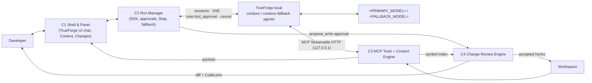

# PRD Lite · Contexo (Round 1 build)

> This document records the original build plan. See the [implemented features](../README.md#implemented-features) and [current engineering and release gates](REMAINING_WORK_PLAN.md#current-implementation-and-release-gates) for the release candidate.

> The one-day version of [PRD.md](PRD.md). It is built to be finished by **20 Nov 2026, 23:59 IST** by **2–3 people in ~12 hours**, scoring full anchors on the fixed Flask tasks.
> Rule for this build: **reuse everything that already exists; hand-write only the novel parts** (context assembly, staged per-hunk review, guards, fallback).

| Field | Value |
|---|---|
| Fork point | `microsoft/vscode-extension-samples`, path `webview-view-sample/`, commit `65c1c44800eeac6fb065a54823ee5ae62c79540a` (verify; MIT) |
| Agent runtime | TrueForge local mode: `npx @truefoundry/trueforge@latest` (default `http://localhost:8790`) |
| Reused packages | `@truefoundry/trueforge-sdk`, `@truefoundry/trueforge-ui`, `@modelcontextprotocol/sdk`, `diff` (jsdiff), `@vscode/ripgrep`, `web-tree-sitter` + `tree-sitter-python.wasm`, `@xyflow/react`, `zod`, `js-tiktoken`, `tree-kill` |
| Test repo | `pallets/flask` tag `3.1.3` (`22d92470`) |
| Models | `<PRIMARY_MODEL>` → `<FALLBACK_MODEL>`, both configured in TrueForge only |

### Decisions for the light build

| Decision | Choice |
|---|---|
| Editor-side base | Fork of `webview-view-sample` + TrueForge UI SDK for chat; no upstream agent loop to remove |
| Team / time | 2–3 people, ~12 working hours |
| Context view | List (excerpts, reasons, tokens, omissions, budget bar) **plus** a simple React Flow graph |
| V2 extras kept | Automatic fallback model, scope guard (red), symbol check |
| TrueForge features | MCP tools, native tool approval, deferred tool loading (config only). Subagents, compaction and Skills are cut. |
| Cut from V2 | Run journal and resume, checkpoints, crash recovery, Chesterton's Fence (`why_exists`), wiring map, candidate-copy command isolation, language-service enrichment, embeddings, multi-run concurrency |

---

## 1. Problem being solved

AI coding agents fail in three ways that matter on a real repository:

1. **Wrong context.** Flask 3.1.3 is ~17k lines of Python, which is larger than a model's context window. Agents either stuff whole files in or need the user to name every file.
2. **Unsafe edits.** They touch code outside the request, call functions that don't exist, and write to disk before the user sees the change.
3. **Fragile runs.** Cancelling leaves half-applied edits, and a dead model endpoint hangs the editor or dumps a stack trace.

The competition fixes the agent loop (TrueForge). What is left to win on is **what the model sees** and **how safely and quickly the editor shows and applies its changes**.

---

## 2. The solution in brief

**Contexo** is a VS Code extension that is a **client of a TrueForge agent** and an **MCP server for it**:

- TrueForge runs the model, the tool loop, streaming, approvals and deferred tool loading. The chat UI comes from `@truefoundry/trueforge-ui`.
- The extension exposes **6 editor MCP tools**. The novel one is `assemble_context`, a budgeted hybrid retriever that reports why each excerpt was chosen and what was left out.
- `propose_write` is **approval-gated in TrueForge**. When TrueForge pauses for approval, the extension stages the edit in memory without touching disk. It runs the **symbol check** (and the **scope guard** for inline edits), then opens a **native VS Code diff with per-hunk Accept/Reject CodeLens**. The user's choice resolves the TrueForge approval, and only accepted hunks are written. Applied hunks can be **undone**.
- **Stop** cancels the TrueForge session and drops any pending proposal. Nothing reaches disk until approval, so the workspace stays consistent.
- If the primary model fails (invalid key or unreachable endpoint), the extension **automatically opens a fresh session on the fallback agent** and replays the request. The workspace stays unchanged until the user reviews.

---

## 3. Goals and success metrics

### 3.1 Scoring targets (the definition of done)

| Criterion | Pts | Target | Demonstrated by |
|---|---:|---:|---|
| A1 Inline edit | 10 | 10 | Task A: selection → `Ctrl+Alt+E` → instruction → native diff with per-hunk Accept/Reject CodeLens |
| A2 Agent mode | 10 | 10 | Task B: agent finds and edits `src/flask/cli.py`, `tests/test_cli.py`, `docs/cli.rst` (or equivalents) without file names |
| A3 Streaming/cancel | 10 | 10 | Tokens stream; Stop mid-generation; `git status` clean; editor usable throughout |
| B1 Context | 15 | 15 | Context tab during Task B: graph + list of chosen files, a reason per excerpt, a budget bar; strategy in the write-up |
| B2 Diff safety | 10 | 10 | Per-hunk review in Tasks A and B; **Undo** of an applied hunk on screen |
| B3 Resilience | 10 | 10 | Task C: invalid key → fallback model takes over with no clicks; `git status` clean |
| B4 TrueForge depth | 10 | 10 | Session shows editor MCP calls, TrueForge approval driving the diff, **deferred tool discovery** of `run_command`; explained in write-up |
| C1 Video | 10 | 10 | ≤4 min, A → B → C, each verified |
| C2 Write-up | 15 | 15 | 8 headings, accurate timestamps, honest limitations |

### 3.2 Engineering checks (must pass before recording)

| Check | Target |
|---|---|
| Writes to disk without an accepted hunk | 0 |
| `git status` after Stop, after rejecting all hunks, after Task C | Unchanged |
| Editor typing during streaming/indexing | No visible lag (indexing runs async in chunks; ripgrep runs as a child process) |
| Flask index build at activation | < 10 s; search works before it finishes (ripgrep only) |
| `assemble_context` latency at 8k-token budget | < 1 s |
| Fallback takeover after primary failure | < 5 s, no user action |
| `pytest tests/test_cli.py -q` after Task B | Passes |

---

## 4. Scope and constraints

### 4.1 In scope

1. Inline edit with per-hunk review, scope guard and symbol check.
2. Agent panel (TrueForge UI chat) driving a multi-file change through MCP tools.
3. `@file` / `@symbol` mentions (as typed text, resolved by the assembler) and automatic hybrid retrieval with a token budget.
4. Staged, approval-gated, per-hunk application with undo (per hunk and "undo last apply").
5. Streaming, Stop and automatic fallback.
6. README (setup from a clean clone, fork point, how to start TrueForge and load the agents), agent definitions, example model config without keys, UPSTREAMS.md, write-up, video.

### 4.2 Out of scope (cut for time)

Everything the problem statement lists as unscored, plus: run journal and crash recovery, resume after restart, Chesterton's Fence, before/after wiring map, subagents, compaction, Skills / Code Mode / sandbox, isolated command execution, language-service symbol resolution, embeddings, non-Python indexing, remote/multi-root workspaces, more than one active run.

### 4.3 Hard constraints (eligibility)

- The agent loop runs only in TrueForge. The extension creates sessions and turns through `@truefoundry/trueforge-sdk` and renders streamed events.
- Read, search, propose-write and run-command are **MCP tools**; the agent decides what to call.
- No model provider SDK or URL anywhere in the extension. A `grep` check runs in `npm run check`.
- Models live only in TrueForge config. The repo ships placeholders, no keys.
- The upstream MIT licence and attribution are preserved, and the fork commit is declared in README and UPSTREAMS.md.
- The agent definitions are committed, and the TrueForge session is shown in the Task B video.

### 4.4 Simplifications we accept (stated in "Known limitations")

- `run_command` runs on the host in the real workspace. It is gated by TrueForge approval and an argv allowlist (`python`, `pytest`, `flask`) with no shell. Tests therefore run **after** hunks are applied, not on a staged candidate.
- Each `propose_write` call needs one TrueForge approval. Per-hunk decisions are made inside that approval (CodeLens), not as one approval per hunk.
- Undo works from in-memory history only and does not survive a window reload.
- Token counts are estimates (`js-tiktoken` `cl100k_base`) and are labelled "≈".
- The symbol check is lexical and structural (Tree-sitter + workspace index + builtins). Dynamic attributes are skipped, not verified.

---

## 5. Proposed experience

### 5.1 Surfaces

| Surface | What the user sees |
|---|---|
| **Contexo panel** (webview, secondary sidebar) | Tabs: **Chat** (TrueForge UI), **Context** (graph + list + budget), **Changes** (applied hunks with Undo) |
| **Inline edit** | `Ctrl+Alt+E` / `Cmd+Alt+E` on a selection → input box → streaming in Chat → diff |
| **Native diff editor** | `contexo-base:` vs `contexo-proposed:` virtual docs. CodeLens per hunk: `✓ Accept` `✗ Reject` (+ `⚠ outside selection` in red). CodeLens at the top: `Apply accepted (n)` `Reject all` |
| **Status bar** | `Contexo: idle` / `streaming · <model>` / `awaiting review (3 hunks)` / `fallback · <model>` + click to Stop |
| **Toasts** | Only for fallback takeover and errors |

### 5.2 Task A: inline edit

1. Select `get_debug_flag` in `src/flask/helpers.py` → `Ctrl+Alt+E` → type the fixed instruction.
2. The extension captures the selection (path, range, document version, SHA-256 of the buffer) and starts a turn on the `contexo` agent. The message carries the instruction, selection metadata and the selected text.
3. Chat streams. The agent calls `read_file` / `assemble_context`, then `propose_write`.
4. TrueForge emits `tool.approval_required` for `propose_write`. The extension:
   - Checks that the base hash still matches the live buffer. If not, it auto-denies with `STALE_BASE`.
   - Builds the proposed text and hunks with jsdiff.
   - Runs the **symbol check**. A confirmed missing name gets auto-denied with `MISSING_SYMBOL name @ file:line`, and the agent retries.
   - Runs the **scope guard** and marks hunks outside the selection in red.
   - Opens the diff with CodeLens.
5. The user accepts or rejects each hunk, then clicks **Apply accepted**. The extension applies the accepted hunks with one `WorkspaceEdit`, saves, records undo, and sends `user.tool_approval` **allow**. The MCP handler returns `applied: [...], rejected: [...]` to the agent. **Reject all** sends **deny** with reason `user rejected all hunks`.
6. Verify in the terminal: `FLASK_DEBUG=off python -c "..."` prints `False`.

### 5.3 Task B: agent mode

1. Type the fixed prompt in the Chat tab (no files named).
2. The agent calls `search_workspace` and `assemble_context`. The **Context tab** updates live:
   - **Graph:** request node → anchor terms → files/symbols. Edges are labelled with their reason (`lexical: "command"`, `registers: @app.cli / cli.add_command`, `tests: test_cli.py references routes_command`, `docs: cli.rst mentions "flask routes"`).
   - **List:** each excerpt with `path:lines`, category (impl/test/docs), reason, ≈tokens. An **Omitted** section shows the reason for each drop (duplicate, lower rank, over budget). A **budget bar** shows `≈7.8k / 8k excerpt budget`.
3. The agent proposes edits. Each `propose_write` opens a diff for review: one or several files per proposal, CodeLens on every hunk.
4. After applying, the agent's attempt to run tests triggers **deferred tool discovery** of `run_command` (visible in the session), then a TrueForge approval for the command. The user allows it, and pytest output streams back.
5. Verify: `pytest tests/test_cli.py -q` passes; `flask --app <demo_app> config` prints masked JSON; open the TrueForge session (link in the panel) to show turns and tool calls.
6. Show **Undo** on one applied hunk in the Changes tab, then re-apply it with **Redo** for final verification.

### 5.4 Stop (A3)

Stop (status bar, panel button, or `Escape` in the panel):

1. Marks the run `cancelled`. From then on, the MCP server rejects that run's calls and any late approval event is ignored.
2. Closes the pending proposal's diff and discards it. Nothing was written.
3. Kills running `run_command` process trees.
4. Calls `client.sessions.cancel(sessionId)`. The stream ends with `turn.done` (`cancelled`).

The panel shows "Stopped". `git status` is unchanged, except for hunks the user had already explicitly applied, which stay until undone.

### 5.5 Task C: fallback (B3)

1. TrueForge's primary model has an invalid key or unreachable endpoint. Repeat Task A.
2. The turn ends in `turn.done` with status `error` (or the SDK throws, or no event arrives within `firstEventTimeoutMs`). The classifier marks it a **model failure**.
3. Without user action, the extension:
   - Marks the primary session sealed and stops reacting to its events.
   - Creates a new session on the **`contexo-fallback`** agent (same tools and instructions, `<FALLBACK_MODEL>`).
   - Replays the original user message, with selection metadata and a one-line note: "Previous model failed; continue the same task."
4. An amber banner says: "Primary model failed (auth error). Continued on fallback `<FALLBACK_MODEL>`." The editor stays responsive.
5. The fallback's proposal opens for review and is **left unaccepted**. `git status` shows no changes.
6. If the fallback also fails, a clear error card appears, and the workspace is untouched.

---

## 6. Components of the solution

Four components. Each folder is owned by one person in the work split (§12).

| # | Component | Reused (not written by us) | Novel (written by us) |
|---|---|---|---|
| **C1** | **Editor Shell & Panel** | `webview-view-sample` (panel, CSP), `@truefoundry/trueforge-ui` (chat), `@xyflow/react` (graph) | Inline-edit capture, Context tab, Changes tab, status bar |
| **C2** | **TrueForge Run Manager** | `@truefoundry/trueforge-sdk` (sessions, streams, approvals, cancel) | Run lifecycle, approval routing to review, Stop, failure classification, automatic fallback |
| **C3** | **MCP Tools + Context Engine** | `@modelcontextprotocol/sdk`, `@vscode/ripgrep`, `web-tree-sitter`, `js-tiktoken` | 6 tools; Python symbol/doc index; hybrid retrieval with RRF, budgeted packing, reasons and omissions |
| **C4** | **Change Review Engine** | `diff` (jsdiff), native `vscode.diff`, `WorkspaceEdit` | Staging from approvals, hunks, per-hunk CodeLens, scope guard, symbol check, apply, undo |



---

## 7. Folder structure

```text
TrueFoundry-Weights-of-Sin/
├── README.md                  # Clean-clone setup, start TrueForge, load agents, models, fork point, demo steps
├── UPSTREAMS.md               # Fork repo + commit + path; reused packages and licences
├── LICENSE                    # MIT
├── docs/
│   ├── PRD.md                 # Full design
│   ├── PRD_Lite.md            # This document
│   ├── Proposed_Solution_V2.md
│   └── writeup.md             # 8 headings → exported to PDF
├── scripts/
│   ├── setup-flask.ps1        # Clone flask@3.1.3, venv, pip install -e . + test deps
│   ├── setup-flask.sh
│   └── demo-app.py            # Tiny Flask app with SECRET_KEY / API_TOKEN for Task B verification
└── extension/                 # ← forked from webview-view-sample
    ├── LICENSE.upstream       # Preserved MIT licence of vscode-extension-samples
    ├── package.json           # Commands, keybinding, view, settings
    ├── tsconfig.json
    ├── esbuild.mjs            # Bundles src/extension.ts
    ├── vite.config.ts         # Builds webview/ → dist/webview
    ├── grammars/
    │   └── tree-sitter-python.wasm
    ├── trueforge/
    │   ├── contexo.agent.json           # Primary agent: <PRIMARY_MODEL>, MCP server, approvals, deferred tools
    │   ├── contexo-fallback.agent.json  # Same agent on <FALLBACK_MODEL>
    │   ├── instructions.md              # Shared system instructions
    │   └── models.example.md            # How to configure the two models in TrueForge (no keys)
    ├── src/
    │   ├── extension.ts
    │   ├── config.ts
    │   ├── types.ts
    │   ├── shell/                # C1 host side
    │   │   ├── panel.ts
    │   │   ├── inlineEdit.ts
    │   │   └── statusBar.ts
    │   ├── run/                  # C2
    │   │   ├── tfClient.ts
    │   │   ├── runManager.ts
    │   │   └── fallback.ts
    │   ├── mcp/                  # C3 transport + tools
    │   │   ├── server.ts
    │   │   ├── tools.ts
    │   │   └── runCommand.ts
    │   ├── context/              # C3 engine
    │   │   ├── indexer.ts
    │   │   ├── search.ts
    │   │   ├── assembler.ts
    │   │   └── tokens.ts
    │   └── review/               # C4
    │       ├── proposal.ts
    │       ├── guards.ts
    │       ├── diffView.ts
    │       └── applyUndo.ts
    ├── webview/
    │   ├── index.html
    │   └── src/
    │       ├── main.tsx
    │       ├── App.tsx
    │       ├── bridge.ts
    │       ├── ChatTab.tsx
    │       ├── ContextTab.tsx
    │       ├── ContextGraph.tsx
    │       └── ChangesTab.tsx
    └── test/
        ├── assembler.test.ts
        ├── proposal.test.ts
        └── guards.test.ts
```

That is about 25 source files.

---

## 8. Data models

All data models live in `extension/src/types.ts`.

```ts
type Sha = string; // sha256 hex

interface Selection {            // captured at Ctrl+Alt+E
  path: string;                  // workspace-relative, POSIX
  startLine: number; endLine: number;   // 0-based inclusive
  docVersion: number;
  hash: Sha;                     // hash of full buffer text
  text: string;
}

interface Run {
  id: string;                    // run_<n>
  mode: 'inline' | 'agent';
  request: string;
  selection?: Selection;
  sessionId: string;
  agent: 'contexo' | 'contexo-fallback';
  state: 'streaming' | 'awaiting-review' | 'done' | 'cancelled' | 'failed';
  sealedSessions: string[];      // sessions whose events are ignored (cancelled / failed primary)
}

// ---- Context ----
interface SymbolEntry {
  id: string;                    // path#qualifiedName
  path: string; name: string; qualifiedName: string;
  kind: 'class' | 'function' | 'method' | 'test' | 'doc';
  startLine: number; endLine: number;
  decorators: string[];          // e.g. ['click.command', 'with_appcontext']
  calls: string[];               // called names (structural)
  imports: string[];             // module-level imported names in file
  text: string;
}

type Reason =
  | { kind: 'mention'; token: string }
  | { kind: 'selection' }
  | { kind: 'lexical'; term: string; rank: number }
  | { kind: 'symbol-name'; term: string; rank: number }
  | { kind: 'calls' | 'called-by' | 'registers' | 'tests' | 'documents'; from: string };

interface Excerpt {
  id: string; path: string; startLine: number; endLine: number;
  category: 'impl' | 'test' | 'docs';
  tokens: number; score: number; reasons: Reason[]; text: string;
}

interface ContextPacket {
  id: string; runId: string; query: string;
  budget: number; used: number;
  excerpts: Excerpt[];
  omitted: Array<{ path: string; startLine: number; endLine: number; reason: 'duplicate' | 'lower-rank' | 'over-budget'; tokens: number }>;
  graph: { nodes: Array<{ id: string; label: string; type: 'request' | 'term' | 'file' | 'symbol' }>; edges: Array<{ from: string; to: string; label: string; inferred: boolean }> };
}

// ---- Review ----
interface FileEdit { path: string; baseHash: Sha; oldText: string; newText: string }   // propose_write op; oldText '' + baseHash 'new' = create

interface Hunk {
  id: string;                    // sha(path + baseHash + hunk lines) first 12
  path: string;
  oldStart: number; oldLines: number; newStart: number; newLines: number;
  lines: string[];
  outsideSelection: boolean;
  decision: 'pending' | 'accepted' | 'rejected';
}

interface Proposal {
  key: Sha;                      // sha(canonical JSON of propose_write args); links the approval and the MCP call
  runId: string; toolCallId: string; threadId: string;
  files: Array<{ path: string; base: string; proposed: string; baseHash: Sha }>;
  hunks: Hunk[];
  status: 'reviewing' | 'applied' | 'rejected' | 'stale' | 'discarded';
  result?: { applied: string[]; rejected: string[] };
}

interface AppliedHunk {          // undo record
  hunkId: string; path: string; runId: string;
  patch: string;                 // unified patch of this hunk alone (forward)
  appliedAt: number; undone: boolean;
}
```

---

## 9. API and integration surface

### 9.1 TrueForge SDK (`@truefoundry/trueforge-sdk`)

| Need | Call |
|---|---|
| Client | `new TrueForge({ baseUrl: 'http://localhost:8790', timeoutInSeconds: 600 })` |
| New session | `client.sessions.create({ agent: { name: 'contexo' } })` (or `contexo-fallback`) |
| Send + stream | `client.sessions.createTurnStream(sessionId, { input: [{ type: 'user.message', content }] })` |
| Merge deltas | `isEventDelta(ev)` / `mergeEventDelta(base, ev)` for `model.message.delta` |
| Events used | `turn.created`, `turn.update` (`paused`/`running`), `turn.done` (`done`/`cancelled`/`error`), `model.message(.delta)`, `tool.approval_required`, `tool.response`, `mcp.initialize` |
| Approve / deny | `client.sessions.createTurnEvents(sessionId, turnId, { events: [{ type: 'user.tool_approval', threadId, toolCallId, approval: { status: 'allow' } \| { status: 'deny', reason } }] })` after `subscribeToTurn(sessionId, turnId, { afterEventId })` |
| Cancel | `client.sessions.cancel(sessionId)` (idempotent; stream ends with `turn.done`) |

These were taken from TrueForge's `docs/api/use-agent.mdx`. **Pin the SDK version** that the first spike runs against.

### 9.2 Agent definitions (`extension/trueforge/*.agent.json`)

Both agents share `instructions.md` and the MCP server entry `contexo-editor` (`http://127.0.0.1:<port>/mcp`, header `X-Contexo-Token: <token>`). The port and token are written by the extension at activation (see §11.1), and the user loads or refreshes the agents in TrueForge by running `extension/trueforge/register.mjs` (or via the UI). The agents are snake_case JSON manifests, and the MCP server is a separate connector file, `contexo-editor.mcp.json`. The tool settings are:

- **Approval required:** `propose_write`, `run_command`.
- **Deferred:** `run_command`, `list_symbols`.
- **Preloaded:** `search_workspace`, `read_file`, `assemble_context`, `propose_write`.

Verify the exact JSON schema against TrueForge `docs/create-agent/overview.mdx` and `docs/key-features/deferred-tool-loading.mdx` in the spike.

### 9.3 Editor MCP tools (C3)

| Tool | Input | Output | Notes |
|---|---|---|---|
| `search_workspace` | `{ query, glob?, limit≤30 }` | `[{ path, line, preview, source: 'ripgrep'\|'symbol' }]` | ripgrep + symbol-name match |
| `read_file` | `{ path, startLine?, endLine? }` | `{ path, text, hash, totalLines, truncated }` | Reads the dirty buffer if the file is open; `hash` is used as `baseHash` |
| `assemble_context` | `{ request, mentions?: string[], budget?: number }` | `ContextPacket` (without `graph`; excerpts as text with `path:lines` headers + reasons) | Also pushes the packet with its graph to the Context tab |
| `list_symbols` *(deferred)* | `{ path? , query? }` | `[{ id, kind, path, lines }]` | Cheap structure lookup |
| `propose_write` *(approval)* | `{ summary, edits: FileEdit[] }` | `{ applied: hunkIds, rejected: hunkIds, files }` | Runs only after allow. Applies the accepted hunks decided during review (looked up by proposal key) |
| `run_command` *(deferred, approval)* | `{ argv: string[], timeoutSec?≤180 }` | `{ exitCode, stdout, stderr, truncated }` | Allowlisted argv[0], no shell, cwd = workspace root, killed on Stop |

All tools check the `X-Contexo-Token` header, resolve paths inside the workspace (no `..`, no absolute paths, no `.git/`), and cap output at 16k characters.

### 9.4 VS Code APIs

`registerWebviewViewProvider`, `registerCommand`, `contributes.keybindings` (`ctrl+alt+e` / `cmd+alt+e`, `editorHasSelection`), `registerTextDocumentContentProvider` (`contexo-base`, `contexo-proposed`), `vscode.diff`, `registerCodeLensProvider`, `createTextEditorDecorationType`, `workspace.applyEdit` + `document.save()`, `createStatusBarItem`, `onDidChangeTextDocument` (index refresh on save only).

### 9.5 Host ↔ webview messages (`webview/src/bridge.ts` ↔ `shell/panel.ts`)

```ts
type ToHost =
  | { type: 'ready' } | { type: 'stop' }
  | { type: 'openSource'; path: string; line: number }
  | { type: 'undo'; hunkId: string } | { type: 'redo'; hunkId: string };
type ToWebview =
  | { type: 'session'; sessionId: string; agent: string; baseUrl: string }  // TrueForge UI attaches to it
  | { type: 'runState'; state: Run['state']; model: string; banner?: string }
  | { type: 'packet'; packet: ContextPacket }
  | { type: 'changes'; hunks: AppliedHunk[] };
```

### 9.6 Settings

| Setting | Default |
|---|---|
| `contexo.trueforgeUrl` | `http://localhost:8790` |
| `contexo.primaryAgent` / `contexo.fallbackAgent` | `contexo` / `contexo-fallback` |
| `contexo.excerptBudget` | `8000` |
| `contexo.firstEventTimeoutMs` | `20000` |
| `contexo.commandAllowlist` | `["python","pytest","flask"]` |

---

## 10. State management map

| State | Lives in | Persisted | Why there |
|---|---|---|---|
| Models, provider keys | TrueForge config | Yes (TrueForge) | Eligibility: models only in TrueForge |
| Conversation, turns, tool calls | TrueForge session | Yes (TrueForge) | The harness owns it; the extension only stores `sessionId` |
| Current `Run` (session, agent, state, sealed sessions) | `runManager` memory | No | One active run; Stop and fallback must act synchronously in-process |
| Pending approval (`toolCallId`, `threadId`, args) | `runManager` memory | No | Needed to answer `user.tool_approval` for the exact call |
| `Proposal` + hunk decisions | `review/diffView` memory, keyed by proposal key | No | Shared by CodeLens and the MCP handler; discarded on Stop |
| Proposal base/proposed text | `review/proposal` memory, served by the virtual doc provider | No | Immutable diff sides |
| Applied hunk history (undo/redo) | `review/applyUndo` memory | No (limitation) | Enough for the demo; listed in limitations |
| Symbol and doc index | `context/indexer` memory | No (rebuilt at activation, < 10 s) | Derived from source; refreshed on save |
| Latest `ContextPacket` + graph | `context/assembler` → webview | No | What the model saw, shown in the Context tab |
| MCP port + token | `extension.ts` memory; written into the agent JSON files on activation | Agent files only | TrueForge must reach the server; the token is random per install and never committed (agent JSONs in the repo hold placeholders) |
| Webview tab and graph positions | Webview `vscode.setState` | Per panel | Survives panel reloads |
| Chat rendering state | TrueForge UI | TrueForge | Reused |

---

## 11. Components in detail

### 11.1 C1 · Editor Shell & Panel

**Purpose:** Capture intent (selection + instruction, Stop, Undo) and present state (chat, context, changes, run status). It has no agent logic.

**Stack:** VS Code API + TypeScript (esbuild); React 18 + Vite; `@truefoundry/trueforge-ui` for chat; `@xyflow/react` for the context graph.

**How it's built:**

- Copy `webview-view-sample` into `extension/` and keep its provider/CSP pattern. Replace its HTML with the Vite bundle.
- **Chat:** mount `TrueForgeUI` attached to the session `runManager` created (message `session`). Allow `connect-src http://localhost:8790` in CSP.
  - **Spike in hour 1:** confirm that TrueForge UI can attach to an existing session from a webview.
  - **Fallback if it can't:** `ChatTab.tsx` renders host-relayed events itself (merged `model.message` text + tool-call chips + approval chips, ~150 lines).
- **Context tab:** list + budget bar + omitted list, and `ContextGraph.tsx` (React Flow, dagre-free: fixed columns request → terms → files → symbols, so positions are stable without a layout library).

| File | Contents | Depends on |
|---|---|---|
| `src/extension.ts` | `activate`: load config. Start the MCP server (C3), get its port, generate a token, and write port + token into `trueforge/*.agent.json` copies under the extension's global storage. Start indexing (async). Create `runManager`, register the panel, commands, CodeLens/doc providers and status bar. `deactivate`: stop the server, cancel the run. | everything |
| `src/config.ts` | Typed getters for `contexo.*` settings | — |
| `src/types.ts` | §8 models | — |
| `src/shell/panel.ts` | `WebviewViewProvider` (from the fork): HTML with CSP + nonce, message bridge (`ToHost`/`ToWebview`), `post()` used by C2/C3/C4 | `types` |
| `src/shell/inlineEdit.ts` | Command `contexo.inlineEdit`: guard the active run, capture `Selection`, `showInputBox`, call `runManager.start('inline', text, selection)` | `run/runManager`, `review/guards` (selection) |
| `src/shell/statusBar.ts` | Status item showing run state/model; click → `contexo.stop` | `run/runManager` events |
| `webview/src/main.tsx` | React root | — |
| `webview/src/App.tsx` | Tabs, run header with Stop and "Open session in TrueForge", fallback banner | `bridge` |
| `webview/src/bridge.ts` | `acquireVsCodeApi`, typed post/subscribe, `get/setState` | — |
| `webview/src/ChatTab.tsx` | `TrueForgeUI` bound to `sessionId` (or the fallback renderer) | `@truefoundry/trueforge-ui` |
| `webview/src/ContextTab.tsx` | Excerpt list (path:lines, category chip, reasons, ≈tokens; click → `openSource`), Omitted section, budget bar | `bridge` |
| `webview/src/ContextGraph.tsx` | React Flow graph from `packet.graph`; edge labels = reasons; dashed = inferred; node click → `openSource` | `@xyflow/react` |
| `webview/src/ChangesTab.tsx` | Applied hunks grouped by run/file with Undo/Redo | `bridge` |

---

### 11.2 C2 · TrueForge Run Manager

**Purpose:** Own the one active run. It starts sessions and turns, consumes the stream, routes `propose_write` approvals to the review engine, implements Stop, and switches to the fallback agent automatically.

**Stack:** `@truefoundry/trueforge-sdk`, `AbortController`, a small typed `EventEmitter`.

**How it's built:**

- `start(mode, text, selection?)` creates a session on the primary agent and builds the first message. For inline runs, the message has the instruction + `path`, line range, `hash` and selected text, with a rule to keep edits inside the selection. It then runs `consume()`.
- `consume()` loops over `createTurnStream` events. It tracks `turnId` and `lastEventId` and merges deltas (the SDK helpers do the work). On `tool.approval_required`:
  - `propose_write`: pass `{toolCallId, threadId, args}` to `review.beginProposal()`. That call either auto-denies (stale or missing symbol) or opens review. When the user finishes, review calls back `resolveApproval(allow|deny, reason)`.
  - `run_command`: show a VS Code modal-less notification with the argv and **Allow / Deny** buttons. TrueForge UI may also show its own approval, and either one works.
- `resolveApproval` → `subscribeToTurn(afterEventId)` + `createTurnEvents(user.tool_approval)`, then continue consuming the resumed stream.
- `stop()` runs synchronously first: `run.state='cancelled'`, `mcp.revoke(run.id)`, `review.discardPending()`, `runCommand.killAll()`. Then it `await`s `sessions.cancel()`.
- `turn.done` with `error`, a thrown SDK/network error, or no event within `firstEventTimeoutMs` goes to `fallback.classify()`. Model or endpoint failures go to `fallback.takeOver(run)`.

| File | Contents | Depends on |
|---|---|---|
| `src/run/tfClient.ts` | Thin wrapper over the SDK: `createSession(agent)`, `streamTurn(sessionId, content)`, `approve(sessionId, turnId, threadId, toolCallId, allow, reason?, afterEventId)`, `cancel(sessionId)`, `sessionUrl(sessionId)`. The only file that imports the SDK. | SDK, `config` |
| `src/run/runManager.ts` | `Run` state, `start`, `consume`, approval routing, `resolveApproval`, `stop`, events for the panel/status bar, ignoring events from sealed sessions | `tfClient`, `review/diffView`, `mcp/server` (revoke), `mcp/runCommand`, `fallback`, `shell/panel` |
| `src/run/fallback.ts` | `classify(err \| turnDone)` → `'model-failure' \| 'cancelled' \| 'other'` (HTTP 401/403/404/5xx, ECONNREFUSED/ENOTFOUND/timeouts, provider error text in `turn.done.state`). `takeOver(run)`: seal the primary, create a `contexo-fallback` session, replay the first message + note, post the banner. Runs at most once per run. | `tfClient`, `runManager` |

---

### 11.3 C3 · MCP Tools + Context Engine

**Purpose:** Give the agent editor capabilities as MCP tools, and do the core novel work: choose the right code within a token budget and explain the choice.

**Stack:** `@modelcontextprotocol/sdk` (Streamable HTTP on `127.0.0.1`, random port), `zod`, `@vscode/ripgrep`, `web-tree-sitter` + `tree-sitter-python.wasm`, `js-tiktoken`, `tree-kill`.

**How retrieval works (`assemble_context`):**

1. **Anchors.** Use the mentions (`@path` → whole-file or top symbols; `@name` → symbol lookup) plus the inline selection. From the request, extract terms: identifiers, quoted strings, CLI-ish words (`flask config` → `config`, `command`, `cli`), and capitalised constants (`SECRET`, `TOKEN`). Drop stopwords.
2. **Candidate lists**, each ranked independently:
   - (a) BM25 over symbol entries (name + docstring + body tokens, snake/camel split).
   - (b) Symbol-name match.
   - (c) ripgrep hits per term, mapped to the enclosing symbol.
   - (d) Doc sections (`.rst`/`.md` headings) by BM25.
3. **One-hop expansion** from the top 10 fused candidates:
   - `calls`/`called-by` (name match in `calls`).
   - `registers`: decorator patterns like `@click.command`, `@app.cli.command`, `cli.add_command(x)`, and siblings sharing the same registration pattern.
   - `tests`: test symbols whose body calls or references the candidate's name, or test files named `test_<module>.py`.
   - `documents`: doc sections containing the name or the CLI word.
   - Each expanded item gets a reason that names its source.
4. **Fusion:** reciprocal-rank fusion `score = Σ 1/(60 + rank_i)` across lists (expansion lists count as lists).
5. **Packing:**
   - Mandatory items go first: selection and mentions.
   - Then greedy by `score / tokens` until the budget is reached.
   - Overlapping ranges are merged. A duplicate penalty applies to excerpts from the same file beyond 3.
   - **Coverage quota:** the best test and the best doc excerpt are reserved if either scored at all.
   - Excerpts are symbol- or section-bounded. A symbol larger than 30% of the budget is cut to its signature + docstring + matching lines.
6. **Output:** text with `### path:start-end · impl|test|docs · reason · ≈tokens` headers, followed by an "Omitted" list. The full packet + graph goes to the Context tab.

| File | Contents | Depends on |
|---|---|---|
| `src/mcp/server.ts` | HTTP server + Streamable HTTP transport. Token check middleware, run-revocation check (rejects while the run is cancelled), path guard (`resolveInWorkspace`), output cap. Registers the tools from `tools.ts`. Exposes `port`, `revoke(runId)`. | MCP SDK, `tools` |
| `src/mcp/tools.ts` | zod schemas + handlers for `search_workspace`, `read_file`, `assemble_context`, `list_symbols`, `propose_write` (computes the proposal key from args → `review.finalize(key)` → returns applied/rejected), `run_command` (delegates). Tool descriptions are written so the agent knows to call `assemble_context` before editing and to use `read_file` hashes as `baseHash`. | `context/*`, `review/diffView`, `runCommand`, `shell/panel` |
| `src/mcp/runCommand.ts` | `spawn(argv[0], argv.slice(1), { cwd: workspaceRoot, shell: false })`, allowlist, timeout, output cap, PID tracking, `killAll()` via `tree-kill` | `tree-kill`, `config` |
| `src/context/indexer.ts` | Walks `*.py`, `*.rst`, `*.md` (respecting `.gitignore` via ripgrep `--files`). Parses Python with Tree-sitter into `SymbolEntry` (classes, functions, methods, tests, decorators, calls, imports) and splits docs into sections. Indexes in chunks with `setImmediate` yields so the host never blocks. Re-indexes a file on save. API: `symbols()`, `byName(name)`, `inFile(path)`, `enclosing(path,line)`, `ready` promise. | `web-tree-sitter`, `@vscode/ripgrep` |
| `src/context/search.ts` | Identifier tokenizer, a small BM25 over symbols and doc sections, and a ripgrep wrapper (`--json`, per-term, max hits) that maps hits to enclosing symbols | `indexer`, `@vscode/ripgrep` |
| `src/context/assembler.ts` | Steps 1–6 above; returns `ContextPacket` with graph | `search`, `indexer`, `tokens`, `config` |
| `src/context/tokens.ts` | `count(text)` with `js-tiktoken` (`cl100k_base`), cached by hash, labelled as an estimate | `js-tiktoken` |

---

### 11.4 C4 · Change Review Engine

**Purpose:** Turn a `propose_write` approval request into a safe per-hunk review, write only accepted hunks, and make them undoable.

**Stack:** jsdiff (`structuredPatch`, `applyPatch`, `createPatch`), `vscode.diff`, CodeLens, decorations, `WorkspaceEdit`.

**How it's built:**

- `beginProposal(run, toolCallId, threadId, args)`:
  1. Compute `key = sha(canonical(args))`.
  2. For each edit: get the live text (open buffer, or disk). If the hash ≠ `baseHash`, auto-deny with `STALE_BASE path (current hash …), re-read and retry`.
  3. Find `oldText` exactly once. Zero matches or more than one auto-denies with `OLD_TEXT_NOT_FOUND` / `AMBIGUOUS`. Then build `proposed`.
  4. Run `structuredPatch` (3 context lines) → hunks with IDs.
  5. Guards: if the symbol check finds missing names, auto-deny with `MISSING_SYMBOL`. For inline runs, the scope guard flags each hunk.
  6. Register the virtual docs, open `vscode.diff` per file (first file focused), refresh the CodeLens, and set the status to "awaiting review".
- CodeLens commands set `decision` per hunk. **Apply accepted** runs `applyAccepted(key)`:
  1. Re-verify the base hash. If the file changed during review, mark it `stale` and deny with a reason.
  2. Rebuild each file from the base + accepted hunks only (`applyPatch` on a patch built from accepted hunks).
  3. Apply one `WorkspaceEdit` with a full-range replace per file, then `save()`.
  4. Push undo records, store `result` on the proposal, and call `runManager.resolveApproval(allow)`.
- **Reject all:** `resolveApproval(deny, 'user rejected all hunks')`.
- When TrueForge then executes `propose_write` over MCP, `tools.ts` calls `finalize(key)`, which returns the stored result. If the key is unknown (should not happen), it returns an error and writes nothing.
- **Undo hunk:** reverse the hunk's patch (`applyPatch` with the reversed patch) on the current text. If it doesn't apply cleanly, show "Cannot undo automatically: file changed at this hunk" and leave the file alone. **Redo** re-applies the forward patch the same way. **Undo last apply** undoes all hunks of the latest apply in reverse order.

**Symbol check (`guards.ts`):**

1. Parse each proposed file with Tree-sitter.
2. Collect bare-name calls (`foo(...)`, not `x.foo(...)`) and decorator names located in `+` lines.
3. A name passes if it is any of:
   - Defined or imported in the proposed file (including defs added in the same proposal).
   - A Python builtin.
   - A known name in the workspace index that the file imports or can import.
   - A parameter or local assignment in the enclosing function.
4. Anything else is reported as `MISSING_SYMBOL name @ path:line`.
5. Names reached through `*` imports are treated as unknown-but-allowed (no false denials).

**Scope guard:** map each hunk's old range against the selection's line range, adjusted by line deltas of hunks above it. Hunks outside the range get `outsideSelection = true`, which shows as a red decoration on the proposed side plus a `⚠ outside selection (L…)` CodeLens. Accept stays available.

| File | Contents | Depends on |
|---|---|---|
| `src/review/proposal.ts` | Exact-match edit application, hashing, hunk construction, proposal key, `rebuildFromAccepted(base, hunks)` | `diff` |
| `src/review/guards.ts` | `symbolCheck(files, index)`, `scopeGuard(hunks, selection)`, Python builtins list | `context/indexer`, `web-tree-sitter` |
| `src/review/diffView.ts` | Proposal registry; `beginProposal`, `applyAccepted`, `rejectAll`, `finalize`, `discardPending`; `TextDocumentContentProvider` for both schemes; CodeLens provider; decorations; opening diffs | `proposal`, `guards`, `applyUndo`, `run/runManager` |
| `src/review/applyUndo.ts` | `applyFiles(map)` via `WorkspaceEdit` + save; undo/redo stack of `AppliedHunk`; posts `changes` to the panel | `diff`, `shell/panel` |

---

## 12. Build plan (≈12 hours, 3 people; with 2 people, merge P1 + P3's UI work)

| Hour | P1 · C2 + C1 shell | P2 · C3 | P3 · C4 + C1 tabs |
|---|---|---|---|
| 0–1 | **Spike (all):** run TrueForge locally, configure two models, create `contexo` agent pointing at a hello-world MCP server, stream a turn with the SDK, approve a tool call, cancel. Check whether TrueForge UI can attach to a session inside a webview. Pin versions. | (spike) | Flask setup scripts, fork the sample, esbuild + Vite build |
| 1–4 | `tfClient`, `runManager` (stream, approvals, Stop), `inlineEdit`, status bar, chat tab | MCP server + token + path guard; `read_file`, `search_workspace`; `indexer` (Tree-sitter Python + docs) | `proposal.ts`, virtual docs, `vscode.diff`, CodeLens, `applyUndo` |
| 4–7 | `fallback.ts` + Task C dry run; agent JSONs (approvals, deferred tools) | `search.ts` (BM25 + rg), `assembler.ts` (expansion, RRF, packing, reasons, omissions), `assemble_context`, `list_symbols`, `run_command` | `guards.ts` (symbol + scope), `beginProposal`/`applyAccepted`/`finalize` wired to `runManager` |
| 7–9 | Integration: Task A end to end | Context tab + React Flow graph; tune retrieval on Task B | Changes tab (Undo/Redo); Task B end to end |
| 9–10 | **All:** rehearse A → B → C on a clean Flask checkout and fix blockers. Check `git status` after Stop and after Task C. | | |
| 10–12 | Record the video (≤4 min) | README, UPSTREAMS.md, example config, `check` script | Write-up PDF with real timestamps and limitations |

**Cut order if behind:** (1) Redo button, (2) React Flow graph (keep the list), (3) `list_symbols`, (4) symbol check. Never cut per-hunk CodeLens, Stop, fallback or the Context list.

---

## 13. Risks and spike checks (hour 0–1)

| Risk | Check | Fallback |
|---|---|---|
| TrueForge UI can't attach to an existing session inside a VS Code webview (CORS/CSP/session API) | Mount `TrueForgeUI` with `sessionId` in the webview | Host-relayed minimal chat renderer (`ChatTab.tsx`, ~150 lines) |
| `tool.approval_required` doesn't include the full tool arguments | Log the event payload | Read the args from the preceding merged `model.message` tool-call part, or `listTurnEvents` |
| Agent JSON schema for approvals or deferred tools differs from assumptions | Load a minimal agent with one deferred tool | Configure via the TrueForge UI and export the JSON into the repo |
| Unreachable endpoint hangs instead of erroring | Point the primary at a closed port | `firstEventTimeoutMs` triggers fallback |
| A model ignores `assemble_context` and reads files ad hoc | Watch Task B runs | Stronger tool descriptions + instructions ("always call `assemble_context` first"); the retrieval still shows in the Context tab |
| Format-on-save changes applied text | Run Task A with format-on-save on | Use `save()` without formatting (`files.formatOnSave` scoped off for the demo workspace) |
