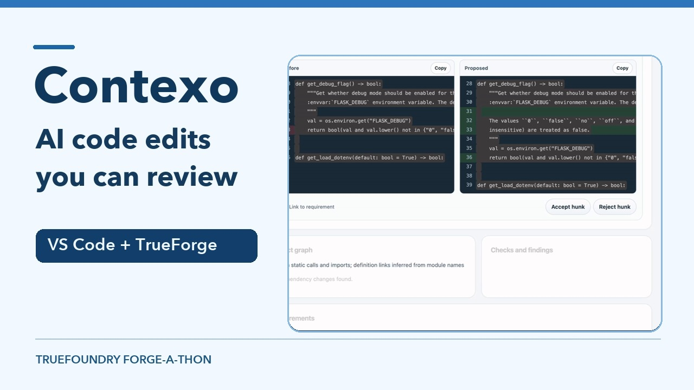

# Contexo demo

- [Watch on YouTube](https://www.youtube.com/watch?v=ZB7hxPhwrwU)
- [Download the 4:00 MP4](https://github.com/Bhavik-Sheth/TrueFoundry-Weights-of-Sin/releases/download/contexo-demo/Contexo-Forge-a-thon-1080p.mp4) and [verify its SHA-256](SHA256SUMS)
- [English captions](captions.en.srt) and [YouTube title, description and chapters](youtube-metadata.md)
- [Competition write-up and scorecard](../Contexo-writeup.pdf) · [Flask recording runbook](../DEMO_SCRIPT.md)

The demo uses Flask 3.1.3 at `22d924701a6ae2e4cd01e9a15bbaf3946094af65`. Task A shows hunk review, a passing inline edit, undo and redo, and cancellation. Task B shows context selection, the TrueForge session, three-file review, 60 passing CLI tests, and nested redaction. Task C shows an unreachable primary endpoint, automatic handoff to a local Qwen model, rejection of a malformed write, and a clean working tree.

The LMCache segment reports a separate retrieval check and a local Bonsai 4B probe. The probe reached an exact read. Its write failed to reach review.

The downloadable file is 1920×1080 at 30 fps. The editor footage comes from live runs, with Kokoro narration and word-highlighted captions. The SRT is a separate English caption track for the same read.
