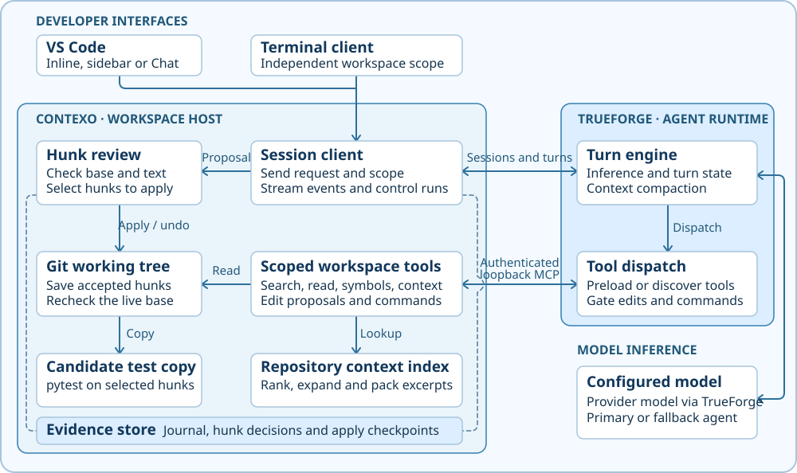
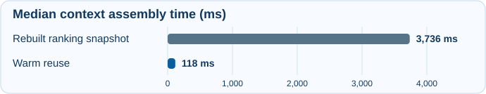

## 1. Team

**Weights of Sin** · Team TM-AFBECD9C838. Atharva Deo (lead, @atharvavdeo, D. J. Sanghvi College of Engineering), Bhavik Sheth (@Bhavik-Sheth), Parvati R Iyer and Akshat Bhalani (@ByteMeHarder-404).

## 2. Starting point

A developer selects a Flask helper and asks for a precise behavior change, which gives the agent a starting point and the reviewer a boundary. Then they ask for a CLI command that displays configuration and masks sensitive values. The agent has to find where commands are registered, tested and documented.

The developer then reviews hunks in the editor, applies some and verifies what landed. We built on Microsoft’s MIT-licensed VS Code webview sample for the sidebar, content security policy and asset loading. Contexo adds a TrueForge-backed agent, repository context and native review. [Upstream record](../UPSTREAMS.md)

## 3. Architecture on TrueForge

TrueForge owns inference, conversation state and tool approvals. Contexo supplies workspace-scoped reads and proposals over authenticated MCP, and verifies the file revision before staging a diff and before saving accepted hunks. Commands need their own approval. An eligible primary failure starts a fresh fallback session. The journal records delivered context, decisions and checks.

An edit deleting a blamed fix is denied once with `HISTORY_CONCERN` and then needs per-hunk confirmation. Stale reviews can be regenerated. Changes shows a grounded summary and wiring map, and Task tracks each requirement to checked. Undo previews a three-way merge, Undo Run reverts a run, and startup recovers an interrupted apply. [Architecture and runtime details](../README.md#architecture)

## 4. How context is selected

**First turn.** An inline edit starts with the selected code, its path and line range, and the full-buffer hash. A repository-wide turn starts with the goal. Contexo indexes Python symbols, imports and calls with Tree-sitter in a worker thread, then maps documentation by heading. For Go and Rust, live search supplies source previews and coordinates for exact reads.

**What enters the model.** Explicit selections, paths, `@` mentions and symbol anchors take priority. Plain keywords inform ranking. Contexo fuses BM25, symbol matching, live search and local sparse TF-IDF vectors. One-hop expansion links a leading implementation to registration sites, callers, tests and docs. The packer protects these roles, removes overlapping excerpts, and trims long symbols around signatures or matching lines. It budgets 8,000 estimated source tokens by default and separately caps the escaped response at 22,000 characters. The delivered packet records ranges, reasons and omissions.

**What a file contributes.** The file map explains why a file matters and what it contains. It shows the current buffer or checkout against Git HEAD, the latest file-changing commit subject and short before-and-after samples. The agent can request exact historical lines or read the current range. A range proposal then sends the path, coordinates, hash and replacement. Contexo reconstructs the diff against the live file.

**What carries across steps.** TrueForge compacts the conversation and loads deferred tools on demand, including `read_symbol`, `why_exists` and versioned instruction packs. Contexo’s journal preserves the goal, delivered source pointers, review decisions and observed checks. A checkpoint pages decisions in groups of 12. The agent can reopen the affected source at its current revision. Ranking data is reused per index snapshot. Git history is cached by immutable revision.

**From intent to evidence.** In the HTTPX run, the goal was to reject invalid command-line timeouts and preserve Python API behavior. The packet brought together the flag declaration, CLI tests and timeout guide. Mercury received 19 excerpts in 21,777 serialized characters, read all three target files, and scoped six replacements to source it had read. After review and feedback, it reopened the test and guide on their new revisions and issued the verification command.

**Budget across the run.** The packet budget governs repository evidence. The model also receives instructions, tool schemas, prior turns and tool results. Leaving room for output matters because a line-range proposal needs to return the replacement plus the source coordinates. Keeping earlier decisions in the checkpoint lets the agent recover them without copying prior diffs back into the next packet.

On pinned LMCache and HTTPX, filename-free probes delivered **5/5** and **3/3** required files, respectively. The chart compares 12 cold and 12 warm runs over 24,952 LMCache symbols. Excerpt order matched. Timing covers in-memory assembly. [Delivery and cache evidence](verification/2026-11-21/AGENT_BRIDGE.md#retrieval-and-range-edit-follow-up)

## 5. Model setup

Mercury 3 is the hosted default. Switch the primary and fallback in Contexo Settings. TrueForge holds the provider credentials. Earlier Flask editor A/B sessions cost an estimated **$0.0102 combined** at Inception’s launch rates. The two Mercury HTTPX turns cost about **$0.0102** on the same basis. Qwen3 1.7B ran locally through Ollama, and Bonsai 4B ran locally through MLX. Local runs had no hosted API charge. [Pricing basis](https://www.inceptionlabs.ai/blog/introducing-mercury-3) · [Session counters](verification/2026-11-20/local-editor/sessions.json)

## 6. Scorecard

| Criterion | Video time | Evidence |
| --- | --- | --- |
| A1 · Inline edit | 00:15–00:52 | Per-hunk review. FLASK_DEBUG=off prints False. |
| A2 · Agent mode | 01:15–02:35 | Three files discovered from one request. All 60 CLI tests pass. |
| A3 · Streaming / Stop | 01:05–01:15 | Stop cancels the turn. Git shows a clean tree. |
| B1 · Context selection | 01:23–01:51 | Graph, ranked excerpts, inclusion reasons and packet budget. |
| B2 · Diff safety | 00:27–01:05 | Reject and accept a hunk, apply, then undo and redo. |
| B3 · Resilience | 02:35–03:25 | Local Qwen takes over after an endpoint error. Git stays clean. |
| B4 · TrueForge | 01:52–01:58 | Task B turn, editor MCP calls and pending write approval. |
| C1 · Video | 00:00–04:00 | A, B and C appear in order with on-screen checks. |
| C2 · Write-up | This PDF | Eight required headings and timestamps for the recorded evidence. |

[Watch the full demo](https://www.youtube.com/watch?v=ZB7hxPhwrwU) · [Flask verification and evidence reel](verification/2026-11-22/SUBMISSION.md) · [Review and recovery checks](verification/2026-11-22/PRD_HANDOFF.md)

Mercury’s repaired HTTPX patch passed **13 CLI tests** and **1,418 upstream tests** under the matched comparison protocol. The independent oracle checked invalid values, the default, valid fractions and Python API behavior. [Benchmark method and patches](verification/2026-11-21/model-comparison/README.md)

## 7. Tools used

Claude Code and OpenAI Codex assisted development. The implementation uses the TrueForge and MCP TypeScript SDKs, React, Tree-sitter, ripgrep, js-tiktoken, jsdiff and SQLite. Verification used VS Code, Vitest and pytest. FFmpeg produced the reel. [Dependency provenance](../UPSTREAMS.md)

## 8. Known limitations

Mercury’s first HTTPX patch needed feedback to repair the test file and Markdown fence. Native Bonsai emitted a tool request as text and made no source changes. An experimental adapter delivered all three relevant files after the retrieval fix, but the model exhausted its 512-token output allowance before a read or write. The upstream suite excluded one pre-existing Trio failure on both revisions.

Review features were checked on Flask with replayed patches and a scripted model, not live Mercury. Known gaps include history-match precision, single-file regeneration in multi-file proposals and new-file Undo Run.

The full demo preserves prompt-to-diff footage for A and B. The local Qwen fallback sent a malformed write that was denied, leaving Flask clean. With another month, we would validate an actual 100-file migration through forced compaction, run remote-host tests, and rehearse on a second model. Local two-root routing is covered by the packaged fixture. [Remaining implementation and verification](REMAINING_WORK_PLAN.md)
